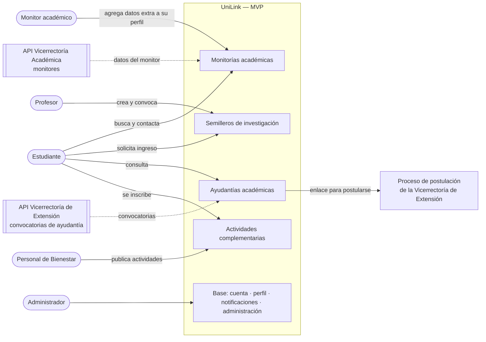
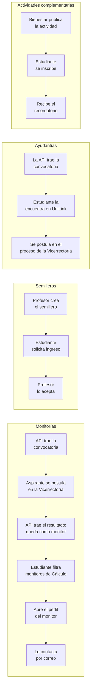

# Actores y alcance del MVP — UniLink

_Red Profesional Universitaria — Universidad del Magdalena · CIDTI_

| Campo | Valor |
|---|---|
| **Documento** | Definición de actores y alcance del producto mínimo viable (MVP) |
| **Dirigido a** | Profesor tutor y equipo de UniLink |
| **Versión** | 2.1 — 2026-10-29 (MVP acotado a cuatro líneas; monitores y ayudantías llegan por API) |
| **Responde a** | Observación del tutor: "no están claros los actores ni qué elementos van al MVP" |
| **Fuentes** | [SRS §2.4](./srs/Especificacion_Requisitos.md#24-actores-del-sistema), [acta del 2026-10-19](./decisiones/2026-10-19-reunion-preguntas-abiertas.md), decisiones del equipo del 2026-10-29 y los specs |

Este documento es la **fuente única** del alcance del MVP y de sus actores. Cuando el SRS, el roadmap o un spec digan algo distinto, prevalece este documento hasta que se actualicen.

## Contenido

1. [Resumen](#1-resumen)
2. [Las cuatro líneas del MVP](#2-las-cuatro-líneas-del-mvp)
3. [Actores del MVP](#3-actores-del-mvp)
4. [Qué hace cada actor](#4-qué-hace-cada-actor)
5. [Alcance: qué entra y qué no](#5-alcance-qué-entra-y-qué-no)
6. [Plan de sprints propuesto](#6-plan-de-sprints-propuesto)
7. [Evaluación de los actores anteriores](#7-evaluación-de-los-actores-anteriores)
8. [Cambios que esto implica en otros documentos](#8-cambios-que-esto-implica-en-otros-documentos)

---

## 1. Resumen

**El MVP de UniLink conecta a los estudiantes con cuatro tipos de oferta académica y de bienestar de la Universidad.** Todo lo demás (red de conexiones, feed, mensajería, hoja de vida, etc.) queda fuera del MVP.

| Línea | Quién la oferta | Qué hace el estudiante |
|---|---|---|
| **Monitorías académicas** | Vicerrectoría Académica, que envía por API los datos de los monitores | Busca un monitor por área y especialización y lo contacta |
| **Semilleros de investigación** | Profesor | Solicita ingresar a un semillero |
| **Ayudantías académicas** | Vicerrectoría de Extensión y Proyección Social, que envía las convocatorias por API | Consulta las convocatorias y se postula en el proceso de la Vicerrectoría, fuera de UniLink |
| **Actividades complementarias** | Bienestar Universitario | Se inscribe a una actividad con cupo |

Las monitorías y las ayudantías **no se publican en UniLink**: llegan de las vicerrectorías por API, y UniLink las presenta y las hace fáciles de encontrar. Los semilleros y las actividades complementarias sí se publican en UniLink.

Para soportar esas cuatro líneas, el MVP incluye una **base mínima**: cuenta precreada e inicio de sesión, perfil del usuario, notificaciones y panel de administración.

**Seis actores** usan el sistema: Visitante, Estudiante, Monitor académico, Profesor, Personal de Bienestar Universitario y Administrador.

---

## 2. Las cuatro líneas del MVP

### 2.1 Monitorías académicas

| | |
|---|---|
| **Qué es** | Apoyo académico entre pares: un estudiante destacado, seleccionado por la Vicerrectoría Académica, orienta a otros estudiantes en un área (por ejemplo, Matemáticas · Cálculo). |
| **Quién la oferta** | La **Vicerrectoría Académica**. Nada se publica a mano en UniLink: todo llega por API en dos momentos. |
| **Cómo se llega a ser monitor** ([CU-31](./modulos/usuarios/casos-de-uso.md#cu-31--obtener-la-condición-de-monitor-académico)) | 1) UniLink **recibe la convocatoria** de monitorías y la muestra. 2) El estudiante interesado pulsa "Postularme" y va al proceso de la Vicerrectoría. 3) La convocatoria **se resuelve fuera de UniLink**. 4) UniLink **recibe el resultado**, marca como monitores a los seleccionados con su área y especialización y les notifica. |
| **Cómo participa el estudiante** | Como aspirante, consulta la convocatoria y va a postularse fuera de UniLink. Como usuario del servicio, busca monitores por área y especialización, abre el perfil del monitor y **lo contacta por su correo institucional**. En el MVP no hay mensajería interna ni inscripción a sesiones. |
| **Lo que muestra el perfil del monitor** | Los datos que llegan de la API, de solo lectura: la insignia con área y especialización. El monitor **solo puede agregar datos extra** (descripción, habilidades, intereses), sin cambiar los oficiales. No hay campo de horario, porque la atención es totalmente flexible. |
| **Specs base** | [FS-USR-06](./modulos/usuarios/specs/FS-USR-06-perfil-profesional.md) RN-13 (insignia) · [FS-RED-03](./modulos/red/specs/FS-RED-03-busqueda-perfiles.md) RN-09 (filtro), reducido a la búsqueda de monitores · importación de convocatorias y resultados (nuevo, [sección 5.1](#51-specs-que-entran-al-mvp)) |

### 2.2 Semilleros de investigación

| | |
|---|---|
| **Qué es** | Grupo de investigación que dirige un profesor, al que se unen estudiantes. Un semillero puede tener varios proyectos (acta del 2026-10-19). |
| **Quién lo oferta** | El **Profesor**, que lo crea, indica si está recibiendo integrantes y decide las solicitudes. |
| **Cómo participa el estudiante** | Explora los semilleros abiertos, solicita ingresar y, si lo aceptan, aparece como integrante. |
| **Specs base** | [FS-COL-05](./modulos/colaboracion/specs/FS-COL-05-espacios-proyectos.md), adaptado de "proyecto" a "semillero" y sin tablero de tareas. Los roles detallados de [FS-COL-06](./modulos/colaboracion/specs/FS-COL-06-roles-proyectos.md) se reducen a Director (profesor) e Integrante. |

### 2.3 Ayudantías académicas

| | |
|---|---|
| **Qué es** | Plaza para que un estudiante apoye actividades académicas o de proyección social, asignada por convocatoria. |
| **Quién la oferta** | La **Vicerrectoría de Extensión y Proyección Social**. UniLink **importa las convocatorias por API**: título, descripción, requisitos, cupos, fecha de cierre y enlace de postulación. Nadie las publica a mano en UniLink. |
| **Cómo participa el estudiante** | Explora y filtra las convocatorias abiertas, ve el detalle y pulsa "Postularme", que lo lleva al proceso de la Vicerrectoría. **La postulación y su decisión ocurren fuera de UniLink.** |
| **Specs base** | [FS-COL-02](./modulos/colaboracion/specs/FS-COL-02-postulaciones.md), reducido al listado y al detalle de convocatorias. Falta especificar la importación (un puerto con adaptador simulado y real, como en [ADR-014](./arquitectura/Registro_Decisiones.md#adr-014-integración-con-la-api-de-admisiones)). |

### 2.4 Actividades complementarias

| | |
|---|---|
| **Qué es** | Actividades formativas de Bienestar Universitario (culturales, deportivas, de salud y desarrollo humano) con fecha, lugar y cupo. |
| **Quién la oferta** | El **Personal de Bienestar Universitario**, que publica la actividad, ve los inscritos y puede editarla o cancelarla. |
| **Cómo participa el estudiante** | Explora las actividades, se inscribe mientras haya cupo y recibe un recordatorio. |
| **Specs base** | [FS-COL-03](./modulos/colaboracion/specs/FS-COL-03-publicacion-listado-eventos.md) y [FS-COL-04](./modulos/colaboracion/specs/FS-COL-04-confirmacion-asistencia.md), adaptados de "evento" a "actividad complementaria" y de "confirmar asistencia" a "inscribirse" |

---

## 3. Actores del MVP

| # | Actor | Quién es | Cómo obtiene su cuenta |
|---|---|---|---|
| A1 | **Visitante** | Persona que todavía no ha iniciado sesión | — |
| A2 | **Estudiante** | Estudiante de un programa de la Universidad. Es el **usuario principal** del MVP. | Precreada por la Universidad; la activa |
| A3 | **Monitor académico** | Estudiante que la Vicerrectoría Académica reporta como monitor, con área y especialización | Precreada; la API de la Vicerrectoría la marca como monitor, **aunque no la haya activado** |
| A4 | **Profesor** | Docente de una facultad y un departamento. En el MVP solo oferta semilleros. | Precreada por la Universidad; la activa |
| A5 | **Personal de Bienestar Universitario** | Funcionario de la dependencia de Bienestar Universitario | Precreada; la dependencia viene del directorio institucional ([P-71](./preguntas-abiertas.md#g-actores-del-mvp)) |
| A6 | **Administrador de la plataforma** | Personal de la Universidad (no el equipo de desarrollo). También modera. | Procedimiento con TI ([P-68](./preguntas-abiertas.md#g-actores-del-mvp)) |

**Sistemas externos:**

| Sistema | Para qué | Estado en el MVP |
|---|---|---|
| **Directorio institucional** (API de admisiones) | Precrear las cuentas con correo, nombre, programa o dependencia y tipo de usuario | **Simulado** ([ADR-014](./arquitectura/Registro_Decisiones.md#adr-014-integración-con-la-api-de-admisiones)) |
| **API de la Vicerrectoría Académica** | Datos de los monitores: condición, área y especialización | _Propuesto:_ simulada en el MVP, como el directorio ([P-72](./preguntas-abiertas.md#g-actores-del-mvp)) |
| **API de la Vicerrectoría de Extensión y Proyección Social** | Convocatorias de ayudantía con su enlace de postulación | _Propuesto:_ simulada en el MVP ([P-72](./preguntas-abiertas.md#g-actores-del-mvp)) |
| **Campus Virtual** | Autenticar a la comunidad | Por validar con TI ([ADR-013](./arquitectura/Registro_Decisiones.md#adr-013-autenticación-institucional-y-cuentas-precreadas), P-63) |
| **Servicio de correo** | Notificaciones por correo y recuperación de acceso | Requerido |
| **Tareas automáticas** | Sincronizar el directorio, los monitores y las ayudantías, y enviar recordatorios | Parte de UniLink ([ADR-011](./arquitectura/Registro_Decisiones.md#adr-011-tareas-en-segundo-plano-y-programadas)) |

### A1. Visitante

Puede activar su cuenta precreada, iniciar sesión y recuperar el acceso. No ve ninguna oferta. Al iniciar sesión pasa a ser A2, A3, A4 o A5, según lo que diga el directorio. Specs: [FS-USR-01](./modulos/usuarios/specs/FS-USR-01-registro.md), [FS-USR-02](./modulos/usuarios/specs/FS-USR-02-inicio-sesion.md), [FS-USR-03](./modulos/usuarios/specs/FS-USR-03-recuperar-contrasena.md).

### A2. Estudiante

| | |
|---|---|
| **Objetivo** | Aprovechar la oferta académica y de bienestar: encontrar apoyo, entrar a investigación, conseguir una ayudantía y completar actividades complementarias. |
| **Puede** | Completar su perfil (habilidades e intereses); buscar monitores y contactarlos; solicitar ingreso a semilleros; consultar convocatorias de ayudantía e ir al proceso de postulación; inscribirse a actividades complementarias y cancelar su inscripción; recibir notificaciones. |
| **No puede** | Publicar semilleros ni actividades. |

### A3. Monitor académico

| | |
|---|---|
| **Quién es** | Un Estudiante que la Vicerrectoría Académica reporta como monitor. Hereda todo lo del Estudiante: también puede consultar ayudantías, unirse a semilleros e inscribirse a actividades. |
| **Cómo llega a serlo** | UniLink recibe sus datos por la **API de la Vicerrectoría Académica**. Una tarea programada los aplica sobre las cuentas precreadas, aunque el estudiante no haya activado la suya. Al activarla ya entra como monitor. Si la Vicerrectoría deja de reportarlo, pierde la condición en la siguiente sincronización. |
| **Lo que agrega** | Su perfil muestra los datos oficiales (insignia, área y especialización), que no puede modificar. **Solo puede agregar datos extra** (descripción, habilidades, intereses). Aparece en la búsqueda de monitores. No hay horario: la atención es flexible y se acuerda por correo. |
| **Cómo lo contactan** | Por su correo institucional, que el perfil muestra a los usuarios con sesión iniciada _(propuesto; resuelve [P-67](./preguntas-abiertas.md) en el sentido de que la condición de monitor y su contacto son visibles para la comunidad)_. |

### A4. Profesor

| | |
|---|---|
| **Objetivo** | Conformar sus semilleros de investigación con estudiantes interesados. |
| **Puede** | Crear semilleros, abrir o cerrar el ingreso, revisar el perfil de quienes solicitan ingresar, aceptar o rechazar solicitudes y retirar integrantes. Buscar monitores. |
| **No puede** | Publicar ayudantías (llegan de la Vicerrectoría de Extensión) ni actividades complementarias. |

### A5. Personal de Bienestar Universitario

| | |
|---|---|
| **Objetivo** | Difundir las actividades complementarias y controlar sus inscripciones. |
| **Puede** | Publicar, editar y cancelar actividades complementarias; ver y descargar la lista de inscritos; avisar a los inscritos de un cambio. |
| **No puede** | Publicar semilleros. |
| **Nota** | Los demás funcionarios administrativos no tienen funciones en el MVP. |

### A6. Administrador de la plataforma

| | |
|---|---|
| **Objetivo** | Mantener la plataforma operando y la oferta en orden. |
| **Puede** | Suspender, inhabilitar y reactivar cuentas; gestionar los catálogos (áreas, tipos de actividad, etiquetas del perfil); retirar un semillero o una actividad que incumpla las normas, con motivo _(propuesto, reemplaza a la moderación de publicaciones)_; consultar la auditoría y el estado de las sincronizaciones. |
| **No puede** | Actuar sobre su propia cuenta ni sobre la de otro Administrador, ni cambiar los datos que llegan de las APIs institucionales (cuentas, monitores y ayudantías). |
| **Specs** | [FS-USR-08](./modulos/usuarios/specs/FS-USR-08-gestion-cuentas.md), [FS-PLT-01](./modulos/plataforma/specs/FS-PLT-01-gestion-categorias.md) |

---

## 4. Qué hace cada actor

`✓` = puede · `—` = no puede · _(propio)_ = solo sobre lo suyo.
Columnas: **Vis** Visitante · **Est** Estudiante · **Mon** Monitor académico · **Prof** Profesor · **Bien** Personal de Bienestar · **Adm** Administrador.

| Línea | Funcionalidad | Vis | Est | Mon | Prof | Bien | Adm | Spec base |
|---|---|---|---|---|---|---|---|---|
| Base | Activar la cuenta precreada, iniciar sesión y recuperar el acceso | ✓ | — | — | — | — | — | USR-01, USR-02, USR-03 |
| Base | Editar el perfil (habilidades, intereses) y la configuración | — | ✓ _(propio)_ | ✓ _(propio)_ | ✓ _(propio)_ | ✓ _(propio)_ | — | USR-05, USR-06 |
| Base | Recibir notificaciones en la plataforma y por correo | — | ✓ | ✓ | ✓ | ✓ | ✓ | COM-02 |
| Monitorías | Consultar la convocatoria de monitorías e ir a postularse (fuera de UniLink) | — | ✓ | ✓ | — | — | — | Importación (nuevo), CU-31 |
| Monitorías | Recibir la condición de monitor cuando llega el resultado | — | ✓ (seleccionado) | — | — | — | — | Importación (nuevo), CU-31 |
| Monitorías | Buscar monitores por área y especialización | — | ✓ | ✓ | ✓ | — | ✓ | RED-03 (reducido) |
| Monitorías | Ver el perfil del monitor y contactarlo por correo | — | ✓ | ✓ | ✓ | — | — | USR-06 |
| Monitorías | Agregar datos extra a su perfil de monitor (los oficiales llegan por API) | — | — | ✓ _(propio)_ | — | — | — | USR-06 RN-13 |
| Semilleros | Crear un semillero y abrir o cerrar el ingreso | — | — | — | ✓ | — | — | COL-05 (adaptado) |
| Semilleros | Explorar semilleros y solicitar ingreso | — | ✓ | ✓ | — | — | — | COL-05 (adaptado) |
| Semilleros | Aceptar o rechazar solicitudes y retirar integrantes | — | — | — | ✓ _(propio)_ | — | — | COL-05 (adaptado) |
| Ayudantías | Explorar y filtrar las convocatorias importadas | — | ✓ | ✓ | ✓ | — | ✓ | COL-02 (reducido) |
| Ayudantías | Ir al proceso de postulación de la Vicerrectoría (fuera de UniLink) | — | ✓ | ✓ | — | — | — | COL-02 (reducido) |
| Actividades | Publicar, editar y cancelar una actividad complementaria | — | — | — | — | ✓ | — | COL-03 (adaptado) |
| Actividades | Explorar actividades e inscribirse | — | ✓ | ✓ | — | — | — | COL-03, COL-04 (adaptados) |
| Actividades | Ver y descargar la lista de inscritos | — | — | — | — | ✓ _(propio)_ | — | COL-04 (adaptado) |
| Administración | Suspender, inhabilitar y reactivar cuentas | — | — | — | — | — | ✓ | USR-08 |
| Administración | Gestionar catálogos y consultar la auditoría | — | — | — | — | — | ✓ | PLT-01 |
| Administración | Retirar un semillero o una actividad que incumple las normas | — | — | — | — | — | ✓ | _Por agregar_ |

### 4.1 Recorridos que el MVP debe permitir

### 4.2 Casos de uso del MVP

De los 31 casos de uso del producto, **16 entran al MVP**: 1 nuevo (CU-31), 4 sin cambios y 11 que se adaptan al nuevo alcance. Los otros 15 quedan fuera. Los números no cambian, para no romper la trazabilidad. Lo que cambia es el nombre en el MVP y el actor.

_El diagrama se genera con `python scripts/diagrama_casos_de_uso.py`. Si cambia esta sección, hay que actualizar el script y volver a ejecutarlo._

Las flechas con triángulo son generalizaciones. Estudiante, Profesor y Personal de Bienestar heredan del actor abstracto "Miembro de la comunidad" los casos de uso de la base (CU-03, CU-04 y CU-23). El Monitor académico es un Estudiante y hereda todos sus casos de uso: lo único distinto es que en CU-04 solo agrega datos extra, porque sus datos oficiales llegan por CU-31.

**Entran al MVP:**

| CU | Nombre en el producto | Nombre en el MVP | Línea | Actor principal | Cambio | Spec |
|---|---|---|---|---|---|---|
| [CU-01](./modulos/usuarios/casos-de-uso.md#cu-01--registrar-cuenta) | Registrar cuenta | **Activar cuenta precreada** | Base | Visitante | Adaptado: no hay autorregistro, la cuenta ya existe | USR-01 |
| [CU-02](./modulos/usuarios/casos-de-uso.md#cu-02--iniciar-sesión) | Iniciar sesión | Iniciar sesión | Base | Visitante | Sin cambios (el mecanismo depende de ADR-013) | USR-02 |
| [CU-17](./modulos/usuarios/casos-de-uso.md#cu-17--recuperar-contraseña) | Recuperar contraseña | Recuperar contraseña | Base | Visitante | Sin cambios (depende de ADR-013) | USR-03 |
| [CU-03](./modulos/usuarios/casos-de-uso.md#cu-03--administrar-cuenta) | Administrar cuenta | Administrar mi cuenta | Base | Toda la comunidad | Reducido: seguridad, privacidad y notificaciones | USR-05 |
| [CU-04](./modulos/usuarios/casos-de-uso.md#cu-04--creareditar-perfil-profesional) | Crear/editar perfil profesional | **Editar mi perfil** | Base | Toda la comunidad | Adaptado: el monitor solo agrega datos extra a los oficiales | USR-06 |
| [CU-23](./modulos/comunicacion/casos-de-uso.md) | Consultar notificaciones | Consultar notificaciones | Base | Toda la comunidad | Sin cambios; solo avisos de las cuatro líneas | COM-02 |
| [CU-31](./modulos/usuarios/casos-de-uso.md#cu-31--obtener-la-condición-de-monitor-académico) | — | **Obtener la condición de monitor académico** | Monitorías | Estudiante + API de la Vicerrectoría Académica | **Nuevo** (2026-10-29) | Importación (nuevo) |
| [CU-05](./modulos/red/casos-de-uso.md#cu-05--buscar-y-visualizar-perfiles) | Buscar y visualizar perfiles | **Buscar monitores y contactarlos** | Monitorías | Estudiante | Reducido: solo filtro de monitores y contacto por correo | RED-03 |
| [CU-11](./modulos/colaboracion/casos-de-uso.md#cu-11--gestionar-espacio-de-proyectos) | Gestionar espacio de proyectos | **Gestionar semillero y solicitar ingreso** | Semilleros | Profesor y Estudiante | Adaptado: semillero en vez de proyecto, sin tareas | COL-05 |
| [CU-12](./modulos/colaboracion/casos-de-uso.md#cu-12--explorar-oportunidades) | Explorar oportunidades | **Consultar convocatorias de ayudantía** | Ayudantías | Estudiante + API de la Vicerrectoría de Extensión | Adaptado: convocatorias importadas; la postulación ocurre fuera | COL-02 |
| [CU-20](./modulos/colaboracion/casos-de-uso.md#cu-20--publicar-evento) | Publicar evento | **Publicar actividad complementaria** | Actividades | Personal de Bienestar | Adaptado: solo Bienestar publica | COL-03 |
| [CU-21](./modulos/colaboracion/casos-de-uso.md#cu-21--visualizar-eventos) | Visualizar eventos | **Explorar actividades complementarias** | Actividades | Estudiante | Adaptado | COL-03 |
| [CU-15](./modulos/colaboracion/casos-de-uso.md#cu-15--confirmar-asistencia-a-eventos-rsvp) | Confirmar asistencia a eventos | **Inscribirse a una actividad complementaria** | Actividades | Estudiante | Adaptado: inscripción con cupo | COL-04 |
| [CU-24](./modulos/usuarios/casos-de-uso.md#cu-24--administrar-cuentas-de-usuario) | Administrar cuentas de usuario | Administrar cuentas | Administración | Administrador | Sin cambios | USR-08 |
| [CU-25](./modulos/contenido/casos-de-uso.md) | Moderar contenido | **Retirar un semillero o una actividad** | Administración | Administrador | Adaptado: sin reportes ni cola; retiro directo con motivo | _Por agregar_ |
| [CU-26](./modulos/plataforma/casos-de-uso.md) | Administrar categorías | **Administrar catálogos** | Administración | Administrador | Adaptado: áreas, tipos de actividad y etiquetas del perfil | PLT-01 |

**Quedan fuera del MVP:**

| CU | Nombre | Motivo |
|---|---|---|
| CU-06, CU-07 | Enviar y responder solicitudes de conexión | Sin red de conexiones |
| CU-13 | Sugerir conexiones iniciales | Sin red de conexiones |
| CU-08, CU-09 | Publicar y ver publicaciones | Sin feed |
| CU-10 | Enviar mensaje privado | El contacto con el monitor es por correo |
| CU-14 | Gestionar estado de postulaciones | La postulación a ayudantías ocurre fuera de UniLink |
| CU-22 | Publicar oportunidades y gestionar postulaciones | Las ayudantías llegan por API |
| CU-16 | Administrar roles en proyectos | El semillero solo tiene Director e Integrante |
| CU-18 | Seleccionar preferencias de contenido | Servía al feed |
| CU-19 | Generar hoja de vida en PDF | Recorte del 2026-10-29 |
| CU-27 a CU-30 | Servicios | Fase 2 |

Los textos de los 11 casos de uso adaptados todavía describen el producto completo. Su reescritura forma parte de la adaptación de los specs ([sección 8](#8-cambios-que-esto-implica-en-otros-documentos)).

---

## 5. Alcance: qué entra y qué no

### 5.1 Specs que entran al MVP

| Spec | Nombre | En el MVP | Cambio necesario |
|---|---|---|---|
| [FS-USR-01](./modulos/usuarios/specs/FS-USR-01-registro.md) | Registro y verificación | ✓ Adaptado | Pasa a activación de cuenta precreada; sincronización del directorio y de la API de monitores |
| [FS-USR-02](./modulos/usuarios/specs/FS-USR-02-inicio-sesion.md) | Inicio y cierre de sesión | ✓ | Autenticación con el Campus Virtual (ADR-013) |
| [FS-USR-03](./modulos/usuarios/specs/FS-USR-03-recuperar-contrasena.md) | Recuperación de contraseña | ✓ | Depende de ADR-013 |
| [FS-USR-05](./modulos/usuarios/specs/FS-USR-05-configuracion-cuenta.md) | Configuración de cuenta | ✓ Reducido | Solo seguridad, privacidad y notificaciones |
| [FS-USR-06](./modulos/usuarios/specs/FS-USR-06-perfil-profesional.md) | Perfil | ✓ Adaptado | Datos oficiales del monitor de solo lectura, datos extra editables y contacto por correo |
| [FS-USR-08](./modulos/usuarios/specs/FS-USR-08-gestion-cuentas.md) | Gestión de cuentas | ✓ | — |
| [FS-RED-03](./modulos/red/specs/FS-RED-03-busqueda-perfiles.md) | Búsqueda de perfiles | ✓ Reducido | Solo búsqueda de monitores por área y especialización |
| [FS-COM-02](./modulos/comunicacion/specs/FS-COM-02-centro-notificaciones.md) | Centro de notificaciones | ✓ | Solo los eventos de las cuatro líneas |
| [FS-PLT-01](./modulos/plataforma/specs/FS-PLT-01-gestion-categorias.md) | Gestión de categorías | ✓ Adaptado | Catálogos de áreas y tipos de actividad; auditoría |
| [FS-COL-02](./modulos/colaboracion/specs/FS-COL-02-postulaciones.md) | Postulaciones | ✓ Reducido | Listado, filtros y detalle de las convocatorias de **ayudantía** importadas, con enlace al proceso externo; sin postulación ni estados en UniLink |
| _Nuevo_ | Importación de convocatorias y resultados | ✓ Por especificar | Puertos con adaptador simulado y real para las APIs de las dos vicerrectorías: convocatorias de ayudantía, convocatorias de monitorías y resultado de monitores ([CU-31](./modulos/usuarios/casos-de-uso.md#cu-31--obtener-la-condición-de-monitor-académico), [P-72](./preguntas-abiertas.md#g-actores-del-mvp)) |
| [FS-COL-03](./modulos/colaboracion/specs/FS-COL-03-publicacion-listado-eventos.md) | Publicación de eventos | ✓ Adaptado | Pasa a **actividades complementarias**; solo Bienestar |
| [FS-COL-04](./modulos/colaboracion/specs/FS-COL-04-confirmacion-asistencia.md) | Confirmación de asistencia | ✓ Adaptado | Pasa a inscripción con cupo |
| [FS-COL-05](./modulos/colaboracion/specs/FS-COL-05-espacios-proyectos.md) | Espacios de proyectos | ✓ Adaptado | Pasa a **semilleros**; sin tablero de tareas; roles Director e Integrante |

**Resultado: entran 13 de los 22 specs, 9 de ellos con cambios, más una especificación nueva para importar convocatorias y resultados.** Antes de adaptarlos suman 101 requisitos funcionales (72 de prioridad Alta). La cifra definitiva se recalcula al adaptar cada spec.

### 5.2 Fuera del MVP

| Excluido | Spec afectado | Motivo |
|---|---|---|
| Red de conexiones (solicitudes, aceptar, rechazar) | [FS-RED-01](./modulos/red/specs/FS-RED-01-solicitudes-conexion.md) | Recorte del 2026-10-29 |
| Onboarding y sugerencias de conexión | [FS-RED-02](./modulos/red/specs/FS-RED-02-onboarding-sugerencias.md) | Recorte del 2026-10-29 |
| Feed, publicaciones, comentarios y "Me gusta" | [FS-CNT-01](./modulos/contenido/specs/FS-CNT-01-publicaciones-feed.md) | Recorte del 2026-10-29 |
| Reportes y cola de moderación | [FS-CNT-02](./modulos/contenido/specs/FS-CNT-02-moderacion-contenido.md) | Sin feed no hay contenido de usuarios que moderar; el Administrador retira ofertas directamente |
| Mensajería privada | [FS-COM-01](./modulos/comunicacion/specs/FS-COM-01-mensajeria-privada.md) | El contacto con el monitor es por correo institucional |
| Publicación de ayudantías y gestión de postulaciones en UniLink | [FS-COL-01](./modulos/colaboracion/specs/FS-COL-01-publicacion-oportunidades.md) | Las convocatorias llegan por API y la postulación se decide en la Vicerrectoría de Extensión |
| Horario de atención de los monitores | — | La atención es flexible y se acuerda por correo |
| Hoja de vida en PDF | [FS-USR-07](./modulos/usuarios/specs/FS-USR-07-hoja-de-vida-pdf.md) | Recorte del 2026-10-29 |
| Preferencias de contenido | [FS-USR-04](./modulos/usuarios/specs/FS-USR-04-preferencias-contenido.md) | Servían al feed; los intereses quedan en el perfil |
| Roles detallados y tablero de tareas en proyectos | [FS-COL-06](./modulos/colaboracion/specs/FS-COL-06-roles-proyectos.md) | El semillero solo necesita Director e Integrante |
| Proyectos, eventos y oportunidades generales | COL-03, COL-05 | Solo hay semilleros, ayudantías importadas y actividades de Bienestar |
| Inscripción a sesiones de monitoría | — | El estudiante busca y contacta al monitor |
| Usuario externo, módulo de servicios, app nativa, pagos | — | Ya estaban fuera o en evaluación |

En la arquitectura, el **módulo Contenido** no se construye en el MVP, y de Comunicación solo se construyen las notificaciones. El monolito modular (ADR-002) no cambia: esos módulos se agregan después sin rediseñar.

### 5.3 Cuándo el MVP está terminado

Se puede demostrar, con el directorio simulado, que:

1. La sincronización crea las cuentas. La API simulada de la Vicerrectoría Académica trae una convocatoria de monitorías y luego su resultado, y los seleccionados quedan marcados como monitores, aunque no hayan activado su cuenta ([CU-31](./modulos/usuarios/casos-de-uso.md#cu-31--obtener-la-condición-de-monitor-académico)).
2. **Monitorías:** un estudiante filtra monitores por área, abre el perfil de uno y lo contacta por correo. El monitor agrega datos extra a su perfil, pero no puede cambiar los oficiales.
3. **Semilleros:** un profesor crea un semillero, un estudiante solicita ingreso y el profesor lo acepta.
4. **Ayudantías:** la API simulada de la Vicerrectoría de Extensión trae convocatorias, el estudiante las encuentra y "Postularme" lo lleva al proceso externo.
5. **Actividades:** Bienestar publica una actividad con cupo, un estudiante se inscribe y recibe el recordatorio.
6. **Administración:** el Administrador suspende una cuenta, retira una actividad y encuentra ambas acciones en la auditoría.

---

## 6. Plan de sprints propuesto

Reemplaza al [roadmap de 8 sprints](./sprints/README.md) mientras el equipo no lo confirme. Se mantienen 8 sprints de dos semanas, pero el contenido cabe en 6 y los dos últimos quedan como margen.

| Sprint | Al terminar el sprint… | Specs |
|---|---|---|
| 1 | Las cuentas se precrean y el usuario activa la suya e inicia sesión | USR-01, USR-02, USR-03 |
| 2 | El usuario completa su perfil y el estudiante encuentra monitores | USR-05, USR-06, RED-03 |
| 3 | Notificaciones y panel de administración | COM-02, PLT-01, USR-08 |
| 4 | **Ayudantías:** importación desde la API y consulta de convocatorias | COL-02 + importación (nuevo) |
| 5 | **Semilleros:** creación e ingreso de integrantes | COL-05 |
| 6 | **Actividades complementarias:** publicación e inscripción | COL-03, COL-04 |
| 7 y 8 | Margen: requisitos de prioridad media, pruebas de usuario con estudiantes, ajustes y estabilización | — |

---

## 7. Evaluación de los actores anteriores

El [SRS §2.4](./srs/Especificacion_Requisitos.md#24-actores-del-sistema) lista **29 nombres** en una sola tabla. Mezcla actores, papeles (la situación de un actor frente a un objeto, como "Autor de su publicación") y roles de proyecto. Con el MVP acotado, cada uno queda así:

| Nombre en el SRS | Categoría | En el MVP acotado |
|---|---|---|
| Visitante | Actor | **A1 Visitante** |
| Usuario | Generalización | Nombre común de A2 a A5 |
| Estudiante | Actor | **A2 Estudiante** |
| Profesor | Actor | **A4 Profesor** |
| Personal administrativo | Actor | Solo el de Bienestar: **A5 Personal de Bienestar** |
| Administrador de la plataforma | Actor | **A6 Administrador**, que también modera |
| Dueño del perfil, Observador | Papel | Se mantienen (perfil) |
| Destinatario | Papel | Se mantiene (notificaciones) |
| Responsable de oportunidad | Papel | **Fuera del MVP**: las ayudantías las gestiona la Vicerrectoría de Extensión |
| Postulante | Papel | **Fuera del MVP**: la postulación ocurre en el proceso externo |
| Organizador | Papel | Personal de Bienestar que publicó una actividad |
| Asistente | Papel | Estudiante inscrito en una actividad |
| Creador del proyecto, Administrador de proyecto | Rol de proyecto | Director del semillero (profesor) |
| Miembro del proyecto, Editor, Visualizador | Rol de proyecto | Integrante del semillero |
| Solicitante | Papel | Estudiante que solicita ingresar a un semillero |
| Conexión, Autor, Lector, Denunciante, Remitente | Papel | **Fuera del MVP**: pertenecen a red, feed, moderación y mensajería |
| Sistema, Servicio de correo | Sistema | Se mantienen |
| Monitor académico | Actor (nuevo) | **A3 Monitor académico** |
| Personal de Bienestar Universitario | Actor (nuevo) | **A5 Personal de Bienestar** |
| Directorio institucional, Campus Virtual | Sistema (nuevo) | Se mantienen |
| API de la Vicerrectoría Académica, API de la Vicerrectoría de Extensión y Proyección Social | Sistema (nuevo) | Se mantienen |
| Egresado, Tercerizado, Oferente | Fase 2 | Fuera del MVP |

**Nuevos frente al SRS:** el Monitor académico (A3) como actor y el Personal de Bienestar (A5) como oferente propio. Como sistemas externos, el Directorio institucional, el Campus Virtual y las APIs de la Vicerrectoría Académica y de la Vicerrectoría de Extensión y Proyección Social.

**Decisiones del equipo del 2026-10-29:**
- El MVP se acota a las cuatro líneas, con perfil y notificaciones como únicas funciones de apoyo.
- Las monitorías llegan de la Vicerrectoría Académica y las ayudantías de la Vicerrectoría de Extensión y Proyección Social, ambas por API. Los semilleros los publican los profesores y las actividades, Bienestar.
- El estudiante contacta al monitor; no se inscribe a sesiones y no hay horario de atención.
- El monitor solo agrega datos extra a su perfil; los oficiales vienen de la API.
- La postulación a una ayudantía y su decisión ocurren fuera de UniLink.
- Moderador y Administrador se unen.
- El Usuario externo sigue en evaluación.

---

## 8. Cambios que esto implica en otros documentos

| Documento | Cambio | Estado |
|---|---|---|
| [Informe del proyecto](./informe_unilink.md) | Resumen, actores, alcance y plan con el MVP acotado | **Hecho** (2026-10-29) |
| [SRS §1.2 y §2.4](./srs/Especificacion_Requisitos.md#12-alcance) | Nota que remite a este documento; reescritura del alcance, de las funciones y de la matriz de permisos | Nota **hecha**; reescritura pendiente |
| [Roadmap de sprints](./sprints/README.md) | Reemplazar por el plan de la [sección 6](#6-plan-de-sprints-propuesto) | Nota **hecha**; reescritura pendiente de confirmación |
| [Preguntas abiertas](./preguntas-abiertas.md#g-actores-del-mvp) | P-68 a P-72 | **Hecho** |
| [ADR-014](./arquitectura/Registro_Decisiones.md#adr-014-integración-con-la-api-de-admisiones) | Extender el patrón de puerto con adaptador simulado y real a las APIs de las dos vicerrectorías | Pendiente |
| Specs de la [sección 5.1](#51-specs-que-entran-al-mvp) | Adaptar los 9 marcados como "Adaptado" o "Reducido" y escribir el de importación de convocatorias y resultados | Pendiente: es el trabajo de optimización de los specs |
| Specs de la [sección 5.2](#52-fuera-del-mvp) | Marcarlos como "Fuera del MVP" en el [índice de specs](./modulos/README.md#índice-de-specs) | Pendiente |
