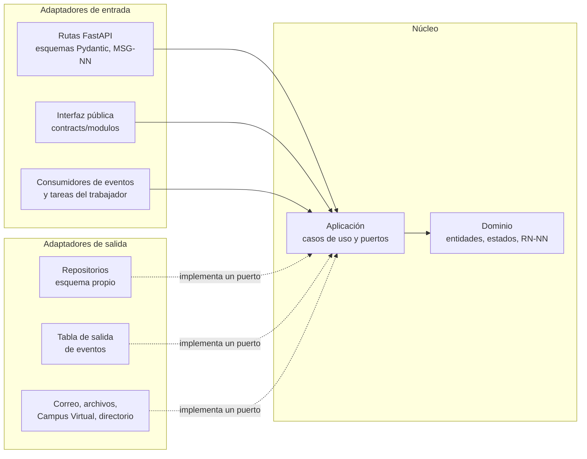
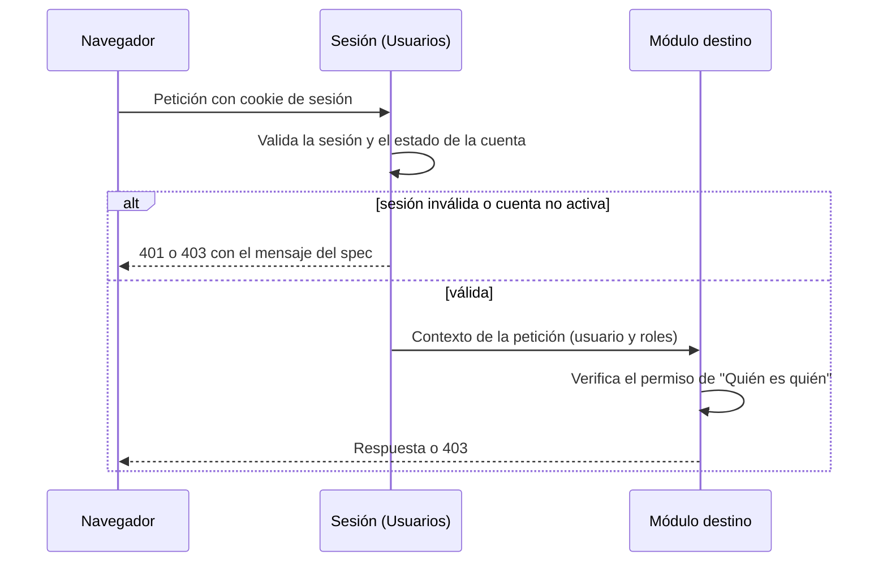
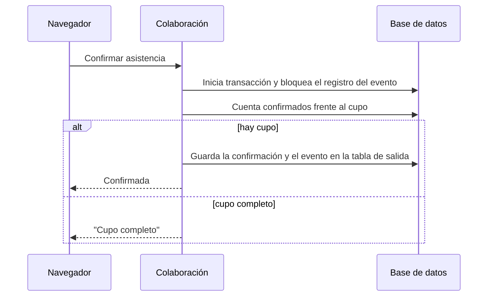
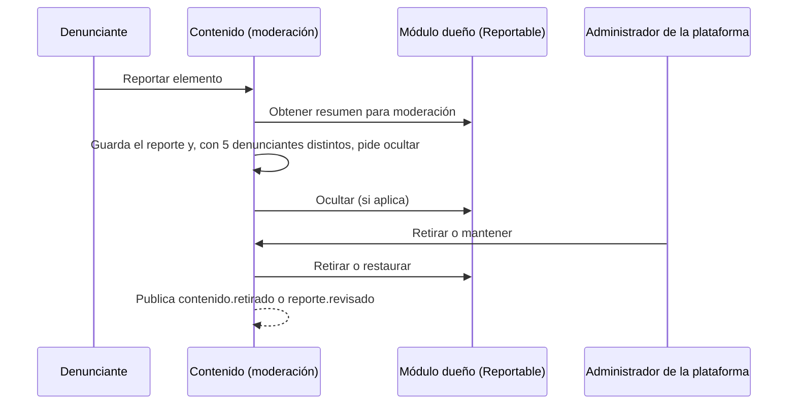
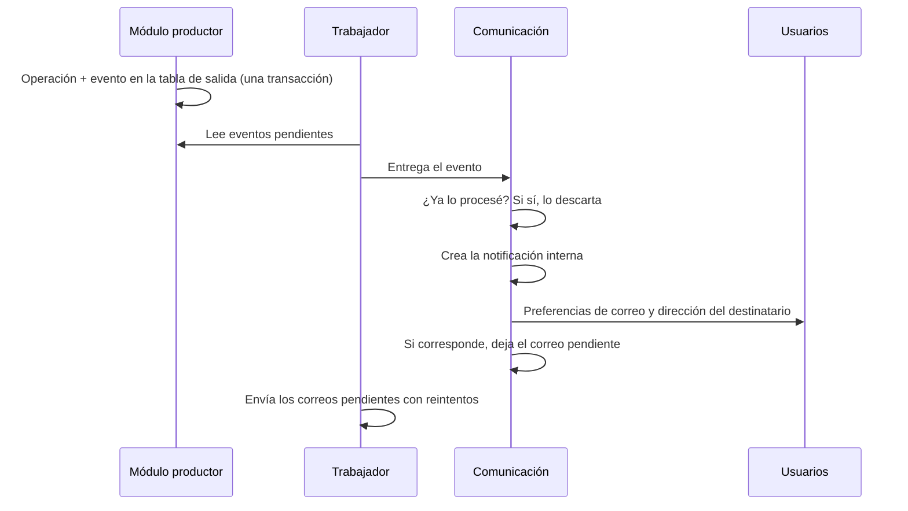

# Plan de implementación — UniLink

_MVP — Red Profesional Universitaria — Universidad del Magdalena_
_Centro de Interés de Desarrollo Tecnológico e Innovación (CIDTI)_

| Campo | Valor |
|---|---|
| **Estado** | Esqueleto — las partes marcadas con ⏳ dependen de una ADR en estado Propuesta |
| **Última actualización** | 2026-10-27 |

Este documento describe **cómo funciona UniLink por dentro**: la estructura de cada módulo, cómo se hacen cumplir las fronteras, los flujos que atraviesan varios módulos y cómo se prueba. El stack está decidido ([ADR-010](./Registro_Decisiones.md#adr-010-lenguaje-y-framework): **FastAPI** en el backend y **React** en el frontend) y cada módulo sigue la arquitectura **hexagonal con Clean Architecture** ([ADR-017](./Registro_Decisiones.md#adr-017-arquitectura-interna-de-los-módulos-hexagonal-con-clean-architecture)). El motor es PostgreSQL (ADR-005). Sigue marcada con ⏳ la parte que depende de las tareas (ADR-011).

## 1. Estructura interna de un módulo

Cada módulo es un **hexágono** con cuatro anillos ([ADR-017](./Registro_Decisiones.md#adr-017-arquitectura-interna-de-los-módulos-hexagonal-con-clean-architecture)). Las dependencias apuntan **siempre hacia el dominio**, y su **interfaz pública** es la única puerta de entrada para los demás módulos.



| Anillo | Contiene | No contiene |
|---|---|---|
| Dominio | Entidades, objetos de valor, máquinas de estados, reglas (RN-NN) y eventos de dominio, en Python puro | FastAPI, Pydantic, el ORM o cualquier adaptador |
| Aplicación | Un caso de uso por acción del usuario o de otro módulo; control de permisos ("Quién es quién"); límites de la transacción; **puertos** de salida | Detalles de HTTP, de la base de datos o de servicios externos |
| Adaptadores de entrada | Rutas de FastAPI que implementan [`contracts/api/`](../../contracts/api/README.md), con sus esquemas Pydantic y los mensajes al usuario; implementación de la interfaz pública ([`contracts/modulos/<modulo>.md`](../../contracts/modulos/)); consumidores de eventos y tareas programadas | Reglas de negocio |
| Adaptadores de salida | Repositorios sobre el esquema propio (ADR-005), tabla de salida de eventos (ADR-004), correo, archivos, Campus Virtual (ADR-013) y directorio institucional (ADR-014, simulado en el MVP) | Consultas a esquemas ajenos |

**Paquete de contratos** (compartido por todos): interfaces públicas, esquemas de eventos, contrato `Reportable` y contexto de la petición ([ADR-003](./Registro_Decisiones.md#adr-003-límites-de-los-módulos-y-dependencias-permitidas)). Un caso de uso que necesita a otro módulo depende de su interfaz pública definida aquí, y la **raíz de composición** conecta cada puerto con su adaptador al arrancar la aplicación.

**Estructura de carpetas del backend:**

```
backend/
├── app/                        ← arranque de FastAPI, raíz de composición, middleware de sesión, CSRF, límites y errores
├── contratos/                  ← paquete de contratos: interfaces públicas, eventos, Reportable, contexto de la petición (sin lógica)
├── modulos/
│   └── <modulo>/               ← usuarios, red, contenido, comunicacion, colaboracion, plataforma
│       ├── dominio/
│       ├── aplicacion/
│       │   ├── casos_uso/
│       │   └── puertos/
│       └── adaptadores/
│           ├── entrada/        ← api/ (rutas y esquemas Pydantic), publica/, consumidores/
│           └── salida/         ← persistencia/, tabla_salida/, correo/, archivos/, ...
├── trabajador/                 ← punto de entrada en modo tareas (ADR-011)
└── tests/                      ← unidad/, integracion/, permisos/, aceptacion/, contrato/, arquitectura/
```

**Estructura del frontend (React)**, por módulo, igual que el backend: `src/modulos/<modulo>/` con sus páginas y componentes; `src/api/` con el cliente generado desde `contracts/api/` (el único lugar que hace peticiones HTTP); y `src/compartido/` con los componentes comunes. El frontend no contiene reglas de negocio: todo permiso y toda regla se validan en el servidor (RNF-SEG-04).

## 2. Cómo se hacen cumplir las fronteras

| Regla | Verificación |
|---|---|
| Un módulo solo importa de otro su interfaz pública y el paquete de contratos | Contrato de **independencia** de import-linter en la integración continua (RNF-MAN-07). |
| Dentro de cada módulo, las dependencias van hacia el dominio | Contrato de **capas** de import-linter (adaptadores → aplicación → dominio) y prohibición de que `dominio/` y `aplicacion/` importen `fastapi`, `pydantic` o el ORM (ADR-017). |
| Las dependencias entre módulos no tienen ciclos | La misma prueba compara con la [vista de módulos](./Vistas_Arquitectura.md#11-descomposición-y-uso). |
| Cada módulo solo accede a su esquema | Un usuario de base de datos por módulo con permisos solo sobre su esquema (ADR-005). |
| La API cumple su contrato | La integración continua compara el OpenAPI que genera FastAPI con el de `contracts/api/` (RNF-MAN-05). Ambos están en OpenAPI 3.1. |
| Los eventos cumplen su esquema | Las pruebas validan cada evento publicado y consumido contra `contracts/eventos/`. |

## 3. Flujos clave

### 3.1 Petición autenticada y control de acceso



### 3.2 Tomar un cupo (asistencia, postulación aceptada, unión a proyecto)



Concreta RNF-CON-01 y EC-04. Con PostgreSQL, el bloqueo es `SELECT … FOR UPDATE` sobre el registro del evento dentro de la transacción (ADR-005).

### 3.3 Reporte y moderación de un contenido de otro módulo



### 3.4 Notificación a partir de un evento



## 4. Tareas programadas

| Tarea | Frecuencia | Spec |
|---|---|---|
| Eliminar cuentas sin verificar de más de 7 días | Diaria | FS-USR-01 |
| Borrar los datos de cuentas en eliminación de más de 30 días | Diaria | FS-USR-05 |
| Reactivar cuentas cuya suspensión terminó | Cada hora | FS-USR-08 |
| Eliminar notificaciones de más de 90 días | Diaria | FS-COM-02 |
| Enviar correos de mensajes sin leer tras 1 hora | Cada 5 minutos | FS-COM-01 |
| Cerrar oportunidades por fecha | Cada hora | FS-COL-01 |
| Finalizar eventos y enviar recordatorios 24 horas antes | Cada 15 minutos | FS-COL-03, FS-COL-04 |
| Vencer invitaciones a proyectos de 14 días | Diaria | FS-COL-05 |
| Despachar eventos de las tablas de salida | Continua | ADR-004 |

⏳ Mecanismo de programación: ADR-011.

## 5. Estrategia de pruebas

| Nivel | Qué prueba | Base |
|---|---|---|
| Unidad | Reglas de dominio (cada RN-NN) | RNF-MAN-01 |
| Aceptación | Escenarios Gherkin del "Resultado esperado" de cada spec | Specs, sección 12 |
| Permisos | Cada fila de "Quién es quién" llamando directamente a la API | RNF-SEG-04, EC-03 |
| Concurrencia | Cupos y ediciones simultáneas | RNF-CON-01, RNF-CON-02, EC-04 |
| Contrato | OpenAPI, interfaces públicas y esquemas de eventos | RNF-MAN-05, RNF-MAN-07 |
| Arquitectura | Fronteras y ausencia de ciclos entre módulos | RNF-MAN-07 |
| Carga | EC-01 con datos de volumen realista | RNF-REN-01, RNF-REN-02 |
| Fallas externas | Correo, archivos y tiempo real desactivados | RNF-DIS-05, EC-02 |

Cobertura mínima del código de negocio: 70 % (RNF-MAN-02). Herramientas del backend: pytest con medición de cobertura e import-linter (ADR-010). Herramientas del frontend: Vitest, Testing Library, Playwright, axe y Lighthouse CI ([ADR-018](./Registro_Decisiones.md#adr-018-bibliotecas-y-herramientas-del-frontend)).
