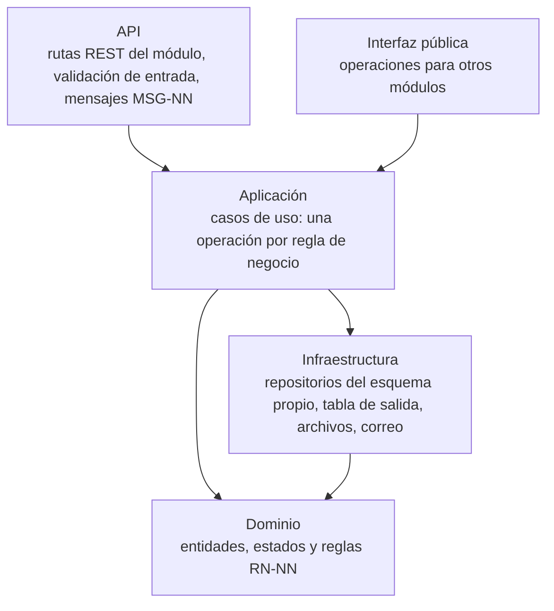
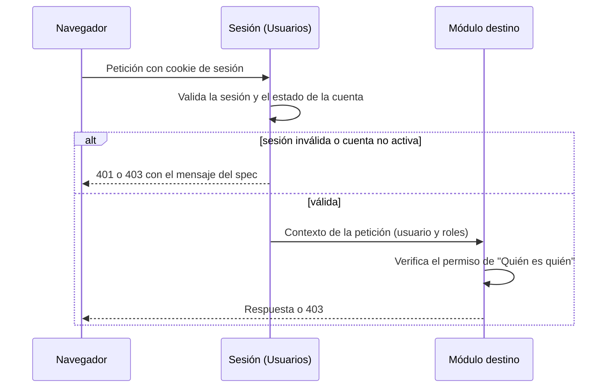
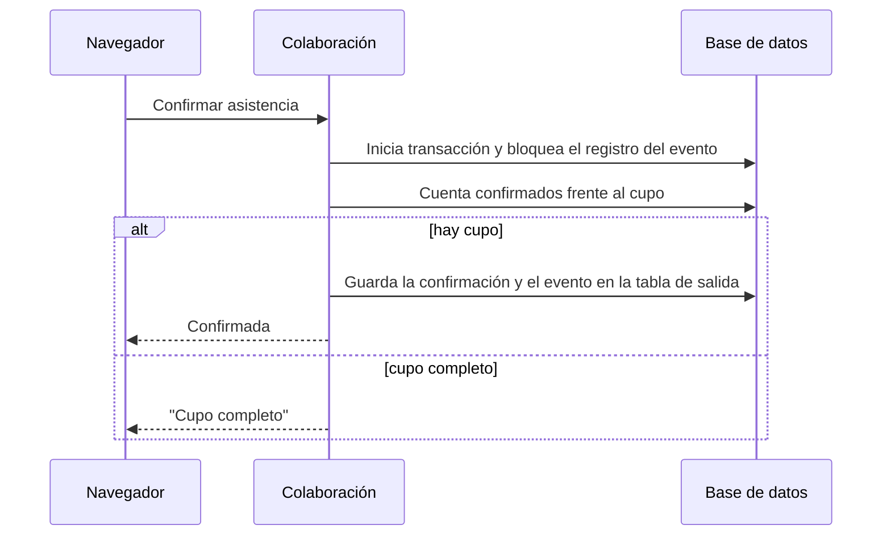
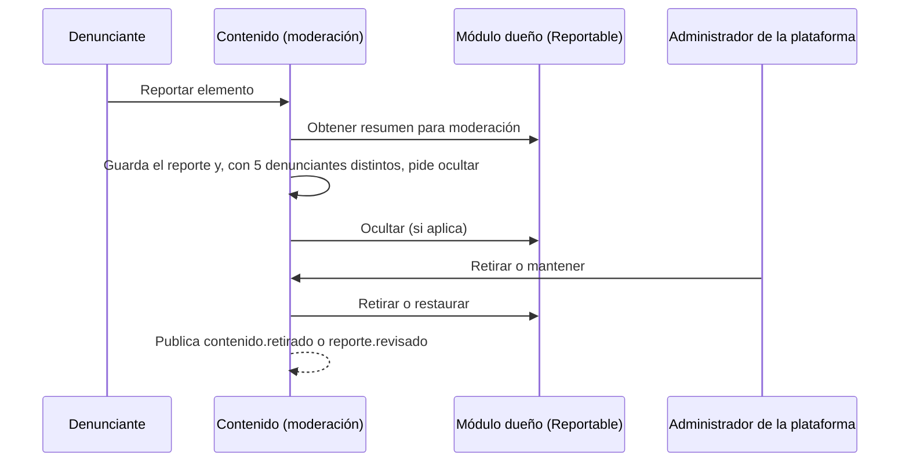
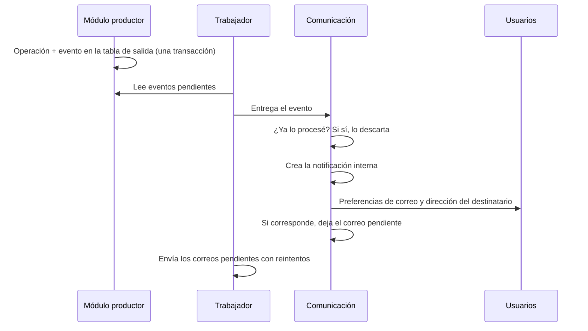

# Plan de implementación — UniLink

_MVP — Red Profesional Universitaria — Universidad del Magdalena_
_Centro de Interés de Desarrollo Tecnológico e Innovación (CIDTI)_

| Campo | Valor |
|---|---|
| **Estado** | Esqueleto — las partes marcadas con ⏳ dependen de una ADR en estado Propuesta |
| **Última actualización** | 2026-10-24 |

Este documento describe **cómo funciona UniLink por dentro**: la estructura de cada módulo, cómo se hacen cumplir las fronteras, los flujos que atraviesan varios módulos y cómo se prueba. Es independiente del lenguaje; cuando se cierre [ADR-010](./Registro_Decisiones.md#adr-010-lenguaje-y-framework) se completan los nombres concretos.

## 1. Estructura interna de un módulo

Cada módulo tiene las mismas cuatro capas, y su **interfaz pública** es la única puerta de entrada para los demás módulos.

| Capa | Contiene | No contiene |
|---|---|---|
| API | Rutas del OpenAPI del módulo, conversión de datos, mensajes al usuario | Reglas de negocio |
| Interfaz pública | Las operaciones de [`contracts/modulos/<modulo>.md`](../../contracts/modulos/) | Acceso a otras capas de otro módulo |
| Aplicación | Un caso de uso por acción del usuario o de otro módulo; control de permisos ("Quién es quién") y transacción | Detalles de la base de datos |
| Dominio | Entidades, máquinas de estados y reglas (RN-NN) | Dependencias de infraestructura |
| Infraestructura | Repositorios sobre el esquema propio (ADR-005), tabla de salida de eventos (ADR-004), adaptadores de correo y archivos | Consultas a esquemas ajenos |

**Paquete de contratos** (compartido por todos): interfaces públicas, esquemas de eventos, contrato `Reportable` y contexto de la petición ([ADR-003](./Registro_Decisiones.md#adr-003-límites-de-los-módulos-y-dependencias-permitidas)).

⏳ Estructura de carpetas y nombres concretos: ADR-010.

## 2. Cómo se hacen cumplir las fronteras

| Regla | Verificación |
|---|---|
| Un módulo solo importa de otro su interfaz pública y el paquete de contratos | Prueba de arquitectura en la integración continua (RNF-MAN-07). ⏳ Herramienta según ADR-010. |
| Las dependencias entre módulos no tienen ciclos | La misma prueba compara con la [vista de módulos](./Vistas_Arquitectura.md#11-descomposición-y-uso). |
| Cada módulo solo accede a su esquema | Un usuario de base de datos por módulo con permisos solo sobre su esquema (ADR-005). |
| La API cumple su contrato | La integración continua compara el OpenAPI generado con el de `contracts/api/` (RNF-MAN-05). |
| Los eventos cumplen su esquema | Las pruebas validan cada evento publicado y consumido contra `contracts/eventos/`. |

## 3. Flujos clave

### 3.1 Petición autenticada y control de acceso

### 3.2 Tomar un cupo (asistencia, postulación aceptada, unión a proyecto)

Concreta RNF-CON-01 y EC-04. ⏳ El mecanismo exacto de bloqueo depende del motor (ADR-005).

### 3.3 Reporte y moderación de un contenido de otro módulo

### 3.4 Notificación a partir de un evento

## 4. Tareas programadas

| Tarea | Frecuencia | Spec |
|---|---|---|
| Eliminar cuentas sin verificar de más de 7 días | Diaria | FS-USR-01 |
| Borrar los datos de cuentas en eliminación de más de 30 días | Diaria | FS-USR-05 |
| Reactivar cuentas cuya suspensión terminó | Cada hora | FS-USR-08 |
| Vencer solicitudes de conexión de 90 días | Diaria | FS-RED-01 |
| Eliminar notificaciones de más de 90 días | Diaria | FS-COM-02 |
| Enviar correos de mensajes sin leer tras 1 hora | Cada 5 minutos | FS-COM-01 |
| Cerrar oportunidades por fecha | Cada hora | FS-COL-01 |
| Finalizar eventos y enviar recordatorios 24 horas antes | Cada 15 minutos | FS-COL-03, FS-COL-04 |
| Vencer invitaciones a proyectos de 14 días | Diaria | FS-COL-05 |
| Despachar eventos de las tablas de salida | Continua | ADR-004 |

⏳ Mecanismo de programación: ADR-011.

## 5. Estrategia de pruebas

| Nivel | Qué prueba | Base |
|---|---|---|
| Unidad | Reglas de dominio (cada RN-NN) | RNF-MAN-01 |
| Aceptación | Escenarios Gherkin del "Resultado esperado" de cada spec | Specs, sección 12 |
| Permisos | Cada fila de "Quién es quién" llamando directamente a la API | RNF-SEG-04, EC-03 |
| Concurrencia | Cupos y ediciones simultáneas | RNF-CON-01, RNF-CON-02, EC-04 |
| Contrato | OpenAPI, interfaces públicas y esquemas de eventos | RNF-MAN-05, RNF-MAN-07 |
| Arquitectura | Fronteras y ausencia de ciclos entre módulos | RNF-MAN-07 |
| Carga | EC-01 con datos de volumen realista | RNF-REN-01, RNF-REN-02 |
| Fallas externas | Correo, archivos y tiempo real desactivados | RNF-DIS-05, EC-02 |

Cobertura mínima del código de negocio: 70 % (RNF-MAN-02). ⏳ Herramientas: ADR-010.
