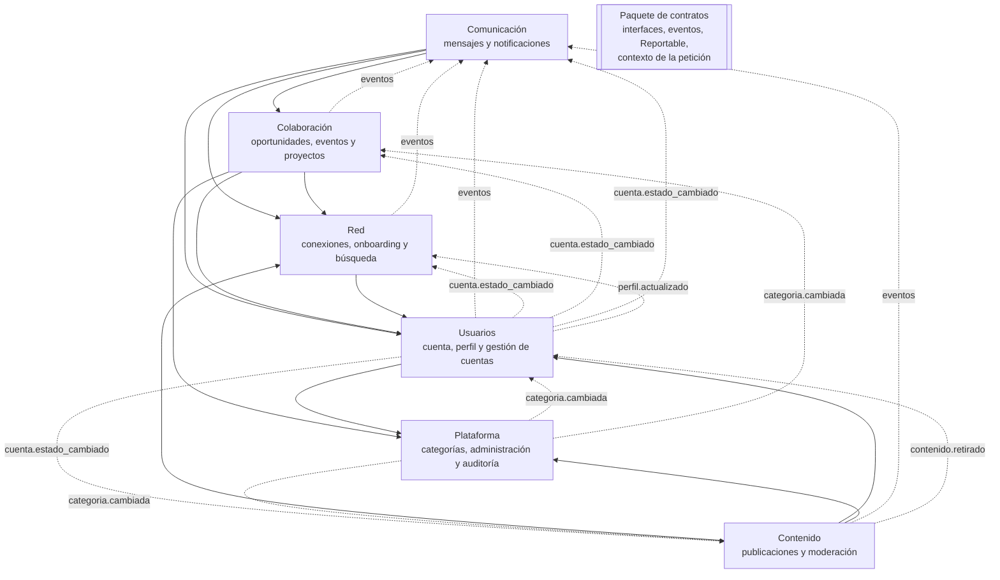
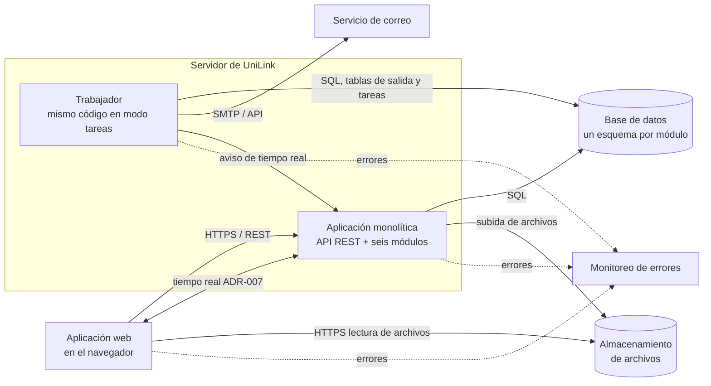
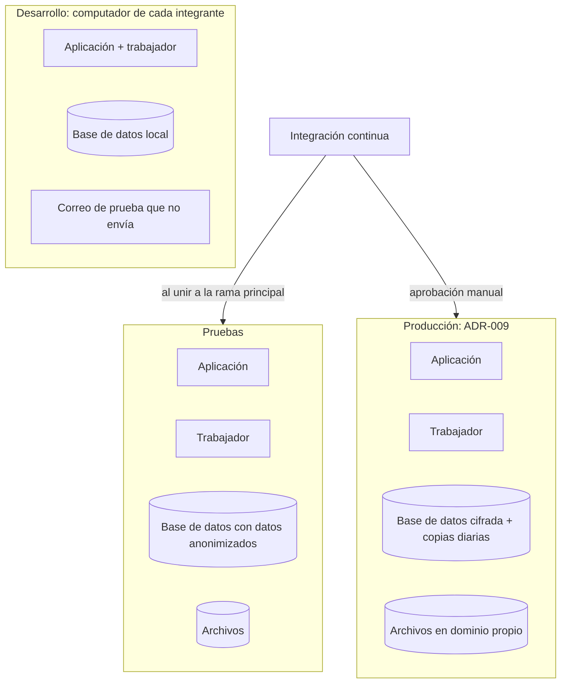

# Vistas de arquitectura — UniLink

_MVP — Red Profesional Universitaria — Universidad del Magdalena_
_Centro de Interés de Desarrollo Tecnológico e Innovación (CIDTI)_

Tres vistas del mismo sistema, cada una para una pregunta distinta:

| Vista | Pregunta que responde |
|---|---|
| [Módulos](#1-vista-de-módulos) | ¿En qué partes se divide el código, de qué datos es dueña cada una y quién puede usar a quién? |
| [Componentes y conectores (C&C)](#2-vista-de-componentes-y-conectores-cc) | ¿Qué piezas existen en ejecución y cómo se comunican? ¿Qué pasa si una falla? |
| [Despliegue](#3-vista-de-despliegue) | ¿Dónde corre cada pieza en cada entorno? |

Las decisiones que estas vistas materializan están en el [registro de decisiones](./Registro_Decisiones.md).

---

## 1. Vista de módulos

### 1.1 Descomposición y uso

Una flecha `A --> B` significa "A usa la interfaz pública de B". Las líneas punteadas son eventos: el productor no conoce al consumidor. No hay ciclos ([ADR-003](./Registro_Decisiones.md#adr-003-límites-de-los-módulos-y-dependencias-permitidas)).

Todos los módulos pueden usar el paquete de contratos; no se dibujan esas flechas.

### 1.2 Datos de cada módulo

| Módulo | Es dueño de | Nadie más puede escribir |
|---|---|---|
| Usuarios | Cuentas, credenciales, sesiones, correo de respaldo, configuración y privacidad, categorías de interés, perfil profesional (unidad académica, etiquetas, trayectoria), indicador de onboarding, sanciones | Credenciales y sesiones son un componente interno: no se exponen ni a los demás módulos. |
| Red | Solicitudes de conexión, conexiones, cálculo de sugerencias y complementariedad | — |
| Contenido | Publicaciones, comentarios, reacciones, reportes y decisiones de moderación | — |
| Comunicación | Conversaciones, mensajes, notificaciones, correos pendientes | Los mensajes privados no se exponen a la administración (RNF-PRI-04). |
| Colaboración | Oportunidades, postulaciones, eventos, asistencias, proyectos, miembros, roles y tareas | — |
| Plataforma | Categorías, lista de palabras prohibidas, registro de auditoría | El registro de auditoría no se modifica desde la aplicación (RNF-SEG-10). |

### 1.3 Reglas que se verifican

1. Ningún módulo importa código interno de otro: solo su interfaz pública y el paquete de contratos.
2. El grafo de la sección 1.1 no tiene ciclos.
3. Cada módulo accede solo a su esquema de base de datos (ADR-005).

Las tres se comprueban en la integración continua (RNF-MAN-07).

---

## 2. Vista de componentes y conectores (C&C)

### 2.1 Diagrama

Dentro de la aplicación, los módulos se conectan con dos conectores en proceso: la **llamada a la interfaz pública** y el **bus de eventos** (ADR-004).

### 2.2 Componentes

| Componente | Responsabilidad |
|---|---|
| Aplicación web | Pantallas de los seis módulos; adaptable desde 360 px (RNF-USA-02). |
| Aplicación monolítica | API REST (`/api/v1/<modulo>/...`), sesión y control de acceso, módulos de dominio, canal de tiempo real. |
| Trabajador | Despacha los eventos de las tablas de salida, envía correos, ejecuta las tareas programadas (ADR-011). |
| Base de datos | Datos de los seis módulos, cada uno en su esquema; copias diarias cifradas (RNF-DIS-03, RNF-PRI-03). |
| Almacenamiento de archivos | Fotos, imágenes, PDF y portadas, servidos desde un dominio que no ejecuta código (RNF-SEG-06). |
| Servicio de correo | Entrega de verificaciones, avisos y recordatorios (RNF-DIS-06). |
| Monitoreo de errores | Recibe los errores del servidor y del navegador y alerta al equipo (RNF-OBS-02). |

### 2.3 Conectores

| Conector | Une | Inicia | Tipo | Si falla |
|---|---|---|---|---|
| HTTPS / REST | Navegador → aplicación | Navegador | Síncrono | El usuario ve un mensaje claro y puede reintentar; las creaciones con `Idempotency-Key` no se duplican (RNF-CON-03). |
| Tiempo real | Aplicación ↔ navegador | Aplicación (empuja) | Asíncrono | La pantalla sigue funcionando; el indicador se actualiza al recargar o al reconectar. |
| Interfaz pública | Módulo → módulo | Módulo que consulta | Síncrono, en proceso | Es parte de la misma petición: el error se devuelve al usuario y la transacción se deshace. |
| Bus de eventos | Módulo productor → consumidores | Productor (al confirmar) | Asíncrono, vía tabla de salida | El evento queda guardado y se reintenta; la operación original no se deshace (RNF-CON-04). |
| SQL | Aplicación y trabajador → base de datos | Aplicación | Síncrono | La petición falla con error del servidor; se alerta al equipo (RNF-OBS-03). |
| Archivos | Aplicación → almacenamiento; navegador → almacenamiento | Aplicación / navegador | Síncrono | Se rechaza la subida con un mensaje; lo publicado sin archivos sigue visible. |
| SMTP o API de correo | Trabajador → servicio de correo | Trabajador | Asíncrono | El correo queda pendiente y se reintenta; la plataforma sigue funcionando ([EC-02](../srs/Especificacion_Requisitos.md#34-escenarios-de-atributos-de-calidad)). |
| Monitoreo | Todos → monitoreo | Cada componente | Asíncrono | No afecta al usuario; se pierden reportes de error mientras dure. |

---

## 3. Vista de despliegue

| Entorno | Para qué | Datos | Requisitos |
|---|---|---|---|
| Desarrollo | Programar y probar en local con un solo comando | De prueba | RNF-DES-03 |
| Pruebas | Revisar cada cambio unido a la rama principal; pruebas de carga y de seguridad | Anonimizados, nunca reales | RNF-DES-01, RNF-DES-02 |
| Producción | Uso real | Reales, cifrados y con copias | RNF-DES-01, RNF-DIS-03, RNF-PRI-03 |

Dónde corre producción (universidad, nube o mixto), qué servicios son gestionados y cómo se reparte el canal de tiempo real dependen de [ADR-009](./Registro_Decisiones.md#adr-009-alojamiento) y [ADR-007](./Registro_Decisiones.md#adr-007-tiempo-real).
