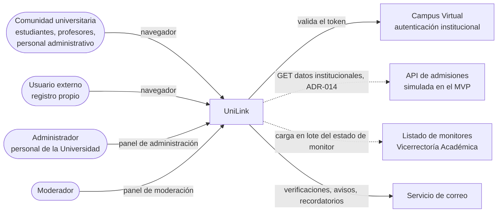
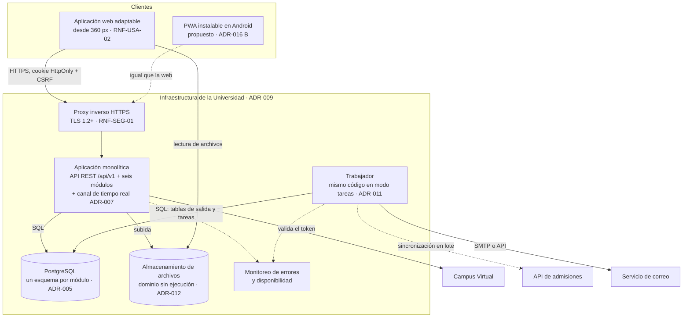
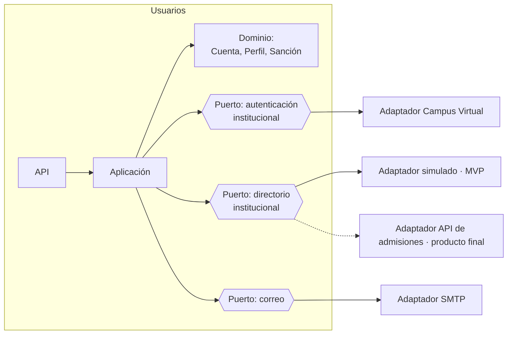
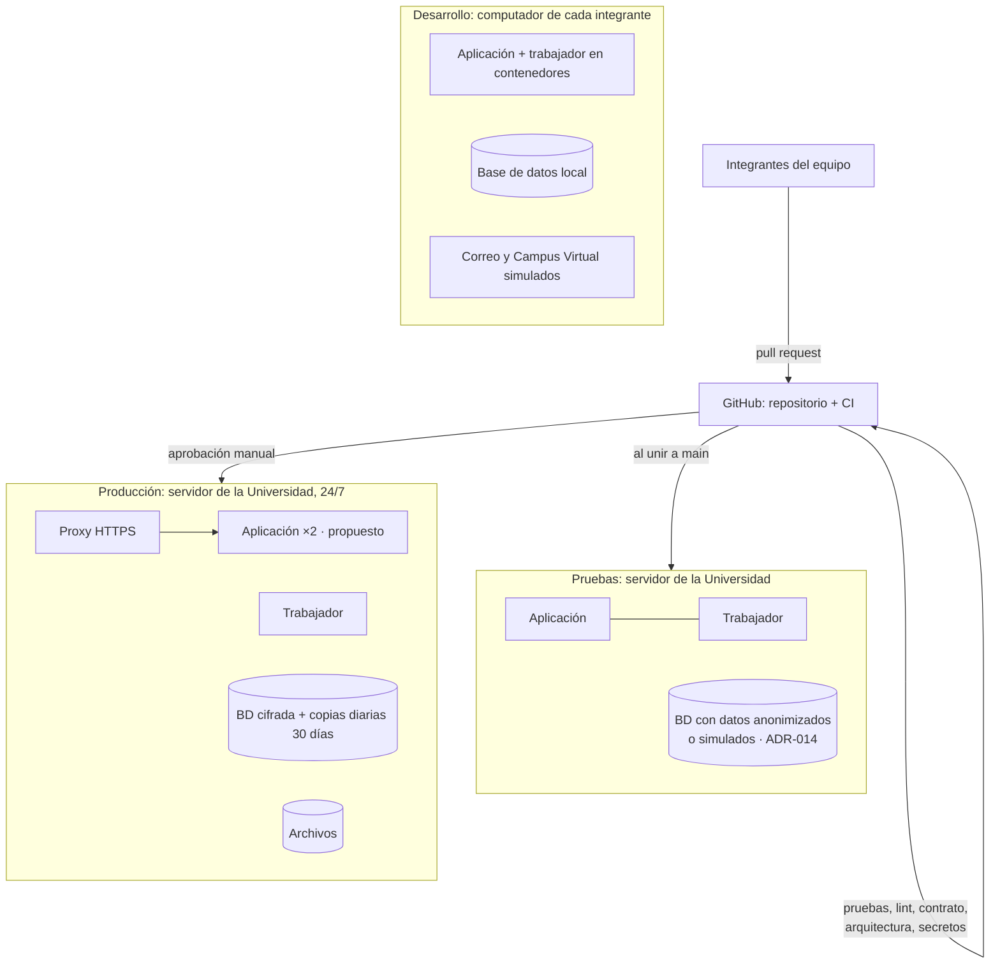
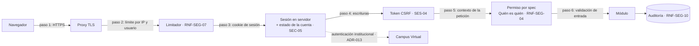

# Arquitectura de UniLink: estado actual y arquitectura objetivo

_Complemento del [informe integral](./informe_integral_unilink.md) · Corte: 2026-10-27_

Este documento consolida en un solo lugar la arquitectura **actual** (lo que existe) y la **objetivo** (lo que se propone construir), e incorpora las decisiones de la reunión del 2026-10-19. No reemplaza a las fuentes, que siguen siendo:

| Tema | Fuente de verdad |
|---|---|
| Por qué un monolito modular | [Comparación de alternativas](./arquitectura/Comparacion_Alternativas.md) |
| Decisiones y su estado | [Registro de decisiones (ADR-001 a ADR-016)](./arquitectura/Registro_Decisiones.md) |
| Vistas de módulos, de componentes y conectores, y de despliegue | [Vistas de arquitectura](./arquitectura/Vistas_Arquitectura.md) |
| Estructura interna de un módulo, flujos y pruebas | [Plan de implementación](./arquitectura/Plan_de_Implementacion.md) |
| Control de acceso y sesión | [Seguridad de la API](./arquitectura/seguridad-endpoints.md) |
| Interfaces y eventos | [`contracts/`](../contracts/README.md) |

Convenciones de los diagramas: **línea continua** = componente o relación especificada en el repositorio; **línea punteada** o nombre marcado _(propuesto)_ = propuesta de este análisis o decisión todavía sin especificar.

## 1. Arquitectura actual

**No hay arquitectura implementada.** Al 2026-10-27, las tres ramas del repositorio (`main`, `documentacion` y `feature/reestructuracion-docs`) contienen solo documentación, contratos y un verificador en Python (`scripts/verificar_docs.py`). No hay código de aplicación, dependencias, migraciones, pruebas, integración continua ni configuración de entornos. Las tareas técnicas del [Sprint 0](./sprints/sprint-00/README.md) están sin marcar.

Lo que **sí existe**, y es verificable, es la arquitectura **especificada**:

| Artefacto | Estado | Evidencia |
|---|---|---|
| Estilo arquitectónico | Decidido (ADR-002, Aceptada) | Comparación ponderada: monolito modular 4,15; monolito en capas 3,75; microservicios 2,75 |
| Módulos, datos propios y dependencias | Decidido (ADR-003, Aceptada) | Grafo sin ciclos en la vista de módulos |
| Comunicación entre módulos | Decidida (ADR-004, Aceptada) | Llamadas en proceso + eventos con tabla de salida |
| Contratos primero | Decidido (ADR-006, Aceptada) | 6 OpenAPI 3.1.0 con 124 operaciones; 25 eventos con JSON Schema 2020-12; 6 interfaces públicas. Válidos según `verificar_docs.py`. |
| Alojamiento | Decidido (ADR-009, Aceptada el 2026-10-19) | Infraestructura propia de la Universidad, 24/7 |
| Stack | Decidido (ADR-010, Aceptada el 2026-10-27) | FastAPI en el backend; React con TypeScript en el frontend, con Vite, TanStack Query, Tailwind CSS y shadcn/ui, entre otras (ADR-018) |
| Persistencia | Decidida (ADR-005, Aceptada el 2026-10-27) | PostgreSQL, un esquema por módulo |
| Arquitectura interna de los módulos | Decidida (ADR-017, Aceptada el 2026-10-27) | Hexagonal con la regla de dependencia de Clean Architecture |
| Búsqueda | Decidida (ADR-008, Aceptada el 2026-10-27) | PostgreSQL con texto completo, `unaccent` y `pg_trgm` |
| Tiempo real, tareas, archivos, autenticación institucional, cliente móvil | **Propuestas** (ADR-007, 011, 012, 013, 016); ADR-013 y ADR-016 tienen posición del equipo pendiente de validar | Bloqueadas por P-16, P-17, P-63 |

## 2. Arquitectura objetivo

### 2.1 Estilo y justificación

Se mantiene el **monolito modular** de ADR-002 y se verificó que sigue siendo adecuado con las decisiones del 2026-10-19:

| Restricción | Efecto sobre el estilo |
|---|---|
| Equipo pequeño de estudiantes, con rotación (nueve personas en tres frentes, según la reunión del 2026-10-19) | Un solo despliegue y una sola base de datos minimizan la operación. |
| Infraestructura propia de la Universidad, sin servicios gestionados (ADR-009) | Refuerza la elección: los microservicios exigirían orquestación, mensajería y monitoreo distribuido que TI tendría que operar. |
| ~1.000 usuarios simultáneos en picos (P-01) | Una aplicación sin estado de sesión en memoria escala horizontalmente con 2 instancias (RNF-ESC-01, propuesto); no justifica separar servicios. |
| Cupos atómicos y moderación transversal | Las transacciones locales los resuelven sin coordinación distribuida. |
| Dos integraciones institucionales nuevas (Campus Virtual y admisiones) | Son adaptadores de salida de Usuarios detrás de puertos (ADR-013, ADR-014), dentro de la arquitectura hexagonal de cada módulo (ADR-017). |

**Patrones combinados y nivel en que se aplican:**

| Nivel | Patrón | Dónde |
|---|---|---|
| Sistema | Monolito modular (seis módulos de dominio con contratos) | ADR-002, ADR-003 |
| Módulo | **Hexagonal con Clean Architecture**: dominio y aplicación al centro; adaptadores de entrada (rutas FastAPI, interfaz pública, consumidores) y de salida (repositorios, tabla de salida, servicios externos) alrededor; dependencias solo hacia adentro | ADR-017; [plan §1](./arquitectura/Plan_de_Implementacion.md#1-estructura-interna-de-un-módulo) |
| Integración entre módulos | Eventos de dominio con tabla de salida (_outbox_) y consumidores idempotentes | ADR-004, RNF-CON-04 |
| Moderación | Inversión de dependencias mediante el contrato `Reportable` | FS-CNT-02 RN-13, EC-06 |
| Integraciones externas | Adaptadores de salida intercambiables (Campus Virtual, directorio institucional, correo, archivos) | ADR-013, ADR-014, ADR-012, ADR-017 |
| Tecnología | FastAPI (Python), PostgreSQL, React con TypeScript | ADR-010, ADR-005 |

### 2.2 Diagrama de contexto

El Campus Virtual, la API de admisiones, el listado de monitores, el Moderador y el usuario externo **vienen de la reunión del 2026-10-19 y todavía no están en el SRS §2.1** (H-02, H-04, H-05).

### 2.3 Contenedores

### 2.4 Módulos y dependencias

La vista completa está en [Vistas §1](./arquitectura/Vistas_Arquitectura.md#1-vista-de-módulos). Las decisiones del 2026-10-19 **no cambian el grafo de dependencias**; agregan responsabilidades dentro de los módulos existentes:

| Módulo | Responsabilidades nuevas (decididas, sin spec) | Hallazgo |
|---|---|---|
| Usuarios | Puertos "Autenticación institucional" (Campus Virtual) y "Directorio institucional" (admisiones y monitores); cuentas precreadas y externas; atributos de monitor; borrado lógico | H-02, H-15, H-03 |
| Red | Bloqueo entre usuarios; filtro de monitor en Personas; solicitudes sin vencimiento | H-12, H-15, H-07 |
| Contenido | Rol Moderador en la cola; umbral que bloquea; reporte de usuarios; relevancia por vistas | H-05, H-06, H-09 |
| Comunicación | Alcance de la mensajería en revisión (P-56) | H-18 |
| Colaboración | Proyectos privados con subtipo y semillero; rol por defecto configurable; aviso del organizador; marca "admite externos" | H-10, H-11, H-16 |
| Plataforma | Asignación de los roles Administrador y Moderador sin el equipo de desarrollo; catálogo de etiquetas predefinidas (si se decide que lo administra este módulo) | H-05, H-08 |

### 2.5 Despliegue objetivo

**Capacidades que existen hoy:** ninguna de las de este diagrama. **Recomendadas para el Sprint 0:** el repositorio de código con CI (pruebas, lint, escaneo de secretos y dependencias, prueba de arquitectura y comparación de contratos), un entorno de desarrollo que se levante con un solo comando (RNF-DES-03) y el acuerdo escrito con TI sobre los servidores de pruebas y producción, las copias, el monitoreo y la restauración (H-27).

### 2.6 Seguridad

El orden de los controles es el de [seguridad de la API §4](./arquitectura/seguridad-endpoints.md#orden-de-los-controles-en-cada-petición). La matriz de amenazas está en el [informe, capítulo 12](./informe_integral_unilink.md#capítulo-12-seguridad-y-privacidad).

### 2.7 Datos

Una base relacional con **un esquema por módulo** y un usuario de base de datos por esquema (ADR-005, propuesta). Las referencias entre módulos son **identificadores, sin claves foráneas entre esquemas**, para que cada módulo siga siendo separable (EC-07). El modelo lógico propuesto, el diagrama entidad-relación y el diccionario de datos están en el [informe, capítulo 10](./informe_integral_unilink.md#capítulo-10-arquitectura-de-datos).

### 2.8 Clientes: web y Android

| Aspecto | Web (alcance del MVP) | Android (fuera del alcance; ADR-016) |
|---|---|---|
| Tecnología | **React con TypeScript** (ADR-010) y las bibliotecas de ADR-018. El SRS exige web adaptable, WCAG 2.1 AA y Lighthouse móvil ≥ 80. | Recomendado: PWA sobre la misma web. Alternativas: nativa (Kotlin) o multiplataforma. |
| Sesión | Cookie `HttpOnly` + CSRF; nada sensible en `localStorage` (SES-01) | PWA: igual que la web. Nativa: exige un esquema de tokens nuevo y almacenamiento seguro del sistema. |
| Lógica en el cliente | Validación de formato para la experiencia de usuario; **toda regla y permiso se repite en el servidor** (RNF-SEG-04) | Igual |
| Tiempo real | Según ADR-007 | Notificaciones push solo con PWA o nativa |

El detalle por plataforma está en el [informe, capítulo 9](./informe_integral_unilink.md#capítulo-9-arquitectura-del-frontend-web-y-android).

## 3. Decisiones que faltan para fijar la arquitectura

| Orden | Decisión | ADR | Bloquea | Pregunta |
|---|---|---|---|---|
| 2 | Mecanismo de autenticación con el Campus Virtual | ADR-013 | Sprint 1 | P-63 |
| 3 | Alcance de la mensajería y tiempo real | ADR-007 | Sprint 3 (notificaciones) y Sprint 5 | P-56, P-16 |
| 5 | Tareas en segundo plano y almacenamiento de archivos en la infraestructura propia | ADR-011, ADR-012 | Sprints 1 y 2 | — |
| 6 | Búsqueda tolerante y etiquetas similares | ADR-008 | Sprint 2 | P-17, P-46 |
| 7 | Borrado lógico | ADR-015 | Sprint 2 | P-12 |
| 8 | Cliente Android | ADR-016 | Después del Sprint 8 | Tutor |

## Historial de cambios

| Fecha | Autor | Cambio |
|---|---|---|
| 2026-10-27 | Gamero | Creación con el análisis integral. |
| 2026-10-27 | Gamero | Stack (ADR-010: FastAPI y React) y arquitectura hexagonal con Clean Architecture por módulo (ADR-017). |
