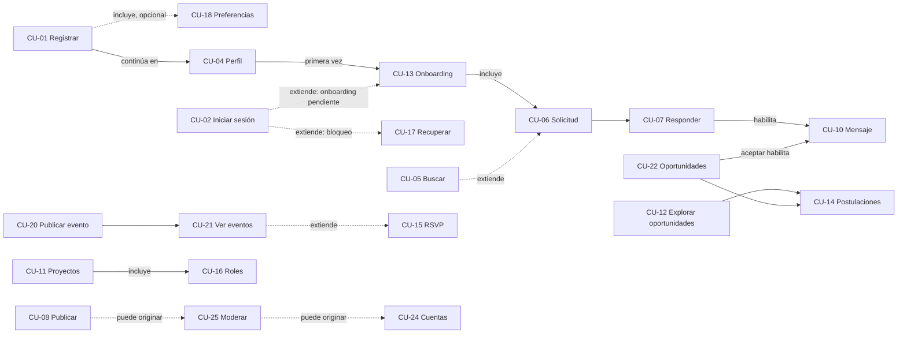
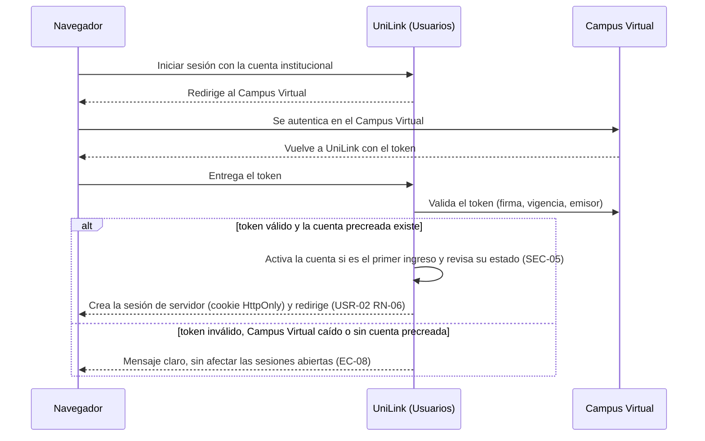
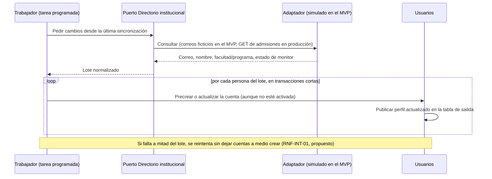
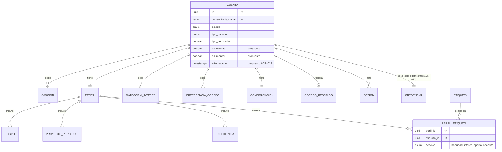
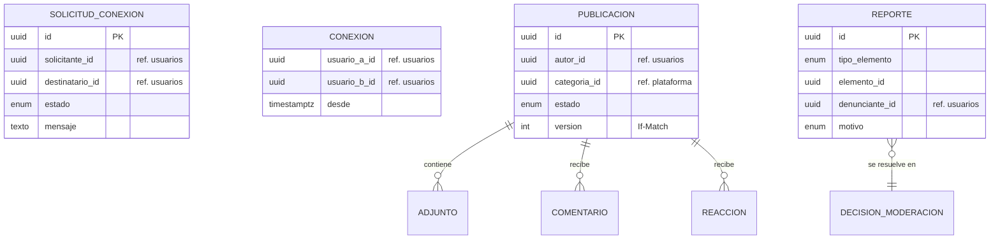
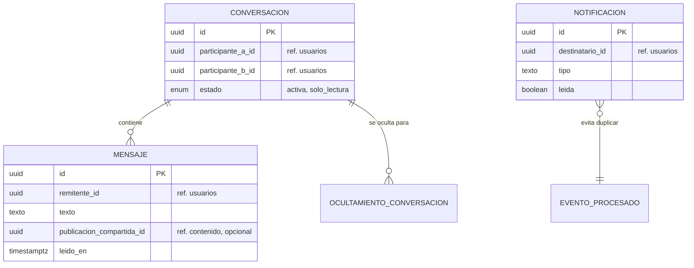
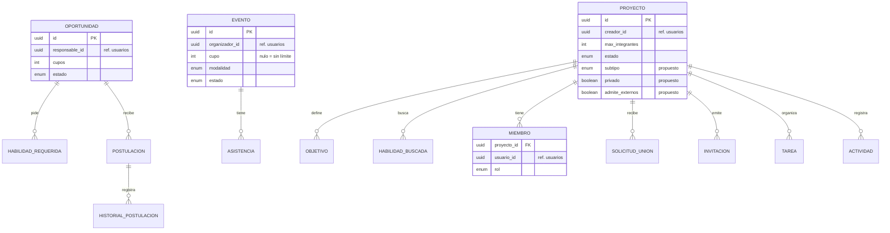
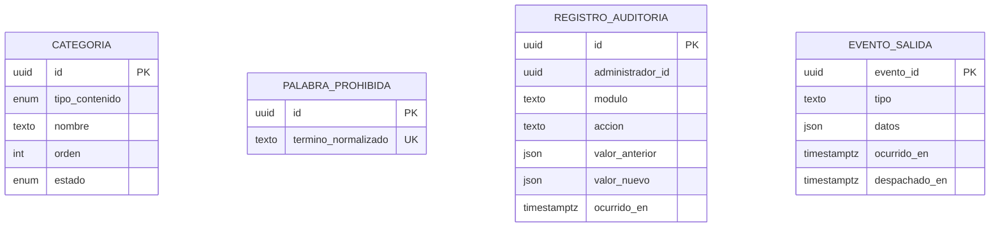

# Informe integral de especificaciones, requisitos y arquitectura de software — UniLink

_Red Profesional Universitaria — Universidad del Magdalena_
_Centro de Interés de Desarrollo Tecnológico e Innovación (CIDTI)_

> **Anexo técnico.** Desde el 2026-10-29, el punto de entrada para el tutor es el [Informe del proyecto](./informe_unilink.md), que resume cada tema y enlaza aquí para el detalle. Los actores y el alcance del MVP vigentes están en [Actores y alcance del MVP](./actores_y_alcance_mvp.md), que reemplaza al [capítulo 5](#capítulo-5-actores-roles-y-permisos) de este informe.

| Campo | Valor |
|---|---|
| **Documento** | Informe integral de especificaciones, requisitos y arquitectura |
| **Dirigido a** | Profesor tutor del proyecto |
| **Equipo** | Andrés Felipe Gamero, Luis Fernando Barraza, Alfonso Salazar, Andrés Manuel Rudas, Samuel Ospino, Luis Javier Saumeth, Vianney Álvarez, Camila Flórez y José Granado |
| **Versión** | 1.0 — Borrador para revisión del equipo y del tutor |
| **Fecha de corte** | 2026-10-27 |
| **Base analizada** | Rama `informe/analisis-integral`: la reestructuración del 2026-10-24 (`feature/reestructuracion-docs`) más las decisiones de la reunión del 2026-10-19 |

## Tabla de contenido

- [Nota metodológica](#nota-metodológica)
- [Capítulo 1. Resumen ejecutivo](#capítulo-1-resumen-ejecutivo)
- [Capítulo 2. Introducción y contexto del proyecto](#capítulo-2-introducción-y-contexto-del-proyecto)
- [Capítulo 3. Análisis del sistema de referencia](#capítulo-3-análisis-del-sistema-de-referencia)
- [Capítulo 4. Especificación de requisitos](#capítulo-4-especificación-de-requisitos)
- [Capítulo 5. Actores, roles y permisos](#capítulo-5-actores-roles-y-permisos)
- [Capítulo 6. Reglas de negocio](#capítulo-6-reglas-de-negocio)
- [Capítulo 7. Arquitectura de software](#capítulo-7-arquitectura-de-software)
- [Capítulo 8. Arquitectura del backend](#capítulo-8-arquitectura-del-backend)
- [Capítulo 9. Arquitectura del frontend web y Android](#capítulo-9-arquitectura-del-frontend-web-y-android)
- [Capítulo 10. Arquitectura de datos](#capítulo-10-arquitectura-de-datos)
- [Capítulo 11. Arquitectura de API e integraciones](#capítulo-11-arquitectura-de-api-e-integraciones)
- [Capítulo 12. Seguridad y privacidad](#capítulo-12-seguridad-y-privacidad)
- [Capítulo 13. Infraestructura y despliegue](#capítulo-13-infraestructura-y-despliegue)
- [Capítulo 14. Calidad y estrategia de pruebas](#capítulo-14-calidad-y-estrategia-de-pruebas)
- [Capítulo 15. Atributos de calidad y evaluación arquitectónica](#capítulo-15-atributos-de-calidad-y-evaluación-arquitectónica)
- [Capítulo 16. Riesgos, brechas e inconsistencias](#capítulo-16-riesgos-brechas-e-inconsistencias)
- [Capítulo 17. Plan de implementación](#capítulo-17-plan-de-implementación)
- [Capítulo 18. Conclusiones y recomendaciones](#capítulo-18-conclusiones-y-recomendaciones)
- [Capítulo 19. Referencias y anexos](#capítulo-19-referencias-y-anexos)

**Documentos complementarios** (cada uno es la fuente única de su tema; este informe los resume y los cita):

| Documento | Contenido |
|---|---|
| [`requisitos_unilink.md`](./requisitos_unilink.md) | Catálogo de los 167 requisitos funcionales y de los 63 no funcionales, propuestas de RNF y decisiones sin especificar (RD-01 a RD-28). |
| [`matriz_trazabilidad_unilink.md`](./matriz_trazabilidad_unilink.md) | Requisito → fuente → módulo → componente → entidad → endpoint → prueba → estado. |
| [`arquitectura_unilink.md`](./arquitectura_unilink.md) | Arquitectura actual y objetivo consolidadas, con los diagramas de contexto, contenedores y despliegue. |
| [`arquitectura/Registro_Decisiones.md`](./arquitectura/Registro_Decisiones.md) | ADR-001 a ADR-016. Por decisión del equipo, las ADR nuevas se agregaron a este registro y no a una carpeta aparte. |
| [`riesgos_y_brechas_unilink.md`](./riesgos_y_brechas_unilink.md) | Matriz de 37 hallazgos (H-01 a H-37) y los cambios pendientes por spec. |

---

## Nota metodológica

**Fuentes.** Se revisaron todos los archivos de `docs/` y `contracts/` y el historial de las tres ramas del repositorio (`main`, `documentacion` y `feature/reestructuracion-docs`). También se usaron el acta de la reunión de decisiones del 2026-10-19 y el sitio público de Aluna Conecta. Las verificaciones automáticas se hicieron con `scripts/verificar_docs.py --fase completa`, que valida enlaces, códigos, cobertura de casos de uso, actores y contratos.

**Alcance de la evidencia.** El repositorio **no contiene código fuente, pruebas, migraciones ni configuración de despliegue** (H-22). Por lo tanto, este informe es un **análisis documental**. Ninguna afirmación verifica una implementación, y toda arquitectura descrita es especificada o propuesta, no construida.

**Clasificación de las fuentes.**

| Categoría | Qué incluye en UniLink |
|---|---|
| Requisitos vigentes y confirmados | Los 22 specs (estado Borrador), el SRS v0.1 y los contratos, **salvo** donde la reunión del 2026-10-19 los contradice |
| Requisitos históricos u obsoletos | `docs/requisitos/` y `docs/specs/` de la rama `documentacion`, reemplazados el 2026-10-24 (tabla de equivalencias en el [README de módulos](./modulos/README.md#equivalencias-con-los-códigos-anteriores)); el registro del 2026-10-24 sobre el autorregistro y el vencimiento de solicitudes, superado por la reunión |
| Funcionalidades implementadas o parcialmente implementadas | Ninguna |
| Funcionalidades propuestas, no implementadas | Todas las de los specs y las decisiones sin especificar RD-01 a RD-28 |
| Decisiones técnicas confirmadas | ADR-001, 002, 003, 004, 005, 006, 008, 009, 010, 017 y 018, y ADR-014 en su versión simulada |
| Decisiones pendientes | ADR-007, 011, 012, 013, 015 y 016; 64 preguntas, de las cuales siguen abiertas las que no están resueltas ([estado](./preguntas-abiertas.md#resumen)) |
| Supuestos por validar | Volumen de usuarios (salvo el pico), disponibilidad del 99,5 %, capacidad de TI, formato del token del Campus Virtual |

**Criterio ante contradicciones.** Una fuente no se considera vigente solo por ser más reciente. Se aplicó este orden:

1. Las decisiones explícitas de la reunión del equipo del 2026-10-19, con asistentes y acta.
2. Las especificaciones revisadas (specs y SRS).
3. Las propuestas.

La reestructuración del 2026-10-24 es posterior a la reunión, pero partió de una versión anterior a ella y no la incorpora. Por eso, donde se contradicen, se toma como vigente la decisión de la reunión y se registra el conflicto (H-01).

**Convenciones de este informe.** Los hechos llevan su fuente enlazada. Las inferencias se marcan con _Inferencia:_. Las recomendaciones se marcan con **Recomendación:**. Las propuestas de este análisis que no son decisiones del equipo llevan la marca _(propuesto)_. Los identificadores son los del repositorio: `USR-01/RF-03`, `RNF-SEG-04`, `EC-04`, `CU-01`, `HU-01`, `P-12`, `ADR-009`, `H-01`.

---

## Capítulo 1. Resumen ejecutivo

**Qué es UniLink.** Es la red profesional de la comunidad de la Universidad del Magdalena, promovida por el CIDTI. Estudiantes, profesores y personal administrativo construyen un perfil profesional y declaran **qué pueden aportar y qué necesitan**. Con esa información, la plataforma sugiere conexiones, ordena oportunidades y ayuda a formar equipos ([SRS §1.2 y §2.1](./srs/Especificacion_Requisitos.md#21-perspectiva-del-producto)). El modelo "Puedo aportar / Necesito" se inspira en Aluna Conecta, el producto de Aluna I.A. con la Universidad del Magdalena que UniLink busca reemplazar o rediseñar ([capítulo 3](#capítulo-3-análisis-del-sistema-de-referencia)).

**Problema que resuelve.** Según el SRS, hoy quien necesita un diseñador, un monitor de cálculo o integrantes para un semillero depende de grupos de chat dispersos y de conocidos. UniLink reúne esa oferta y esa demanda en un solo lugar.

**Usuarios.** La comunidad universitaria (estudiantes, profesores y personal administrativo), los usuarios externos con registro propio (decidido el 2026-10-19, todavía sin especificar), el Administrador de la plataforma (personal de la Universidad) y el Moderador.

**Capacidades.** Seis módulos en el MVP:

- **Usuarios:** cuenta, perfil y hoja de vida en PDF.
- **Red:** conexiones, onboarding y búsqueda de perfiles.
- **Contenido:** publicaciones, feed y moderación transversal.
- **Comunicación:** mensajería privada y notificaciones.
- **Colaboración:** oportunidades con postulaciones, eventos con confirmación de asistencia y proyectos con roles y tareas.
- **Plataforma:** categorías, palabras prohibidas y auditoría.

Un séptimo módulo, Servicios, queda para una fase 2. En total hay **22 specs, 167 requisitos funcionales, 256 reglas de negocio y 253 escenarios de aceptación en Gherkin**, más **63 requisitos no funcionales** y **7 escenarios de calidad**.

**Alcance tecnológico.** Una aplicación web adaptable, desde 360 px, sin aplicaciones nativas en el MVP (RNF-COM-02). Hay 124 operaciones REST definidas en contratos OpenAPI 3.1.0 y 25 eventos de dominio con JSON Schema 2020-12, todos válidos. El sistema se alojará en la infraestructura propia de la Universidad (ADR-009).

**Enfoque arquitectónico.** Un **monolito modular** (ADR-002), elegido con una comparación ponderada frente al monolito en capas y a los microservicios. Tiene seis módulos que solo se comunican por su interfaz pública o por eventos de dominio con tabla de salida (ADR-003, ADR-004), y los contratos se acuerdan antes que el código (ADR-006). El 2026-10-27, el equipo eligió **FastAPI** para el backend y **React** para el frontend (ADR-010), y decidió que cada módulo se construya con **arquitectura hexagonal y Clean Architecture** (ADR-017). Así, el dominio no depende del framework ni de la base de datos, y las integraciones con el Campus Virtual y la API de admisiones quedan como adaptadores intercambiables (ADR-013, ADR-014).

**Estado actual.** La especificación está muy desarrollada:

- Cada spec estudia sus actores, variaciones y casos límite.
- Los contratos son válidos.
- Hay una matriz de permisos, escenarios de calidad y un verificador automático de la documentación.

En cambio, **no hay código** y **ningún spec está aprobado**. Además, la reestructuración del 2026-10-24 **no incorporó las decisiones del 2026-10-19**, y varias de ellas cambian partes centrales: el modelo de cuentas, los roles de administración y la eliminación de cuentas.

**Riesgos principales:**

| Riesgo | Hallazgo |
|---|---|
| Los specs contradicen las decisiones de la reunión (cuentas, roles, borrado, etiquetas) | H-01, H-02, H-05 |
| No hay código y los contratos no tienen esquemas, aunque el frontend debía arrancar el 2026-10-24 (el stack se decidió el 2026-10-27) | H-22, H-24 |
| La integración con el Campus Virtual no tiene especificación | H-25 |
| El borrado lógico podría chocar con el derecho de supresión de la Ley 1581 de 2012 | H-03 |
| Mantener el 99,5 % de disponibilidad con infraestructura propia y un equipo de estudiantes | H-27 |

**Decisiones pendientes más urgentes:**

| Decisión | Pregunta o ADR |
|---|---|
| Mecanismo de autenticación institucional | P-63, ADR-013 |
| Alcance de la mensajería y del tiempo real | P-56, P-16 |
| Validación jurídica del borrado lógico | P-12 |
| Lo que pasa con lo que posee una cuenta inactiva | P-51 |
| Aprobación de las normas de la comunidad | P-13 |
| Si existe o no un cliente Android | ADR-016, decisión que se propone al tutor |

---

## Capítulo 2. Introducción y contexto del proyecto

### 2.1 Contexto y antecedentes

UniLink es un proyecto del **Centro de Interés de Desarrollo Tecnológico e Innovación (CIDTI)** de la Universidad del Magdalena. Su documentación empezó el 2026-10-06 con casos de uso, historias de usuario y 22 specs funcionales, y se organizó en módulos el 2026-10-24 ([decisión de reestructuración](./decisiones/2026-10-24-reestructuracion-docs.md)). El 2026-10-19, el equipo cerró en reunión buena parte de las preguntas abiertas ([acta](./decisiones/2026-10-19-reunion-preguntas-abiertas.md)).

El antecedente directo es **Aluna Conecta**, un producto de Aluna I.A. y la Universidad del Magdalena. El spec del perfil profesional registra que su modelo "Puedo aportar / Necesito" se inspira en él ([FS-USR-06, historial](./modulos/usuarios/specs/FS-USR-06-perfil-profesional.md#17-historial-de-cambios)).

### 2.2 Problema identificado

El único planteamiento del problema que tiene respaldo documental está en el [SRS §2.1](./srs/Especificacion_Requisitos.md#21-perspectiva-del-producto): la búsqueda de colaboradores, monitores e integrantes de semilleros depende de grupos de chat dispersos y de contactos personales. No hay en el repositorio cifras, encuestas ni estudios que cuantifiquen ese problema.

**Recomendación:** que el equipo valide el planteamiento con evidencia, por ejemplo con una encuesta a estudiantes o con datos de las convocatorias de monitores. Ese dato también sustentaría el supuesto de ~1.000 usuarios simultáneos de P-01.

### 2.3 Justificación

Según las fuentes, la justificación se apoya en tres elementos:

1. **Reunir en un solo lugar** la oferta y la demanda de colaboración dentro de la comunidad.
2. **Cruzar las declaraciones** de "Puedo aportar" y "Necesito" para sugerir conexiones complementarias ([FS-RED-02](./modulos/red/specs/FS-RED-02-onboarding-sugerencias.md), RN-10).
3. **Operar dentro de la institución**, con identidad universitaria, datos propios e infraestructura de la Universidad (decisiones del 2026-10-19).

### 2.4 Objetivos

_Los objetivos no aparecen formulados como tales en el repositorio. Los que siguen los formuló este análisis a partir del SRS (§1.1, §1.2 y §2.2) y deben ser validados por el equipo y el tutor._

**Objetivo general.** Desarrollar el MVP de una red profesional para la comunidad de la Universidad del Magdalena que permita construir perfiles profesionales, conectar a personas con necesidades y capacidades complementarias, y colaborar en oportunidades, eventos y proyectos, de forma segura y conforme a la Ley 1581 de 2012.

**Objetivos específicos:**

| # | Objetivo | Módulo | Specs |
|---|---|---|---|
| OE-1 | Gestionar la identidad y el perfil profesional de cada miembro, incluida la declaración de lo que aporta y lo que necesita. | Usuarios | FS-USR-01 a 08 |
| OE-2 | Facilitar el descubrimiento y la conexión entre perfiles complementarios. | Red | FS-RED-01 a 03 |
| OE-3 | Permitir la publicación y moderación de contenido académico y profesional. | Contenido | FS-CNT-01, 02 |
| OE-4 | Mantener informados a los usuarios y permitir la comunicación privada. | Comunicación | FS-COM-01, 02 |
| OE-5 | Organizar la colaboración en oportunidades, eventos y proyectos con cupos y roles. | Colaboración | FS-COL-01 a 06 |
| OE-6 | Dar a la administración herramientas de configuración, moderación y auditoría. | Plataforma | FS-PLT-01 |
| OE-7 | Diseñar una arquitectura que el equipo pueda mantener y que se pueda evolucionar. | Transversal | ADR-001 a 016 |

### 2.5 Alcance funcional y tecnológico

| Dimensión | Dentro del MVP | Fuente |
|---|---|---|
| Funcional | Seis módulos, 22 specs, CU-01 a CU-26 | [SRS §1.2](./srs/Especificacion_Requisitos.md#12-alcance) |
| Usuarios | Comunidad universitaria; **usuarios externos** (decidido el 2026-10-19; sin especificar) | SRS §2.4; acta |
| Plataforma de cliente | Web adaptable para navegadores de escritorio y móviles | RNF-COM-01, RNF-COM-02, RNF-USA-02 |
| Servidor | Monolito modular con API REST, trabajador y base de datos relacional | ADR-002, 004, 005 y 011 |
| Infraestructura | Servidores de la Universidad, 24/7 | ADR-009 |
| Integraciones | Servicio de correo; Campus Virtual (autenticación); API de admisiones (simulada en el MVP) | Vistas C&C; ADR-013; ADR-014 |

### 2.6 Beneficiarios y partes interesadas

Los stakeholders, con lo que esperan y lo que deciden, están en el [SRS §2.3](./srs/Especificacion_Requisitos.md#23-stakeholders). La reunión del 2026-10-19 agrega o precisa tres:

- **Vicerrectoría Académica:** fuente del listado oficial de monitores.
- **TI y Admisiones:** dueños del Campus Virtual y de la API de admisiones.
- **Administración de la plataforma:** la ejerce personal de la Universidad, no el equipo de desarrollo.

### 2.7 Limitaciones conocidas

| Limitación | Efecto | Fuente |
|---|---|---|
| Equipo pequeño de estudiantes, con rotación entre semestres | Favorece una arquitectura con pocas piezas | SRS §2.6; [comparación](./arquitectura/Comparacion_Alternativas.md) |
| Sprint 0 más 8 sprints de dos semanas | Las funciones de prioridad media pueden pasar a una iteración posterior | [Roadmap](./sprints/README.md); R-09 |
| Presupuesto universitario e infraestructura propia | Sin servicios gestionados en la nube | ADR-009 |
| Datos institucionales sujetos a la gestión con la Universidad | La API de admisiones se simula en el MVP | ADR-014; P-61 |
| Aprobaciones jurídicas pendientes | Normas, borrado lógico y términos | P-12, P-13; acta |

### 2.8 Exclusiones explícitas del alcance

Las del [SRS §1.2](./srs/Especificacion_Requisitos.md#12-alcance) son: aplicaciones nativas, pagos, oportunidades de empresas externas, chat grupal y encuestas, y moderación automática con inteligencia artificial. Las que dejó fuera del MVP la reunión del 2026-10-19 son:

- Chat de equipo y registro interno de grupos en los proyectos.
- Apelaciones dentro de la plataforma (se gestionan por soporte).
- Sugerencias por afinidad como notificación.
- Lista de espera en los eventos.
- Servicios entre estudiantes (fase 2).
- Ruta institucional de atención (a lo sumo, un enlace).
- Términos y condiciones aprobados por la Oficina Jurídica, que son obligatorios antes de producción pero no para el prototipo.

Dos exclusiones del SRS **chocan con decisiones de la reunión** y deben revisarse:

- El inicio de sesión con proveedores externos, frente a la autenticación con el Campus Virtual (H-02).
- Los archivos adjuntos en los mensajes, que la reunión aceptó condicionados a la mensajería (H-13).

---

## Capítulo 3. Análisis del sistema de referencia

**Fuente:** <https://www.alunaia.co/conecta>, consultada el 2026-10-27, junto con las subpáginas `/conecta/explorar`, `/conecta/publicar`, `/conecta/yo` y `/conecta/pulso`. El sitio es una aplicación que carga su contenido en el navegador: sin sesión, el texto disponible se limita a la navegación y a algunos títulos, y varias páginas quedan en el estado "Cargando". **Las observaciones de este capítulo son, por eso, parciales.**

### 3.1 Observaciones verificadas

| Aspecto | Observación |
|---|---|
| Identidad | "Aluna Conecta · Mar Abierto", con el subtítulo "Mar Abierto · Caribe Azul". Muestra los logos de la Universidad del Magdalena y de Aluna I.A. El pie dice "Universidad del Magdalena · Aluna I.A. · Portafolio Caribe Azul". |
| Propuesta de valor | "¿Quién está en este mar que te convendría conocer?". Los usuarios declaran sus intereses, lo que pueden aportar y lo que necesitan, y la plataforma les muestra **personas y organizaciones complementarias**, organizadas alrededor de "las 12 Juntanzas Caribe Azul" (el sitio no las enumera). |
| Navegación de Conecta | **Mar Abierto** (muro), **Explorar**, **Publicar**, **Mensajes** y **Yo**. En la sección "Ecosistema" aparece **Pulso del ecosistema**. |
| Explorar | Título "Radar". Descripción: "Personas y organizaciones, las 12 Juntanzas Caribe Azul y el radar de oportunidades". Pestañas: Personas, Juntanzas y Oportunidades. |
| Muro | Filtros "Todo" y "Todas las Juntanzas"; el contenido no cargó. |
| Ecosistema | Forma parte de un portafolio de productos: SakukuMasterclass, Kunsamu, Conecta y TraductorSayta ("Sistema de Audio y Traducción Ancestral", en sayta.unimagdalena.edu.co). |

### 3.2 Inferencias (no verificadas)

- _Inferencia:_ Mensajes, Publicar y Yo requieren sesión. No se pudo comprobar el mecanismo de registro ni de inicio de sesión.
- _Inferencia:_ las "Juntanzas" son agrupaciones temáticas o territoriales de un programa regional (Caribe Azul) y cumplen un papel parecido al de las categorías de UniLink.
- _Inferencia:_ "Pulso del ecosistema" es un tablero de indicadores agregados, comparable a RNF-OBS-04.
- **No se verificaron** el modelo de datos, el cruce de complementariedad, el uso de inteligencia artificial, la moderación ni la mensajería.

### 3.3 Qué conserva, modifica o descarta UniLink

| Elemento de Aluna Conecta | En UniLink | Justificación |
|---|---|---|
| Modelo "intereses / puedo aportar / necesito" y sugerencia de perfiles complementarios | **Conserva** | Es el núcleo del perfil (FS-USR-06) y de las sugerencias (FS-RED-02 RN-10). |
| Navegación Explorar / Publicar / Mensajes / **Yo** | **Conserva**, con secciones propias | La reunión del 2026-10-19 decidió Explorar con Personas, Proyectos y Eventos, más una vista personal "Yo" (RD-10). Falta especificarlo (H-16). |
| Radar de oportunidades | **Conserva y amplía** | Oportunidades con postulaciones, estados y cupos (FS-COL-01 y 02); el alcance está en revisión (P-59). |
| Juntanzas (12 agrupaciones) | **Modifica** | UniLink usa categorías administrables por tipo de contenido (FS-PLT-01) y un subtipo de proyecto (RD-08). |
| Organizaciones como actores | **No está especificado** | UniLink define solo personas. Los semilleros aparecen como agrupación de proyectos (RD-08), no como cuentas. |
| Público abierto ("personas y organizaciones") | **Modifica** | UniLink es institucional: comunidad con autenticación universitaria y externos con registro propio, bajo reglas por proyecto (RD-04). |
| Pulso del ecosistema | **Equivalente parcial** | Indicadores de uso para el equipo, sin rastrear a individuos (RNF-OBS-04). |
| Elementos no observados (moderación, auditoría, privacidad por niveles, eventos con RSVP, proyectos con roles y tareas) | **Agrega** | Specs FS-CNT-02, FS-PLT-01, FS-USR-05, FS-COL-03 a 06. |

### 3.4 Diferencias principales

1. **Gobierno institucional.** UniLink define roles de Administrador y Moderador, normas de la comunidad, auditoría de dos años y cumplimiento de la Ley 1581. En Aluna Conecta no se observó nada de esto.
2. **Colaboración estructurada.** UniLink modela cupos atómicos, estados y permisos de oportunidades, eventos y proyectos.
3. **Arquitectura documentada.** UniLink tiene una especificación contract-first y un registro de decisiones. La arquitectura de Aluna Conecta no se pudo observar.

**Recomendación:** pedir a Aluna I.A. o al CIDTI acceso con sesión, o capturas de pantalla, para completar este capítulo. Interesa sobre todo el registro, el cruce de complementariedad y Pulso.

---

## Capítulo 4. Especificación de requisitos

### 4.1 Requisitos funcionales

**Ubicación y formato.** Cada requisito funcional vive en la sección 5 de su spec y se identifica de forma única como `<MOD>-NN/RF-NN`. Este informe **no renumera** los requisitos a `RF-001`, para que haya una sola numeración en todo el proyecto (regla M-3 de la [reestructuración](./decisiones/2026-10-24-reestructuracion-docs.md#54-método)). El [catálogo](./requisitos_unilink.md#3-requisitos-funcionales) lista los 167 con su texto y prioridad.

**Dónde está cada atributo.** Cada spec documenta todos los atributos que pide la plantilla:

| Atributo pedido | Sección del spec |
|---|---|
| Identificador, nombre, descripción, prioridad | §5 Requisitos funcionales |
| Actores | §2 Quién es quién |
| Precondiciones y postcondiciones | §7 Estados y §8 Flujo principal; además, el caso de uso del módulo |
| Flujo principal | §8 |
| Flujos alternativos y excepciones | §9 Variaciones y §10 ¿Qué pasaría si…? |
| Reglas de negocio asociadas | §4 (RN-NN), citadas en cada RF |
| Criterios de aceptación verificables | §12 Resultado esperado (Gherkin) |
| Dependencias | §13 Contratos (expone y consume) y [ADR-003](./arquitectura/Registro_Decisiones.md#adr-003-límites-de-los-módulos-y-dependencias-permitidas) |
| Fuente documental | Encabezado del spec (CU y HU) y su historial |
| Estado de implementación | Ninguno implementado; estado del spec en el [índice](./modulos/README.md#índice-de-specs) |

**Resumen por módulo:**

| Módulo | Specs | RF | Alta / Media / Baja | Depende de (ADR-003) | Desactualizado por la reunión del 2026-10-19 |
|---|---|---|---|---|---|
| Usuarios | FS-USR-01 a 08 | 52 | 42 / 10 / 0 | Plataforma | USR-01, 02, 03, 05 y 08 (USR-06 actualizado el 2026-10-27) |
| Red | FS-RED-01 a 03 | 23 | 14 / 7 / 2 | Usuarios | RED-01, 02 y 03 |
| Contenido | FS-CNT-01, 02 | 18 | 11 / 7 / 0 | Usuarios, Red, Plataforma | CNT-01, 02 |
| Comunicación | FS-COM-01, 02 | 15 | 10 / 4 / 1 | Usuarios, Red, Colaboración | COM-01 (en revisión) |
| Colaboración | FS-COL-01 a 06 | 50 | 34 / 14 / 2 | Usuarios, Red, Plataforma | COL-03, 04, 05 y 06 |
| Plataforma | FS-PLT-01 | 9 | 6 / 2 / 1 | — | PLT-01 |
| **Total** | **22** | **167** | **117 / 44 / 6** | | **16 de 22** |

**Ficha completa de un requisito (ejemplo).** Se elige `COL-04/RF-02` porque concentra reglas de negocio, concurrencia y permisos:

| Atributo | Contenido |
|---|---|
| ID y nombre | `COL-04/RF-02` — Confirmar o cancelar la asistencia a un evento |
| Descripción | "El sistema debe aplicar RN-01 a RN-04 al confirmar o cancelar." ([FS-COL-04](./modulos/colaboracion/specs/FS-COL-04-confirmacion-asistencia.md)) |
| Actores | Asistente (primario); Organizador y Sistema (secundarios) |
| Precondiciones | Usuario con cuenta Activa; evento en estado Programado y sin comenzar; el usuario no es el organizador |
| Flujo principal | El usuario abre el detalle → pulsa "Asistiré" → el sistema bloquea el registro del evento, verifica el cupo y guarda la confirmación junto con su evento en la tabla de salida, en una sola transacción → se muestran la lista de asistentes y "Agregar a mi calendario" ([plan §3.2](./arquitectura/Plan_de_Implementacion.md#32-tomar-un-cupo-asistencia-postulación-aceptada-unión-a-proyecto)) |
| Alternos y excepciones | Cupo completo ("Cupo completo"); el evento ya empezó (MSG-06); cancelación antes del inicio (libera el cupo); evento cancelado o retirado después de confirmar |
| Postcondiciones | Asistencia Confirmada o Cancelada; el número de confirmados nunca supera el cupo |
| Reglas | COL-04/RN-01 a RN-04; RNF-CON-01 |
| Prioridad | Alta |
| Fuente | CU-15, HU-26 |
| Estado | Especificado (Borrador); no implementado |
| Criterios de aceptación | Escenarios "Confirmar asistencia", "Cupo completo", "Dos usuarios confirman a la vez el último cupo" (§12) y EC-04: nunca más confirmados que cupo en 1.000 intentos concurrentes |
| Dependencias | FS-COL-03 (evento); Red (conexiones que asistirán); Usuarios (datos públicos); ADR-005 (mecanismo de bloqueo) |

### 4.2 Requisitos no funcionales

Los 63 RNF están en el [SRS §3.3](./srs/Especificacion_Requisitos.md#33-requisitos-no-funcionales), cada uno con su criterio verificable, y se clasifican según ISO/IEC 25010. El [catálogo §4](./requisitos_unilink.md#4-requisitos-no-funcionales) los agrupa en las categorías de este análisis. Las conclusiones principales son:

- **Rendimiento:** está bien cubierto, con medición en p95 y datos de volumen realista. El supuesto de carga se ajustó a 1.000 usuarios simultáneos según P-01.
- **Escalabilidad y testabilidad:** no tenían requisito con identificador. Se proponen RNF-ESC-01 y RNF-TES-01 _(propuestas pendientes de aprobación)_.
- **Disponibilidad:** 99,5 % mensual, RPO de 24 h y RTO de 8 h. Ahora dependen de TI de la Universidad (ADR-009, H-27).
- **Privacidad:** RNF-PRI-06 y RNF-PRI-09 chocan con el borrado lógico (H-03).
- **Integraciones nuevas:** se proponen RNF-DIS-07 y RNF-INT-01, con los escenarios EC-08 y EC-09.

### 4.3 Historias de usuario y casos de uso

Los 30 casos de uso y las 31 historias viven en `docs/modulos/<modulo>/casos-de-uso.md` e `historias.md`. Cada uno aparece una sola vez, lo que comprueba `verificar_docs.py`. El SRS tiene el diagrama de casos de uso por actor ([§3.2](./srs/Especificacion_Requisitos.md#32-casos-de-uso)).

| CU | Nombre | Módulo | Actor primario | Actores secundarios | HU | Spec |
|---|---|---|---|---|---|---|
| CU-01 | Registrar cuenta | Usuarios | Visitante | Sistema, Servicio de correo | HU-01 | FS-USR-01 |
| CU-02 | Iniciar sesión | Usuarios | Visitante | Sistema | HU-02 | FS-USR-02 |
| CU-03 | Administrar cuenta | Usuarios | Dueño del perfil | Servicio de correo | HU-03 | FS-USR-05 |
| CU-04 | Crear o editar el perfil profesional | Usuarios | Dueño del perfil | Observador | HU-04 | FS-USR-06 |
| CU-05 | Buscar y visualizar perfiles | Red | Observador | Dueño del perfil | HU-05 | FS-RED-03 |
| CU-06 | Enviar solicitud de conexión | Red | Solicitante | Destinatario | HU-06 | FS-RED-01 |
| CU-07 | Responder solicitud de conexión | Red | Destinatario | Solicitante | HU-07 | FS-RED-01 |
| CU-08 | Publicar contenido | Contenido | Autor | Lector | HU-08 | FS-CNT-01 |
| CU-09 | Visualizar publicaciones | Contenido | Lector | Autor | HU-09 | FS-CNT-01 |
| CU-10 | Enviar mensaje privado | Comunicación | Remitente | Destinatario | HU-10 | FS-COM-01 |
| CU-11 | Gestionar espacio de proyectos | Colaboración | Creador del proyecto, Solicitante | Administrador de proyecto | HU-11 | FS-COL-05 |
| CU-12 | Explorar oportunidades | Colaboración | Postulante | Responsable de oportunidad | HU-12 | FS-COL-02 |
| CU-13 | Sugerir conexiones iniciales (onboarding) | Red | Usuario | Sistema | HU-24 | FS-RED-02 |
| CU-14 | Gestionar estado de postulaciones | Colaboración | Postulante | Responsable de oportunidad | HU-25 | FS-COL-02 |
| CU-15 | Confirmar asistencia a eventos | Colaboración | Asistente | Organizador, Sistema | HU-26 | FS-COL-04 |
| CU-16 | Administrar roles en proyectos | Colaboración | Administrador de proyecto | Miembro del proyecto | HU-27 | FS-COL-06 |
| CU-17 | Recuperar contraseña | Usuarios | Visitante | Servicio de correo | HU-28 | FS-USR-03 |
| CU-18 | Seleccionar preferencias de contenido | Usuarios | Visitante, Dueño del perfil | — | HU-14 | FS-USR-04 |
| CU-19 | Generar hoja de vida en PDF | Usuarios | Dueño del perfil | — | HU-13 | FS-USR-07 |
| CU-20 | Publicar evento | Colaboración | Organizador | Asistente | HU-15 | FS-COL-03 |
| CU-21 | Visualizar eventos | Colaboración | Usuario | Organizador | HU-16 | FS-COL-03 |
| CU-22 | Publicar oportunidades y gestionar postulaciones | Colaboración | Responsable de oportunidad | Postulante | HU-29 | FS-COL-01 |
| CU-23 | Consultar notificaciones | Comunicación | Destinatario | Sistema | HU-30 | FS-COM-02 |
| CU-24 | Administrar cuentas de usuario | Usuarios | Administrador de la plataforma | Dueño del perfil | HU-17 | FS-USR-08 |
| CU-25 | Moderar contenido | Contenido | Administrador de la plataforma | Denunciante, Autor, Sistema | HU-18, HU-19 | FS-CNT-02 |
| CU-26 | Administrar categorías | Plataforma | Administrador de la plataforma | Usuario | HU-20 | FS-PLT-01 |
| CU-27 a CU-30 | Servicios (fase 2) | Servicios | Usuario, Oferente | Administrador de la plataforma | HU-21, 22, 23, 31 | FS-SRV-01 a 03 (pendientes) |

**Relaciones entre casos de uso** _(propuesta; se deriva de las referencias cruzadas de los casos de uso y los specs, y el repositorio no la diagrama)_:



**Observaciones:**

1. El [informe de la reunión](./decisiones/2026-10-19-reunion-preguntas-abiertas.md) agrega comportamientos sin caso de uso: la activación de una cuenta precreada, la vista "Yo", el bloqueo entre usuarios y el aviso del organizador (RD-01 a RD-28).
2. Hay solapamientos que conviene revisar sin fusionar: CU-12, CU-14 y CU-22 tratan el mismo módulo de oportunidades; CU-20 y CU-21 se resuelven en un solo spec; HU-18 y HU-19 apuntan a CU-25; CU-11 y CU-13 envían solicitudes de unión a proyectos por dos caminos (P-50).

### 4.4 Matriz de trazabilidad

La matriz completa está en [`matriz_trazabilidad_unilink.md`](./matriz_trazabilidad_unilink.md). Por cada spec relaciona la fuente (CU y HU), el módulo, el componente, las entidades propuestas, el número de endpoints, los eventos, las pruebas (Gherkin, permisos, concurrencia, contrato y escenario de calidad) y el estado. También traza los RNF a los escenarios y las decisiones de la reunión a los documentos. La conclusión es que **todo requisito tiene fuente y estrategia de validación**, y que **17 de 22 specs quedaron desactualizados** con la reunión del 2026-10-19. El 2026-10-27 se actualizaron FS-USR-06, FS-RED-01 y FS-RED-03; quedan **16**, porque FS-RED-01 y FS-RED-03 todavía esperan el bloqueo de usuarios (H-12) y la navegación de Explorar (H-16).

---

## Capítulo 5. Actores, roles y permisos

### 5.1 Perfiles definidos

El [SRS §2.4](./srs/Especificacion_Requisitos.md#24-actores-del-sistema) define 29 actores con un nombre único (26 del MVP y 3 de la fase 2). Distingue **papeles**, como Autor, Lector, Solicitante, Organizador o Asistente, de **tipos** de usuario (Estudiante, Profesor, Personal administrativo) y de **roles** (Administrador de la plataforma y los roles de proyecto). La reunión del 2026-10-19 agrega dos y modifica uno; los tres _(sin especificar)_ se marcan en las tablas:

| Perfil | Objetivo y responsabilidades | Restricciones | Datos a los que accede | Relación con otros roles |
|---|---|---|---|---|
| Visitante | Activar su cuenta o registrarse (externo) e iniciar sesión | Solo los endpoints públicos (SEC-01) | Ninguno | Pasa a Usuario al activarse |
| Usuario (Estudiante, Profesor, Personal administrativo) | Usar la red: perfil, conexiones, contenido, colaboración | Cuenta Activa (SEC-05); límites de uso (RNF-SEG-07) | Perfiles según su privacidad; contenido visible | Asume papeles: Autor, Solicitante, Organizador, etc. |
| **Usuario externo** _(sin especificar)_ | Participar con registro propio | Por definir: proyectos que lo admiten (RD-04); demás permisos sin definir (H-04) | Por definir | Variante de Usuario |
| Dueño del perfil | Administrar su cuenta, privacidad y perfil | Contraseña actual para cambios sensibles (USR-05 RN-01) | Todo lo propio, salvo los mensajes ajenos | — |
| Responsable de oportunidad / Organizador / Creador del proyecto | Gestionar lo que publica | No participa en lo propio (RT-04) | Perfil completo de sus postulantes mientras la postulación exista (COL-02 RN-05) | El Creador es administrador protegido del proyecto (COL-06 RN-06) |
| Administrador de proyecto, Editor, Visualizador | Colaborar según su rol | [Matriz de FS-COL-06](./modulos/colaboracion/specs/FS-COL-06-roles-proyectos.md#6-datos-y-validaciones) | Todo el espacio del proyecto | Un proyecto siempre tiene un administrador (COL-06 RN-05) |
| **Administrador de la plataforma** _(modificado)_ | Control total: cuentas, moderación, categorías, palabras prohibidas, auditoría | No actúa sobre sí mismo ni sobre otro administrador; no decide sobre su propio contenido; **no lee mensajes privados** | Datos básicos de las cuentas, cola de moderación, auditoría | Desde el 2026-10-19 debe ser **personal de la Universidad**; el equipo de desarrollo no administra |
| **Moderador** _(nuevo, sin especificar)_ | Reportes, bloqueos, contenido y lenguaje | Por definir (H-05): _(propuesto)_ sin gestión de categorías, de roles ni de auditoría | Cola de moderación; reportes de usuarios | Subordinado al Administrador |
| Sistema | Tareas automáticas y consumo de eventos | No retira contenido por su cuenta (CNT-02) | Según cada tarea | — |

### 5.2 Autenticación, autorización, propiedad y permisos administrativos

| Mecanismo | Pregunta que responde | Dónde se resuelve | Estado |
|---|---|---|---|
| **Autenticación** | ¿Quién es? | Usuarios: sesión de servidor con cookie (SES-01). Desde el 2026-10-19: Campus Virtual para la comunidad y contraseña para los externos (ADR-013). | Mecanismo institucional pendiente (P-63) |
| **Estado de la cuenta** | ¿Puede operar? | Máquina de estados única ([Usuarios](./modulos/usuarios/README.md#máquina-de-estados-de-la-cuenta)), revisada en cada petición (SEC-05) | Especificado |
| **Autorización por rol** | ¿Tiene el rol? | Contexto de la petición (roles de plataforma); FS-COL-06 (roles de proyecto) | Especificado; falta Moderador |
| **Propiedad del recurso** | ¿Es suyo? | Cada módulo, según el "Quién es quién" de su spec; rutas sin identificador para lo propio (SEC-03) | Especificado |
| **Relación** | ¿Tiene la relación necesaria? | Red (`sonConexiones`, `queVeObservador`); Colaboración (`tienenPostulacionAceptada`) | Especificado |
| **Permiso administrativo** | ¿Es Administrador o Moderador? | Prefijo `/admin/` en los contratos; FS-PLT-01 RN-02 | Especificado para Administrador; la asignación cambia (H-05) |

Todas las comprobaciones se hacen en el servidor (RNF-SEG-04). Cuando el usuario no debe saber que un recurso existe, la respuesta es `404` (SEC-06).

### 5.3 Matriz de permisos por módulo y acción

Amplía la [matriz del SRS §2.5](./srs/Especificacion_Requisitos.md#25-matriz-de-permisos) con las columnas **Moderador** y **Usuario externo**. Esas columnas son una **propuesta de este análisis** para validar (H-04, H-05), no una especificación vigente. `✓` = puede; `—` = no puede; `(P)` = propuesto; `?` = sin definir.

| Módulo | Acción | Visitante | Usuario | Usuario externo (P) | Dueño del objeto | Moderador (P) | Administrador |
|---|---|---|---|---|---|---|---|
| Usuarios | Activar una cuenta precreada / registrarse (externo) | ✓ | — | — | — | — | — |
| Usuarios | Editar perfil y configuración | — | — | — | ✓ | — | — |
| Usuarios | Ver el perfil completo de otro | — | ✓ si "Comunidad" o Conexión | ? | ✓ | Datos básicos (P) | Datos básicos |
| Usuarios | Suspender, inhabilitar, reactivar cuentas | — | — | — | — | Suspender por reportes (P) | ✓ (no a sí mismo ni a otro administrador) |
| Usuarios | Asignar los roles Administrador y Moderador | — | — | — | — | — | ? (H-05) |
| Red | Enviar solicitud de conexión | — | ✓ (30 por día) | ? | — | — | — |
| Red | Bloquear o reportar a un usuario | — | ✓ (RD-17) | ✓ (P) | — | Revisar reportes (P) | Verificar y decidir (RD-17) |
| Red | Buscar perfiles (incluido el filtro de monitor) | — | ✓ | ? | — | ✓ | ✓ |
| Contenido | Publicar, comentar, reaccionar | — | ✓ | ? | — | — | — |
| Contenido | Editar o eliminar una publicación | — | — | — | ✓ (Autor) | — | — |
| Contenido | Reportar | — | ✓ (no lo propio) | ✓ (P) | — | — | — |
| Contenido | Retirar o mantener contenido | — | — | — | — | ✓ (P, no lo propio) | ✓ (no lo propio) |
| Comunicación | Enviar mensaje privado | — | Conexión o postulación aceptada | ? | — | — | — |
| Comunicación | Leer conversaciones ajenas | — | — | — | — | — | — (RNF-PRI-04) |
| Colaboración | Publicar oportunidad, evento o proyecto | — | ✓ | ? | — | — | — |
| Colaboración | Unirse a un proyecto | — | ✓ | Solo si el proyecto admite externos (RD-04) | — | — | — |
| Colaboración | Ver un proyecto privado | — | Solo miembros (P) | Solo miembros (P) | ✓ | ? | ? |
| Colaboración | Enviar aviso a los asistentes | — | — | — | ✓ (Organizador, RD-22) | — | — |
| Colaboración | Configurar roles del proyecto | — | — | — | ✓ (Creador, RD-24) | — | — |
| Plataforma | Administrar categorías y palabras prohibidas | — | — | — | — | Palabras prohibidas (P) | ✓ |
| Plataforma | Consultar la auditoría | — | — | — | — | — | ✓ |

---

## Capítulo 6. Reglas de negocio

### 6.1 Ubicación y volumen

Las **256 reglas de negocio** viven en la sección 4 de cada spec, numeradas como `<MOD>-NN/RN-NN`; el [catálogo](./requisitos_unilink.md#2-resumen-por-spec) da su número por spec. Repetirlas aquí rompería la regla de fuente única. Este capítulo presenta, en cambio, las **reglas transversales**: las que atraviesan varios specs y condicionan la arquitectura. Para cada una indica su fuente, el componente que la hace cumplir y su prueba, y luego separa las confirmadas de las deducidas y de las propuestas.

### 6.2 Reglas transversales confirmadas

Están especificadas en specs en estado Borrador. "Conflicto" indica que una decisión de la reunión del 2026-10-19 las modifica.

| ID | Regla | Condición | Resultado esperado | Fuente (RN) | Componente responsable | Prueba | Estado |
|---|---|---|---|---|---|---|---|
| RT-01 | Cupo atómico | Confirmar asistencia, aceptar postulaciones, aprobar a un miembro | Nunca se supera el cupo; un lote que lo excede se rechaza completo | COL-01/RN-14, COL-04/RN-03, COL-05/RN-11; RNF-CON-01 | Colaboración (aplicación + bloqueo en la base de datos) | Concurrente, EC-04 | Confirmada |
| RT-02 | Visibilidad por privacidad | El perfil es "Solo mis conexiones" | Los no conectados ven nombre, foto y unidad académica; las etiquetas no se usan para buscarlo ni sugerirlo | USR-05/RN-06, RED-03/RN-04 y RN-08, RED-02/RN-10, CNT-01/RN-06, COL-04/RN-06 | Red (`queVeObservador`) | Permisos por API | Confirmada |
| RT-03 | Colaboración visible para todos | Oportunidades, eventos y proyectos | Los ve cualquier usuario autenticado, sin importar la privacidad de quien los crea | COL-01/RN-04, COL-03/RN-06, COL-05/RN-04 | Colaboración | Permisos | **Conflicto:** proyectos privados (RD-23) |
| RT-04 | Quien crea no participa en lo propio | Postularse, confirmar asistencia | Se rechaza | COL-02/RN-03, COL-04/RN-02 | Colaboración | Permisos | Confirmada |
| RT-05 | Palabras prohibidas | Todo texto público al crearlo o editarlo | Se rechaza si contiene palabras de la lista (comparación por palabra completa) | CNT-02/RN-14, PLT-01/RN-10 y RN-11, USR-06/RN-10 | Plataforma (`revisarTexto`) + cada módulo | Unitaria + aceptación | Confirmada |
| RT-06 | Moderación transversal | Elemento `Reportable` con reportes de 5 usuarios distintos | Se oculta hasta que lo revise un administrador | CNT-02/RN-04 y RN-13 | Contenido + implementaciones de `Reportable` | EC-06 | **Conflicto:** "bloquear" (RD-18) y Moderador (RD-27) |
| RT-07 | Estado de cuenta único | Cuenta suspendida, inhabilitada o en eliminación | No inicia sesión; su perfil, publicaciones y comentarios dejan de verse; sus conversaciones pasan a solo lectura | [Máquina de estados](./modulos/usuarios/README.md#máquina-de-estados-de-la-cuenta), USR-08/RN-04, COM-01/RN-08 | Usuarios + consumidores de `cuenta.estado_cambiado` | Aceptación por módulo | Parcial: P-51 |
| RT-08 | Permisos en el servidor | Toda acción | Se valida en el servidor; ocultar un botón no es control | RNF-SEG-04, COL-06/RF-03, SEC-02 | Contexto de la petición + capa de aplicación | Permisos por API, EC-03 | Confirmada |
| RT-09 | Edición concurrente e idempotencia | Ediciones y creaciones que se pueden reintentar | `If-Match` → 409; `Idempotency-Key` evita duplicados | RNF-CON-02, RNF-CON-03 | Capa API | Concurrente | Confirmada |
| RT-10 | Notificaciones por eventos | Cualquier hecho que se notifica | Solo Comunicación notifica, consumiendo eventos; nunca por acciones propias; sin duplicados | ADR-004, COM-02/RN-08 y RN-09, RNF-CON-04 | Trabajador + Comunicación | Prueba con un consumidor que falla | Confirmada |
| RT-11 | Límites de la administración | Acciones de administración | No sobre sí mismo ni sobre otro administrador; no sobre su propio contenido; todo queda auditado | USR-08/RN-06, CNT-02/RN-15, PLT-01/RN-12, RNF-SEG-10 | Usuarios, Contenido, Plataforma | Permisos | Confirmada; Moderador sin definir |
| RT-12 | Privacidad de los mensajes | Conversaciones privadas | Ningún administrador las lee desde la aplicación | COM-01/RN-11, RNF-PRI-04 | Comunicación | EC-05 | Confirmada |
| RT-13 | Límites de uso | Inicio de sesión, reenvíos, solicitudes, mensajes | 5 intentos y bloqueo de 15 min; 3 reenvíos por hora; 30 solicitudes por día; 60 mensajes por minuto; 100 peticiones por minuto | USR-02/RN-02, USR-01/RN-06, RED-01/RN-05, COM-01/RN-09, RNF-SEG-07 | Limitador + cada módulo | Carga por límite | Confirmada |
| RT-14 | Retención de datos | Cada tipo de dato | Se elimina al vencer su plazo | RNF-PRI-09 | Trabajador | Prueba de cada limpieza | **Conflicto:** borrado lógico (RD-15, P-12) |

### 6.3 Reglas deducidas

No están escritas como regla, pero se desprenden de varias fuentes. Hay que confirmarlas al aprobar los specs.

| ID | Regla deducida | De dónde se deduce |
|---|---|---|
| RT-D1 | Toda consulta de listados excluye a las cuentas que no están Activas y el contenido retirado u oculto, salvo para su autor. | RED-03/RN-03, CNT-01/RN-17, máquina de estados de la cuenta |
| RT-D2 | Las fechas se guardan con zona horaria y se muestran en hora de Colombia. | RNF-USA-01; convención ISO 8601 de `contracts/api/README.md` |
| RT-D3 | Los identificadores expuestos son UUID. | SEC-04; contratos (`format: uuid`) |
| RT-D4 | Un cambio en la lista de palabras prohibidas o en las categorías no altera lo ya publicado. | PLT-01/RN-05 y RN-11; CNT-01 §10 |

### 6.4 Reglas propuestas a partir de la reunión del 2026-10-19

Son **propuestas de este análisis para concretar decisiones**. No son reglas vigentes.

| ID | Regla propuesta | Decisión que concreta |
|---|---|---|
| RP-01 | Bloquear a un usuario oculta mutuamente los perfiles, cancela las solicitudes pendientes, impide nuevas solicitudes y deja la conversación en solo lectura. | RD-17 (y la propuesta original de P-27) |
| RP-02 | El contenido bloqueado por 5 reportes solo lo ven su autor y la moderación, y su autor no puede editarlo hasta la decisión. | RD-18 |
| RP-03 | Un proyecto privado solo lo ven sus miembros; no aparece en Explorar, en búsquedas ni en perfiles de quienes no son miembros. | RD-23 |
| RP-04 | Un usuario externo solo puede pedir unirse a proyectos marcados "admite externos". El resto de sus permisos debe definirse antes del Sprint 1. | RD-04 |
| RP-05 | La eliminación de una cuenta conserva la traza de quién y cuándo, y anonimiza los datos personales en el plazo que fije la Oficina Jurídica. | RD-15, opción B de ADR-015 |
| RP-06 | El estado de monitor lo escribe solo la sincronización institucional, nunca el usuario. | RD-05 |

---

## Capítulo 7. Arquitectura de software

### 7.1 Arquitectura actual

**No existe una arquitectura implementada que se pueda describir.** No hay lenguajes, frameworks, paquetes, componentes en ejecución, acceso a datos ni procesos de despliegue observables: ninguna de las tres ramas contiene código de aplicación (H-22). Lo único ejecutable del repositorio es `scripts/verificar_docs.py`, un verificador de documentación en Python 3. Cualquier tecnología que se mencione en este capítulo es una **propuesta**, no algo implementado.

### 7.2 Arquitectura objetivo

**Evaluación de estilos.** El equipo comparó tres alternativas con una tabla ponderada ([comparación](./arquitectura/Comparacion_Alternativas.md)). Este análisis amplía la evaluación a los seis estilos que pide el encargo y la contrasta con las restricciones de UniLink:

| Estilo | Ajuste a UniLink | Veredicto |
|---|---|---|
| Monolito en capas | Simple, pero no impide que un módulo lea las tablas de otro; la moderación transversal y la evolución se degradan (3,75 en la comparación). | Descartado. Dentro de cada módulo se usan los anillos de ADR-017 en lugar de capas técnicas. |
| **Monolito modular** | Un despliegue, transacciones locales para los cupos, fronteras verificables y separación posible después (4,15). | **Elegido (ADR-002, Aceptada).** |
| Arquitectura hexagonal | Aísla el dominio de la infraestructura con puertos y adaptadores; el costo es más mapeo entre modelos. | **Elegida dentro de cada módulo** (decisión del equipo del 2026-10-27, [ADR-017](./arquitectura/Registro_Decisiones.md#adr-017-arquitectura-interna-de-los-módulos-hexagonal-con-clean-architecture)). |
| Clean Architecture | Su regla de dependencia (todo apunta hacia el dominio) ordena los anillos del hexágono. | **Elegida junto con la hexagonal** (ADR-017): dominio → aplicación → adaptadores. |
| Orientada a servicios (SOA) | Exige un bus o un orquestador y contratos de red entre servicios; no tiene sentido sin sistemas heterogéneos que integrar. | Descartada. |
| Microservicios | Independencia de despliegue a costa de seis servicios, mensajería, observabilidad distribuida y consistencia eventual en los cupos. Con infraestructura propia sin servicios gestionados (ADR-009), el costo operativo aumenta (2,75). | Descartada; Comunicación es el primer candidato a separarse si algún día hace falta (EC-07). |

**Cómo se complementan los patrones elegidos.** El monolito modular es el **nivel del sistema**. Cada módulo es un **hexágono** con los anillos de Clean Architecture (ADR-017). Los módulos se integran con **llamadas en proceso** para las consultas y con **eventos de dominio y tabla de salida** para las reacciones (ADR-004). La moderación invierte dependencias con el contrato `Reportable`. Las integraciones externas, la base de datos y el correo son **adaptadores de salida** detrás de puertos. Los detalles están en [arquitectura_unilink.md §2.1](./arquitectura_unilink.md#21-estilo-y-justificación).

### 7.3 Diagramas de arquitectura

| # | Diagrama | Dónde | Estado de lo que muestra |
|---|---|---|---|
| 1 | Contexto del sistema (con Campus Virtual, admisiones, Moderador y externos) | [arquitectura_unilink.md §2.2](./arquitectura_unilink.md#22-diagrama-de-contexto) | Propuesto, a partir de las decisiones del 2026-10-19 |
| 2 | Contenedores de alto nivel | [arquitectura_unilink.md §2.3](./arquitectura_unilink.md#23-contenedores) | Especificado (vista C&C) más lo propuesto (PWA, proxy) |
| 3 | Módulos y dependencias | [Vistas §1.1](./arquitectura/Vistas_Arquitectura.md#11-descomposición-y-uso) y [arquitectura_unilink.md §2.4](./arquitectura_unilink.md#24-módulos-y-dependencias) | Especificado (ADR-003) |
| 4 | Despliegue | [arquitectura_unilink.md §2.5](./arquitectura_unilink.md#25-despliegue-objetivo) | Propuesto sobre ADR-009 |
| 5 | Secuencias de los flujos críticos | Petición autenticada, toma de cupo, moderación y notificación en el [plan §3](./arquitectura/Plan_de_Implementacion.md#3-flujos-clave); inicio de sesión institucional y sincronización de monitores, abajo | Especificado y propuesto, respectivamente |
| 6 | Componentes de seguridad | [arquitectura_unilink.md §2.6](./arquitectura_unilink.md#26-seguridad) | Especificado (SEC y SES) |
| 7 | Arquitectura de datos | [Capítulo 10](#capítulo-10-arquitectura-de-datos) | Propuesto |

**Secuencia propuesta: inicio de sesión institucional** (ADR-013, opción C). El formato real del token depende de TI (P-63):



**Secuencia propuesta: sincronización institucional y estado de monitor** (ADR-014):



### 7.4 Decisiones arquitectónicas

El registro completo, con contexto, alternativas, ventajas y desventajas, decisión, consecuencias y estado, está en [Registro_Decisiones.md](./arquitectura/Registro_Decisiones.md). Este análisis agregó ADR-013 a ADR-016, aceptó ADR-009 según la reunión y anotó lo discutido el 2026-10-19 en ADR-007 y ADR-008.

| ADR | Tema | Estado | Requisitos que la condicionan | Riesgo principal |
|---|---|---|---|---|
| ADR-001 | Scrum de 2 semanas guiado por specs | Aceptada | DoR, DoD | Specs sin aprobar (H-31) |
| ADR-002 | Monolito modular | Aceptada | Equipo, plazo, RNF-CON-01 | Erosión de las fronteras (R-08) |
| ADR-003 | Seis módulos sin ciclos | Aceptada | RNF-MAN-07 | Verificarlo en la CI (H-30) |
| ADR-004 | Llamadas en proceso + eventos con tabla de salida | Aceptada | RNF-CON-04, RNF-DIS-05, EC-02 | Complejidad del despachador |
| ADR-005 | PostgreSQL, un esquema por módulo | **Aceptada (2026-10-27)** | RNF-CON-01, RNF-PRI-03 | Cifrado en reposo a cargo de TI |
| ADR-006 | Contratos antes que el código | Aceptada | RNF-MAN-05 | Contratos sin esquemas (H-24) |
| ADR-007 | Tiempo real | Propuesta (P-16, P-56) | FS-COM-01 RN-04, FS-COM-02 RN-04 | Alcance de la mensajería |
| ADR-008 | Búsqueda en PostgreSQL (`unaccent`, `pg_trgm`) | **Aceptada (2026-10-27)** | RNF-REN-02, P-46 | Etiquetas similares requieren sinónimos |
| ADR-009 | Infraestructura de la Universidad | **Aceptada (2026-10-19)** | RNF-PRI-08, RNF-DIS-01 | 99,5 % sin servicios gestionados (H-27) |
| ADR-010 | FastAPI (backend) y React (frontend) | **Aceptada (2026-10-27)** | RNF-MAN-05, RNF-MAN-07 | Contratos migrados a OpenAPI 3.1.0 |
| ADR-011 | Tareas en segundo plano | Propuesta | RNF-REN-05 | — |
| ADR-012 | Almacenamiento de archivos | Propuesta | RNF-SEG-06, RNF-DIS-03 | Resolverlo en la infraestructura propia |
| ADR-013 | Autenticación institucional y cuentas precreadas | Propuesta; posición del equipo: opción C, falta TI (P-63) | Decisiones del 2026-10-19; SES-01 | Dependencia del Campus Virtual (H-25) |
| ADR-014 | API de admisiones: simulada en el MVP | Aceptada (MVP) | RD-01, RD-05, RD-06 | Acceso no gestionado (P-61) |
| ADR-015 | Borrado lógico | Propuesta (P-12) | RNF-PRI-06, RNF-PRI-09, Ley 1581 | Derecho de supresión (H-03) |
| ADR-016 | Cliente móvil Android | Propuesta; posición del equipo: web en el MVP y PWA después, falta el tutor | RNF-COM-02 | Cambio del modelo de sesión si se elige nativo |
| ADR-017 | Hexagonal con Clean Architecture en cada módulo | **Aceptada (2026-10-27)** | RNF-MAN-01, RNF-MAN-07, EC-07 | Más mapeo entre modelos |
| ADR-018 | Bibliotecas y herramientas del frontend | **Aceptada (2026-10-27)** | RNF-ACC, RNF-USA-01, RNF-REN-03, SES-01 | Curva de aprendizaje de Tailwind y shadcn/ui |

**Decisiones que requieren aprobación del tutor:** ADR-016, porque cambia el alcance, y la aceptación de que el MVP sea solo web adaptable (RNF-COM-02).

---

## Capítulo 8. Arquitectura del backend

**No hay backend implementado.** Lo que sigue es la **arquitectura objetivo** con el stack que el equipo decidió el 2026-10-27. No se atribuye a ningún componente código que no existe.

### 8.1 Framework y estructura de la aplicación

**Decisión del equipo (2026-10-27):** el backend se construye con **Python y FastAPI** ([ADR-010](./arquitectura/Registro_Decisiones.md#adr-010-lenguaje-y-framework)). Cada módulo sigue una **arquitectura hexagonal con la regla de dependencia de Clean Architecture** ([ADR-017](./arquitectura/Registro_Decisiones.md#adr-017-arquitectura-interna-de-los-módulos-hexagonal-con-clean-architecture)). El sistema sigue siendo **un solo monolito con un solo despliegue y seis módulos** (ADR-002, ADR-003): la arquitectura hexagonal organiza el interior de cada módulo, no reemplaza la división en módulos.

| Necesidad | Cómo se resuelve con FastAPI | Estado |
|---|---|---|
| Rutas y validación de entrada | Rutas de FastAPI con esquemas Pydantic en los adaptadores de entrada | Decidido (ADR-010) |
| OpenAPI generado desde el código (RNF-MAN-05) | Nativo en FastAPI, que emite OpenAPI 3.1; los contratos se migraron a 3.1.0 para compararlos directamente | Decidido |
| Fronteras entre módulos y capas (RNF-MAN-07) | import-linter en la CI: independencia entre módulos, capas de ADR-017 y prohibición de frameworks en el dominio | Decidido (ADR-010) |
| Pruebas y cobertura (RNF-MAN-01, 02) | pytest con medición de cobertura | Decidido (ADR-010) |
| Persistencia y migraciones | PostgreSQL (ADR-005). _(propuesto)_ SQLAlchemy 2 y Alembic, con una carpeta de migraciones por esquema de módulo | Motor decidido; ORM propuesto |
| Tiempo real | WebSocket o SSE nativos en FastAPI, según ADR-007 | Pendiente |
| Tareas en segundo plano | La misma aplicación arrancada en modo trabajador (ADR-011, opción A) | Pendiente |

**Estructura del código:** la detalla el [plan de implementación §1](./arquitectura/Plan_de_Implementacion.md#1-estructura-interna-de-un-módulo):

```
backend/
├── app/              ← arranque de FastAPI, raíz de composición (conecta puertos con adaptadores), sesión, CSRF, límites, errores
├── contratos/        ← paquete de contratos: interfaces públicas, eventos, Reportable, contexto de la petición
├── modulos/<modulo>/ ← dominio/ · aplicacion/ (casos_uso/, puertos/) · adaptadores/ (entrada/, salida/)
├── trabajador/       ← punto de entrada en modo tareas (ADR-011)
└── tests/            ← unidad, integración, permisos, aceptación, contrato y arquitectura
```

### 8.2 Separación de responsabilidades por anillo

| Anillo (ADR-017) | Responsabilidad | Ejemplo concreto (FS-COL-04) |
|---|---|---|
| Adaptador de entrada: API | Ruta de FastAPI con su esquema Pydantic; deserialización, validación de formato y conversión a los mensajes MSG-NN | `POST /api/v1/colaboracion/eventos/{evento_id}/asistencia` |
| Adaptador de entrada: interfaz pública | Operaciones para otros módulos, sin exponer el dominio | `tienenPostulacionAceptada(a, b)` en Colaboración |
| Aplicación (casos de uso y puertos) | Una operación por acción; control de permisos ("Quién es quién"); límites de la transacción; define los puertos de salida que necesita | Caso de uso "Confirmar asistencia": verifica RN-01 y RN-02, abre la transacción y usa el puerto `RepositorioAsistencias` |
| Dominio | Entidades, máquinas de estados y reglas RN-NN, en Python puro | `Evento.confirmar(usuario)` aplica el cupo (RN-03) |
| Adaptador de salida (persistencia y externos) | Implementa los puertos: acceso solo al esquema propio, tabla de salida, correo, archivos, Campus Virtual y directorio | Implementación de `RepositorioAsistencias` con bloqueo del registro del evento |

**Modelos del dominio, DTO y persistencia.** Son tres modelos distintos, como exige ADR-017. El dominio usa sus propias clases. Los esquemas Pydantic de la API son los DTO de entrada y salida de cada operación, y se pueden escribir a partir de la sección 6 de cada spec para completar los contratos que hoy no tienen esquemas (H-24). Los modelos del ORM quedan en los adaptadores de salida.

### 8.3 Validación, errores y transacciones

- **Validación:** primero el formato en la API, según la sección 6 de cada spec; después las reglas en el dominio. El cliente repite las de formato solo para mejorar la experiencia (RNF-SEG-05).
- **Errores:** respuesta uniforme `{ "error", "message", "correlation_id" }`, donde `message` es el MSG-NN del spec. Los códigos son 400, 401, 403, 404, 409 y 429 ([seguridad §9](./arquitectura/seguridad-endpoints.md#9-códigos-de-respuesta)). Nunca incluye trazas ni SQL.
- **Transacciones:** una por caso de uso; la operación y su evento se guardan en la misma transacción (ADR-004). Las tomas de cupo bloquean el registro padre (RT-01). Las ediciones usan `If-Match` (RT-09).

### 8.4 Autenticación y autorización

La sesión es de servidor, con cookie `HttpOnly`, `Secure` y `SameSite`, y token CSRF en las escrituras (SES-01 a SES-05). El componente de sesión de Usuarios resuelve el **contexto de la petición** (usuario y roles) para todos los módulos. Cada caso de uso verifica su permiso. Desde el 2026-10-19, la autenticación de la comunidad se delega al Campus Virtual (ADR-013) y la de los externos sigue con contraseña y hash lento (RNF-SEG-02).

### 8.5 Procesamiento asíncrono e integraciones externas

El **trabajador** (ADR-011, opción A recomendada) despacha los eventos de las tablas de salida, envía correos con reintentos, ejecuta las 9 tareas programadas del [plan §4](./arquitectura/Plan_de_Implementacion.md#4-tareas-programadas) y la sincronización institucional (ADR-014).

Dos tareas cambian con la reunión del 2026-10-19:

- "Vencer solicitudes de conexión de 90 días" desaparece (H-07).
- "Borrar los datos de cuentas en eliminación" depende de ADR-015.

### 8.6 Registro, monitoreo y pruebas

- **Registros y monitoreo:** registros estructurados con fecha, nivel, módulo y `correlation_id`, sin datos sensibles (RNF-OBS-01, RNF-PRI-07); envío de errores a una herramienta de monitoreo (RNF-OBS-02) y alertas de disponibilidad (RNF-OBS-03). En la infraestructura propia, la herramienta debe poder alojarse en la Universidad.
- **Pruebas:** las del [capítulo 14](#capítulo-14-calidad-y-estrategia-de-pruebas).

---

## Capítulo 9. Arquitectura del frontend web y Android

Las dos plataformas se tratan por separado. **Solo la web está en el alcance del MVP** (RNF-COM-02). No existe ningún diseño de Figma, prototipo ni código de frontend en el repositorio, aunque el arranque del frontend estaba previsto para el 2026-10-24.

### 9.1 Aplicación web (alcance del MVP)

| Aspecto | Arquitectura objetivo | Fuente o estado |
|---|---|---|
| Tecnologías | **React con TypeScript** (ADR-010, decidido el 2026-10-27). Bibliotecas de [ADR-018](./arquitectura/Registro_Decisiones.md#adr-018-bibliotecas-y-herramientas-del-frontend): Vite, React Router, TanStack Query, cliente generado con openapi-typescript y openapi-fetch, React Hook Form con Zod, Tailwind CSS con shadcn/ui, MSW para simular la API | Decidido (ADR-010, ADR-018) |
| Organización de componentes | Por módulo de dominio, igual que el backend (`src/modulos/<modulo>/`, con el cliente de la API aislado en `src/api/`, [plan §1](./arquitectura/Plan_de_Implementacion.md#1-estructura-interna-de-un-módulo)): `usuarios/`, `red/`, `contenido/`, `comunicacion/`, `colaboracion/`, `plataforma/`, más componentes compartidos (tarjetas de perfil, etiquetas, estados con texto y color) | _(propuesto)_ |
| Navegación | Menú principal según los specs: Feed, Mi red, Mensajes, Notificaciones, Oportunidades, Eventos y Proyectos; Administración solo para administradores. La reunión del 2026-10-19 agrega **Explorar** (Personas, Proyectos, Eventos) y la vista **Yo** (H-16). | Specs §8 + acta |
| Estado | Estado del servidor en una caché de consultas (invalidada por las mutaciones y por el tiempo real); estado de la interfaz, local en cada componente; sin almacén global de datos de negocio | _(propuesto)_ |
| Consumo de la API | Cliente generado desde `contracts/api/*.yaml`; envía la cabecera `X-CSRF-Token` en las escrituras, `Idempotency-Key` en las creaciones e `If-Match` en las ediciones | Contratos |
| Sesión | Cookie `HttpOnly` gestionada por el navegador; el frontend nunca lee ni guarda el token (SES-01); ante un 401, lleva al inicio de sesión y luego vuelve a la página (USR-02 RF-08) | Especificado |
| Validación en el cliente | Solo la de formato de la sección 6 de cada spec, con los mismos mensajes; toda regla se repite en el servidor | RNF-SEG-04 |
| Errores | Muestra `message` (MSG-NN); 409 → recarga la versión actual; 429 → espera `Retry-After`; sin códigos técnicos (RNF-USA-03) | Especificado |
| Diseño adaptable y accesibilidad | Desde 360 px; WCAG 2.1 AA; teclado; contraste 4,5:1; estados con texto; zoom al 200 % | RNF-USA-02, RNF-ACC-01 a 06 |
| Almacenamiento local | Solo preferencias de interfaz y borradores no sensibles; nunca datos personales de terceros ni tokens | _(propuesto)_, de SES-01 |
| Credenciales y tokens | Ningún secreto en el cliente; tiempo real autenticado con la misma cookie (SES-10) | Especificado |
| Pruebas | Vitest y Testing Library (componentes); Playwright con los escenarios Gherkin (extremo a extremo); @axe-core/playwright (accesibilidad); Lighthouse CI móvil ≥ 80 | ADR-018; RNF-ACC-01, RNF-REN-03 |
| Compilación y distribución | Compilación estática con Vite (ADR-018) servida desde la infraestructura de la Universidad detrás del mismo dominio de la API (cookies `SameSite`, CORS restringido, SES-05) | _(propuesto)_ |

**Qué lógica vive en el cliente y cuál en el servidor.** El cliente presenta, valida el formato, gestiona la caché y muestra el estado. El **servidor** decide todo permiso, privacidad, cupo, estado, límite de uso, palabra prohibida, cálculo de afinidad, complementariedad y relevancia. Un cliente modificado no debe poder saltarse ninguna regla (RT-08).

**Inventario de pantallas** _(propuesto; se deriva de la sección 8 de cada spec, no de un diseño)_:

| Pantalla | Módulo | Specs |
|---|---|---|
| Activación de la cuenta precreada / registro de externos / inicio de sesión / recuperación | Usuarios | FS-USR-01, 02 y 03 (pendientes de ADR-013) |
| Configuración (Cuenta, Seguridad, Privacidad, Notificaciones, Intereses, Eliminar cuenta) | Usuarios | FS-USR-04, 05 |
| Editar perfil / Mi perfil / Descargar hoja de vida | Usuarios | FS-USR-06, 07 |
| Onboarding / Personas que podrían interesarte / Búsqueda (Personas) / Perfil de otro usuario | Red | FS-RED-02, 03 |
| Mi red (Conexiones, Recibidas, Enviadas) | Red | FS-RED-01 |
| Feed / Publicación / Formulario de publicación | Contenido | FS-CNT-01 |
| Mensajes (bandeja y conversación) | Comunicación | FS-COM-01 (en revisión) |
| Panel de notificaciones / Ver todas | Comunicación | FS-COM-02 |
| Oportunidades / Detalle / Mis postulaciones / Mis oportunidades / Panel de postulaciones | Colaboración | FS-COL-01, 02 |
| Eventos (Próximos, Mis eventos, Pasados) / Detalle / Formulario | Colaboración | FS-COL-03, 04 |
| Proyectos (Explorar, Mis proyectos, Finalizados) / Espacio (Resumen, Tareas, Miembros, Actividad) | Colaboración | FS-COL-05, 06 |
| Administración: Categorías, Palabras prohibidas, Auditoría, Usuarios, Moderación | Plataforma, Usuarios, Contenido | FS-PLT-01, FS-USR-08, FS-CNT-02 |
| Explorar y Yo | Transversal | Sin spec (H-16) |

### 9.2 Android (fuera del alcance; ADR-016)

No hay requisitos aprobados para Android. Se presentan las opciones para que decidan el equipo y el tutor ([ADR-016](./arquitectura/Registro_Decisiones.md#adr-016-cliente-móvil-android)):

| Aspecto | PWA (recomendada después del MVP) | Nativa (Kotlin) o multiplataforma |
|---|---|---|
| Tecnologías | La misma web + manifiesto + service worker | Kotlin (Android) o Flutter / React Native |
| Componentes, navegación y estado | Los de la web | Propios; duplican la lógica de presentación |
| Consumo de la API | El mismo cliente generado | Cliente generado desde los mismos OpenAPI |
| Sesión y credenciales | Cookie `HttpOnly` (sin cambios) | **Exige diseñar autenticación por tokens** (acceso corto + renovación) guardados en almacenamiento seguro del sistema; afecta a SES-01 y al contrato de Usuarios |
| Almacenamiento local | Caché del service worker **sin** respuestas con datos personales | Base local cifrada si se necesita trabajo sin conexión |
| Notificaciones | Web Push, donde el navegador lo soporte | Notificaciones push del sistema |
| Pruebas | Las de la web + auditoría "Installable" | Unitarias, de interfaz e instrumentadas en dispositivos |
| Distribución | Instalación desde el navegador | Publicación en la tienda y firma |

---

## Capítulo 10. Arquitectura de datos

**No existe un modelo físico implementado.** No hay migraciones, scripts SQL ni tablas. El modelo que sigue es **lógico y propuesto**: se deriva de las secciones "Entidades y datos propios" de los README de módulo y de las secciones 6 ("Datos y validaciones") de los specs. Los nombres de las entidades son propuestas de este análisis.

### 10.1 Motor de base de datos

**Decisión (2026-10-27): PostgreSQL** ([ADR-005](./arquitectura/Registro_Decisiones.md#adr-005-persistencia)). Requisitos que cumple:

- Transacciones y bloqueo de registros (RNF-CON-01).
- Esquemas y permisos por esquema (ADR-005).
- Texto completo que ignore mayúsculas y tildes (FS-RED-03 RN-01, ADR-008).
- Cifrado en reposo (RNF-PRI-03).
- Copias diarias y restauración (RNF-DIS-03 y 04).
- Que se pueda operar en la infraestructura de la Universidad (ADR-009).

PostgreSQL cumple estos requisitos de forma nativa, salvo el cifrado en reposo, que se resuelve en el disco del servidor con TI, con esquemas, `SELECT … FOR UPDATE`, búsqueda de texto con `unaccent` y búsqueda por similitud con `pg_trgm`. Esto último responde a la búsqueda tolerante pedida en la reunión y apoya en parte el reconocimiento de etiquetas parecidas (P-17, P-46), sin un motor aparte.

### 10.2 Modelo conceptual

| Módulo (esquema) | Entidades | Referencias a otros módulos (solo por identificador) |
|---|---|---|
| `usuarios` | Cuenta, Credencial, Sesion, IntentoFallido, EnlaceToken, CorreoRespaldo, Configuracion, PreferenciaCorreo, CategoriaInteres, Perfil, Etiqueta, PerfilEtiqueta, Experiencia, ProyectoPersonal, Logro, Sancion; _(propuesto el 2026-10-19)_ datos institucionales y de monitor | `categoria_id` → Plataforma |
| `red` | SolicitudConexion, Conexion, Sugerencia (calculada), IndiceBusqueda; _(propuesto)_ Bloqueo | `usuario_id` → Usuarios |
| `contenido` | Publicacion, Adjunto, Comentario, Reaccion, Reporte, DecisionModeracion; _(propuesto)_ Vista | `autor_id` → Usuarios; `categoria_id` → Plataforma; `elemento_id` + `tipo` → módulo dueño |
| `comunicacion` | Conversacion, Mensaje, OcultamientoConversacion, Notificacion, CorreoPendiente, EventoProcesado | `usuario_id` → Usuarios; `publicacion_id` → Contenido |
| `colaboracion` | Oportunidad, HabilidadRequerida, Postulacion, HistorialPostulacion, Evento, Asistencia, Proyecto, Objetivo, HabilidadBuscada, Miembro, SolicitudUnion, Invitacion, Tarea, Actividad | `usuario_id` → Usuarios; `categoria_id` → Plataforma; `etiqueta_id` → Usuarios |
| `plataforma` | Categoria, PalabraProhibida, RegistroAuditoria | `administrador_id` → Usuarios (identificador, sin dependencia) |
| Todos | EventoSalida (tabla de salida de cada módulo, ADR-004) | — |

### 10.3 Modelo lógico

Las relaciones dentro de un esquema llevan clave foránea. **Entre esquemas no hay claves foráneas**: la referencia es un identificador y la integridad la garantiza el módulo dueño, por su interfaz pública y por el evento `cuenta.estado_cambiado`. Así se mantiene la separabilidad (EC-07).

**Usuarios:**



**Red y Contenido:**



**Comunicación:**



**Colaboración:**



**Plataforma y tablas de salida:**



### 10.4 Diccionario de datos (entidades principales, propuesto)

Los tipos son genéricos: `texto(n)` = cadena de máximo n caracteres; `timestamptz` = fecha y hora con zona. Las restricciones salen de la sección 6 del spec citado.

**Cuenta** (`usuarios`; [FS-USR-01](./modulos/usuarios/specs/FS-USR-01-registro.md), [README](./modulos/usuarios/README.md#entidades-y-datos-propios))

| Atributo | Tipo | Nulo | Restricciones | Descripción |
|---|---|---|---|---|
| id | uuid | No | PK (SEC-04) | Identificador |
| correo_institucional | texto(254) | No | Único, sin distinguir mayúsculas (RN-02); dominio permitido (RN-01) | Medio de acceso y prueba de pertenencia |
| estado | enum | No | Pendiente de verificación, Activa, Suspendida, Inhabilitada por administración, En eliminación, Eliminada | Máquina de estados única |
| tipo_usuario | enum | No | Estudiante, Profesor, Personal administrativo | RN-10 |
| tipo_verificado | booleano | No | — | Verificado o declarado (RN-11) |
| terminos_version, terminos_aceptados_en | texto, timestamptz | No | — | Consentimiento (RNF-PRI-02) |
| onboarding_completado | booleano | No | Lo marca Red por la interfaz pública | FS-RED-02 RN-02 |
| es_externo | booleano | No | _(propuesto, RD-04)_ | Cuenta con registro propio |
| es_monitor, area_monitor, especialidad_monitor | booleano, texto, texto | Sí | _(propuesto, RD-05)_ solo los escribe la sincronización (RP-06) | Estado de monitor académico |
| eliminado_en, eliminado_por | timestamptz, uuid | Sí | _(propuesto, ADR-015)_ | Traza del borrado lógico |

**Perfil, Etiqueta y PerfilEtiqueta** (`usuarios`; [FS-USR-06](./modulos/usuarios/specs/FS-USR-06-perfil-profesional.md))

| Entidad.atributo | Tipo | Nulo | Restricciones | Descripción |
|---|---|---|---|---|
| Perfil.nombre | texto(120) | No | 2 a 120 caracteres | Nombre visible |
| Perfil.unidad_academica | referencia de catálogo | No | Según el tipo (RN-01) | Programa, facultad y departamento, o dependencia |
| Perfil.foto | referencia a archivo | Sí | JPG, PNG o WebP; ≤ 5 MB (RN-09) | Se guarda en el almacenamiento (ADR-012) |
| Perfil.titular / biografia | texto(120) / texto(1000) | Sí | Palabras prohibidas (RN-10) | — |
| Perfil.version | entero | No | `If-Match` (RNF-CON-02) | Control de concurrencia |
| Etiqueta.nombre_normalizado | texto | No | Único; sin mayúsculas, tildes ni espacios repetidos (RN-04) | **Predefinida** según RD-13 |
| PerfilEtiqueta.seccion | enum | No | Habilidad (1 a 20), Interés (≤ 20), Aporta (≤ 10), Necesita (≤ 10); la misma etiqueta no puede estar en Aporta y Necesita (RN-05) | Relación perfil–etiqueta |

**SolicitudConexion y Conexion** (`red`; [FS-RED-01](./modulos/red/specs/FS-RED-01-solicitudes-conexion.md))

| Entidad.atributo | Tipo | Nulo | Restricciones | Descripción |
|---|---|---|---|---|
| SolicitudConexion.estado | enum | No | Pendiente, Aceptada, Rechazada, Cancelada (sin "Vencida" según RD-16) | — |
| SolicitudConexion.mensaje | texto(300) | Sí | RN-04 | — |
| SolicitudConexion (par) | — | — | Una sola pendiente por par (RN-01); índice único parcial sobre el par no ordenado, con estado Pendiente | — |
| Conexion (par) | uuid, uuid | No | Único sobre el par no ordenado (RN-03) | Conexión mutua |

**Publicacion, Comentario, Reaccion, Reporte** (`contenido`; [FS-CNT-01](./modulos/contenido/specs/FS-CNT-01-publicaciones-feed.md), [FS-CNT-02](./modulos/contenido/specs/FS-CNT-02-moderacion-contenido.md))

| Entidad.atributo | Tipo | Nulo | Restricciones | Descripción |
|---|---|---|---|---|
| Publicacion.titulo / texto | texto(120) / texto(3000) | No | 5 a 120 / 10 a 3.000; palabras prohibidas | — |
| Publicacion.estado | enum | No | Publicada, Eliminada, Retirada (+ Oculta o Bloqueada por reportes, H-06) | — |
| Adjunto.tipo | enum | No | Hasta 4 imágenes ≤ 5 MB **o** 1 PDF ≤ 10 MB (RN-02) | — |
| Comentario.texto | texto(1000) | No | Sin respuestas anidadas (RN-13) | — |
| Reaccion (publicacion, usuario) | — | — | Única (RN-12) | Solo "Me gusta" |
| Reporte (elemento, denunciante) | — | — | Único (RN-02); motivo "Otro" exige descripción de 10 a 500 caracteres | — |
| DecisionModeracion.norma | enum | Sí | N-01 a N-11, obligatoria al retirar (RN-09) | — |

**Mensaje y Notificacion** (`comunicacion`; [FS-COM-01](./modulos/comunicacion/specs/FS-COM-01-mensajeria-privada.md), [FS-COM-02](./modulos/comunicacion/specs/FS-COM-02-centro-notificaciones.md))

| Entidad.atributo | Tipo | Nulo | Restricciones | Descripción |
|---|---|---|---|---|
| Conversacion (par) | — | — | Una por par de usuarios (RN-02) | — |
| Mensaje.texto | texto(2000) | No | 1 a 2.000; no visible para la administración (RN-11) | — |
| Notificacion.tipo | texto | No | Catálogo de FS-COM-02 §6 | — |
| Notificacion (retención) | — | — | Se elimina a los 90 días (RN-05) | — |
| EventoProcesado.evento_id | uuid | No | PK; garantiza procesar cada evento una sola vez (RN-09) | — |

**Oportunidad, Postulacion, Evento, Asistencia, Proyecto, Miembro, Tarea** (`colaboracion`)

| Entidad.atributo | Tipo | Nulo | Restricciones | Descripción |
|---|---|---|---|---|
| Oportunidad.cupos | entero | No | 1 a 100; nunca por debajo de los aceptados (COL-01 RN-06, RN-14) | — |
| Oportunidad.fecha_cierre | fecha | No | Entre 1 día y 6 meses después de publicarla (RN-03) | — |
| Postulacion (oportunidad, usuario) | — | — | Única; no se repite tras retirarla (COL-02 RN-02) | — |
| Postulacion.motivacion | texto(1000) | No | 50 a 1.000 (RN-04) | — |
| Evento.inicio / fin | timestamptz | No | Inicio entre 1 hora y 1 año después; duración ≤ 7 días (COL-03 RN-03) | — |
| Evento.enlace | URL | Según la modalidad | Solo lo ven el organizador y los asistentes (RN-05) | — |
| Evento.cupo | entero | Sí | 1 a 5.000; nulo = sin límite | — |
| Asistencia (evento, usuario) | — | — | Única; atómica frente al cupo (COL-04 RN-03) | — |
| Proyecto.max_integrantes | entero | No | 2 a 50, incluye al creador (COL-05 RN-03) | — |
| Miembro.rol | enum | No | Visualizador, Editor, Administrador (COL-06 RN-01); por defecto configurable según RD-24 | — |
| Tarea.estado | enum | No | Por hacer, En progreso, Hecha (COL-05 RN-14) | — |

**Categoria, PalabraProhibida, RegistroAuditoria** (`plataforma`; [FS-PLT-01](./modulos/plataforma/specs/FS-PLT-01-gestion-categorias.md))

| Entidad.atributo | Tipo | Nulo | Restricciones | Descripción |
|---|---|---|---|---|
| Categoria (tipo, nombre normalizado) | — | — | Único (RN-04); no se elimina, solo se desactiva (RN-05) | — |
| Categoria.nombre | texto(40) | No | 2 a 40 caracteres | — |
| PalabraProhibida.termino_normalizado | texto | No | Único; comparación por palabra completa (RN-10) | — |
| RegistroAuditoria | — | — | Solo inserción desde la aplicación; se conserva 2 años (RN-12, RNF-SEG-10) | — |

### 10.5 Integridad, migraciones, transacciones, copias y auditoría

| Tema | Propuesta | Fuente |
|---|---|---|
| Integridad | Claves foráneas e índices únicos dentro de cada esquema; entre esquemas, referencias validadas por la interfaz pública; consumidores de `cuenta.estado_cambiado` para mantener la consistencia | ADR-003, ADR-005 |
| Índices | Únicos de la sección 10.4; búsqueda de texto y trigramas sobre nombre, titular y etiquetas; por (estado, fecha) en el feed, la exploración y las tareas programadas | RNF-REN-02 |
| Migraciones | Versionadas, por esquema de módulo, en el mismo repositorio y aplicadas por la CI antes del despliegue; cada pull request que cambia el modelo incluye su migración | _(propuesto)_ |
| Transacciones | Una por caso de uso; operación y evento en la misma transacción; bloqueo del registro padre en las tomas de cupo | ADR-004, RNF-CON-01 |
| Copias de seguridad | Diarias, cifradas, conservadas 30 días; responsabilidad de TI (ADR-009) | RNF-DIS-03, RNF-PRI-03 |
| Recuperación | RPO 24 h, RTO 8 h; simulacro semestral | RNF-DIS-04 |
| Auditoría | Registro inmutable desde la aplicación, por evento `auditoria.registrada` | RNF-SEG-10 |
| Retención | [Tabla única del SRS §3.3.12](./srs/Especificacion_Requisitos.md#3312-retención-de-datos), pendiente de ADR-015 | RNF-PRI-09 |

---

## Capítulo 11. Arquitectura de API e integraciones

### 11.1 Estilo y convenciones

UniLink expone una **API REST** por módulo, descrita en OpenAPI 3.1.0 y acordada antes que el código (ADR-006). Las convenciones están en [`contracts/api/README.md`](../contracts/api/README.md):

| Tema | Convención |
|---|---|
| Rutas y versionado | `/api/v1/<modulo>/...`; administración bajo `/admin/`. Un cambio incompatible crea una versión nueva. |
| Métodos HTTP | `GET` lectura; `POST` creación y acciones (`/cierre`, `/cancelacion`, `/retiro`); `PUT` reemplazo y edición; `DELETE` eliminación |
| Autenticación | Cookie de sesión `unilink_sesion` (`HttpOnly`, `Secure`, `SameSite`) + `X-CSRF-Token` en las escrituras |
| Autorización | Cada operación declara en `description` quién puede usarla; se valida en el servidor |
| Errores | `{ "error", "message", "correlation_id" }`; códigos 400, 401, 403, 404, 409 y 429 |
| Paginación, filtrado y orden | Por cursor en el feed, los mensajes y las notificaciones; por página (20 o 25) en búsquedas y administración; los filtros reflejados en la URL (RED-03 RF-07) |
| Idempotencia | `Idempotency-Key` en las creaciones que se pueden reintentar (RNF-CON-03) |
| Concurrencia | `ETag` / `If-Match` → 409 (RNF-CON-02) |
| Límites de uso | 429 con `Retry-After` (RNF-SEG-07) |
| Fechas e idioma | ISO 8601 con zona; español de Colombia |
| Documentación | OpenAPI validado en la CI; documentación interactiva desactivada en producción ([seguridad §6](./arquitectura/seguridad-endpoints.md#6-endpoints-que-nunca-se-exponen-a-internet)) |

**Brecha de los esquemas** (H-24): al corte inicial, ninguna de las 124 operaciones definía el cuerpo de la petición ni el esquema de la respuesta. El 2026-10-27 se completaron las 12 de Red y 10 de Usuarios (perfil, etiquetas, foto, preferencias, configuración, privacidad, correos y sesiones); el estado de cada contrato está en [`contracts/README.md`](../contracts/README.md#estado). Las de registro, sesión y recuperación esperan a ADR-013.

### 11.2 Catálogo de endpoints especificados

Hay **124 operaciones especificadas en los contratos y ninguna implementada**: 29 en Usuarios, 12 en Red, 16 en Contenido, 9 en Comunicación, 46 en Colaboración y 12 en Plataforma. El inventario completo, con método, ruta, operación, quién puede usarla y spec, está en el [Anexo F](#anexo-f-inventario-de-endpoints-especificados). No se marcan como "confirmadas", porque ningún spec está aprobado.

### 11.3 Endpoints propuestos

Salen de las decisiones del 2026-10-19 y **no existen en los contratos**:

| Módulo | Método y ruta propuestos | Propósito | Decisión |
|---|---|---|---|
| Usuarios | `GET /sesion/institucional` (inicio) y `POST /sesion/institucional` (vuelta con el token) | Inicio de sesión con el Campus Virtual | RD-03, ADR-013 |
| Usuarios | `POST /activacion` | Activar una cuenta precreada en el primer ingreso | RD-01, RD-02 |
| Usuarios | `POST /registro-externo` | Registro propio de externos (reemplaza o acompaña a `/registro`) | RD-04 |
| Usuarios | `GET /admin/roles` · `PUT /admin/cuentas/{id}/rol` | Asignar Administrador y Moderador sin el equipo de desarrollo | RD-27, H-05 |
| Red | `POST /bloqueos` · `DELETE /bloqueos/{usuario_id}` | Bloquear y desbloquear a un usuario | RD-17, RP-01 |
| Red | Parámetros `monitor`, `area` y `especialidad` en `GET /busqueda` | Filtro de la sección Personas | RD-07 |
| Contenido | `tipo=usuario` en `POST /reportes` | Reportar a un usuario | RD-17 |
| Colaboración | `POST /eventos/{evento_id}/avisos` | Aviso del organizador a los asistentes | RD-22 |
| Colaboración | `privado`, `subtipo` y `admite_externos` en `POST/PUT /proyectos`; `PUT /proyectos/{id}/rol-por-defecto` | Proyectos privados y roles configurables | RD-08, RD-23, RD-24 |

### 11.4 Integraciones externas

| Integración | Dirección y datos | Dependencia | Riesgo | Estrategia ante indisponibilidad |
|---|---|---|---|---|
| **Campus Virtual** | UniLink valida un token de autenticación institucional; no intercambia datos académicos | Crítica para el inicio de sesión de la comunidad | Especificación inexistente (H-25) | Las sesiones abiertas continúan; mensaje claro; los externos no se ven afectados (RNF-DIS-07 y EC-08, propuestos) |
| **API de admisiones** (GET) | Entrada: correo, nombre, facultad o programa (ADR-014) | Precreación de cuentas | Acceso no gestionado (P-61); en el MVP es simulada | Sincronización en lote con reintentos; los datos existentes siguen vigentes |
| **Listado de monitores** (Vicerrectoría Académica) | Entrada en lote: estado de monitor, área y especialización | Filtro de Personas y picos de carga | El formato de entrega no está definido | Carga manual o en lote por un administrador como plan de contingencia _(propuesto)_ |
| **Servicio de correo** | Salida: verificaciones, avisos y recordatorios; sin contenido de mensajes privados | Activación de externos, notificaciones | Spam y rebotes (R-01) | Cola de correos pendientes con reintentos; SPF, DKIM y DMARC; corte tras 3 rebotes (RNF-DIS-05 y 06) |
| **Almacenamiento de archivos** | Fotos, imágenes, PDF y portadas | Perfil, publicaciones, eventos | Resolverlo en la infraestructura propia (ADR-012) | Se publica sin el archivo o con una imagen por categoría (CNT-01 RN-18; COL-03 §10) |
| **Monitoreo de errores** | Salida: errores del servidor y del navegador | Operación | Herramienta por elegir y alojar | No afecta al usuario |

---

## Capítulo 12. Seguridad y privacidad

La seguridad está especificada en tres lugares: los diez RNF-SEG y los nueve RNF-PRI del [SRS](./srs/Especificacion_Requisitos.md#331-seguridad), los principios, las reglas de sesión y los niveles de acceso de [seguridad de la API](./arquitectura/seguridad-endpoints.md), y el "Quién es quién" de cada spec. **Ningún control está implementado.**

### 12.1 Controles por tema

| Tema | Control especificado | Fuente | Brecha |
|---|---|---|---|
| Gestión de identidades | Correo institucional único; tipo de usuario verificado o declarado; correo de respaldo verificado | FS-USR-01, FS-USR-05 | Cambia a cuentas precreadas, Campus Virtual y externos (H-02) |
| Autenticación | Sesión de servidor; bloqueo de 15 min tras 5 fallos; mensajes que no revelan qué cuentas existen | SES-01, USR-02/RN-02 y RN-03 | Mecanismo institucional (P-63); bloqueo malintencionado por origen (P-55); segunda verificación para administradores (P-64) |
| Autorización por rol y recurso | Bloqueado por defecto; validación en el servidor; 404 para lo que no se puede ver; matriz por spec | SEC-01, SEC-02, SEC-06, RNF-SEG-04 | Falta el Moderador (H-05) |
| Contraseñas | Hash lento con sal (bcrypt, scrypt o Argon2); política de 8 caracteres con mayúscula, minúscula y número | RNF-SEG-02, USR-01/RN-03 | Solo aplicará a los externos (ADR-013) |
| Tokens y sesiones | Cookie `HttpOnly`, `Secure`, `SameSite`; se regenera al iniciar sesión; se invalida al cerrar sesión, cambiar la contraseña o suspender la cuenta; 2 h o 30 días | RNF-SEG-03, SES-02, SES-03, SES-08 | Tokens para un cliente nativo (ADR-016) |
| Credenciales y secretos | Fuera del repositorio; escaneo de secretos en la CI | RNF-SEG-08 | La CI no existe (H-22) |
| Validación de entradas | En el servidor; archivos validados por su contenido; texto de búsqueda recortado a 100 caracteres | RNF-SEG-05, RNF-SEG-06, RED-03 §10 | — |
| Inyección SQL | OWASP Top 10; consultas parametrizadas _(propuesto)_; un usuario de base de datos por esquema | RNF-SEG-05, ADR-005 | — |
| XSS | Escapar toda salida; archivos servidos desde un dominio que no ejecuta código | RNF-SEG-05, RNF-SEG-06 | Política CSP _(propuesto)_ |
| CSRF | Token anti-CSRF en toda escritura | SES-04 | — |
| CORS | Solo el dominio del frontend | SES-05 | Depende del dominio (P-60) |
| Comunicaciones | HTTPS con TLS 1.2+; redirección desde HTTP | RNF-SEG-01 | Certificado y proxy en la infraestructura de la Universidad |
| Datos personales | Minimización, consentimiento con versión, cifrado en reposo, mensajes no legibles por la administración, registros sin datos sensibles | RNF-PRI-01 a 08 | Borrado lógico (H-03) |
| Registros y auditoría | Registros estructurados; auditoría de administración inmutable por 2 años | RNF-OBS-01, RNF-SEG-10 | Retención de los registros técnicos (P-52) |
| Vulnerabilidades y dependencias | Escaneo OWASP ZAP antes de cada salida; alertas de dependencias; críticas corregidas en < 7 días | RNF-SEG-05, RNF-SEG-09 | — |
| Copias y recuperación | Diarias y cifradas, por 30 días; RPO 24 h; RTO 8 h | RNF-DIS-03, RNF-DIS-04 | A cargo de TI (ADR-009) |
| Aplicación móvil | No aplica en el MVP | RNF-COM-02 | Riesgos de un cliente nativo en ADR-016 |

### 12.2 Matriz de amenazas

Probabilidad e impacto: A = alto, M = medio, B = bajo. El riesgo residual supone que los controles están implementados y probados.

| ID | Amenaza (STRIDE) | Activo | Prob. | Impacto | Mitigación | Residual |
|---|---|---|---|---|---|---|
| T-01 | Fuerza bruta o relleno de credenciales (suplantación) | Cuentas externas | A | A | Bloqueo por cuenta (USR-02/RN-02), límite por IP (SES-07), hash lento | B |
| T-02 | Bloqueo malintencionado de la cuenta de otra persona (denegación) | Disponibilidad de una cuenta | M | M | Desbloqueo al restablecer la contraseña; límite por origen (P-55) | M |
| T-03 | Token del Campus Virtual falsificado o reutilizado (suplantación) | Sesión institucional | M | A | Validar firma, vigencia, emisor y audiencia; un solo uso; sesión propia después (ADR-013) | M, hasta que se especifique (H-25) |
| T-04 | Acceso a datos de otro cambiando identificadores (elevación) | Perfiles, postulaciones, conversaciones | A | A | UUID (SEC-04), rutas `/yo` (SEC-03), permisos en el servidor, 404 (SEC-06), pruebas de permisos (EC-03) | B |
| T-05 | Un Editor cambia roles llamando directamente a la API (elevación) | Proyectos | M | M | Matriz de FS-COL-06 validada en el servidor (EC-03) | B |
| T-06 | XSS almacenado en publicaciones, biografías o comentarios (manipulación) | Sesiones de los lectores | M | A | Escapar la salida, CSP, cookie `HttpOnly` | B |
| T-07 | CSRF en acciones de estado (manipulación) | Cuentas | M | A | Token CSRF + `SameSite` | B |
| T-08 | Archivo malicioso con extensión falsa (manipulación) | Servidor y usuarios | M | A | Validación por contenido; dominio sin ejecución (RNF-SEG-06) | B |
| T-09 | Un administrador lee mensajes privados (revelación) | Privacidad de las conversaciones | B | A | Ninguna ruta ni exportación (EC-05); acceso a la base de datos restringido y registrado (RNF-PRI-04) | B |
| T-10 | Perfiles privados deducidos con filtros de búsqueda (revelación) | Privacidad | M | M | Las etiquetas privadas no participan en la búsqueda (RED-03/RN-04) | B |
| T-11 | Ocultamiento coordinado con cuentas múltiples (manipulación) | Moderación | M | M | El umbral cuenta usuarios distintos; N-03; revisión humana | M |
| T-12 | Secretos filtrados en el repositorio (revelación) | Base de datos y correo | M | A | Variables de entorno y escaneo de secretos (RNF-SEG-08) | B |
| T-13 | Dependencia con una vulnerabilidad crítica | Toda la aplicación | A | A | Alertas y corrección en < 7 días (RNF-SEG-09) | M |
| T-14 | Pérdida de datos por falla del servidor propio (denegación) | Todos los datos | M | A | Copias diarias cifradas fuera del servidor y simulacro semestral (RNF-DIS-03 y 04) | M, depende de TI |
| T-15 | Acoso por solicitudes o mensajes (abuso) | Usuarios | M | M | Espera de 30 días tras un rechazo; solo lectura al desconectarse; bloqueo y reporte de usuarios (RD-17, sin especificar) | M |
| T-16 | Repudio de una acción de administración | Gobierno | B | M | Auditoría inmutable de 2 años (RNF-SEG-10) | B |

### 12.3 Aspectos legales que requieren evaluación (Colombia)

**Este informe no afirma el cumplimiento jurídico de UniLink.** Identifica los temas que la Oficina Jurídica y la oficina de protección de datos deben evaluar:

1. **Ley 1581 de 2012 y su reglamentación** (Decreto 1377 de 2013, citado por el SRS). La Universidad del Magdalena es la responsable del tratamiento (SRS §3.3.2).
2. **Autorización y finalidad.** Texto de autorización y política de tratamiento (P-11, que la reunión dejó para antes de producción). Finalidad declarada por cada dato (RNF-PRI-01, sección 6 de cada spec).
3. **Derecho de supresión frente al borrado lógico** (P-12, ADR-015, H-03).
4. **Consultas y reclamos de los titulares**, en los plazos de RNF-PRI-05 (10 y 15 días hábiles), por el correo de soporte (P-05, todavía sin definir).
5. **Registro de la base de datos ante la SIC** (P-10).
6. **Datos de menores de edad.** _Inferencia:_ algunos estudiantes de primer semestre pueden ser menores de 18 años. La ley prevé un tratamiento especial para los datos de niños, niñas y adolescentes, y ningún documento del repositorio lo aborda. **Recomendación:** consultarlo con la Oficina Jurídica.
7. **Datos compartidos con el Campus Virtual y la API de admisiones.** Hay que precisar la finalidad, la base legal y el acuerdo entre las dependencias, aunque los datos no salgan de la institución.
8. **Transferencia a terceros.** Si el servicio de correo o el monitoreo es externo, aplica RNF-PRI-08.
9. **Normas de la comunidad y sanciones** (P-13, P-14). La Ley 1482 de 2011 la cita la norma N-02.

---

## Capítulo 13. Infraestructura y despliegue

### 13.1 Estado actual frente a lo recomendado

| Capacidad | Funciona hoy | Especificada | Recomendación |
|---|---|---|---|
| Entornos de desarrollo, pruebas y producción | No | RNF-DES-01 | Desarrollo con contenedores y un solo comando (RNF-DES-03); pruebas y producción en servidores de la Universidad |
| Servidores y servicios | No | ADR-009 (Universidad, 24/7) | Acuerdo escrito con TI: capacidad para 1.000 usuarios simultáneos, 2 instancias de la aplicación, trabajador, base de datos, archivos, proxy TLS y monitoreo |
| Contenedores | No | Vistas (desarrollo) | Imagen única de la aplicación, arrancada en modo web o en modo trabajador (ADR-011) |
| Configuración por entorno | No | — | Variables de entorno; las mismas imágenes en todos los entornos |
| Secretos | No | RNF-SEG-08 | Gestor de secretos o variables protegidas en el servidor; nunca en el repositorio |
| Integración y despliegue continuos | No | RNF-MAN-03, RNF-DES-02 | CI en GitHub (el repositorio está en `github.com/AFGamero/UniLink`): pruebas, lint, secretos, dependencias, arquitectura, contrato y `verificar_docs.py`; despliegue a pruebas al unir a `main`; producción con aprobación manual |
| Migraciones | No | — | Versionadas por esquema y aplicadas por el pipeline antes de cambiar la versión |
| Monitoreo y registros | No | RNF-OBS-01 a 03 | Herramienta alojable en la Universidad; alerta si el tiempo de respuesta supera el doble de lo esperado durante 5 min |
| Gestión de errores | No | RNF-OBS-02 | Errores del servidor y del navegador con `correlation_id` |
| Copias de seguridad | No | RNF-DIS-03 | Diarias, cifradas, fuera del servidor de producción, conservadas 30 días |
| Recuperación ante desastres | No | RNF-DIS-04, RNF-DES-04 | Procedimiento escrito y simulacro semestral; reversión en < 15 min |
| Escalabilidad y costos | — | Supuestos del SRS §2.7 | Escalado horizontal de la aplicación (RNF-ESC-01, propuesto). Sin costo de nube; el costo es de hardware y del tiempo de TI, que no está cuantificado. |

### 13.2 Procedimiento general de publicación _(propuesto)_

1. Pull request con el spec actualizado, sus pruebas y su contrato (RNF-MAN-06, RNF-MAN-05).
2. La CI ejecuta las pruebas unitarias, de aceptación, de permisos, de arquitectura y de contrato, el lint, el escaneo de secretos y dependencias, y `verificar_docs.py`.
3. Revisión de al menos otra persona y unión a `main` (RNF-MAN-03).
4. Despliegue automático a pruebas: migraciones, nueva versión y pruebas de humo.
5. Antes de cada salida a producción: escaneo OWASP ZAP sin hallazgos altos y pruebas manuales en los navegadores de RNF-COM-01.
6. Aprobación manual y despliegue a producción fuera del horario pico, con aviso de 48 h si hay mantenimiento (RNF-DIS-02).
7. Verificación posterior y, si falla, reversión a la versión anterior en < 15 min (RNF-DES-04).

El diagrama de despliegue está en [arquitectura_unilink.md §2.5](./arquitectura_unilink.md#25-despliegue-objetivo).

---

## Capítulo 14. Calidad y estrategia de pruebas

**No existen pruebas automatizadas, reportes de cobertura ni resultados de pruebas.** Lo que sí existe es una base verificable: **253 escenarios Gherkin** en los specs, **7 escenarios de calidad**, la columna "Cómo se verifica" de cada RNF y el verificador de documentación, que hoy pasa sin errores en todo lo heredado de la rama reestructurada.

### 14.1 Tipos de prueba, riesgos y requisitos que cubren

| Tipo | Qué prueba | Riesgos que cubre | Requisitos | Herramienta |
|---|---|---|---|---|
| Unitarias | Cada regla de negocio (RN-NN) en el dominio | Reglas mal implementadas | RNF-MAN-01, RNF-MAN-02 (≥ 70 %) | pytest; dominio y casos de uso sin base de datos (ADR-017) |
| Integración | Módulo con su base de datos, tabla de salida y adaptadores | Persistencia, eventos | RNF-CON-04 | Base de datos efímera en contenedor |
| API y permisos | Cada operación sin sesión, sin permiso y con permiso | Control de acceso roto (T-04, T-05) | RNF-SEG-04, EC-03, RNF-TES-01 (propuesto) | Cliente HTTP en la CI |
| Contrato | OpenAPI generado frente al acordado; eventos frente a su esquema | Desacople entre frontend y backend | RNF-MAN-05 | openapi-spec-validator, jsonschema |
| Arquitectura | Fronteras entre módulos, capas del hexágono e inexistencia de ciclos | Erosión del monolito (R-08) | RNF-MAN-07, EC-06, EC-07 | import-linter (ADR-010) |
| Base de datos | Migraciones de ida y vuelta; restricciones únicas; un usuario por esquema | Datos inconsistentes | ADR-005 | Migraciones en la CI |
| Concurrencia | Cupos, solicitudes cruzadas, ediciones simultáneas | Sobrecupo (R-07) | RNF-CON-01 y 02, EC-04 | Prueba con hilos o peticiones paralelas |
| Interfaz | Componentes y flujos extremo a extremo de los escenarios Gherkin | Regresiones visibles | Sección 12 de los specs | Vitest y Testing Library; Playwright (ADR-018) |
| Aceptación | Escenarios Gherkin de cada spec | Requisito no cumplido | Sección 12 de los specs, DoD | Ejecutor de Gherkin |
| Seguridad | Escaneo dinámico; dependencias; secretos | OWASP Top 10 (T-06 a T-13) | RNF-SEG-05, 08 y 09 | OWASP ZAP, alertas de dependencias |
| Rendimiento | Carga con 1.000 usuarios simultáneos y datos de volumen realista | Lentitud en los picos | RNF-REN-01 y 02, EC-01, EC-09 | Herramienta de carga |
| Disponibilidad y fallas | Correo, archivos, tiempo real y Campus Virtual desactivados | Caída en cascada | RNF-DIS-05, EC-02, EC-08 | Simulaciones en el entorno de pruebas |
| Accesibilidad | Auditoría automática + teclado + lector de pantalla | Exclusión de usuarios | RNF-ACC-01 a 06 | axe, NVDA o VoiceOver |
| Compatibilidad | Flujos principales en los navegadores de RNF-COM-01 | Fallas por navegador | RNF-COM-01, RNF-COM-03 | Manual antes de cada salida |
| Regresión | Toda la batería automatizada en cada pull request | Romper lo existente | DoD | CI |
| Usabilidad | 5 estudiantes completan su perfil y su primera conexión en < 10 min | Adopción | RNF-USA-05 | Prueba moderada |

### 14.2 Estrategia de automatización, criterios y datos

- **Pirámide.** Muchas pruebas unitarias de reglas; pruebas de integración y de permisos por cada operación; pocas pruebas extremo a extremo para los flujos críticos (registro y activación, conexión, publicación, toma de cupo, moderación).
- **Criterio de entrada de un spec al sprint:** _Definition of Ready_ más su lista de revisión completa (H-31).
- **Criterio de salida:** _Definition of Done_. Todos los escenarios Gherkin del spec pasan; sus operaciones tienen las tres pruebas de acceso; contrato y arquitectura en verde; cobertura ≥ 70 % del código de negocio.
- **Datos de prueba.** Sintéticos, generados por fábricas; directorio institucional **simulado con correos ficticios** (ADR-014); volumen realista para la carga (25.000 usuarios y 100.000 publicaciones); nunca datos reales sin anonimizar (RNF-DES-01).
- **Aceptación del MVP:** todos los specs del roadmap en estado Implementado; EC-01 a EC-07 (más EC-08 y EC-09, si se aprueban) medidos y cumplidos; auditoría de accesibilidad y escaneo de seguridad sin hallazgos altos; simulacro de restauración hecho (SRS §3.3.14).

---

## Capítulo 15. Atributos de calidad y evaluación arquitectónica

Se aplica un análisis **basado en escenarios e inspirado en ATAM**. **No es una evaluación ATAM formal:** no hubo talleres con los stakeholders ni árbol de utilidad priorizado por ellos. Cada fila resume el escenario, la decisión que lo atiende, los riesgos y la evidencia disponible, que es documental.

| Atributo | Escenario relevante | Solución arquitectónica | Riesgos y puntos de sensibilidad | Evidencia |
|---|---|---|---|---|
| Mantenibilidad | Un integrante nuevo cambia una regla de Colaboración sin tocar otros módulos | Módulos con datos propios y contratos; capas por módulo | Erosión de las fronteras si la CI no las verifica (R-08) | ADR-002 y 003; RNF-MAN-07 |
| Modificabilidad | Agregar un tipo de contenido reportable (EC-06) o separar la mensajería (EC-07) | Contrato `Reportable`; eventos; interfaz pública; puertos y adaptadores (ADR-017) | La inversión de `Reportable` debe verificarse (H-30) | EC-06, EC-07 |
| Seguridad | Un Editor intenta cambiar roles por la API (EC-03) | Bloqueado por defecto, permisos en el servidor, sesión de servidor | Autenticación institucional sin especificar (H-25); Moderador sin definir (H-05) | RNF-SEG, SEC, SES |
| Rendimiento | 1.000 usuarios abren el feed o buscan monitores a la vez (EC-01, EC-09) | Feed con cursor; búsqueda de texto en la base de datos; tareas pesadas en el trabajador | Búsqueda tolerante y etiquetas similares (ADR-008); relevancia por vistas (H-09) | RNF-REN-01 a 05 |
| Disponibilidad | Cae el servicio de correo (EC-02) o el Campus Virtual (EC-08) | Tabla de salida y reintentos; las fallas externas no tumban la plataforma | 99,5 % con infraestructura propia (H-27); punto único de falla en la base de datos | RNF-DIS-01 a 06, ADR-009 |
| Escalabilidad | Crecer a 25.000 usuarios registrados | Aplicación sin estado en memoria y escalado horizontal; separar un módulo como último recurso | No había un RNF verificable (RNF-ESC-01, propuesto) | SRS §2.7 |
| Testabilidad | Cada regla y cada permiso tiene una prueba automática | Escenarios Gherkin; contratos; dominio sin infraestructura | Contratos sin esquemas (H-24); sin CI (H-22) | RNF-MAN-01, 02 y 05 |
| Interoperabilidad | Integrar el Campus Virtual y la API de admisiones | Adaptadores de salida detrás de puertos (ADR-017); adaptador simulado en el MVP | Formatos sin acordar (P-61, P-63) | ADR-013, ADR-014 |
| Usabilidad | Un estudiante completa su perfil y su primera conexión en < 10 min | Cuentas precreadas (menos datos que llenar), onboarding con sugerencias, mensajes claros | Arranque en frío sin perfiles semilla (H-14) | RNF-USA-01 a 05, RNF-ACC |
| Portabilidad | Ejecutar el mismo sistema en desarrollo, pruebas y producción, y eventualmente instalarlo en Android | Contenedores; configuración por entorno; PWA como opción | Un cliente nativo cambiaría el modelo de sesión (ADR-016) | RNF-DES-01 a 04 |

**Puntos de equilibrio (_trade-offs_):**

1. **Simplicidad operativa frente a aislamiento de fallas.** El monolito falla y escala completo. Se compensa con el trabajador separado y con la resiliencia ante servicios externos.
2. **Sesión por cookie frente a clientes nativos.** Es lo más seguro para la web, pero exige otro esquema si se adopta Android nativo.
3. **Trazabilidad del borrado lógico frente a derecho de supresión.** Lo debe resolver la Oficina Jurídica.
4. **Búsqueda en la base de datos frente a relevancia.** Es suficiente para el MVP; las etiquetas similares podrían exigir sinónimos administrados.

**Lo que no es un riesgo** (decisiones bien sustentadas): el estilo de monolito modular para este equipo y esta carga; la consistencia de los cupos con transacciones locales; el modelo de notificaciones por eventos con idempotencia.

---

## Capítulo 16. Riesgos, brechas e inconsistencias

La matriz completa, con 37 hallazgos y para cada uno su evidencia, categoría, impacto, probabilidad, nivel, recomendación, prioridad, responsable sugerido, dependencias y estado, está en [`riesgos_y_brechas_unilink.md`](./riesgos_y_brechas_unilink.md). Ese documento también lista los cambios pendientes por spec. El SRS mantiene, además, sus riesgos de producto R-01 a R-10 ([apéndice B](./srs/Especificacion_Requisitos.md#apéndice-b-matriz-de-riesgos)), dos de los cuales cambian con la reunión (H-14, H-27).

**Hallazgos críticos:**

| ID | Hallazgo | Acción |
|---|---|---|
| H-01 | Las decisiones del 2026-10-19 no están en los specs | Actualizar los 16 specs que quedan según la lista de cambios |
| H-02 | Modelo de cuentas contradictorio (autorregistro frente a cuentas precreadas y Campus Virtual) | Cerrar ADR-013 y reescribir FS-USR-01 a 03 |
| H-05 | Roles de administración contradictorios; falta el Moderador | Actualizar el SRS §2.4 y §2.5 y FS-PLT-01 |
| H-15 | "Monitor académico" no existe en el modelo | Especificarlo en Usuarios y Red |
| H-19 | Efectos del estado de la cuenta sobre lo que posee (P-51) | Tabla única de efectos |
| H-22 | No hay implementación | Ejecutar el Sprint 0 |
| H-24 | Contratos sin esquemas de petición y respuesta | Completarlos para los Sprints 1 y 2 |
| H-25 | Integración con el Campus Virtual sin especificar | Documento de integración con TI |
| H-31 | Ningún spec puede pasar a Aprobado | Revisión en el refinamiento |

**Por tipo de problema:**

| Tipo | Hallazgos |
|---|---|
| Requisitos contradictorios | H-01 a H-14 |
| Requisitos sin criterios de aceptación completos | H-31 (escenarios por regla sin marcar), H-15 y H-16 (sin spec) |
| Módulos o conceptos sin definir | H-15 a H-21 |
| Dependencias circulares | Ninguna en el grafo de ADR-003; H-30 (inversión de `Reportable` por verificar) |
| Decisiones técnicas sin justificar o sin tomar | H-29 (H-23 resuelto el 2026-10-27) |
| Riesgos de seguridad | H-02, H-05, H-12, H-25, H-28 |
| Entidades de datos incompletas | H-09 (vistas), H-15 (monitor), H-08 (catálogo de etiquetas) |
| Integraciones sin especificación | H-25, H-26 |
| Diferencias entre la documentación y la implementación | No aplica: no hay implementación (H-22) |
| Funcionalidades sin pruebas | Todas (H-22), aunque todas tienen escenarios de aceptación |
| Diferencias entre web, Android y backend | H-21 |

---

## Capítulo 17. Plan de implementación

**No se inventan fechas ni duraciones.** Los únicos hitos fechados son los de la reunión del 2026-10-19: presentación al profesor el 2026-10-20, arranque del frontend el 2026-10-24 (no hay evidencia de que haya ocurrido) y specs de backend hacia el 2026-10-26. El roadmap define un Sprint 0 más 8 sprints de 2 semanas, sin fechas. Las fases que siguen se superponen a ese roadmap.

| Fase | Entregables | Dependencias | Criterio de finalización | Riesgos |
|---|---|---|---|---|
| 1. Cierre y validación de requisitos | Specs actualizados con las decisiones del 2026-10-19 (riesgos §3); P-12, P-13, P-51, P-53, P-56, P-59 y P-63 decididas; spec de navegación (Explorar, Personas, Yo); SRS v0.2 | Equipo, Oficina Jurídica, TI | Specs del Sprint 1 y 2 en **Aprobado** | Las respuestas institucionales tardan (R-02) |
| 2. Diseño arquitectónico | ADR-007, 011, 012 y 013 aceptadas (ADR-005, 008, 010, 017 y 018 ya lo están); ADR-016 decidida con el tutor | Fase 1 (P-56, P-63) | Ninguna ADR del Sprint 0 en Propuesta | Que la arquitectura hexagonal multiplique el trabajo de mapeo |
| 3. Datos y contratos de API | Esquemas de petición y respuesta en `contracts/api/` para los Sprints 1 y 2; modelo físico del esquema `usuarios`; contrato del puerto "Directorio institucional" y del Campus Virtual | Fases 1 y 2 | Contratos validados en la CI; el frontend genera su cliente | Cambios tardíos en el modelo de cuentas |
| 4. Infraestructura base (Sprint 0) | Repositorio de código; CI (pruebas, lint, secretos, dependencias, arquitectura, contrato, `verificar_docs.py`); entorno de desarrollo con un comando; servidores de pruebas y producción acordados con TI; middleware de bloqueo por defecto, sesión y CSRF | Fase 2 | Tareas del [Sprint 0](./sprints/sprint-00/README.md) marcadas; prueba de lista blanca en verde | Capacidad y tiempos de TI (H-27) |
| 5. Módulos prioritarios | Sprints 1 a 3: Usuarios (activación, sesión, perfil), Red (conexiones, onboarding, búsqueda con filtro de monitor), notificaciones | Fases 3 y 4 | Specs en Implementado según la DoD | Integración con el Campus Virtual (H-25) |
| 6. Desarrollo web (y Android si se aprueba) | Pantallas del capítulo 9 por sprint; PWA después del Sprint 8, si se elige ADR-016 B | Contratos de la fase 3 | Escenarios extremo a extremo y accesibilidad en verde | Arranque del frontend sin contratos (H-24) |
| 7. Integración y pruebas | Sprints 4 a 8 (contenido, moderación, mensajería según P-56, colaboración); pruebas de carga, fallas y seguridad | Fase 5 | EC-01 a EC-09 medidos; escaneo sin hallazgos altos | Sprints 5 y 8 sobrecargados (R-09) |
| 8. Validación con usuarios y tutor | Prueba con 5 estudiantes (RNF-USA-05); revisión con el tutor; datos simulados de admisiones | Fase 7 | Hallazgos de usabilidad atendidos | Pocos usuarios de prueba |
| 9. Despliegue y documentación final | Términos y condiciones aprobados (antes de producción); procedimiento de consultas y reclamos (RNF-PRI-05); simulacro de restauración; documentación actualizada | Fase 8; Oficina Jurídica | Lista de "Antes del lanzamiento" del SRS §3.3.14 completa | Aprobaciones jurídicas |

**Supuestos de cualquier estimación futura:** la velocidad del equipo se mide a partir del Sprint 1; los requisitos de prioridad media se pueden diferir (R-09); la sincronización real con admisiones queda fuera del MVP (ADR-014).

---

## Capítulo 18. Conclusiones y recomendaciones

**Síntesis del estado.** UniLink tiene una **especificación madura**:

- 22 specs que estudian actores, variaciones, casos límite y criterios de aceptación.
- Un SRS conforme a ISO/IEC/IEEE 29148, con matriz de permisos y escenarios de calidad.
- Contratos válidos.
- Una decisión arquitectónica justificada con comparación ponderada y registro de decisiones.

**No tiene implementación**, y su especificación **quedó desalineada** con las decisiones que el equipo tomó el 2026-10-19.

**Fortalezas:**

1. Método contract-first con verificación automática de la documentación.
2. Monolito modular con fronteras explícitas, eventos idempotentes y moderación transversal desacoplada.
3. Atención temprana a la seguridad (bloqueado por defecto, sesión de servidor, auditoría) y a la privacidad (finalidad de cada dato, mensajes no legibles por la administración).
4. Consistencia de los cupos y casos límite tratados en cada spec.

**Debilidades y brechas:**

1. Las decisiones del 2026-10-19 no están en los specs (H-01).
2. Modelo de cuentas y roles por redefinir (H-02, H-05).
3. Contratos sin esquemas, aunque el frontend debía arrancar (H-24). El stack se decidió el 2026-10-27 (H-23 resuelto).
4. Integraciones institucionales sin especificar (H-25, H-26).
5. Disponibilidad dependiente de una infraestructura cuyo nivel de servicio no está acordado (H-27).

**Justificación de la arquitectura recomendada.** Se ratifica el **monolito modular** con **arquitectura hexagonal y Clean Architecture dentro de cada módulo** (ADR-017), eventos con tabla de salida, FastAPI y React (ADR-010). Es la opción que mejor equilibra:

- Un equipo pequeño y rotativo.
- La infraestructura propia sin servicios gestionados.
- La consistencia transaccional de los cupos.
- La necesidad de evolucionar (EC-06, EC-07).

Los microservicios añadirían una carga operativa que nadie podría sostener. El monolito en capas perdería las fronteras que protegen la mantenibilidad.

**Decisiones que requieren aprobación del tutor:**

1. Que el MVP sea solo web adaptable, o la estrategia Android de ADR-016.
2. El alcance funcional ajustado por la reunión del 2026-10-19: usuarios externos, mensajería en revisión, alcance de oportunidades.
3. El enfoque de borrado lógico, sujeto a la Oficina Jurídica.
4. Los objetivos de la sección 2.4, formulados por este análisis.

**Acciones prioritarias:**

1. Decidir P-63 (Campus Virtual), P-56 (mensajería) y P-51 (cuentas inactivas). El stack (P-53) ya está decidido.
2. Actualizar los specs del Sprint 1 y 2 con las decisiones de la reunión y aprobarlos.
3. Completar los esquemas de los contratos de esos specs.
4. Ejecutar el Sprint 0 con la CI que verifica fronteras y contratos.
5. Acordar por escrito con TI la operación de la infraestructura.
6. Enviar a la Oficina Jurídica el borrado lógico, las normas y la autorización de datos.

**Recomendaciones para mantener la coherencia entre requisitos, diseño, código y pruebas:**

- Una sola fuente por tipo de información, como ya define la reestructuración: el spec para las reglas, el SRS para los RNF, las preguntas en su consolidado y las ADR en su registro.
- Toda decisión de una reunión se lleva a su documento de origen en el mismo pull request que la registra.
- Agregar a `verificar_docs.py` la comprobación de los rangos de RF del SRS (H-33) y de los IDs de preguntas sin duplicar.
- Exigir en la CI, desde el primer endpoint, la comparación de contratos y la prueba de arquitectura.
- Mantener los escenarios Gherkin como pruebas ejecutables, para que el spec no se aparte del código.

---

## Capítulo 19. Referencias y anexos

### 19.1 Documentos consultados del repositorio

| Documento | Ruta |
|---|---|
| Índice de la documentación | [`docs/README.md`](./README.md) |
| SRS v0.1 | [`docs/srs/Especificacion_Requisitos.md`](./srs/Especificacion_Requisitos.md) |
| Comparación de alternativas | [`docs/arquitectura/Comparacion_Alternativas.md`](./arquitectura/Comparacion_Alternativas.md) |
| Registro de decisiones (ADR-001 a 016) | [`docs/arquitectura/Registro_Decisiones.md`](./arquitectura/Registro_Decisiones.md) |
| Vistas de arquitectura | [`docs/arquitectura/Vistas_Arquitectura.md`](./arquitectura/Vistas_Arquitectura.md) |
| Plan de implementación | [`docs/arquitectura/Plan_de_Implementacion.md`](./arquitectura/Plan_de_Implementacion.md) |
| Seguridad de la API | [`docs/arquitectura/seguridad-endpoints.md`](./arquitectura/seguridad-endpoints.md) |
| Módulos: README, casos de uso, historias y 22 specs | [`docs/modulos/`](./modulos/README.md) |
| Contratos: 6 OpenAPI, 6 interfaces, 26 esquemas de eventos | [`contracts/`](../contracts/README.md) |
| Roadmap y sprints | [`docs/sprints/`](./sprints/README.md) |
| Preguntas abiertas (P-01 a P-64) | [`docs/preguntas-abiertas.md`](./preguntas-abiertas.md) |
| Normas de la comunidad | [`docs/normas-comunidad.md`](./normas-comunidad.md) |
| Reunión de decisiones del 2026-10-19 | [`docs/decisiones/2026-10-19-reunion-preguntas-abiertas.md`](./decisiones/2026-10-19-reunion-preguntas-abiertas.md) |
| Reestructuración del 2026-10-24 (decisión y plan) | [`docs/decisiones/`](./decisiones/2026-10-24-reestructuracion-docs.md) |
| Verificador de la documentación | `scripts/verificar_docs.py` |
| Historial de ramas | `main` (a721e83), `documentacion` (db7ae8f), `feature/reestructuracion-docs` (f0c1c1b) |

### 19.2 Fuentes externas consultadas en este análisis

| Fuente | Uso |
|---|---|
| Aluna Conecta — <https://www.alunaia.co/conecta> y subpáginas `/explorar`, `/publicar`, `/yo` y `/pulso` (consultadas el 2026-10-27) | Capítulo 3 |
| `openapi-spec-validator` y `jsonschema` (paquetes de Python), ejecutados por `verificar_docs.py` | Validación de los contratos |

### 19.3 Normas y estándares

Los siguientes los **cita el SRS** ([§1.4](./srs/Especificacion_Requisitos.md#14-referencias)) y el repositorio los usa como marco. Este análisis no revisó su texto completo: ISO/IEC/IEEE 29148:2018 (estructura del SRS), ISO/IEC 25010 (calidad), Ley 1581 de 2012 y Decreto 1377 de 2013 (datos personales), Ley 1482 de 2011 (norma N-02), WCAG 2.1 nivel AA (accesibilidad) y OWASP Top 10 (seguridad). Los formatos de los contratos son OpenAPI 3.1.0 y JSON Schema 2020-12, y fueron validados.

**Referencias técnicas de consulta recomendada** (no consultadas en este análisis; se citan como punto de partida): la especificación OpenAPI 3.1.0 (<https://spec.openapis.org/oas/v3.1.0>), JSON Schema 2020-12 (<https://json-schema.org/draft/2020-12>), la documentación de Mermaid (<https://mermaid.js.org>) y el método ATAM del Software Engineering Institute, como base del análisis por escenarios del capítulo 15.

### 19.4 Glosario

El glosario principal está en el [SRS §1.3](./srs/Especificacion_Requisitos.md#13-glosario). Términos nuevos de este informe:

| Término | Definición |
|---|---|
| Campus Virtual | Plataforma institucional con la que UniLink comparte solo la autenticación (ADR-013). |
| Cuenta precreada | Cuenta que UniLink crea con los datos institucionales antes de que la persona ingrese; el usuario solo la activa y personaliza. |
| Directorio institucional | Puerto de Usuarios que obtiene los datos institucionales (API de admisiones y listado de monitores); simulado en el MVP (ADR-014). |
| Monitor académico | Estudiante reconocido en el listado oficial de la Vicerrectoría Académica; filtro de la sección Personas (RD-05, RD-07). |
| Moderador | Rol que atiende reportes, bloqueos, contenido y lenguaje, con menos permisos que el Administrador (RD-27). |
| Usuario externo | Persona sin cuenta institucional que se registra por su cuenta (RD-04). |
| Borrado lógico | Marcar un registro como eliminado y ocultarlo, conservando la traza de quién y cuándo, sin borrarlo físicamente (ADR-015). |
| Tabla de salida (_outbox_) | Tabla donde un módulo guarda sus eventos en la misma transacción que la operación, para despacharlos después (ADR-004). |
| Puerto y adaptador | Interfaz que define el dominio (puerto) y su implementación concreta para un sistema externo (adaptador). |
| PWA | Aplicación web progresiva: una web que se puede instalar y funcionar como una aplicación (ADR-016). |
| H-NN / RD-NN / RT-NN / RP-NN | Hallazgo / requisito decidido sin especificar / regla transversal / regla propuesta, definidos en este informe y en sus complementos. |

### 19.5 Anexos

| Anexo | Contenido | Ubicación |
|---|---|---|
| A | Catálogo completo de requisitos | [`requisitos_unilink.md`](./requisitos_unilink.md) |
| B | Matrices de trazabilidad | [`matriz_trazabilidad_unilink.md`](./matriz_trazabilidad_unilink.md) |
| C | Diagramas | Capítulos 4, 7 y 10 de este informe; [`arquitectura_unilink.md`](./arquitectura_unilink.md); [vistas](./arquitectura/Vistas_Arquitectura.md); [plan](./arquitectura/Plan_de_Implementacion.md) |
| D | ADR | [`Registro_Decisiones.md`](./arquitectura/Registro_Decisiones.md) |
| E | Diccionario de datos | [Capítulo 10.4](#104-diccionario-de-datos-entidades-principales-propuesto) |
| F | Inventario de endpoints | [Abajo](#anexo-f-inventario-de-endpoints-especificados) |
| G | Matriz de riesgos | [`riesgos_y_brechas_unilink.md`](./riesgos_y_brechas_unilink.md); SRS, apéndice B |
| H | Estado de las preguntas abiertas | [`preguntas-abiertas.md`](./preguntas-abiertas.md#resumen) |

### Anexo F. Inventario de endpoints especificados

Generado desde `contracts/api/*.yaml` el 2026-10-27. Todas las operaciones están **especificadas y sin implementar**, y la columna "Quién puede usarla" reproduce la descripción del contrato. Las rutas son relativas a su prefijo. Las de `/registro`, `/verificacion` y `/recuperacion` cambiarán con ADR-013.

**Usuarios** — prefijo `/api/v1/usuarios` · [usuarios.yaml](../contracts/api/usuarios.yaml) · 29 operaciones

| Método | Ruta | Operación | Quién puede usarla | Spec |
|---|---|---|---|---|
| POST | `/registro` | Registrarse con correo institucional | Público (sin sesión) | FS-USR-01 |
| POST | `/registro/reenvio` | Reenviar el enlace de verificación | Público (sin sesión) | FS-USR-01 |
| POST | `/verificacion` | Verificar el correo con el enlace recibido | Público (sin sesión) | FS-USR-01 |
| POST | `/sesion` | Iniciar sesión | Público (sin sesión) | FS-USR-02 |
| GET | `/sesion` | Usuario actual y a dónde redirigir | Usuario | FS-USR-02 |
| DELETE | `/sesion` | Cerrar sesión | Usuario | FS-USR-02 |
| POST | `/recuperacion` | Pedir el enlace de restablecimiento (correo institucional o de respaldo) | Público (sin sesión) | FS-USR-03 |
| POST | `/recuperacion/confirmacion` | Definir la nueva contraseña con el enlace | Público (sin sesión) | FS-USR-03 |
| GET | `/preferencias` | Categorías de interés del usuario | Dueño del perfil | FS-USR-04 |
| PUT | `/preferencias` | Cambiar las categorías de interés | Dueño del perfil | FS-USR-04 |
| GET | `/configuracion` | Configuración de la cuenta | Dueño del perfil | FS-USR-05 |
| PUT | `/configuracion/correo` | Cambiar el correo (queda pendiente hasta verificarlo) | Dueño del perfil | FS-USR-05 |
| PUT | `/configuracion/contrasena` | Cambiar la contraseña | Dueño del perfil | FS-USR-05 |
| PUT | `/configuracion/correo-respaldo` | Registrar o cambiar el correo de respaldo | Dueño del perfil | FS-USR-05 |
| DELETE | `/configuracion/correo-respaldo` | Quitar el correo de respaldo | Dueño del perfil | FS-USR-05 |
| PUT | `/configuracion/privacidad` | Cambiar la privacidad del perfil | Dueño del perfil | FS-USR-05 |
| PUT | `/configuracion/correos` | Elegir qué correos de actividad recibir | Dueño del perfil | FS-USR-05 |
| DELETE | `/configuracion/sesiones` | Cerrar la sesión en los demás dispositivos | Dueño del perfil | FS-USR-05 |
| POST | `/configuracion/eliminacion` | Pedir la eliminación de la cuenta | Dueño del perfil | FS-USR-05 |
| DELETE | `/configuracion/eliminacion` | Cancelar la eliminación | Dueño del perfil | FS-USR-05 |
| GET | `/perfil` | Perfil propio para editarlo | Dueño del perfil | FS-USR-06 |
| PUT | `/perfil` | Guardar el perfil | Dueño del perfil | FS-USR-06 |
| PUT | `/perfil/foto` | Subir la foto de perfil | Dueño del perfil | FS-USR-06 |
| GET | `/etiquetas` | Sugerir etiquetas existentes mientras se escribe | Usuario | FS-USR-06 |
| POST | `/perfil/hoja-de-vida` | Generar la hoja de vida en PDF | Dueño del perfil | FS-USR-07 |
| GET | `/admin/cuentas` | Listar y buscar cuentas | Administrador de la plataforma | FS-USR-08 |
| GET | `/admin/cuentas/{usuario_id}` | Detalle de una cuenta | Administrador de la plataforma | FS-USR-08 |
| POST | `/admin/cuentas/{usuario_id}/sanciones` | Suspender o inhabilitar una cuenta | Administrador de la plataforma | FS-USR-08 |
| POST | `/admin/cuentas/{usuario_id}/reactivacion` | Reactivar una cuenta | Administrador de la plataforma | FS-USR-08 |

**Red** — prefijo `/api/v1/red` · [red.yaml](../contracts/api/red.yaml) · 12 operaciones

| Método | Ruta | Operación | Quién puede usarla | Spec |
|---|---|---|---|---|
| POST | `/solicitudes` | Enviar una solicitud de conexión | Solicitante | FS-RED-01 |
| GET | `/solicitudes` | Solicitudes recibidas y enviadas | Usuario | FS-RED-01 |
| POST | `/solicitudes/{solicitud_id}/aceptacion` | Aceptar una solicitud | Destinatario | FS-RED-01 |
| POST | `/solicitudes/{solicitud_id}/rechazo` | Rechazar una solicitud | Destinatario | FS-RED-01 |
| DELETE | `/solicitudes/{solicitud_id}` | Cancelar una solicitud enviada | Solicitante | FS-RED-01 |
| GET | `/conexiones` | Mis conexiones | Usuario | FS-RED-01 |
| DELETE | `/conexiones/{usuario_id}` | Eliminar una conexión | Conexión | FS-RED-01 |
| GET | `/onboarding` | Sugerencias del onboarding | Usuario | FS-RED-02 |
| POST | `/onboarding` | Enviar las solicitudes elegidas u omitir el onboarding | Usuario | FS-RED-02 |
| GET | `/sugerencias` | Personas que podrían interesarte | Usuario | FS-RED-02 |
| GET | `/busqueda` | Buscar perfiles | Observador | FS-RED-03 |
| GET | `/perfiles/{usuario_id}` | Ver el perfil de otro usuario con su privacidad aplicada | Observador | FS-RED-03 |

**Contenido** — prefijo `/api/v1/contenido` · [contenido.yaml](../contracts/api/contenido.yaml) · 16 operaciones

| Método | Ruta | Operación | Quién puede usarla | Spec |
|---|---|---|---|---|
| GET | `/feed` | Feed del usuario | Lector | FS-CNT-01 |
| POST | `/publicaciones` | Publicar | Autor | FS-CNT-01 |
| GET | `/publicaciones/{publicacion_id}` | Ver una publicación | Lector | FS-CNT-01 |
| PUT | `/publicaciones/{publicacion_id}` | Editar una publicación propia | Autor | FS-CNT-01 |
| DELETE | `/publicaciones/{publicacion_id}` | Eliminar una publicación propia | Autor | FS-CNT-01 |
| GET | `/publicaciones/{publicacion_id}/comentarios` | Comentarios de una publicación | Lector | FS-CNT-01 |
| POST | `/publicaciones/{publicacion_id}/comentarios` | Comentar | Lector | FS-CNT-01 |
| DELETE | `/comentarios/{comentario_id}` | Eliminar un comentario (propio o en una publicación propia) | Autor | FS-CNT-01 |
| PUT | `/publicaciones/{publicacion_id}/reaccion` | Dar "Me gusta" | Lector | FS-CNT-01 |
| DELETE | `/publicaciones/{publicacion_id}/reaccion` | Quitar "Me gusta" | Lector | FS-CNT-01 |
| GET | `/usuarios/{usuario_id}/publicaciones` | Publicaciones de un usuario (pestaña del perfil) | Observador | FS-CNT-01 |
| POST | `/reportes` | Reportar un elemento Reportable | Denunciante | FS-CNT-02 |
| GET | `/admin/moderacion/cola` | Cola de moderación | Administrador de la plataforma | FS-CNT-02 |
| GET | `/admin/moderacion/publicaciones` | Todas las publicaciones, para retirar sin reportes | Administrador de la plataforma | FS-CNT-02 |
| POST | `/admin/moderacion/{tipo}/{elemento_id}/decision` | Retirar o mantener un elemento | Administrador de la plataforma | FS-CNT-02 |
| GET | `/admin/moderacion/historial` | Historial de decisiones | Administrador de la plataforma | FS-CNT-02 |

**Comunicación** — prefijo `/api/v1/comunicacion` · [comunicacion.yaml](../contracts/api/comunicacion.yaml) · 9 operaciones

| Método | Ruta | Operación | Quién puede usarla | Spec |
|---|---|---|---|---|
| GET | `/conversaciones` | Bandeja de conversaciones | Usuario | FS-COM-01 |
| POST | `/conversaciones` | Abrir la conversación con un usuario | Remitente | FS-COM-01 |
| GET | `/conversaciones/{conversacion_id}/mensajes` | Mensajes de una conversación | Usuario | FS-COM-01 |
| POST | `/conversaciones/{conversacion_id}/mensajes` | Enviar un mensaje | Remitente | FS-COM-01 |
| POST | `/conversaciones/{conversacion_id}/ocultamiento` | Ocultar una conversación | Usuario | FS-COM-01 |
| GET | `/notificaciones` | Notificaciones del usuario | Destinatario | FS-COM-02 |
| GET | `/notificaciones/no-leidas` | Número de notificaciones sin leer | Destinatario | FS-COM-02 |
| POST | `/notificaciones/{notificacion_id}/lectura` | Marcar una notificación como leída | Destinatario | FS-COM-02 |
| POST | `/notificaciones/lectura` | Marcar todas como leídas | Destinatario | FS-COM-02 |

**Colaboración** — prefijo `/api/v1/colaboracion` · [colaboracion.yaml](../contracts/api/colaboracion.yaml) · 46 operaciones

| Método | Ruta | Operación | Quién puede usarla | Spec |
|---|---|---|---|---|
| GET | `/oportunidades` | Explorar oportunidades | Usuario | FS-COL-02 |
| POST | `/oportunidades` | Publicar una oportunidad | Responsable de oportunidad | FS-COL-01 |
| GET | `/mis-oportunidades` | Mis oportunidades publicadas | Responsable de oportunidad | FS-COL-01 |
| GET | `/oportunidades/{oportunidad_id}` | Detalle de una oportunidad | Usuario | FS-COL-02 |
| PUT | `/oportunidades/{oportunidad_id}` | Editar una oportunidad | Responsable de oportunidad | FS-COL-01 |
| DELETE | `/oportunidades/{oportunidad_id}` | Eliminar una oportunidad sin postulaciones | Responsable de oportunidad | FS-COL-01 |
| POST | `/oportunidades/{oportunidad_id}/cierre` | Cerrar una oportunidad | Responsable de oportunidad | FS-COL-01 |
| POST | `/oportunidades/{oportunidad_id}/cancelacion` | Cancelar una oportunidad | Responsable de oportunidad | FS-COL-01 |
| GET | `/oportunidades/{oportunidad_id}/postulaciones` | Postulaciones recibidas | Responsable de oportunidad | FS-COL-01 |
| POST | `/oportunidades/{oportunidad_id}/postulaciones` | Postularse | Postulante | FS-COL-02 |
| POST | `/oportunidades/{oportunidad_id}/postulaciones/decision` | Cambiar el estado de una o varias postulaciones | Responsable de oportunidad | FS-COL-01 |
| GET | `/postulaciones` | Mis postulaciones | Postulante | FS-COL-02 |
| GET | `/postulaciones/{postulacion_id}` | Historial de una postulación | Postulante | FS-COL-02 |
| POST | `/postulaciones/{postulacion_id}/retiro` | Retirar una postulación | Postulante | FS-COL-02 |
| GET | `/eventos` | Explorar eventos | Usuario | FS-COL-03 |
| POST | `/eventos` | Publicar un evento | Organizador | FS-COL-03 |
| GET | `/eventos/{evento_id}` | Detalle de un evento | Usuario | FS-COL-03 |
| PUT | `/eventos/{evento_id}` | Editar un evento | Organizador | FS-COL-03 |
| DELETE | `/eventos/{evento_id}` | Eliminar un evento sin asistentes | Organizador | FS-COL-03 |
| POST | `/eventos/{evento_id}/cancelacion` | Cancelar un evento | Organizador | FS-COL-03 |
| POST | `/eventos/{evento_id}/asistencia` | Confirmar asistencia | Asistente | FS-COL-04 |
| DELETE | `/eventos/{evento_id}/asistencia` | Cancelar la asistencia | Asistente | FS-COL-04 |
| GET | `/eventos/{evento_id}/asistentes` | Lista de asistentes | Asistente u Organizador | FS-COL-04 |
| GET | `/eventos/{evento_id}/asistentes.csv` | Descargar la lista de asistentes | Organizador | FS-COL-04 |
| GET | `/eventos/{evento_id}/calendario.ics` | Archivo de calendario del evento | Asistente | FS-COL-04 |
| GET | `/proyectos` | Explorar proyectos | Usuario | FS-COL-05 |
| POST | `/proyectos` | Crear un proyecto | Creador del proyecto | FS-COL-05 |
| GET | `/proyectos/{proyecto_id}` | Espacio de un proyecto | Usuario | FS-COL-05 |
| PUT | `/proyectos/{proyecto_id}` | Editar la información del proyecto | Administrador de proyecto | FS-COL-05 |
| DELETE | `/proyectos/{proyecto_id}` | Eliminar un proyecto sin otros miembros | Creador del proyecto | FS-COL-05 |
| POST | `/proyectos/{proyecto_id}/reclutamiento` | Abrir o cerrar el reclutamiento | Administrador de proyecto | FS-COL-05 |
| POST | `/proyectos/{proyecto_id}/finalizacion` | Finalizar el proyecto | Administrador de proyecto | FS-COL-05 |
| POST | `/proyectos/{proyecto_id}/solicitudes` | Pedir unirse | Solicitante | FS-COL-05 |
| POST | `/proyectos/{proyecto_id}/solicitudes/{solicitud_id}/decision` | Aprobar o rechazar una solicitud | Administrador de proyecto | FS-COL-05 |
| POST | `/proyectos/{proyecto_id}/invitaciones` | Invitar a una conexión | Administrador de proyecto | FS-COL-05 |
| POST | `/invitaciones/{invitacion_id}/aceptacion` | Aceptar una invitación | Usuario | FS-COL-05 |
| POST | `/proyectos/{proyecto_id}/salida` | Salir del proyecto | Miembro del proyecto | FS-COL-05 |
| GET | `/proyectos/{proyecto_id}/miembros` | Miembros y sus roles | Usuario | FS-COL-06 |
| PUT | `/proyectos/{proyecto_id}/miembros/{usuario_id}/rol` | Cambiar el rol de un miembro | Administrador de proyecto | FS-COL-06 |
| DELETE | `/proyectos/{proyecto_id}/miembros/{usuario_id}` | Retirar a un miembro | Administrador de proyecto | FS-COL-06 |
| GET | `/proyectos/{proyecto_id}/permisos` | Qué puede hacer cada rol | Miembro del proyecto | FS-COL-06 |
| GET | `/proyectos/{proyecto_id}/tareas` | Tablero de tareas | Miembro del proyecto | FS-COL-05 |
| POST | `/proyectos/{proyecto_id}/tareas` | Crear una tarea | Editor | FS-COL-05 |
| PUT | `/proyectos/{proyecto_id}/tareas/{tarea_id}` | Editar o mover una tarea | Miembro del proyecto | FS-COL-05 |
| DELETE | `/proyectos/{proyecto_id}/tareas/{tarea_id}` | Eliminar una tarea | Editor | FS-COL-05 |
| GET | `/proyectos/{proyecto_id}/actividad` | Actividad del proyecto | Miembro del proyecto | FS-COL-05 |

**Plataforma** — prefijo `/api/v1/plataforma` · [plataforma.yaml](../contracts/api/plataforma.yaml) · 12 operaciones

| Método | Ruta | Operación | Quién puede usarla | Spec |
|---|---|---|---|---|
| GET | `/categorias` | Categorías activas de un tipo | Usuario | FS-PLT-01 |
| GET | `/admin/categorias` | Todas las categorías por tipo | Administrador de la plataforma | FS-PLT-01 |
| POST | `/admin/categorias` | Crear una categoría | Administrador de la plataforma | FS-PLT-01 |
| PUT | `/admin/categorias/{categoria_id}` | Editar una categoría | Administrador de la plataforma | FS-PLT-01 |
| POST | `/admin/categorias/{categoria_id}/desactivacion` | Desactivar una categoría | Administrador de la plataforma | FS-PLT-01 |
| POST | `/admin/categorias/{categoria_id}/reactivacion` | Reactivar una categoría | Administrador de la plataforma | FS-PLT-01 |
| GET | `/admin/categorias/{categoria_id}/historial` | Historial de una categoría | Administrador de la plataforma | FS-PLT-01 |
| PUT | `/admin/orden-categorias` | Reordenar las categorías de un tipo | Administrador de la plataforma | FS-PLT-01 |
| GET | `/admin/palabras-prohibidas` | Lista de palabras prohibidas | Administrador de la plataforma | FS-PLT-01 |
| POST | `/admin/palabras-prohibidas` | Agregar una palabra prohibida | Administrador de la plataforma | FS-PLT-01 |
| DELETE | `/admin/palabras-prohibidas/{palabra_id}` | Quitar una palabra prohibida | Administrador de la plataforma | FS-PLT-01 |
| GET | `/admin/auditoria` | Registro de auditoría | Administrador de la plataforma | FS-PLT-01 |

## Historial de cambios

| Fecha | Autor | Cambio |
|---|---|---|
| 2026-10-27 | Gamero | Versión 1.0: análisis integral sobre la reestructuración del 2026-10-24 y las decisiones del 2026-10-19. |
