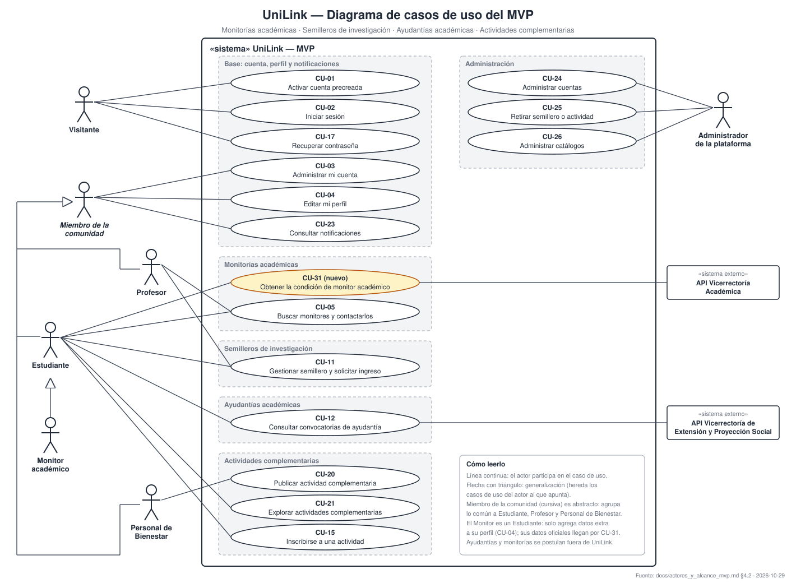

# Informe del proyecto UniLink

**Red Profesional Universitaria — Universidad del Magdalena**
Centro de Interés de Desarrollo Tecnológico e Innovación (CIDTI)

| | |
|---|---|
| **Documento** | Informe de especificación, alcance y arquitectura |
| **Dirigido a** | Profesor tutor del proyecto |
| **Equipo** | Andrés Felipe Gamero, Luis Fernando Barraza, Alfonso Salazar, Andrés Manuel Rudas, Samuel Ospino, Luis Javier Saumeth, Vianney Álvarez, Camila Flórez y José Granado |
| **Versión** | 2.0 — 2026-10-29 |
| **Estado** | Para revisión del tutor |
| **Versión anterior** | [Informe integral detallado (v1.0, 2026-10-27)](./informe_integral_unilink.md), que se conserva como anexo técnico |

### Cómo leer este informe

Cada sección resume un tema en una página o menos y termina con un recuadro **Detalle**, que enlaza a los documentos donde ese tema está especificado por completo. El informe se puede leer de corrido en unos 15 minutos. Los enlaces sirven para profundizar en lo que interese.

## Contenido

1. [Resumen ejecutivo](#1-resumen-ejecutivo)
2. [Problema, objetivo y alcance](#2-problema-objetivo-y-alcance)
3. [Actores del sistema](#3-actores-del-sistema)
4. [Alcance del MVP](#4-alcance-del-mvp)
5. [Requisitos](#5-requisitos)
6. [Arquitectura](#6-arquitectura)
7. [Datos, API y seguridad](#7-datos-api-y-seguridad)
8. [Calidad y pruebas](#8-calidad-y-pruebas)
9. [Plan de implementación](#9-plan-de-implementación)
10. [Estado, riesgos y decisiones pendientes](#10-estado-riesgos-y-decisiones-pendientes)
11. [Mapa de la documentación](#11-mapa-de-la-documentación)

---

## 1. Resumen ejecutivo

**UniLink** es la plataforma de la Universidad del Magdalena que conecta a los estudiantes con la oferta académica y de bienestar de la institución. Su **MVP** se concentra en cuatro líneas: **monitorías académicas, semilleros de investigación, ayudantías académicas y actividades complementarias** de Bienestar Universitario.

| Aspecto | Síntesis |
|---|---|
| **Problema** | Hoy un estudiante que busca un monitor, un semillero, una ayudantía o una actividad complementaria depende de carteleras, grupos de chat y conocidos. La oferta está dispersa y no se sabe quién está disponible. |
| **Usuarios** | Seis actores: Visitante, Estudiante, Monitor académico, Profesor, Personal de Bienestar Universitario y Administrador ([sección 3](#3-actores-del-sistema)). |
| **MVP** | Cuatro líneas de oferta sobre una base de cuenta, perfil, notificaciones y administración. Las monitorías y las ayudantías llegan por API de las vicerrectorías. Son 13 especificaciones funcionales más una nueva, en 6 sprints con 2 de margen ([sección 4](#4-alcance-del-mvp)). |
| **Plataforma** | Aplicación web adaptable (desde 360 px), alojada en servidores de la Universidad. |
| **Arquitectura** | Monolito modular con arquitectura hexagonal en cada módulo. Backend en FastAPI, frontend en React con TypeScript y base de datos PostgreSQL. |
| **Estado** | La especificación del producto completo está en borrador y los contratos de API son válidos. Hay que adaptar 9 specs al MVP acotado y escribir uno nuevo. Todavía no hay código. |
| **Riesgo principal** | El MVP depende de datos institucionales: el directorio de cuentas, la API de monitores y la de ayudantías. Ninguna tiene acceso gestionado todavía, por lo que en el MVP se simulan. A eso se suma la autenticación con el Campus Virtual, pendiente con TI. |

---

## 2. Problema, objetivo y alcance

**Objetivo general del MVP.** Reunir en un solo lugar las monitorías, los semilleros, las ayudantías y las actividades complementarias de la Universidad, para que cada estudiante encuentre y aproveche la oferta que le sirve.

**Objetivos específicos.**

1. Permitir que el estudiante encuentre monitores por área y especialización y los contacte, con los datos oficiales de la Vicerrectoría Académica.
2. Permitir que los profesores conformen sus semilleros de investigación con estudiantes interesados.
3. Reunir las convocatorias de ayudantía de la Vicerrectoría de Extensión y Proyección Social y llevar al estudiante a su proceso de postulación.
4. Publicar las actividades complementarias de Bienestar Universitario con inscripción y control de cupo.
5. Mantener a cada usuario informado con notificaciones, y operar la plataforma con trazabilidad y cumplimiento de la Ley 1581 de 2012.

**Visión del producto completo (después del MVP).** Una red profesional universitaria con conexiones, feed, mensajería y proyectos abiertos, donde cada persona declara qué puede aportar y qué necesita. Ya está especificada en los 22 specs, y el MVP construye su base.

**Restricciones principales.** Un equipo pequeño de estudiantes, Sprint 0 más 8 sprints, infraestructura propia de la Universidad, solo datos institucionales mínimos (correo, nombre, programa o dependencia y estado de monitor) y aprobación jurídica pendiente para producción.

> **Detalle →** [Actores y alcance del MVP](./actores_y_alcance_mvp.md) · [SRS §1 y §2](./srs/Especificacion_Requisitos.md#1-introducción) (producto completo, stakeholders, restricciones y supuestos) · [Análisis del sistema de referencia, Aluna Conecta](./informe_integral_unilink.md#capítulo-3-análisis-del-sistema-de-referencia)

---

## 3. Actores del sistema

El MVP tiene **seis actores humanos**. Los demás nombres que aparecían en el SRS (Autor, Postulante, Organizador…) no son actores distintos: son **papeles** que asume un mismo actor según lo que esté haciendo.

| Actor | Quién es | Qué hace en el MVP |
|---|---|---|
| **Visitante** | Persona sin sesión iniciada | Activa su cuenta precreada, inicia sesión y recupera el acceso. |
| **Estudiante** | Estudiante de un programa. Es el usuario principal. | Busca y contacta monitores, solicita ingreso a semilleros, consulta ayudantías y va a su proceso de postulación, y se inscribe a actividades complementarias. |
| **Monitor académico** | Estudiante que la Vicerrectoría Académica reporta como monitor por API. Su cuenta precreada queda marcada aunque no la haya activado. | Es la cara de las monitorías: su perfil muestra los datos oficiales (área y especialización), a los que solo puede **agregar datos extra**, y aparece en la búsqueda de monitores. Además puede hacer todo lo del Estudiante. |
| **Profesor** | Docente de una facultad y un departamento | **Oferta los semilleros**: los crea, revisa las solicitudes y acepta integrantes. |
| **Personal de Bienestar Universitario** | Funcionario de la dependencia de Bienestar | **Oferta las actividades complementarias**: las publica, controla el cupo y descarga los inscritos. |
| **Administrador de la plataforma** | Personal de la Universidad (no el equipo de desarrollo). También modera. | Gestiona cuentas y catálogos, retira ofertas que incumplan las normas y consulta la auditoría. |

Las cuentas las **precrea la Universidad**: el usuario solo las activa y personaliza. Las vicerrectorías no son actores de UniLink: son **fuentes de datos**. La plataforma se integra con el **directorio institucional**, la **API de la Vicerrectoría Académica** (monitores), la **API de la Vicerrectoría de Extensión y Proyección Social** (ayudantías), el **Campus Virtual** (autenticación) y un **servicio de correo**. Las tres primeras se simulan en el MVP.

> **Detalle →** [Actores y alcance del MVP, secciones 3, 4 y 7](./actores_y_alcance_mvp.md#3-actores-del-mvp): ficha de cada actor, matriz actor × funcionalidad y clasificación de los 29 nombres del SRS

---

## 4. Alcance del MVP

| Línea | Quién la oferta | Qué hace el estudiante | Specs base |
|---|---|---|---|
| **Monitorías académicas** | Vicerrectoría Académica (datos del monitor por API) | Busca un monitor por área y especialización y lo contacta por correo | [USR-06](./modulos/usuarios/specs/FS-USR-06-perfil-profesional.md), [RED-03](./modulos/red/specs/FS-RED-03-busqueda-perfiles.md) |
| **Semilleros de investigación** | Profesor | Solicita ingresar | [COL-05](./modulos/colaboracion/specs/FS-COL-05-espacios-proyectos.md) |
| **Ayudantías académicas** | Vicerrectoría de Extensión y Proyección Social (convocatorias por API) | Consulta la convocatoria y se postula en el proceso de la Vicerrectoría, fuera de UniLink | [COL-02](./modulos/colaboracion/specs/FS-COL-02-postulaciones.md) (reducido) e importación (nuevo) |
| **Actividades complementarias** | Bienestar Universitario | Se inscribe mientras haya cupo | [COL-03](./modulos/colaboracion/specs/FS-COL-03-publicacion-listado-eventos.md), [COL-04](./modulos/colaboracion/specs/FS-COL-04-confirmacion-asistencia.md) |
| **Base** | — | Cuenta, perfil y notificaciones; administración | [USR-01](./modulos/usuarios/specs/FS-USR-01-registro.md), [USR-02](./modulos/usuarios/specs/FS-USR-02-inicio-sesion.md), [USR-03](./modulos/usuarios/specs/FS-USR-03-recuperar-contrasena.md), [USR-05](./modulos/usuarios/specs/FS-USR-05-configuracion-cuenta.md), [USR-08](./modulos/usuarios/specs/FS-USR-08-gestion-cuentas.md), [COM-02](./modulos/comunicacion/specs/FS-COM-02-centro-notificaciones.md), [PLT-01](./modulos/plataforma/specs/FS-PLT-01-gestion-categorias.md) |

**Entran 13 de los 22 specs**, 9 de ellos con adaptaciones (por ejemplo, "evento" pasa a "actividad complementaria" y "proyecto" pasa a "semillero"), más una especificación nueva para importar convocatorias y resultados.

**Casos de uso del MVP: entran 16 de 31.**

| Línea | Casos de uso |
|---|---|
| Base | CU-01 Activar cuenta precreada · CU-02 Iniciar sesión · CU-17 Recuperar contraseña · CU-03 Administrar mi cuenta · CU-04 Editar mi perfil · CU-23 Consultar notificaciones |
| Monitorías | **CU-31 Obtener la condición de monitor académico (nuevo)** · CU-05 Buscar monitores y contactarlos |
| Semilleros | CU-11 Gestionar semillero y solicitar ingreso |
| Ayudantías | CU-12 Consultar convocatorias de ayudantía |
| Actividades complementarias | CU-20 Publicar actividad · CU-21 Explorar actividades · CU-15 Inscribirse a una actividad |
| Administración | CU-24 Administrar cuentas · CU-25 Retirar semillero o actividad · CU-26 Administrar catálogos |

El detalle de qué cambia en cada caso de uso está en [Actores y alcance del MVP, sección 4.2](./actores_y_alcance_mvp.md#42-casos-de-uso-del-mvp).

**Fuera del MVP:**
- Red de conexiones y sugerencias.
- Feed y moderación de publicaciones.
- Mensajería privada.
- Hoja de vida en PDF.
- Preferencias de contenido.
- Proyectos, eventos y oportunidades generales.
- Publicación de ayudantías y gestión de postulaciones dentro de UniLink.
- Horario e inscripción a sesiones de monitoría.
- Usuario externo.
- Módulo de servicios.
- Aplicación nativa.

> **Detalle →** [Actores y alcance del MVP, sección 5](./actores_y_alcance_mvp.md#5-alcance-qué-entra-y-qué-no) (spec por spec, qué cambia y criterio de terminado)

---

## 5. Requisitos

Los requisitos están especificados para el **producto completo**, del cual el MVP toma 13 specs:

| Elemento | Producto completo | En el MVP | Dónde está |
|---|---|---|---|
| Especificaciones funcionales (specs) | 22 | 13 + 1 nueva | [Índice de specs](./modulos/README.md#índice-de-specs) · [specs del MVP](./actores_y_alcance_mvp.md#51-specs-que-entran-al-mvp) |
| Requisitos funcionales | 167 | 101 antes de adaptar (72 de prioridad Alta) | Sección 5 de cada spec · [catálogo](./requisitos_unilink.md#3-requisitos-funcionales) |
| Reglas de negocio | 256 | Por recalcular | Sección 4 de cada spec |
| Escenarios de aceptación (Gherkin) | 253 | Por recalcular | Sección 12 de cada spec |
| Requisitos no funcionales | 64 | 63 (RNF-PRI-04 queda fuera) | [SRS §3.3](./srs/Especificacion_Requisitos.md#33-requisitos-no-funcionales) |
| Escenarios de atributos de calidad | 7 | 7 | [SRS §3.4](./srs/Especificacion_Requisitos.md#34-escenarios-de-atributos-de-calidad) |
| Casos de uso | 26 (más 4 de fase 2) | Por recalcular | [SRS §3.2](./srs/Especificacion_Requisitos.md#32-casos-de-uso) |

**Por módulo:**

| Módulo | Qué resuelve | Specs | Casos de uso |
|---|---|---|---|
| [Usuarios](./modulos/usuarios/README.md) | Cuenta, sesión, configuración, perfil, hoja de vida y gestión de cuentas | 8 | [CU-01, 02, 03, 04, 17, 18, 19, 24](./modulos/usuarios/casos-de-uso.md) |
| [Red](./modulos/red/README.md) | Conexiones, sugerencias y búsqueda | 3 | [CU-05, 06, 07, 13](./modulos/red/casos-de-uso.md) |
| [Contenido](./modulos/contenido/README.md) | Publicaciones, feed y moderación | 2 | [CU-08, 09, 25](./modulos/contenido/casos-de-uso.md) |
| [Comunicación](./modulos/comunicacion/README.md) | Mensajería privada y notificaciones | 2 | [CU-10, 23](./modulos/comunicacion/casos-de-uso.md) |
| [Colaboración](./modulos/colaboracion/README.md) | Oportunidades, eventos y proyectos | 6 | [CU-11, 12, 14, 15, 16, 20, 21, 22](./modulos/colaboracion/casos-de-uso.md) |
| [Plataforma](./modulos/plataforma/README.md) | Categorías, palabras prohibidas y auditoría | 1 | [CU-26](./modulos/plataforma/casos-de-uso.md) |

Cada spec sigue la misma [plantilla](./modulos/_plantilla-spec.md): quién es quién, reglas de negocio, requisitos, datos y validaciones, estados, casos límite y criterios de aceptación.

> **Detalle →** [Catálogo de requisitos](./requisitos_unilink.md) · [Matriz de trazabilidad](./matriz_trazabilidad_unilink.md) (requisito → componente → endpoint → prueba) · [Historias de usuario por módulo](./modulos/README.md)

---

## 6. Arquitectura

**Estilo: monolito modular.** Una sola aplicación desplegable, dividida en seis módulos con fronteras estrictas. Se eligió con una comparación ponderada frente al monolito en capas y a los microservicios. Ofrece la separación de los microservicios sin su costo de operación, que un equipo pequeño de estudiantes no podría sostener.

**Dentro de cada módulo: arquitectura hexagonal.** El dominio no depende del framework ni de la base de datos. Las integraciones (Campus Virtual, admisiones, correo) son adaptadores intercambiables. Por ejemplo, el directorio de admisiones simulado del MVP se cambia por el real sin tocar el resto del sistema.

**Comunicación entre módulos.** Un módulo solo usa a otro por su interfaz pública o por eventos de dominio publicados con una tabla de salida (_outbox_). Las reglas se verifican automáticamente con import-linter.

| Capa | Tecnología | Decisión |
|---|---|---|
| Backend | Python con FastAPI | [ADR-010](./arquitectura/Registro_Decisiones.md#adr-010-lenguaje-y-framework) |
| Frontend | React, TypeScript y Vite | [ADR-018](./arquitectura/Registro_Decisiones.md#adr-018-bibliotecas-y-herramientas-del-frontend) |
| Base de datos | PostgreSQL, un esquema por módulo | [ADR-005](./arquitectura/Registro_Decisiones.md#adr-005-persistencia) |
| Alojamiento | Servidores de la Universidad | [ADR-009](./arquitectura/Registro_Decisiones.md#adr-009-alojamiento) |

| Decisiones aceptadas | Decisiones pendientes |
|---|---|
| [ADR-001](./arquitectura/Registro_Decisiones.md#adr-001-metodología-de-desarrollo) metodología · [002](./arquitectura/Registro_Decisiones.md#adr-002-estilo-arquitectónico) estilo · [003](./arquitectura/Registro_Decisiones.md#adr-003-límites-de-los-módulos-y-dependencias-permitidas) límites · [004](./arquitectura/Registro_Decisiones.md#adr-004-comunicación-entre-módulos) comunicación · [005](./arquitectura/Registro_Decisiones.md#adr-005-persistencia) persistencia · [006](./arquitectura/Registro_Decisiones.md#adr-006-contratos-antes-que-el-código) contratos · [008](./arquitectura/Registro_Decisiones.md#adr-008-búsqueda-de-texto) búsqueda · [009](./arquitectura/Registro_Decisiones.md#adr-009-alojamiento) alojamiento · [010](./arquitectura/Registro_Decisiones.md#adr-010-lenguaje-y-framework) framework · [014](./arquitectura/Registro_Decisiones.md#adr-014-integración-con-la-api-de-admisiones) admisiones simulada · [017](./arquitectura/Registro_Decisiones.md#adr-017-arquitectura-interna-de-los-módulos-hexagonal-con-clean-architecture) hexagonal · [018](./arquitectura/Registro_Decisiones.md#adr-018-bibliotecas-y-herramientas-del-frontend) frontend | [ADR-007](./arquitectura/Registro_Decisiones.md#adr-007-tiempo-real) tiempo real · [011](./arquitectura/Registro_Decisiones.md#adr-011-tareas-en-segundo-plano-y-programadas) tareas · [012](./arquitectura/Registro_Decisiones.md#adr-012-almacenamiento-de-archivos) archivos · [013](./arquitectura/Registro_Decisiones.md#adr-013-autenticación-institucional-y-cuentas-precreadas) autenticación · [015](./arquitectura/Registro_Decisiones.md#adr-015-eliminación-de-cuentas-borrado-lógico) borrado lógico · [016](./arquitectura/Registro_Decisiones.md#adr-016-cliente-móvil-android) Android |

> **Detalle →** [Comparación de alternativas](./arquitectura/Comparacion_Alternativas.md) · [Registro de decisiones (ADR)](./arquitectura/Registro_Decisiones.md) · [Vistas de arquitectura](./arquitectura/Vistas_Arquitectura.md) (módulos, componentes y conectores, despliegue) · [Arquitectura actual y objetivo](./arquitectura_unilink.md) · [Plan de implementación](./arquitectura/Plan_de_Implementacion.md) (estructura de carpetas por módulo)

---

## 7. Datos, API y seguridad

| Tema | Síntesis | Detalle |
|---|---|---|
| **Datos** | Una base relacional con un esquema por módulo y sin claves foráneas entre esquemas, para que cada módulo siga siendo separable. | [Modelo de datos y diccionario](./informe_integral_unilink.md#capítulo-10-arquitectura-de-datos) |
| **API** | 124 operaciones REST en seis contratos OpenAPI 3.1, acordados antes de programar. Red está completo; Usuarios, parcial. | [Contratos de API](../contracts/README.md) · [Inventario de endpoints](./informe_integral_unilink.md#anexo-f-inventario-de-endpoints-especificados) |
| **Eventos** | 25 eventos de dominio con JSON Schema 2020-12. | [Eventos de dominio](../contracts/eventos/README.md) |
| **Autenticación** | Sesión de servidor con cookie `HttpOnly`. La comunidad se autentica con el Campus Virtual (pendiente de validar con TI). | [ADR-013](./arquitectura/Registro_Decisiones.md#adr-013-autenticación-institucional-y-cuentas-precreadas) |
| **Autorización** | Se comprueba en el servidor en cada petición: estado de la cuenta, rol, propiedad del recurso y relación (por ejemplo, ser conexión). | [Seguridad de la API](./arquitectura/seguridad-endpoints.md) |
| **Privacidad** | Ley 1581 de 2012. Ningún rol lee mensajes privados. El borrado lógico está pendiente de validación jurídica. | [SRS §3.3.2](./srs/Especificacion_Requisitos.md#332-privacidad-y-protección-de-datos-personales) · [Seguridad y amenazas](./informe_integral_unilink.md#capítulo-12-seguridad-y-privacidad) |

---

## 8. Calidad y pruebas

Los atributos de calidad que guían la arquitectura son **seguridad, mantenibilidad, rendimiento y disponibilidad**. Cada uno tiene un escenario medible. Por ejemplo, el sistema debe atender cerca de **1.000 usuarios simultáneos**, el pico esperado en las convocatorias de monitores.

| Nivel de prueba | Herramienta | Qué verifica |
|---|---|---|
| Unitarias del dominio | pytest | Las reglas de negocio de cada spec |
| Contrato | OpenAPI y validación de esquemas | Que la API cumpla lo acordado |
| Arquitectura | import-linter | Que ningún módulo viole las fronteras |
| Frontend | Vitest y MSW | Componentes con la API simulada |
| Extremo a extremo | Playwright | Los criterios de aceptación en Gherkin |
| Accesibilidad y rendimiento | axe y Lighthouse CI | WCAG y tiempos de carga |

Un spec solo se da por terminado cuando cumple la [Definition of Done](./sprints/README.md#definition-of-done-un-spec-está-terminado): criterios de aceptación cumplidos, pruebas automatizadas, revisión por otro integrante y despliegue en el entorno de pruebas.

> **Detalle →** [Escenarios de calidad (SRS §3.4)](./srs/Especificacion_Requisitos.md#34-escenarios-de-atributos-de-calidad) · [Verificación (SRS §4)](./srs/Especificacion_Requisitos.md#4-verificación) · [Estrategia de pruebas](./informe_integral_unilink.md#capítulo-14-calidad-y-estrategia-de-pruebas) · [Evaluación arquitectónica](./informe_integral_unilink.md#capítulo-15-atributos-de-calidad-y-evaluación-arquitectónica)

---

## 9. Plan de implementación

| Fase | Contenido | Duración |
|---|---|---|
| **Sprint 0** | Stack, estructura de módulos, modelo de datos base, integración continua y entorno de pruebas | 2 semanas |
| **Sprints 1 a 6** | Base (1 a 3), ayudantías importadas (4), semilleros (5) y actividades complementarias (6) | 12 semanas |
| **Sprints 7 y 8** | Margen: requisitos de prioridad media, pruebas con estudiantes y estabilización | 4 semanas |
| **Después del MVP** | Red, feed, mensajería y proyectos abiertos; luego el módulo de servicios (fase 2) | Por planificar |

**Equipo:**

| Frente | Integrantes |
|---|---|
| Coordinación y specs | Andrés Felipe Gamero, Alfonso Salazar y Vianney Álvarez |
| Backend | Luis Fernando Barraza y Alfonso Salazar (líderes), Samuel Ospino y Luis Javier Saumeth |
| Frontend | Andrés Manuel Rudas (líder), José Granado, Vianney Álvarez y Camila Flórez |

> **Detalle →** [Plan de sprints del MVP acotado](./actores_y_alcance_mvp.md#6-plan-de-sprints-propuesto) · [Sprints: ceremonias, DoR y DoD](./sprints/README.md) · [Sprint 0](./sprints/sprint-00/README.md) · [Plan de implementación](./arquitectura/Plan_de_Implementacion.md)

---

## 10. Estado, riesgos y decisiones pendientes

**Estado.** Los 22 specs están en estado Borrador y ninguno está Aprobado todavía. Los contratos son válidos y el verificador automático de la documentación (`scripts/verificar_docs.py`) pasa sin errores. No hay código.

**Riesgos principales:**

| Riesgo | Impacto | Acción | Ref. |
|---|---|---|---|
| Los specs no reflejan todas las decisiones del 2026-10-19 | Construir algo descartado | Actualizar cada spec antes de aprobarlo, empezando por el Sprint 1 | [H-01](./riesgos_y_brechas_unilink.md#2-matriz-de-hallazgos) |
| Modelo de cuentas: autorregistro en los specs frente a cuentas precreadas en la reunión | Bloquea el Sprint 1 | Cerrar ADR-013 con TI y reescribir USR-01 a USR-03 | [H-02](./riesgos_y_brechas_unilink.md#2-matriz-de-hallazgos) |
| Integración con el Campus Virtual sin especificar | Nadie de la comunidad podría iniciar sesión | Acordar con TI el formato del token | [H-25](./riesgos_y_brechas_unilink.md#2-matriz-de-hallazgos) |
| Borrado lógico frente al derecho de supresión | Incumplimiento legal | Consultar a la Oficina Jurídica | [H-03](./riesgos_y_brechas_unilink.md#2-matriz-de-hallazgos) |
| Disponibilidad del 99,5 % con infraestructura propia | Caídas fuera de horario | Acordar soporte con TI | [H-27](./riesgos_y_brechas_unilink.md#2-matriz-de-hallazgos) |

**Decisiones pendientes más urgentes:**

| Decisión | Con quién | Ref. |
|---|---|---|
| Mecanismo de autenticación con el Campus Virtual | TI de la Universidad | [P-63](./preguntas-abiertas.md), ADR-013 |
| Cómo se asigna el rol de Administrador | Dirección del CIDTI y TI | [P-68](./preguntas-abiertas.md#g-actores-del-mvp) |
| Cómo se identifica al personal de Bienestar | TI y Bienestar Universitario | [P-71](./preguntas-abiertas.md#g-actores-del-mvp) |
| Acceso a las APIs de monitores y de ayudantías | Vicerrectoría Académica y Vicerrectoría de Extensión | [P-72](./preguntas-abiertas.md#g-actores-del-mvp) |
| Si el Usuario externo entra al MVP | Equipo y tutor | [H-04](./riesgos_y_brechas_unilink.md#2-matriz-de-hallazgos) |
| Alcance de la mensajería y del tiempo real | Equipo | [P-56](./preguntas-abiertas.md), [P-16](./preguntas-abiertas.md) |
| Validación jurídica del borrado lógico | Oficina Jurídica | [P-12](./preguntas-abiertas.md) |

> **Detalle →** [Riesgos y brechas (37 hallazgos)](./riesgos_y_brechas_unilink.md) · [Preguntas abiertas](./preguntas-abiertas.md) · [Acta de la reunión del 2026-10-19](./decisiones/2026-10-19-reunion-preguntas-abiertas.md)

---

## 11. Mapa de la documentación

| Si quiere saber… | Lea |
|---|---|
| Qué problema resuelve UniLink y para quién | [SRS §1 y §2](./srs/Especificacion_Requisitos.md) |
| Quiénes son los actores y qué entra al MVP | [Actores y alcance del MVP](./actores_y_alcance_mvp.md) |
| Cómo funciona exactamente una funcionalidad | El spec correspondiente en [Módulos](./modulos/README.md) |
| Qué requisitos hay y de dónde vienen | [Catálogo de requisitos](./requisitos_unilink.md) y [Matriz de trazabilidad](./matriz_trazabilidad_unilink.md) |
| Por qué se eligió esta arquitectura | [Comparación de alternativas](./arquitectura/Comparacion_Alternativas.md) y [ADR](./arquitectura/Registro_Decisiones.md) |
| Cómo se ve la arquitectura | [Vistas de arquitectura](./arquitectura/Vistas_Arquitectura.md) |
| Qué expone cada módulo | [Contratos](../contracts/README.md) |
| Cómo se protege la API | [Seguridad de la API](./arquitectura/seguridad-endpoints.md) |
| Cuándo se construye cada cosa | [Sprints](./sprints/README.md) |
| Qué falta decidir | [Preguntas abiertas](./preguntas-abiertas.md) y [Riesgos y brechas](./riesgos_y_brechas_unilink.md) |
| El análisis completo, capítulo por capítulo | [Informe integral detallado](./informe_integral_unilink.md) (anexo técnico) |
