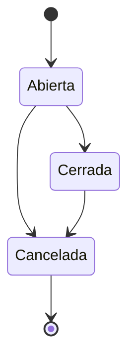

# FS-COL-01 — Publicación de oportunidades

| Campo | Valor |
|---|---|
| **Módulo** | Colaboración (COL) |
| **Estado** | Borrador |
| **Responsable** | Por asignar |
| **Casos de uso** | [CU-22](../casos-de-uso.md#cu-22--publicar-oportunidades-y-gestionar-postulaciones) |
| **Historias** | [HU-29](../historias.md#hu-29) |
| **Última actualización** | 2026-10-24 |

## 1. Objetivo

Permitir que profesores, grupos de investigación, dependencias y estudiantes publiquen oportunidades de investigación, proyectos o voluntariado, y gestionen a los postulantes hasta elegir a quienes participarán.

## 2. Quién es quién

| Actor | Qué hace | Qué ve | Qué no puede hacer |
|---|---|---|---|
| Responsable de oportunidad | Publica, edita, cierra, cancela o elimina; decide postulaciones con retroalimentación. | Sus oportunidades, los postulantes con su perfil completo y su afinidad. | Cambiar la categoría; dejar cupos por debajo de los aceptados; revertir "Aceptada" o "Rechazada"; postularse a lo propio. |
| Postulante | Recibe los cambios de estado. | El estado y la retroalimentación (FS-COL-02). | Ver a los demás postulantes. |
| Sistema | Cierra por fecha o por cupos. | — | — |
| Administrador de la plataforma | Retira oportunidades reportadas (FS-CNT-02). | La oportunidad en la cola. | Decidir postulaciones. |

## 3. Alcance

**Incluye:**

- Crear, editar, cerrar y cancelar oportunidades.
- Habilidades requeridas, para calcular la afinidad con cada postulante.
- Panel del responsable con las postulaciones recibidas.
- Cambio de estado de las postulaciones con retroalimentación.
- Cierre automático por fecha o por cupos completos.
- Moderación de oportunidades con el contrato `Reportable` de [FS-CNT-02](../../contenido/specs/FS-CNT-02-moderacion-contenido.md).

**No incluye:**

- Explorar oportunidades y postularse ([FS-COL-02](./FS-COL-02-postulaciones.md)).
- Oportunidades de empresas externas a la universidad.
- Preguntas personalizadas o formularios para los postulantes.

## 4. Reglas de negocio

| ID | Regla |
|---|---|
| RN-01 | Cualquier usuario autenticado con cuenta activa puede publicar oportunidades y se convierte en su responsable. |
| RN-02 | Toda oportunidad usa una categoría activa de tipo "Oportunidades" ([FS-PLT-01](../../plataforma/specs/FS-PLT-01-gestion-categorias.md)). |
| RN-03 | La fecha de cierre debe ser al menos 1 día después de la publicación y como máximo 6 meses después. |
| RN-04 | Las oportunidades son visibles para todos los usuarios autenticados, sin importar la privacidad del perfil del responsable. |
| RN-05 | **Cierre automático:** la oportunidad se cierra a nuevas postulaciones al llegar la fecha de cierre o cuando el número de postulaciones aceptadas iguala los cupos. |
| RN-06 | **Edición:** mientras esté abierta, el responsable puede editar todo excepto la categoría. Los cupos no pueden quedar por debajo del número de aceptados. Si cambia la descripción o los requisitos, la oportunidad muestra "Actualizada". |
| RN-07 | **Cerrar:** el responsable puede cerrarla antes de tiempo. Las postulaciones pendientes siguen en revisión y él puede seguir decidiéndolas. |
| RN-08 | **Cancelar:** si la oportunidad ya no se realizará, el responsable la cancela indicando el motivo. Las postulaciones "Enviada" y "En revisión" pasan a "Rechazada" con ese motivo como retroalimentación, y sus postulantes son notificados (evento `oportunidad.cancelada`). |
| RN-09 | Una oportunidad sin postulaciones puede eliminarse por completo. Con postulaciones solo puede cancelarse. |
| RN-10 | **Cambios de estado de una postulación:** Enviada → En revisión, Aceptada o Rechazada; En revisión → Aceptada o Rechazada. "Aceptada" y "Rechazada" son definitivos. Cada cambio notifica al postulante. |
| RN-11 | La retroalimentación al rechazar es opcional, pero el sistema la recomienda. Al aceptar, el responsable puede escribir los siguientes pasos. |
| RN-12 | Al aceptar una postulación, se habilita una conversación privada entre el responsable y el postulante aunque no estén conectados ([FS-COM-01](../../comunicacion/specs/FS-COM-01-mensajeria-privada.md)). |
| RN-13 | **Afinidad:** porcentaje de las habilidades requeridas que el postulante tiene entre sus habilidades o su "Puedo aportar" ([FS-USR-06](../../usuarios/specs/FS-USR-06-perfil-profesional.md)). Si la oportunidad no tiene habilidades requeridas, no se muestra afinidad. |
| RN-14 | **Cupos atómicos:** nunca hay más postulaciones aceptadas que cupos, aun con aceptaciones simultáneas. Aceptar en lote más postulantes que cupos disponibles rechaza toda la operación (MSG-07). |
| RN-15 | El título, la descripción y los requisitos se revisan con la lista de palabras prohibidas de [FS-PLT-01](../../plataforma/specs/FS-PLT-01-gestion-categorias.md). La oportunidad es `Reportable`; si se retira, deja de verse y sus postulaciones pendientes pasan a "Rechazada" con el motivo "Oportunidad retirada por moderación". |

## 5. Requisitos funcionales

| ID | Requisito | Prioridad |
|---|---|---|
| RF-01 | El sistema debe ofrecer el botón "Publicar oportunidad" en la sección Oportunidades. | Alta |
| RF-02 | El sistema debe validar y publicar la oportunidad con los datos de la sección 6. | Alta |
| RF-03 | El sistema debe ofrecer al responsable una página "Mis oportunidades publicadas" con cada oportunidad, su estado y el número de postulaciones por estado. | Alta |
| RF-04 | El panel de postulaciones de una oportunidad debe mostrar, por cada postulante: tarjeta de perfil, afinidad (RN-13), mensaje de motivación, fecha y estado, con filtro por estado y orden por afinidad o fecha. | Alta |
| RF-05 | El sistema debe permitir cambiar el estado de una o varias postulaciones a la vez, con retroalimentación opcional (RN-10, RN-11). | Alta |
| RF-06 | El sistema debe permitir editar, cerrar, cancelar y eliminar oportunidades según RN-06 a RN-09. | Alta |
| RF-07 | Una tarea programada debe cerrar las oportunidades que llegan a su fecha de cierre (RN-05). | Alta |
| RF-08 | El responsable debe recibir una notificación por cada postulación nueva y, si lo tiene activado, un correo. | Media |
| RF-09 | En el panel de postulaciones, cada postulación aceptada debe ofrecer "Enviar mensaje" ([FS-COM-01](../../comunicacion/specs/FS-COM-01-mensajeria-privada.md), RF-03). | Alta |

## 6. Datos y validaciones

| Campo | Tipo | Obligatorio | Validación |
|---|---|---|---|
| Título | Texto | Sí | 10 a 120 caracteres. |
| Categoría | Lista | Sí | Categorías activas de tipo "Oportunidades". |
| Descripción | Texto largo | Sí | 50 a 4.000 caracteres. |
| Requisitos | Texto largo | No | Máximo 2.000 caracteres. |
| Habilidades requeridas | Etiquetas | No | Máximo 10, del catálogo de etiquetas de FS-USR-06. |
| Modalidad | Opción | Sí | Presencial, Remota o Híbrida. |
| Dedicación | Número | No | Horas por semana, de 1 a 48. |
| Cupos | Número | Sí | De 1 a 100. |
| Fecha de cierre | Fecha | Sí | RN-03. |

**Categorías semilla de tipo "Oportunidades":** Investigación, Proyectos, Voluntariado, Monitorías, Semilleros.

## 7. Estados



**Estados de la oportunidad:**

| Estado | Entra cuando | Sale hacia |
|---|---|---|
| Abierta | Se publica | **Cerrada** (RN-05, RN-07) o **Cancelada** (RN-08) |
| Cerrada | Fecha de cierre, cupos completos o cierre manual | **Cancelada** |
| Cancelada | El responsable la cancela | Estado final |

**Estados de la postulación** (compartidos con [FS-COL-02](./FS-COL-02-postulaciones.md)): Enviada, En revisión, Aceptada, Rechazada y Retirada. Ver RN-10.

## 8. Flujo principal

1. **Oportunidades** → "Publicar oportunidad" → **Formulario** → "Publicar" → **Detalle de la oportunidad**.
2. **Mis oportunidades publicadas** → selecciona una → **Panel de postulaciones** → selecciona postulantes → "Aceptar", "Rechazar" o "Pasar a revisión".
3. **Detalle de la oportunidad** (como responsable) → "Editar", "Cerrar" o "Cancelar".

## 9. Variaciones

| Variación | Qué cambia | Regla |
|---|---|---|
| Sin habilidades requeridas | No se muestra afinidad. | RN-13 |
| Cierre por fecha, por cupos o manual | Deja de recibir postulaciones; las pendientes se pueden seguir decidiendo. | RN-05, RN-07 |
| Cancelación | Las pendientes pasan a "Rechazada" con el motivo. | RN-08 |
| Sin postulaciones | Se puede eliminar. | RN-09 |
| Oportunidad de un estudiante | Se publica igual (pendiente de P-36). | RN-01, P-36 |

## 10. ¿Qué pasaría si…?

| Situación | Comportamiento esperado | Regla o pregunta |
|---|---|---|
| Acepta a la vez el último cupo en dos pestañas | Solo una aceptación tiene efecto; la otra ve MSG-05. | RN-14, EC-04 |
| Acepta en lote más postulantes que cupos | Se rechaza todo el lote con MSG-07. | RN-14 |
| Un postulante se postula justo cuando se llena el cupo | Su postulación se rechaza con MSG-03 de FS-COL-02. | RN-05 |
| El responsable edita mientras un postulante se postula | La postulación usa la versión vigente; las ediciones concurrentes reciben un conflicto. | RNF-CON-02 |
| La cuenta del responsable se suspende | La oportunidad deja de verse; qué pasa con sus postulaciones depende de P-51. | P-51 |
| La oportunidad se retira por moderación | Sus pendientes pasan a "Rechazada" con el motivo de moderación. | RN-15 |
| Falla la tarea de cierre por fecha | Al volver se cierran las vencidas; no se aceptan postulaciones después de la fecha (se comprueba al postularse). | RN-05 |
| Privacidad: el responsable ve el perfil completo de un postulante privado | Solo mientras la postulación exista (FS-COL-02 RN-05). | FS-COL-02 |

## 11. Mensajes al usuario

| Código | Situación | Mensaje |
|---|---|---|
| MSG-01 | Oportunidad publicada | "Tu oportunidad está publicada. Te avisaremos cuando lleguen postulaciones." |
| MSG-02 | Fecha de cierre inválida | "La fecha de cierre debe estar entre mañana y dentro de 6 meses." |
| MSG-03 | Cupos menores que aceptados | "Ya aceptaste a {n} personas; los cupos no pueden ser menos." |
| MSG-04 | Confirmar cancelación | "Se rechazarán {n} postulaciones pendientes y se notificará a sus postulantes. ¿Cancelar la oportunidad?" |
| MSG-05 | Cupos completos | "Completaste los {n} cupos. La oportunidad se cerró a nuevas postulaciones." |
| MSG-06 | Recomendación de retroalimentación | "Contarle al postulante por qué no fue elegido le ayuda a mejorar. ¿Quieres agregar un comentario?" |
| MSG-07 | Lote mayor que los cupos | "Solo quedan {n} cupos. Selecciona como máximo {n} postulaciones para aceptar." |

## 12. Resultado esperado

```gherkin
Escenario: Publicar una oportunidad
  Dado que soy un usuario autenticado
  Cuando publico una oportunidad de "Investigación" con 3 cupos y cierre en 15 días
  Entonces veo el mensaje MSG-01
  Y la oportunidad aparece en la sección Oportunidades para todos los usuarios

Escenario: Afinidad de un postulante
  Dado que mi oportunidad requiere "Python", "Estadística" y "R"
  Y Ana tiene "Python" en habilidades y "Estadística" en "Puedo aportar"
  Cuando veo su postulación
  Entonces su afinidad es 67 %

Escenario: Aceptar y completar cupos
  Dado que mi oportunidad tiene 2 cupos y ya acepté a 1 persona
  Cuando acepto a otra
  Entonces veo el mensaje MSG-05
  Y la oportunidad pasa a "Cerrada"
  Y nadie más puede postularse

Escenario: Aceptar habilita la conversación
  Dado que no estoy conectado con Ana
  Cuando acepto su postulación
  Entonces Ana recibe una notificación
  Y podemos enviarnos mensajes privados

Escenario: Estados definitivos
  Dado que rechacé la postulación de Pedro
  Entonces no puedo cambiarla a "Aceptada"

Escenario: Cancelar con postulaciones pendientes
  Dado que mi oportunidad tiene 4 postulaciones "En revisión"
  Cuando la cancelo con el motivo "Se canceló la financiación del proyecto"
  Entonces las 4 pasan a "Rechazada" con ese motivo
  Y sus postulantes reciben una notificación

Escenario: Cierre por fecha
  Dado que mi oportunidad cierra hoy
  Cuando se ejecuta la tarea programada
  Entonces la oportunidad pasa a "Cerrada"
  Y sigo pudiendo decidir las postulaciones pendientes

Escenario: Último cupo en dos pestañas
  Dado que mi oportunidad tiene 1 cupo libre
  Cuando acepto a Ana y a Pedro al mismo tiempo desde dos pestañas
  Entonces solo una de las dos postulaciones queda "Aceptada"

Escenario: Lote mayor que los cupos
  Dado que mi oportunidad tiene 2 cupos libres
  Cuando selecciono 3 postulaciones y pulso "Aceptar"
  Entonces veo el mensaje MSG-07
  Y ninguna de las 3 cambia de estado

Escenario: Oportunidad retirada
  Dado que mi oportunidad tiene 2 postulaciones "Enviada"
  Cuando un administrador la retira por moderación
  Entonces las 2 pasan a "Rechazada" con el motivo "Oportunidad retirada por moderación"

Escenario: Mensaje a un postulante aceptado
  Dado que acepté la postulación de Ana
  Cuando abro el panel de postulaciones
  Entonces veo "Enviar mensaje" junto a Ana
```

## 13. Contratos

**Expone:**

- API: `POST /api/v1/colaboracion/oportunidades`, `GET`, `PUT` y `DELETE /api/v1/colaboracion/oportunidades/{id}`, `POST /api/v1/colaboracion/oportunidades/{id}/cierre`, `POST /api/v1/colaboracion/oportunidades/{id}/cancelacion`, `GET /api/v1/colaboracion/oportunidades/{id}/postulaciones`, `POST /api/v1/colaboracion/oportunidades/{id}/postulaciones/decision` ([contrato](../../../../contracts/api/colaboracion.yaml)).
- Interfaz pública: si dos usuarios tienen una postulación aceptada ([interfaz](../../../../contracts/modulos/colaboracion.md)).
- `Reportable` para "oportunidad".
- Eventos: `postulacion.estado_cambiado`, `oportunidad.cancelada` ([catálogo](../../../../contracts/eventos/README.md)).

**Consume:** Usuarios (afinidad y datos públicos), Plataforma (categorías y palabras prohibidas).

## 14. Calidad

RNF-CON-01, RNF-CON-02, [EC-04](../../../srs/Especificacion_Requisitos.md#34-escenarios-de-atributos-de-calidad).

## 15. Preguntas abiertas

- P-36 — ¿quién puede publicar oportunidades?
- P-37 — ¿sugerir oportunidades por afinidad?
- P-51 — oportunidades de un responsable que deja de estar activo.

## 16. Lista de revisión

- [x] Cada actor de "Quién es quién" existe en el [SRS §2.4](../../../srs/Especificacion_Requisitos.md#24-actores-del-sistema) con el mismo nombre.
- [x] Toda acción tiene un actor que puede hacerla y se valida en el servidor (RNF-SEG-04).
- [ ] Cada regla tiene al menos un escenario en "Resultado esperado".
- [x] "¿Qué pasaría si…?" revisó las siete situaciones: concurrencia, estado de la cuenta, eliminación de lo que usa, pérdida de permiso, falla externa, límites de uso y privacidad.
- [ ] Ningún dato se recoge sin finalidad (RNF-PRI-01).
- [x] No contradice a su caso de uso, a su historia ni a otro spec.
- [x] Sus contratos existen en [`contracts/`](../../../../contracts/README.md).
- [ ] No tiene preguntas abiertas que bloqueen el desarrollo.

## 17. Historial de cambios

| Fecha | Autor | Cambio |
|---|---|---|
| 2026-10-06 | Gamero | Creación |
| 2026-10-24 | Equipo UniLink | Estudio de quién es quién, variaciones, casos límite y contratos; nueva plantilla. |
