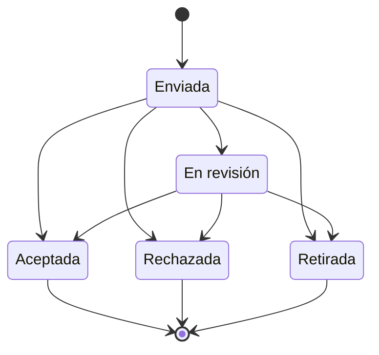

# FS-COL-02 — Postulaciones

| Campo | Valor |
|---|---|
| **Módulo** | Colaboración (COL) |
| **Estado** | Borrador |
| **Responsable** | Por asignar |
| **Casos de uso** | [CU-12](../casos-de-uso.md#cu-12--explorar-oportunidades), [CU-14](../casos-de-uso.md#cu-14--gestionar-estado-de-postulaciones) |
| **Historias** | [HU-12](../historias.md#hu-12), [HU-25](../historias.md#hu-25) |
| **Última actualización** | 2026-10-24 |

## 1. Objetivo

Ayudar a cada usuario a encontrar las oportunidades que mejor encajan con su perfil, postularse en pocos pasos y saber en todo momento en qué va cada postulación.

## 2. Quién es quién

| Actor | Qué hace | Qué ve | Qué no puede hacer |
|---|---|---|---|
| Postulante | Explora, se postula con motivación, sigue el estado y se retira. | Las oportunidades abiertas con su afinidad; sus postulaciones con historial y retroalimentación. | Postularse dos veces a la misma, a una cerrada o a la propia; volver a postularse tras retirarse. |
| Responsable de oportunidad | Recibe la postulación. | El perfil completo del postulante mientras la postulación exista. | — |

## 3. Alcance

**Incluye:**

- Sección Oportunidades con búsqueda, filtros y orden por afinidad.
- Detalle de una oportunidad.
- Postulación con mensaje de motivación.
- Panel "Mis postulaciones" con estado, historial y retroalimentación.
- Retirar una postulación.

**No incluye:**

- Publicar oportunidades y decidir postulaciones ([FS-COL-01](./FS-COL-01-publicacion-oportunidades.md)).
- Adjuntar archivos o la hoja de vida a la postulación: el responsable consulta el perfil del postulante.
- Guardar oportunidades como favoritas.

## 4. Reglas de negocio

| ID | Regla |
|---|---|
| RN-01 | Solo se puede postular a oportunidades en estado "Abierta". |
| RN-02 | Un usuario solo puede tener una postulación por oportunidad. Si la retira, no puede volver a postularse a la misma. |
| RN-03 | El responsable no puede postularse a su propia oportunidad. |
| RN-04 | La postulación exige un mensaje de motivación de 50 a 1.000 caracteres. |
| RN-05 | El responsable ve el perfil completo del postulante, sin importar su configuración de privacidad, mientras la postulación exista. |
| RN-06 | La afinidad se calcula igual que en [FS-COL-01](./FS-COL-01-publicacion-oportunidades.md), RN-13, y se muestra al postulante en cada oportunidad. |
| RN-07 | El postulante puede retirar su postulación mientras esté "Enviada" o "En revisión". Pasa a "Retirada" y el responsable es notificado. |
| RN-08 | Cada cambio de estado queda en el historial de la postulación con su fecha y, si existe, la retroalimentación del responsable. |
| RN-09 | Por defecto, la sección Oportunidades muestra solo las abiertas, ordenadas por afinidad y, a igual afinidad, por fecha de cierre más próxima. |
| RN-10 | Al postularse se comprueba de nuevo que la oportunidad siga abierta y con cupo; si no, MSG-03. |

## 5. Requisitos funcionales

| ID | Requisito | Prioridad |
|---|---|---|
| RF-01 | El sistema debe ofrecer la sección "Oportunidades" en el menú principal. | Alta |
| RF-02 | La sección debe mostrar cada oportunidad como tarjeta: título, responsable, categoría, modalidad, cupos disponibles, días para el cierre y afinidad. | Alta |
| RF-03 | La sección debe permitir buscar por texto y filtrar por categoría, modalidad, habilidad requerida y "Solo con afinidad mayor al 50 %". También debe permitir ordenar por afinidad, más recientes o cierre más próximo. | Alta |
| RF-04 | El detalle debe mostrar todos los datos de la oportunidad, el perfil resumido del responsable, las habilidades requeridas marcando cuáles tiene el usuario, y el botón "Postularme" o el estado de la postulación existente. | Alta |
| RF-05 | Al postularse, el sistema debe pedir el mensaje de motivación, confirmar el envío y notificar al responsable. | Alta |
| RF-06 | El sistema debe ofrecer el panel "Mis postulaciones" con cada postulación: oportunidad, responsable, fecha y estado como etiqueta de color, con filtro por estado. | Alta |
| RF-07 | Al abrir una postulación, el sistema debe mostrar el historial de estados con la retroalimentación (RN-08) y la opción "Retirar postulación" cuando aplique (RN-07). Si la postulación está aceptada, ofrece "Enviar mensaje" al responsable ([FS-COM-01](../../comunicacion/specs/FS-COM-01-mensajeria-privada.md), RF-03). | Alta |
| RF-08 | El sistema debe mostrar un mensaje con enlace a la sección Oportunidades cuando el usuario no tenga postulaciones. | Media |

## 6. Datos y validaciones

| Campo | Tipo | Obligatorio | Validación |
|---|---|---|---|
| Mensaje de motivación | Texto largo | Sí | RN-04. |

**Colores de las etiquetas de estado** (siempre acompañados del texto, para no depender solo del color):

| Estado | Color |
|---|---|
| Enviada | Gris |
| En revisión | Azul |
| Aceptada | Verde |
| Rechazada | Rojo |
| Retirada | Gris tachado |

## 7. Estados



| Estado | Entra cuando | Sale hacia |
|---|---|---|
| Enviada | El usuario se postula | **En revisión**, **Aceptada**, **Rechazada** (responsable) o **Retirada** (postulante) |
| En revisión | El responsable la revisa | **Aceptada**, **Rechazada** o **Retirada** |
| Aceptada | Decisión del responsable | Estado final |
| Rechazada | Decisión del responsable o cancelación de la oportunidad | Estado final |
| Retirada | El postulante la retira | Estado final |

## 8. Flujo principal

1. **Menú principal** → "Oportunidades" → filtra o busca → selecciona una → **Detalle**.
2. **Detalle** → "Postularme" → escribe la motivación → "Enviar postulación" → el detalle muestra "Enviada".
3. **Menú del usuario** → "Mis postulaciones" → selecciona una → **Historial** → "Retirar postulación" (opcional).

## 9. Variaciones

| Variación | Qué cambia | Regla |
|---|---|---|
| Perfil "Solo mis conexiones" | El responsable lo ve completo mientras exista la postulación. | RN-05 |
| Postulación aceptada | Habilita la conversación con el responsable. | RF-07 |
| Postulación retirada | No puede volver a postularse. | RN-02, RN-07 |
| Sin postulaciones | MSG-05 con enlace a Oportunidades. | RF-08 |

## 10. ¿Qué pasaría si…?

| Situación | Comportamiento esperado | Regla o pregunta |
|---|---|---|
| Se postula dos veces por un reintento | Se crea una sola postulación. | RN-02, RNF-CON-03 |
| Se postula justo cuando cierra o se llena | MSG-03. | RN-10 |
| Retira la postulación mientras el responsable la acepta | Gana la primera operación; la otra ve el estado actual. | RN-07, RNF-CON-02 |
| La oportunidad se cancela o se retira | La postulación pendiente pasa a "Rechazada" con el motivo. | FS-COL-01 RN-08, RN-15 |
| La cuenta del postulante se suspende | Qué pasa con sus postulaciones depende de P-51. | P-51 |
| Falla la notificación al responsable | La postulación existe igual; el aviso se reintenta. | RNF-CON-04 |
| Privacidad: el responsable deja de ver el perfil privado al eliminarse la postulación | Al retirarse, el responsable vuelve a ver solo lo público. | RN-05 |

## 11. Mensajes al usuario

| Código | Situación | Mensaje |
|---|---|---|
| MSG-01 | Postulación enviada | "Te postulaste a \"{título}\". Te avisaremos cuando {responsable} la revise." |
| MSG-02 | Ya postulado | "Ya te postulaste a esta oportunidad. Estado: {estado}." |
| MSG-03 | Oportunidad cerrada | "Esta oportunidad ya no recibe postulaciones." |
| MSG-04 | Confirmar retiro | "Si retiras tu postulación no podrás volver a postularte a esta oportunidad. ¿Retirarla?" |
| MSG-05 | Sin postulaciones | "Aún no te has postulado a ninguna oportunidad. Explora las que encajan con tu perfil." |
| MSG-06 | Sin resultados | "No hay oportunidades abiertas con estos filtros." |
| MSG-07 | Ayuda de motivación | "Cuéntale al responsable por qué te interesa y qué puedes aportar." |

## 12. Resultado esperado

```gherkin
Escenario: Orden por afinidad
  Dado que tengo las habilidades "Python" y "Estadística"
  Y hay una oportunidad que requiere ambas y otra que requiere "Diseño gráfico"
  Cuando abro la sección Oportunidades
  Entonces la que requiere Python y Estadística aparece primero con 100 % de afinidad

Escenario: Postularse
  Dado que veo una oportunidad abierta
  Cuando me postulo con un mensaje de motivación de 120 caracteres
  Entonces veo el mensaje MSG-01
  Y la postulación aparece en "Mis postulaciones" como "Enviada"
  Y el responsable recibe una notificación

Escenario: Motivación muy corta
  Dado que me estoy postulando
  Cuando escribo un mensaje de 20 caracteres
  Entonces no puedo enviar la postulación

Escenario: Postulación repetida
  Dado que ya me postulé a una oportunidad
  Cuando abro su detalle
  Entonces veo el mensaje MSG-02 en lugar del botón "Postularme"

Escenario: Seguimiento con retroalimentación
  Dado que el responsable rechazó mi postulación con un comentario
  Cuando abro la postulación en "Mis postulaciones"
  Entonces veo el estado "Rechazada" con el comentario y la fecha
  Y veo el historial completo de estados

Escenario: Retirar postulación
  Dado que mi postulación está "En revisión"
  Cuando la retiro y confirmo
  Entonces pasa a "Retirada"
  Y el responsable recibe una notificación
  Y no puedo volver a postularme a esa oportunidad

Escenario: Perfil privado visible para el responsable
  Dado que mi perfil es "Solo mis conexiones" y no estoy conectado con el responsable
  Cuando me postulo
  Entonces el responsable puede ver mi perfil completo

Escenario: Sin postulaciones
  Dado que nunca me he postulado
  Cuando abro "Mis postulaciones"
  Entonces veo el mensaje MSG-05 con un enlace a Oportunidades

Escenario: Postulación repetida por reintento
  Dado que envío mi postulación y la conexión se corta
  Cuando el navegador reenvía la misma petición
  Entonces tengo una sola postulación

Escenario: Oportunidad que se llena mientras escribo
  Dado que estoy escribiendo mi motivación
  Cuando la oportunidad completa sus cupos antes de que envíe
  Entonces veo el mensaje MSG-03

Escenario: Retirar y aceptar a la vez
  Dado que retiro mi postulación en el momento en que el responsable la acepta
  Entonces solo una de las dos acciones tiene efecto
  Y ambos vemos el estado final

Escenario: Mensaje al responsable tras ser aceptado
  Dado que mi postulación fue aceptada
  Cuando abro la postulación en "Mis postulaciones"
  Entonces veo "Enviar mensaje"
```

## 13. Contratos

**Expone:**

- API: `GET /api/v1/colaboracion/oportunidades` (exploración), `POST /api/v1/colaboracion/oportunidades/{id}/postulaciones`, `GET /api/v1/colaboracion/postulaciones` (mis postulaciones), `GET /api/v1/colaboracion/postulaciones/{id}`, `POST /api/v1/colaboracion/postulaciones/{id}/retiro` ([contrato](../../../../contracts/api/colaboracion.yaml)).
- Eventos: `postulacion.creada`, `postulacion.retirada` ([catálogo](../../../../contracts/eventos/README.md)).

**Consume:** Usuarios (afinidad y datos públicos).

## 14. Calidad

RNF-CON-02, RNF-CON-03, RNF-ACC-04 (estados con texto y color).

## 15. Preguntas abiertas

- P-38 — ¿limitar postulaciones activas?
- P-51 — postulaciones de cuentas que dejan de estar activas.

## 16. Lista de revisión

- [x] Cada actor de "Quién es quién" existe en el [SRS §2.4](../../../srs/Especificacion_Requisitos.md#24-actores-del-sistema) con el mismo nombre.
- [x] Toda acción tiene un actor que puede hacerla y se valida en el servidor (RNF-SEG-04).
- [ ] Cada regla tiene al menos un escenario en "Resultado esperado".
- [x] "¿Qué pasaría si…?" revisó las siete situaciones: concurrencia, estado de la cuenta, eliminación de lo que usa, pérdida de permiso, falla externa, límites de uso y privacidad.
- [ ] Ningún dato se recoge sin finalidad (RNF-PRI-01).
- [x] No contradice a su caso de uso, a su historia ni a otro spec.
- [x] Sus contratos existen en [`contracts/`](../../../../contracts/README.md).
- [ ] No tiene preguntas abiertas que bloqueen el desarrollo.

## 17. Historial de cambios

| Fecha | Autor | Cambio |
|---|---|---|
| 2026-10-06 | Gamero | Creación |
| 2026-10-24 | Equipo UniLink | Estudio de quién es quién, variaciones, casos límite y contratos; nueva plantilla. |
