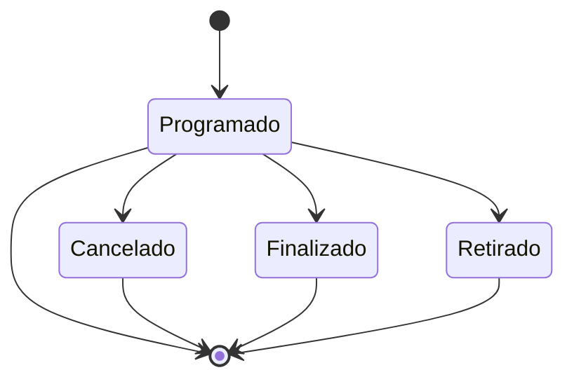

# FS-COL-03 — Publicación y listado de eventos

| Campo | Valor |
|---|---|
| **Módulo** | Colaboración (COL) |
| **Estado** | Borrador |
| **Responsable** | Por asignar |
| **Casos de uso** | [CU-20](../casos-de-uso.md#cu-20--publicar-evento), [CU-21](../casos-de-uso.md#cu-21--visualizar-eventos) |
| **Historias** | [HU-15](../historias.md#hu-15), [HU-16](../historias.md#hu-16) |
| **Última actualización** | 2026-10-24 |

## 1. Objetivo

Reunir en un solo lugar los eventos de la comunidad universitaria (charlas, talleres, ferias, actividades culturales y deportivas) para que cualquiera pueda darlos a conocer y cada usuario encuentre los que le interesan.

## 2. Quién es quién

| Actor | Qué hace | Qué ve | Qué no puede hacer |
|---|---|---|---|
| Organizador | Publica, edita hasta el inicio, cancela o elimina sus eventos. | Sus eventos con asistentes y estado. | Editar un evento que ya empezó; bajar el cupo por debajo de los confirmados; eliminar con asistentes. |
| Usuario | Explora, filtra y reporta eventos. | Todos los eventos; el enlace virtual solo si confirmó. | Ver el enlace sin confirmar asistencia. |
| Denunciante | Reporta un evento (FS-CNT-02). | — | Reportar el propio. |
| Sistema | Marca "Finalizado" al llegar la hora de fin. | — | — |

## 3. Alcance

**Incluye:**

- Crear, editar, cancelar y eliminar eventos presenciales, virtuales o híbridos.
- Cupo opcional y foto de portada.
- Apartado de eventos con filtros y vista de eventos pasados.
- Reportar eventos, usando el mecanismo de [FS-CNT-02](../../contenido/specs/FS-CNT-02-moderacion-contenido.md).

**No incluye:**

- Confirmar asistencia, lista de asistentes y calendario ([FS-COL-04](./FS-COL-04-confirmacion-asistencia.md)).
- Eventos que se repiten (por ejemplo, cada semana).
- Venta de entradas o inscripción con pago.
- Mostrar los eventos dentro del feed.

## 4. Reglas de negocio

| ID | Regla |
|---|---|
| RN-01 | Cualquier usuario autenticado puede publicar eventos y se convierte en su organizador. |
| RN-02 | Todo evento usa una categoría activa de tipo "Eventos" ([FS-PLT-01](../../plataforma/specs/FS-PLT-01-gestion-categorias.md)). |
| RN-03 | La fecha de inicio debe ser al menos 1 hora después del momento de publicación y como máximo 1 año después. La hora de fin debe ser posterior a la de inicio y el evento no puede durar más de 7 días. |
| RN-04 | Según la modalidad: los eventos presenciales exigen lugar; los virtuales exigen enlace; los híbridos exigen ambos. |
| RN-05 | El enlace de un evento virtual o híbrido solo lo ven el organizador y quienes confirmaron asistencia ([FS-COL-04](./FS-COL-04-confirmacion-asistencia.md)). |
| RN-06 | Los eventos son visibles para todos los usuarios autenticados, sin importar la privacidad del perfil del organizador. |
| RN-07 | **Edición:** el organizador puede editar el evento hasta que comience. Si cambia la fecha, la hora, el lugar o el enlace, se notifica a los asistentes confirmados. El cupo no puede quedar por debajo del número de confirmados. |
| RN-08 | **Cancelación:** el organizador puede cancelar un evento que no ha comenzado, indicando el motivo. El evento sigue visible marcado como "Cancelado" y se notifica a los asistentes confirmados. |
| RN-09 | Un evento sin asistentes confirmados puede eliminarse por completo. Con asistentes solo puede cancelarse. |
| RN-10 | Un evento pasa a "Finalizado" automáticamente al llegar su hora de fin. |
| RN-11 | Los eventos se pueden reportar con las mismas reglas que las publicaciones ([FS-CNT-02](../../contenido/specs/FS-CNT-02-moderacion-contenido.md)). Si un administrador retira un evento, se notifica al organizador y a los asistentes confirmados (evento `evento.retirado`). El evento implementa el contrato `Reportable` y sus textos se revisan con las palabras prohibidas de [FS-PLT-01](../../plataforma/specs/FS-PLT-01-gestion-categorias.md). |
| RN-12 | El apartado de eventos muestra por defecto los próximos eventos no cancelados, del más cercano al más lejano. |
| RN-13 | En "Próximos", los eventos de las categorías de interés del usuario ([FS-USR-04](../../usuarios/specs/FS-USR-04-preferencias-contenido.md)) aparecen primero en una franja "Para ti" (hasta 5); el resto sigue el orden de RN-12. |

## 5. Requisitos funcionales

| ID | Requisito | Prioridad |
|---|---|---|
| RF-01 | El sistema debe ofrecer la sección "Eventos" en el menú principal, con el botón "Publicar evento". | Alta |
| RF-02 | El sistema debe validar y publicar el evento con los datos de la sección 6. | Alta |
| RF-03 | El apartado debe mostrar cada evento como tarjeta: portada, fecha y hora, título, modalidad y lugar, categoría y número de asistentes confirmados. | Alta |
| RF-04 | El apartado debe permitir filtrar por categoría, modalidad y periodo (Hoy, Esta semana, Este mes, Todas las fechas) y buscar por texto. | Alta |
| RF-05 | El apartado debe tener las pestañas "Próximos", "Mis eventos" (los que organizo y a los que asistiré) y "Pasados". | Media |
| RF-06 | El detalle del evento debe mostrar todos sus datos, el organizador y, si aplica, la etiqueta "Cancelado" con el motivo o "Finalizado". | Alta |
| RF-07 | El sistema debe permitir al organizador editar, cancelar y eliminar según RN-07 a RN-09. | Alta |
| RF-08 | El menú "…" del evento debe ofrecer "Reportar" a los demás usuarios (RN-11). | Media |
| RF-09 | El perfil del organizador debe mostrar una pestaña "Eventos" con los que ha publicado. | Baja |

## 6. Datos y validaciones

| Campo | Tipo | Obligatorio | Validación |
|---|---|---|---|
| Título | Texto | Sí | 5 a 120 caracteres. |
| Descripción | Texto largo | Sí | 20 a 3.000 caracteres. |
| Categoría | Lista | Sí | Categorías activas de tipo "Eventos". |
| Fecha y hora de inicio | Fecha y hora | Sí | RN-03. Hora de Colombia. |
| Fecha y hora de fin | Fecha y hora | Sí | RN-03. |
| Modalidad | Opción | Sí | Presencial, Virtual o Híbrida. |
| Lugar | Texto | Según RN-04 | 3 a 150 caracteres (por ejemplo, "Edificio Ernestina Lozano, auditorio"). |
| Enlace | URL | Según RN-04 | URL válida que empiece por `https://`. |
| Cupo | Número | No | De 1 a 5.000. Vacío significa sin límite. |
| Portada | Imagen | No | JPG, PNG o WebP de máximo 5 MB, con descripción opcional para lectores de pantalla ([RNF-ACC-05](../../../srs/Especificacion_Requisitos.md#336-accesibilidad)). Si no hay, se usa una imagen por categoría. |

## 7. Estados



| Estado | Entra cuando | Sale hacia |
|---|---|---|
| Programado | Se publica | **Cancelado** (RN-08), **Finalizado** (RN-10) o **Retirado** (RN-11) |
| Cancelado | El organizador lo cancela | Estado final |
| Finalizado | Llega la hora de fin | Estado final |
| Retirado | Un administrador lo retira | Estado final |

## 8. Flujo principal

1. **Eventos** → "Publicar evento" → **Formulario** → "Publicar" → **Detalle del evento**.
2. **Eventos** → filtra o busca → selecciona una tarjeta → **Detalle**.
3. **Detalle** (como organizador) → "Editar" o "Cancelar evento".

## 9. Variaciones

| Variación | Qué cambia | Regla |
|---|---|---|
| Presencial, virtual o híbrido | Exige lugar, enlace o ambos. | RN-04 |
| Con o sin cupo | Sin cupo = sin límite. | Sección 6 |
| Con categorías de interés | Franja "Para ti" en Próximos. | RN-13 |
| Cancelado | Sigue visible con el motivo. | RN-08 |
| Finalizado | Pasa a "Pasados". | RN-10 |
| Retirado por moderación | Deja de verse; se avisa a los asistentes. | RN-11 |

## 10. ¿Qué pasaría si…?

| Situación | Comportamiento esperado | Regla o pregunta |
|---|---|---|
| El organizador cambia el lugar mientras alguien confirma | La confirmación vale; el asistente recibe el aviso del cambio. | RN-07 |
| Baja el cupo mientras llegan confirmaciones | El cupo nunca queda por debajo de los confirmados (MSG-05). | RN-07, RNF-CON-01 |
| La cuenta del organizador se suspende | El evento deja de verse; qué pasa con sus asistentes depende de P-51. | P-51 |
| Se retira por moderación con asistentes | Se notifica a todos (`evento.retirado`). | RN-11 |
| Falla la tarea que marca "Finalizado" | El estado se calcula con la hora de fin: nadie puede confirmar después del inicio. | RN-10, FS-COL-04 RN-01 |
| Falla el almacenamiento de la portada | Se publica con la imagen por categoría. | Sección 6 |
| Privacidad: el enlace virtual | Solo lo ven el organizador y los asistentes. | RN-05 |

## 11. Mensajes al usuario

| Código | Situación | Mensaje |
|---|---|---|
| MSG-01 | Evento publicado | "Tu evento está publicado. Compártelo con tu red." |
| MSG-02 | Fecha inválida | "El evento debe empezar al menos 1 hora después de ahora y como máximo en un año, y terminar después de empezar." |
| MSG-03 | Falta lugar o enlace | "Para un evento {modalidad} debes indicar {lugar / enlace / lugar y enlace}." |
| MSG-04 | Confirmar cancelación | "Avisaremos a las {n} personas que confirmaron asistencia. ¿Cancelar el evento?" |
| MSG-05 | Cupo menor que confirmados | "Ya hay {n} personas confirmadas; el cupo no puede ser menor." |
| MSG-06 | Sin eventos | "No hay eventos próximos con estos filtros." |
| MSG-07 | Enlace oculto | "Confirma tu asistencia para ver el enlace del evento." |

## 12. Resultado esperado

```gherkin
Escenario: Publicar un evento presencial
  Dado que soy un usuario autenticado
  Cuando publico un evento presencial con título, descripción, categoría, fecha futura, hora de fin y lugar
  Entonces veo el mensaje MSG-01
  Y el evento aparece en "Próximos" para todos los usuarios

Escenario: Evento virtual sin enlace
  Dado que estoy creando un evento virtual
  Cuando intento publicarlo sin enlace
  Entonces veo el mensaje MSG-03

Escenario: Enlace solo para asistentes
  Dado que hay un evento virtual al que no he confirmado asistencia
  Cuando abro su detalle
  Entonces no veo el enlace y veo el mensaje MSG-07

Escenario: Cambio de lugar
  Dado que organizo un evento con 20 asistentes confirmados
  Cuando cambio el lugar
  Entonces los 20 asistentes reciben una notificación del cambio

Escenario: Cancelar un evento
  Dado que organizo un evento con asistentes confirmados
  Cuando lo cancelo con un motivo
  Entonces el evento se muestra como "Cancelado" con el motivo
  Y los asistentes reciben una notificación
  Y desaparece de "Próximos"

Escenario: Filtrar por periodo
  Dado que hay un evento hoy y otro el próximo mes
  Cuando filtro por "Esta semana"
  Entonces solo veo el evento de hoy

Escenario: Evento finalizado
  Dado que la hora de fin de un evento ya pasó
  Entonces el evento aparece en "Pasados" como "Finalizado"
  Y ya no se puede editar ni cancelar

Escenario: Reportar un evento
  Dado que veo un evento inapropiado
  Cuando lo reporto
  Entonces aparece en la cola de moderación con las mismas reglas que las publicaciones

Escenario: Franja "Para ti"
  Dado que me interesa la categoría "Culturales"
  Y hay 3 eventos culturales próximos
  Cuando abro "Próximos"
  Entonces veo esos 3 eventos primero en la franja "Para ti"

Escenario: Evento retirado con asistentes
  Dado que un evento tiene 10 asistentes confirmados
  Cuando un administrador lo retira por moderación
  Entonces los 10 asistentes reciben una notificación
  Y el evento deja de verse

Escenario: Portada que no se puede subir
  Dado que el almacenamiento de archivos no responde
  Cuando publico un evento con portada
  Entonces el evento se publica con la imagen de su categoría
```

## 13. Contratos

**Expone:**

- API: `GET /api/v1/colaboracion/eventos`, `POST /api/v1/colaboracion/eventos`, `GET`, `PUT` y `DELETE /api/v1/colaboracion/eventos/{id}`, `POST /api/v1/colaboracion/eventos/{id}/cancelacion` ([contrato](../../../../contracts/api/colaboracion.yaml)).
- `Reportable` para "evento".
- Eventos: `evento.actualizado`, `evento.cancelado`, `evento.retirado` ([catálogo](../../../../contracts/eventos/README.md)).

**Consume:** Usuarios (categorías de interés y datos públicos), Plataforma (categorías y palabras prohibidas).

## 14. Calidad

RNF-USA-01 (hora de Colombia), RNF-ACC-05, RNF-CON-02.

## 15. Preguntas abiertas

- P-09 — ¿validar el lugar con un calendario de espacios?
- P-39 — ¿eventos en el feed?
- P-51 — eventos de un organizador que deja de estar activo.

## 16. Lista de revisión

- [x] Cada actor de "Quién es quién" existe en el [SRS §2.4](../../../srs/Especificacion_Requisitos.md#24-actores-del-sistema) con el mismo nombre.
- [x] Toda acción tiene un actor que puede hacerla y se valida en el servidor (RNF-SEG-04).
- [ ] Cada regla tiene al menos un escenario en "Resultado esperado".
- [x] "¿Qué pasaría si…?" revisó las siete situaciones: concurrencia, estado de la cuenta, eliminación de lo que usa, pérdida de permiso, falla externa, límites de uso y privacidad.
- [ ] Ningún dato se recoge sin finalidad (RNF-PRI-01).
- [x] No contradice a su caso de uso, a su historia ni a otro spec.
- [x] Sus contratos existen en [`contracts/`](../../../../contracts/README.md).
- [ ] No tiene preguntas abiertas que bloqueen el desarrollo.

## 17. Historial de cambios

| Fecha | Autor | Cambio |
|---|---|---|
| 2026-10-06 | Gamero | Creación |
| 2026-10-24 | Equipo UniLink | Estudio de quién es quién, variaciones, casos límite y contratos; nueva plantilla. |
