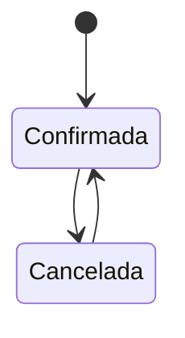

# FS-COL-04 — Confirmación de asistencia (RSVP)

| Campo | Valor |
|---|---|
| **Módulo** | Colaboración (COL) |
| **Estado** | Borrador |
| **Responsable** | Por asignar |
| **Casos de uso** | [CU-15](../casos-de-uso.md#cu-15--confirmar-asistencia-a-eventos-rsvp) |
| **Historias** | [HU-26](../historias.md#hu-26) |
| **Última actualización** | 2026-10-24 |

## 1. Objetivo

Permitir que los usuarios confirmen su asistencia a un evento, vean quiénes más irán para encontrarse allí y lo agreguen a su calendario. Al organizador le da una cifra real de asistentes para preparar el evento.

## 2. Quién es quién

| Actor | Qué hace | Qué ve | Qué no puede hacer |
|---|---|---|---|
| Asistente | Confirma o cancela hasta el inicio; agrega al calendario. | La lista de asistentes y el enlace virtual. | Cambiar su respuesta después del inicio. |
| Usuario | Ve el detalle del evento. | El número de asistentes y cuántas de sus conexiones irán, sin nombres. | Ver la lista ni el enlace sin confirmar. |
| Organizador | Consulta y descarga la lista. | Confirmados, cupo restante y cancelaciones. | Confirmar asistencia a lo propio; descargar correos. |
| Sistema | Envía el recordatorio 24 horas antes. | — | — |

## 3. Alcance

**Incluye:**

- Confirmar y cancelar asistencia.
- Control del cupo.
- Lista de asistentes para los confirmados y el organizador.
- Exportar a calendario (archivo `.ics` y enlace a Google Calendar).
- Recordatorio 24 horas antes.
- Resumen de asistencia y descarga de la lista para el organizador.

**No incluye:**

- Lista de espera cuando se llena el cupo.
- Registro de asistencia real el día del evento (por ejemplo, con código QR).
- Certificados de asistencia.

## 4. Reglas de negocio

| ID | Regla |
|---|---|
| RN-01 | Solo se puede confirmar asistencia a eventos en estado "Programado" que no han comenzado. |
| RN-02 | El organizador no confirma asistencia a su propio evento; aparece como organizador en la lista. |
| RN-03 | Si el evento tiene cupo y está lleno, el botón "Asistiré" se deshabilita con el texto "Cupo completo". Si alguien cancela, el cupo se libera. Confirmar es atómico: nunca hay más confirmados que cupo, aun con confirmaciones simultáneas ([EC-04](../../../srs/Especificacion_Requisitos.md#34-escenarios-de-atributos-de-calidad)). |
| RN-04 | El usuario puede cancelar su asistencia hasta que el evento comience. Después de que comience, su respuesta queda fija. |
| RN-05 | **Lista de asistentes:** la ven el organizador y los asistentes confirmados. Los demás solo ven el número de confirmados. |
| RN-06 | En la lista, los asistentes con perfil "Solo mis conexiones" aparecen solo con nombre, foto y unidad académica para quienes no son sus conexiones. |
| RN-07 | Los usuarios que no han confirmado ven cuántas de sus conexiones asistirán (por ejemplo, "3 de tus conexiones asistirán"), sin ver sus nombres. |
| RN-08 | **Recordatorio:** 24 horas antes del inicio, cada asistente confirmado recibe la notificación `evento.recordatorio` y, si lo tiene activado, un correo. Quien confirma con menos de 24 horas de anticipación no recibe recordatorio. |
| RN-09 | El archivo de calendario incluye título, descripción, inicio, fin, lugar y, si aplica, el enlace virtual. |
| RN-10 | El organizador puede descargar la lista de asistentes en CSV con nombre, unidad académica y fecha de confirmación. **No** incluye correos ni otros datos personales. |

## 5. Requisitos funcionales

| ID | Requisito | Prioridad |
|---|---|---|
| RF-01 | El detalle del evento debe mostrar el botón "Asistiré" o, si el usuario ya confirmó, "Asistirás" con la opción de cancelar. | Alta |
| RF-02 | El sistema debe aplicar RN-01 a RN-04 al confirmar o cancelar. | Alta |
| RF-03 | Tras confirmar, el detalle debe mostrar la lista de asistentes (RN-05, RN-06) con buscador por nombre. | Alta |
| RF-04 | Tras confirmar, el sistema debe ofrecer "Agregar a mi calendario" con dos opciones: descargar `.ics` y abrir en Google Calendar (RN-09). | Media |
| RF-05 | El detalle debe mostrar a quien no ha confirmado el número de asistentes y cuántas de sus conexiones irán (RN-07). | Media |
| RF-06 | El sistema debe enviar el recordatorio de RN-08 mediante una tarea programada. | Media |
| RF-07 | El organizador debe ver en el detalle un resumen: confirmados, cupo restante y cancelaciones, y el botón "Descargar lista" (RN-10). | Media |
| RF-08 | El evento debe aparecer en la pestaña "Mis eventos" del asistente ([FS-COL-03](./FS-COL-03-publicacion-listado-eventos.md), RF-05). | Media |

## 6. Datos y validaciones

**Datos de cada confirmación:** evento, usuario, fecha de confirmación, fecha de cancelación (si la hubo).

No hay campos que el usuario deba llenar.

## 7. Estados



| Estado de la asistencia | Entra cuando | Sale hacia |
|---|---|---|
| Confirmada | El usuario pulsa "Asistiré" | **Cancelada** si la cancela antes del inicio |
| Cancelada | El usuario la cancela | **Confirmada** si vuelve a confirmar antes del inicio y hay cupo |

## 8. Flujo principal

1. **Detalle del evento** → "Asistiré" → el botón cambia a "Asistirás" → aparecen la lista de asistentes y "Agregar a mi calendario".
2. **Detalle** → "Asistirás" → "Cancelar asistencia" → confirma → vuelve a "Asistiré".
3. **Detalle** (como organizador) → resumen → "Descargar lista".

## 9. Variaciones

| Variación | Qué cambia | Regla |
|---|---|---|
| Evento sin cupo | Sin límite de confirmados. | RN-03 |
| Cupo lleno | "Cupo completo"; se libera si alguien cancela. | RN-03 |
| Confirma con menos de 24 horas | No recibe recordatorio. | RN-08 |
| Asistente con perfil privado | En la lista, solo nombre, foto y unidad académica. | RN-06 |
| Evento virtual | El calendario incluye el enlace. | RN-09 |

## 10. ¿Qué pasaría si…?

| Situación | Comportamiento esperado | Regla o pregunta |
|---|---|---|
| Dos usuarios confirman a la vez el último cupo | Solo uno obtiene el cupo; el otro ve "Cupo completo". | RN-03, EC-04 |
| Confirma justo cuando el evento empieza | Se rechaza con MSG-06. | RN-01, RN-04 |
| El evento se cancela o se retira después de confirmar | Recibe la notificación; su confirmación queda sin efecto. | FS-COL-03 RN-08, RN-11 |
| La cuenta del asistente se suspende | Qué pasa con su confirmación y su cupo depende de P-51. | P-51 |
| Falla el envío del recordatorio | Se reintenta mientras falten más de 2 horas para el inicio. | RN-08, RNF-DIS-05 |
| El organizador descarga la lista mientras alguien cancela | El CSV refleja el momento de la descarga. | RN-10 |
| Privacidad: el CSV | Sin correos ni otros datos personales. | RN-10 |

## 11. Mensajes al usuario

| Código | Situación | Mensaje |
|---|---|---|
| MSG-01 | Asistencia confirmada | "¡Listo! Te esperamos en \"{título}\"." |
| MSG-02 | Cupo completo | "Cupo completo" |
| MSG-03 | Confirmar cancelación | "¿Ya no podrás asistir? Liberaremos tu cupo." |
| MSG-04 | Conexiones que asistirán | "{n} de tus conexiones asistirán." |
| MSG-05 | Recordatorio | "Mañana es \"{título}\" a las {hora} en {lugar o 'línea'}." |
| MSG-06 | Evento ya comenzó | "Este evento ya comenzó; no puedes cambiar tu asistencia." |

## 12. Resultado esperado

```gherkin
Escenario: Confirmar asistencia
  Dado que veo un evento programado que no ha comenzado
  Cuando pulso "Asistiré"
  Entonces veo el mensaje MSG-01
  Y veo la lista de asistentes
  Y veo la opción "Agregar a mi calendario"

Escenario: Lista oculta para quien no confirmó
  Dado que no he confirmado asistencia a un evento con 15 confirmados
  Y 3 de ellos son mis conexiones
  Cuando abro su detalle
  Entonces veo "15 asistentes" y el mensaje MSG-04 con n = 3
  Pero no veo la lista de nombres

Escenario: Cupo completo
  Dado que un evento tiene cupo de 30 y 30 confirmados
  Entonces el botón muestra "Cupo completo" y está deshabilitado
  Cuando un asistente cancela
  Entonces el botón vuelve a estar disponible

Escenario: Cancelar asistencia
  Dado que confirmé asistencia a un evento que aún no comienza
  Cuando cancelo mi asistencia
  Entonces desaparezco de la lista de asistentes

Escenario: Asistencia fija tras el inicio
  Dado que un evento ya comenzó
  Cuando intento cancelar mi asistencia
  Entonces veo el mensaje MSG-06

Escenario: Agregar al calendario
  Dado que confirmé asistencia a un evento virtual
  Cuando descargo el archivo de calendario
  Entonces el archivo incluye el título, las horas de inicio y fin y el enlace del evento

Escenario: Recordatorio
  Dado que confirmé asistencia a un evento que empieza en 3 días
  Cuando faltan 24 horas para el inicio
  Entonces recibo la notificación con el mensaje MSG-05

Escenario: Lista para el organizador
  Dado que organizo un evento con 40 confirmados
  Cuando descargo la lista
  Entonces obtengo un CSV con nombre, unidad académica y fecha de confirmación de los 40
  Y el archivo no incluye correos

Escenario: Último cupo simultáneo
  Dado que un evento tiene cupo 30 y 29 confirmados
  Cuando Ana y Luis pulsan "Asistiré" al mismo tiempo
  Entonces solo uno de los dos queda confirmado
  Y el otro ve "Cupo completo"

Escenario: Confirmar cuando empieza
  Dado que un evento empieza ahora
  Cuando intento confirmar mi asistencia
  Entonces veo el mensaje MSG-06

Escenario: Evento cancelado después de confirmar
  Dado que confirmé asistencia a un evento
  Cuando el organizador lo cancela
  Entonces recibo una notificación con el motivo
```

## 13. Contratos

**Expone:**

- API: `POST` y `DELETE /api/v1/colaboracion/eventos/{id}/asistencia`, `GET /api/v1/colaboracion/eventos/{id}/asistentes`, `GET /api/v1/colaboracion/eventos/{id}/asistentes.csv`, `GET /api/v1/colaboracion/eventos/{id}/calendario.ics` ([contrato](../../../../contracts/api/colaboracion.yaml)).

**Consume:** Red (cuántas conexiones asistirán), Usuarios (datos públicos y privacidad de los asistentes).

## 14. Calidad

RNF-CON-01, RNF-COM-03 (archivo .ics), [EC-04](../../../srs/Especificacion_Requisitos.md#34-escenarios-de-atributos-de-calidad).

## 15. Preguntas abiertas

- P-40 — ¿lista de espera?
- P-41 — ¿mensaje del organizador a los asistentes?
- P-51 — asistencias de cuentas que dejan de estar activas.

## 16. Lista de revisión

- [x] Cada actor de "Quién es quién" existe en el [SRS §2.4](../../../srs/Especificacion_Requisitos.md#24-actores-del-sistema) con el mismo nombre.
- [x] Toda acción tiene un actor que puede hacerla y se valida en el servidor (RNF-SEG-04).
- [ ] Cada regla tiene al menos un escenario en "Resultado esperado".
- [x] "¿Qué pasaría si…?" revisó las siete situaciones: concurrencia, estado de la cuenta, eliminación de lo que usa, pérdida de permiso, falla externa, límites de uso y privacidad.
- [ ] Ningún dato se recoge sin finalidad (RNF-PRI-01).
- [x] No contradice a su caso de uso, a su historia ni a otro spec.
- [x] Sus contratos existen en [`contracts/`](../../../../contracts/README.md).
- [ ] No tiene preguntas abiertas que bloqueen el desarrollo.

## 17. Historial de cambios

| Fecha | Autor | Cambio |
|---|---|---|
| 2026-10-06 | Gamero | Creación |
| 2026-10-24 | Equipo UniLink | Estudio de quién es quién, variaciones, casos límite y contratos; nueva plantilla. |
