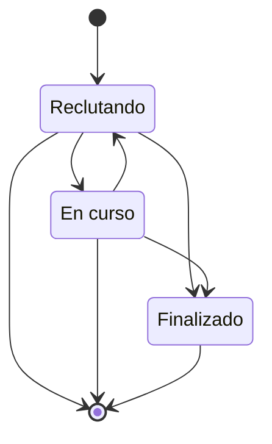

# FS-COL-05 — Espacios de proyectos

| Campo | Valor |
|---|---|
| **Módulo** | Colaboración (COL) |
| **Estado** | Borrador |
| **Responsable** | Por asignar |
| **Casos de uso** | [CU-11](../casos-de-uso.md#cu-11--gestionar-espacio-de-proyectos) |
| **Historias** | [HU-11](../historias.md#hu-11) |
| **Última actualización** | 2026-10-24 |

## 1. Objetivo

Dar a los equipos de la universidad un espacio donde reclutar integrantes con las habilidades que necesitan, organizar las tareas del proyecto y dejar constancia del trabajo realizado, que luego sirve como portafolio en el perfil de cada miembro.

## 2. Quién es quién

| Actor | Qué hace | Qué ve | Qué no puede hacer |
|---|---|---|---|
| Usuario | Crea proyectos, explora y pide unirse. | Los proyectos que reclutan, con su afinidad; Resumen y Miembros de cualquier proyecto. | Ver Tareas y Actividad sin ser miembro. |
| Solicitante | Pide unirse con un mensaje. | El estado de su solicitud. | Volver a pedir antes de 30 días tras un rechazo. |
| Creador del proyecto | Lo crea; es administrador protegido (FS-COL-06). | Todo el espacio. | Eliminarlo si tiene otros miembros. |
| Administrador de proyecto | Aprueba o rechaza, invita a sus conexiones, finaliza. | Todo el espacio. | Lo que impide FS-COL-06. |
| Miembro del proyecto | Colabora según su rol (FS-COL-06). | Todo el espacio. | Lo que su rol no permite. |
| Sistema | Vence invitaciones a los 14 días. | — | — |

## 3. Alcance

**Incluye:**

- Crear, editar, finalizar y eliminar proyectos.
- Explorar proyectos con orden por afinidad.
- Solicitudes de unión, invitaciones y salida del proyecto.
- Espacio del proyecto con resumen, tareas, miembros y actividad.
- Proyectos finalizados en el perfil de los miembros.
- Sugerencias de proyectos en el onboarding ([FS-RED-02](../../red/specs/FS-RED-02-onboarding-sugerencias.md)).

**No incluye:**

- Roles y permisos de los miembros ([FS-COL-06](./FS-COL-06-roles-proyectos.md)).
- Chat grupal, archivos compartidos o control de versiones dentro del proyecto.
- Proyectos privados que no aparecen en la exploración.

## 4. Reglas de negocio

**Proyecto**

| ID | Regla |
|---|---|
| RN-01 | Cualquier usuario autenticado puede crear proyectos. Quien lo crea es su **creador** y queda como administrador ([FS-COL-06](./FS-COL-06-roles-proyectos.md)). |
| RN-02 | Todo proyecto usa una categoría activa de tipo "Proyectos" ([FS-PLT-01](../../plataforma/specs/FS-PLT-01-gestion-categorias.md)). |
| RN-03 | El máximo de integrantes va de 2 a 50 e incluye al creador. No puede quedar por debajo del número actual de miembros. |
| RN-04 | Los proyectos son visibles para todos los usuarios autenticados. |
| RN-05 | **Afinidad:** porcentaje de las habilidades buscadas del proyecto que el usuario tiene en sus habilidades o en su "Puedo aportar", igual que en [FS-COL-01](./FS-COL-01-publicacion-oportunidades.md), RN-13. |
| RN-06 | **Finalizar:** el proyecto queda en solo lectura, deja de recibir solicitudes y aparece en la sección "Proyectos" del perfil de cada miembro como parte de su portafolio. |
| RN-07 | Un proyecto solo puede eliminarse si su único miembro es el creador. Con más miembros solo puede finalizarse. |

**Membresía**

| ID | Regla |
|---|---|
| RN-08 | Se puede solicitar unirse solo si el proyecto está "Reclutando" y tiene cupo. La solicitud lleva un mensaje de 20 a 500 caracteres. |
| RN-09 | Los administradores del proyecto aprueban o rechazan las solicitudes. Al rechazar, el solicitante es notificado y puede volver a solicitar después de 30 días. |
| RN-10 | Los administradores pueden invitar a sus conexiones. La invitación cuenta como solicitud aprobada: si el invitado acepta, entra directamente. Las invitaciones vencen a los 14 días. |
| RN-11 | Al llenarse el cupo, el proyecto deja de recibir solicitudes y las pendientes se mantienen hasta que haya un lugar o un administrador las rechace. Aprobar una solicitud o aceptar una invitación es atómico: nunca hay más miembros que el máximo, aun con aprobaciones simultáneas; quien llega tarde ve MSG-03. |
| RN-12 | Un miembro puede salir del proyecto cuando quiera, excepto si es su único administrador ([FS-COL-06](./FS-COL-06-roles-proyectos.md), RN-05). Sus tareas asignadas quedan sin responsable. |
| RN-13 | Los nuevos miembros entran con el rol por defecto definido en [FS-COL-06](./FS-COL-06-roles-proyectos.md). |

**Tareas**

| ID | Regla |
|---|---|
| RN-14 | Cada tarea tiene título, descripción opcional, responsable opcional (un miembro), fecha límite opcional y estado: Por hacer, En progreso o Hecha. |
| RN-15 | Quién puede crear, editar, mover o eliminar tareas lo define [FS-COL-06](./FS-COL-06-roles-proyectos.md). |
| RN-16 | Al asignar una tarea, el responsable recibe una notificación. |
| RN-17 | La pestaña Actividad registra: ingresos y salidas de miembros, cambios de rol, tareas creadas, completadas y eliminadas, y cambios en la información del proyecto. |
| RN-18 | El nombre, la descripción, los objetivos, los perfiles buscados y las tareas se revisan con la lista de palabras prohibidas de [FS-PLT-01](../../plataforma/specs/FS-PLT-01-gestion-categorias.md). El proyecto es `Reportable` ([FS-CNT-02](../../contenido/specs/FS-CNT-02-moderacion-contenido.md)); si se retira, deja de verse en Explorar y en los perfiles, y sus miembros reciben una notificación. |
| RN-19 | En "Explorar", a igual afinidad, aparecen primero los proyectos de las categorías de interés del usuario ([FS-USR-04](../../usuarios/specs/FS-USR-04-preferencias-contenido.md)). |

## 5. Requisitos funcionales

| ID | Requisito | Prioridad |
|---|---|---|
| RF-01 | El sistema debe ofrecer la sección "Proyectos" en el menú principal con el botón "Crear proyecto". | Alta |
| RF-02 | La sección debe mostrar los proyectos que están reclutando como tarjetas (nombre, categoría, habilidades buscadas, integrantes y cupo, afinidad), con búsqueda, filtros por categoría y habilidad, y orden por afinidad (RN-19) o más recientes. | Alta |
| RF-03 | La sección debe tener las pestañas "Explorar", "Mis proyectos" y "Finalizados". | Media |
| RF-04 | El espacio de cada proyecto debe tener las pestañas Resumen, Tareas, Miembros y Actividad. Quienes no son miembros solo ven Resumen y Miembros. | Alta |
| RF-05 | La pestaña Tareas debe mostrar un tablero con tres columnas (Por hacer, En progreso, Hecha) donde las tareas se arrastran entre columnas, y un filtro "Mis tareas". | Alta |
| RF-06 | El sistema debe permitir solicitar unirse (RN-08), y a los administradores aprobar o rechazar solicitudes desde la pestaña Miembros (RN-09). | Alta |
| RF-07 | El sistema debe permitir a los administradores invitar a sus conexiones (RN-10). | Media |
| RF-08 | El sistema debe permitir salir del proyecto (RN-12), finalizarlo (RN-06) y eliminarlo (RN-07). | Alta |
| RF-09 | El perfil de cada usuario debe mostrar los proyectos finalizados en los que participó, con su rol y fechas. | Media |
| RF-10 | El onboarding ([FS-RED-02](../../red/specs/FS-RED-02-onboarding-sugerencias.md)) debe sugerir hasta 5 proyectos que están reclutando, con afinidad mayor a 0. Elegir uno envía una solicitud con el mensaje "Me interesa unirme a este proyecto." | Media |

## 6. Datos y validaciones

| Campo | Tipo | Obligatorio | Validación |
|---|---|---|---|
| Nombre | Texto | Sí | 3 a 80 caracteres. |
| Descripción | Texto largo | Sí | 50 a 4.000 caracteres. |
| Objetivos | Lista | Sí | De 1 a 10 objetivos de hasta 200 caracteres cada uno. |
| Categoría | Lista | Sí | Categorías activas de tipo "Proyectos". |
| Habilidades buscadas | Etiquetas | No | Máximo 10, del catálogo de FS-USR-06. |
| Perfiles que buscamos | Texto | No | Máximo 500 caracteres (por ejemplo, "Un diseñador UX y dos desarrolladores web"). |
| Máximo de integrantes | Número | Sí | RN-03. |
| Mensaje de solicitud | Texto | Sí, al solicitar | RN-08. |
| Título de tarea | Texto | Sí | 3 a 120 caracteres. |
| Descripción de tarea | Texto | No | Máximo 2.000 caracteres. |
| Fecha límite de tarea | Fecha | No | Igual o posterior a hoy al crearla. |

## 7. Estados



**Estado del proyecto:**

| Estado | Entra cuando | Sale hacia |
|---|---|---|
| Reclutando | Se crea, o un administrador lo reabre | **En curso** (un administrador cierra el reclutamiento) o **Finalizado** |
| En curso | Se cierra el reclutamiento | **Reclutando** o **Finalizado** |
| Finalizado | Un administrador lo finaliza | Estado final (solo lectura) |

**Estado de la solicitud de unión:** Pendiente → Aprobada, Rechazada o Cancelada (por el solicitante).

## 8. Flujo principal

1. **Proyectos** → "Crear proyecto" → **Formulario** → "Crear" → **Espacio del proyecto**.
2. **Proyectos > Explorar** → selecciona un proyecto → **Resumen** → "Solicitar unirme" → escribe el mensaje → "Enviar".
3. **Espacio del proyecto > Miembros** (administrador) → "Solicitudes" → "Aprobar" o "Rechazar".
4. **Espacio del proyecto > Tareas** → "Nueva tarea" → arrastra tareas entre columnas.

## 9. Variaciones

| Variación | Qué cambia | Regla |
|---|---|---|
| Entrada por invitación | Entra sin aprobación al aceptar. | RN-10 |
| Cupo lleno | No recibe solicitudes; las pendientes esperan. | RN-11 |
| Reclutamiento cerrado (En curso) | No recibe solicitudes. | Sección 7 |
| Finalizado | Solo lectura y portafolio. | RN-06 |
| Solo el creador como miembro | Se puede eliminar. | RN-07 |
| Desde el onboarding (Sprint 8) | Sugerencias de proyectos con afinidad. | RF-10, P-50 |

## 10. ¿Qué pasaría si…?

| Situación | Comportamiento esperado | Regla o pregunta |
|---|---|---|
| Dos administradores aprueban a la vez el último lugar | Solo una aprobación entra; la otra ve MSG-03. | RN-11, EC-04 |
| Un invitado acepta cuando el cupo ya se llenó | Ve MSG-03 y la invitación queda sin efecto. | RN-11 |
| Dos miembros mueven la misma tarea a la vez | Queda el último movimiento; ambos ven el tablero actualizado. | RN-15 |
| Asignan una tarea a alguien que acaba de salir | Se rechaza; la tarea queda sin responsable. | RN-12 |
| La cuenta del creador se suspende o se elimina | Depende de P-51 (el creador está protegido y no se puede retirar). | P-51 |
| El proyecto se retira por moderación | Deja de verse; sus miembros reciben una notificación. | RN-18 |
| Privacidad: proyectos de clase que deberían ser privados | Hoy todos son visibles. | P-43 |

## 11. Mensajes al usuario

| Código | Situación | Mensaje |
|---|---|---|
| MSG-01 | Proyecto creado | "Tu proyecto está creado. Invita a tus conexiones o espera solicitudes." |
| MSG-02 | Solicitud enviada | "Enviamos tu solicitud a los administradores de \"{proyecto}\"." |
| MSG-03 | Cupo completo | "Este proyecto ya completó sus {n} integrantes." |
| MSG-04 | Proyecto no recluta | "Este proyecto no está buscando integrantes en este momento." |
| MSG-05 | Espera tras rechazo | "Podrás volver a solicitar unirte a partir del {fecha}." |
| MSG-06 | Confirmar finalizar | "El proyecto quedará en solo lectura y aparecerá en el perfil de sus {n} miembros. ¿Finalizarlo?" |
| MSG-07 | No se puede eliminar | "El proyecto tiene otros miembros. Puedes finalizarlo, pero no eliminarlo." |

## 12. Resultado esperado

```gherkin
Escenario: Crear un proyecto
  Dado que soy un usuario autenticado
  Cuando creo un proyecto con nombre, descripción, objetivos, categoría y máximo de 5 integrantes
  Entonces veo el mensaje MSG-01
  Y soy administrador del proyecto
  Y el proyecto aparece en "Explorar" como "Reclutando"

Escenario: Afinidad con un proyecto
  Dado que un proyecto busca "React" y "Diseño UX"
  Y yo tengo "React" en mis habilidades
  Cuando lo veo en Explorar
  Entonces su afinidad es 50 %

Escenario: Solicitar unirse y ser aprobado
  Dado que un proyecto está reclutando y tiene cupo
  Cuando solicito unirme con un mensaje
  Entonces veo el mensaje MSG-02
  Y los administradores reciben una notificación
  Cuando un administrador aprueba mi solicitud
  Entonces soy miembro con el rol por defecto y veo las pestañas Tareas y Actividad

Escenario: Cupo completo
  Dado que un proyecto tiene 5 de 5 integrantes
  Cuando abro su resumen
  Entonces veo el mensaje MSG-03 en lugar del botón "Solicitar unirme"

Escenario: Invitar a una conexión
  Dado que soy administrador de un proyecto y estoy conectado con Luis
  Cuando invito a Luis y él acepta
  Entonces Luis es miembro del proyecto sin pasar por aprobación

Escenario: Tablero de tareas
  Dado que soy miembro con permiso de edición
  Cuando creo una tarea, se la asigno a Ana y la muevo a "En progreso"
  Entonces Ana recibe una notificación
  Y la tarea aparece en la columna "En progreso"
  Y la pestaña Actividad registra la creación

Escenario: Salir del proyecto
  Dado que soy miembro con 2 tareas asignadas
  Cuando salgo del proyecto
  Entonces dejo de ser miembro
  Y mis 2 tareas quedan sin responsable

Escenario: Finalizar y portafolio
  Dado que soy administrador de un proyecto con 4 miembros
  Cuando lo finalizo
  Entonces el proyecto queda en solo lectura
  Y aparece en la sección "Proyectos" del perfil de los 4 miembros

Escenario: Sugerencia en el onboarding
  Dado que soy un usuario nuevo con la habilidad "React"
  Y un proyecto que busca "React" está reclutando
  Entonces el proyecto aparece entre mis sugerencias del onboarding

Escenario: Último lugar con dos aprobaciones
  Dado que un proyecto tiene 4 de 5 integrantes y 2 solicitudes pendientes
  Cuando dos administradores aprueban una cada uno al mismo tiempo
  Entonces solo una solicitud queda aprobada
  Y el proyecto tiene 5 integrantes

Escenario: Invitación aceptada con el cupo lleno
  Dado que invité a Luis y después el proyecto completó sus integrantes
  Cuando Luis acepta la invitación
  Entonces ve el mensaje MSG-03 y no entra al proyecto

Escenario: Proyecto retirado
  Dado que un administrador de la plataforma retira un proyecto
  Entonces el proyecto deja de aparecer en Explorar
  Y sus miembros reciben una notificación

Escenario: Orden por categorías de interés
  Dado que dos proyectos tienen la misma afinidad conmigo
  Y solo uno es de una categoría de mi interés
  Cuando abro Explorar ordenado por afinidad
  Entonces el de mi categoría de interés aparece primero
```

## 13. Contratos

**Expone:**

- API: `/api/v1/colaboracion/proyectos/...` (crear, explorar, editar, finalizar, eliminar), `/solicitudes`, `/invitaciones`, `/miembros`, `/tareas`, `/actividad` ([contrato](../../../../contracts/api/colaboracion.yaml)).
- `Reportable` para "proyecto".
- Eventos: `proyecto.solicitud_creada`, `proyecto.solicitud_respondida`, `proyecto.invitacion_creada`, `proyecto.tarea_asignada`, `proyecto.miembro_retirado` ([catálogo](../../../../contracts/eventos/README.md)).

**Consume:** Usuarios (afinidad, categorías de interés y datos públicos), Red (conexiones para invitar), Plataforma (categorías y palabras prohibidas).

## 14. Calidad

RNF-CON-01, RNF-CON-02, RNF-USA-02 (tablero en celular), [EC-04](../../../srs/Especificacion_Requisitos.md#34-escenarios-de-atributos-de-calidad).

## 15. Preguntas abiertas

- P-42 — ¿conversación del equipo?
- P-43 — ¿proyectos privados? (cambiaría el alcance: hoy están excluidos)
- P-50 — proyectos sugeridos a quien ya pasó el onboarding.
- P-51 — proyecto cuyo creador deja de estar activo.

## 16. Lista de revisión

- [x] Cada actor de "Quién es quién" existe en el [SRS §2.4](../../../srs/Especificacion_Requisitos.md#24-actores-del-sistema) con el mismo nombre.
- [x] Toda acción tiene un actor que puede hacerla y se valida en el servidor (RNF-SEG-04).
- [ ] Cada regla tiene al menos un escenario en "Resultado esperado".
- [x] "¿Qué pasaría si…?" revisó las siete situaciones: concurrencia, estado de la cuenta, eliminación de lo que usa, pérdida de permiso, falla externa, límites de uso y privacidad.
- [ ] Ningún dato se recoge sin finalidad (RNF-PRI-01).
- [x] No contradice a su caso de uso, a su historia ni a otro spec.
- [x] Sus contratos existen en [`contracts/`](../../../../contracts/README.md).
- [ ] No tiene preguntas abiertas que bloqueen el desarrollo.

## 17. Historial de cambios

| Fecha | Autor | Cambio |
|---|---|---|
| 2026-10-06 | Gamero | Creación |
| 2026-10-24 | Equipo UniLink | Estudio de quién es quién, variaciones, casos límite y contratos; nueva plantilla. |
