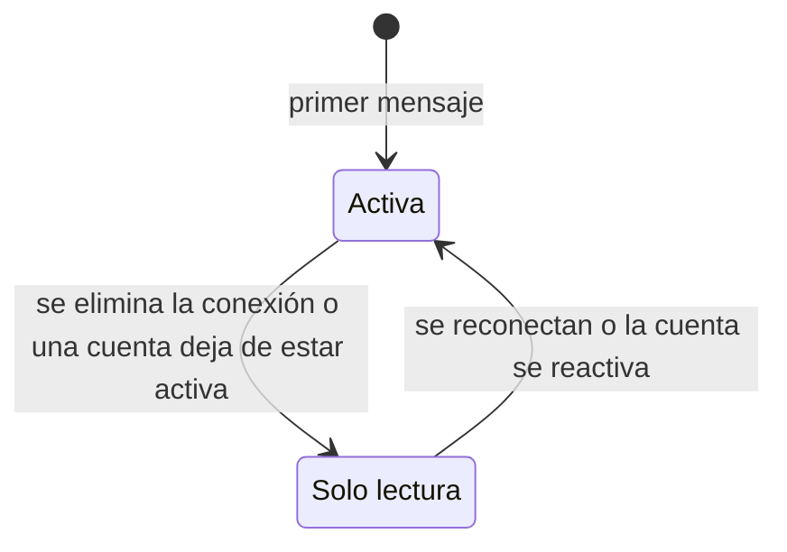

# Módulo Comunicación (COM)

## Propósito

Que las personas se enteren y conversen: **mensajería privada** 1 a 1 y **notificaciones** dentro de la plataforma y por correo. Las notificaciones nacen de los eventos de los demás módulos: ningún módulo llama a Comunicación para notificar (ADR-004).

**No es responsabilidad de este módulo:** decidir quién puede conversar (lo consulta a Red y a Colaboración); los correos de seguridad de la cuenta (los envía Usuarios).

## Documentos

| Documento | Contenido |
|---|---|
| [Casos de uso](./casos-de-uso.md) | CU-10, CU-23 |
| [Historias de usuario](./historias.md) | HU-10, HU-30 |
| [FS-COM-01](./specs/FS-COM-01-mensajeria-privada.md) | Mensajería privada |
| [FS-COM-02](./specs/FS-COM-02-centro-notificaciones.md) | Centro de notificaciones (incluye el catálogo de tipos) |

## Quién es quién

| Actor | En este módulo |
|---|---|
| Remitente | Escribe mensajes a quien puede conversar con él. |
| Destinatario | Recibe mensajes y notificaciones; las marca como leídas. |
| Conexión, Responsable de oportunidad, Postulante | Pueden conversar entre sí (FS-COM-01 RN-01). |
| Administrador de la plataforma | **No** puede leer conversaciones (RNF-PRI-04). |
| Sistema | Crea notificaciones a partir de eventos, envía los correos diferidos y elimina notificaciones de más de 90 días. |
| Servicio de correo | Entrega los correos de actividad. |

## Entidades y datos propios

| Entidad | Datos |
|---|---|
| Conversación | Los dos participantes, estado (activa o solo lectura), ocultamiento por participante. |
| Mensaje | Remitente, texto, publicación compartida (opcional), fechas de envío y lectura. |
| Notificación | Destinatario, tipo, actor, texto, enlace, estado, fecha. |
| Correo pendiente | Destinatario, plantilla, intentos, rebotes. |
| Eventos procesados | Identificadores de los eventos ya atendidos, para no notificar dos veces (RNF-CON-04). |

## Expone

| Tipo | Elemento |
|---|---|
| API | `/api/v1/comunicacion/...`: conversaciones, mensajes y notificaciones; canal de tiempo real (ADR-007) ([contrato](../../../contracts/api/comunicacion.yaml)). |
| Interfaz pública | Si dos usuarios pueden conversar ([contrato](../../../contracts/modulos/comunicacion.md)). |
| Eventos | `mensaje.enviado` (lo consume el propio módulo para la notificación y el correo diferido). |

## Consume

| De | Qué | Para |
|---|---|---|
| Red | Si dos usuarios están conectados | Permiso para conversar. |
| Colaboración | Si hay una postulación aceptada entre dos usuarios | Permiso para conversar. |
| Usuarios | Datos públicos, correo y preferencias de correo del destinatario | Mostrar el remitente y decidir si se envía correo. |
| Eventos de todos los módulos | Ver el [catálogo](../../../contracts/eventos/README.md) | Crear notificaciones. |

## Preguntas abiertas del módulo

P-16, P-27, P-32, P-47, P-51.
