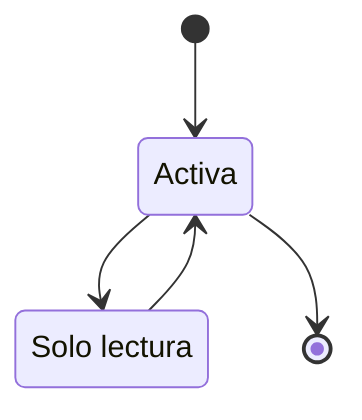

# FS-COM-01 — Mensajería privada

| Campo | Valor |
|---|---|
| **Módulo** | Comunicación (COM) |
| **Estado** | Borrador |
| **Responsable** | Por asignar |
| **Casos de uso** | [CU-10](../casos-de-uso.md#cu-10--enviar-mensaje-privado) |
| **Historias** | [HU-10](../historias.md#hu-10) |
| **Última actualización** | 2026-10-24 |

## 1. Objetivo

Permitir que dos personas conectadas conversen en privado dentro de UniLink, para coordinar colaboraciones sin salir de la plataforma.

## 2. Quién es quién

| Actor | Qué hace | Qué ve | Qué no puede hacer |
|---|---|---|---|
| Remitente | Escribe y envía mensajes; comparte publicaciones; oculta conversaciones. | Su bandeja, la conversación y "Visto". | Escribir a quien no es su conexión ni tiene con él una postulación aceptada; más de 60 mensajes por minuto; editar o borrar mensajes. |
| Destinatario | Lee y responde. | El mensaje en menos de 2 s si tiene la conversación abierta; una notificación por conversación. | Abrir una publicación compartida que no tiene permiso de ver. |
| Conexión | Conversa sin otra condición. | — | — |
| Responsable de oportunidad | Conversa con el postulante que aceptó, aunque no sean conexiones. | "Enviar mensaje" en el panel de postulaciones. | — |
| Postulante | Conversa con el responsable tras ser aceptado. | "Enviar mensaje" en "Mis postulaciones". | — |
| Administrador de la plataforma | — | Nada del contenido de los mensajes. | Leer conversaciones (RN-11). |
| Sistema | Entrega en tiempo real; envía el correo de mensajes sin leer tras 1 hora. | — | — |

## 3. Alcance

**Incluye:**

- Conversaciones 1 a 1 entre usuarios conectados.
- Entrega de mensajes en tiempo real e indicador de leído.
- Bandeja de conversaciones con mensajes sin leer.
- Enviar una publicación del feed por mensaje.
- Ocultar una conversación.

**No incluye:**

- Conversaciones grupales.
- Adjuntar archivos, audios o imágenes.
- Editar o borrar mensajes enviados.
- Conversaciones originadas por solicitudes de servicio: se agregan con FS-SRV-02 en la fase 2, reutilizando este módulo.

## 4. Reglas de negocio

| ID | Regla |
|---|---|
| RN-01 | Solo se puede iniciar una conversación o enviar mensajes a: una conexión ([FS-RED-01](../../red/specs/FS-RED-01-solicitudes-conexion.md)); el responsable o el postulante de una postulación aceptada ([FS-COL-01](../../colaboracion/specs/FS-COL-01-publicacion-oportunidades.md), RN-12, desde el Sprint 6); o, en la fase 2, la otra parte de una solicitud de servicio activa. |
| RN-02 | Entre dos usuarios existe una sola conversación. |
| RN-03 | Un mensaje tiene entre 1 y 2.000 caracteres de texto. Los enlaces se convierten en vínculos. |
| RN-04 | Los mensajes se entregan en tiempo real: el destinatario con la conversación abierta lo ve en menos de 2 segundos. |
| RN-05 | Un mensaje se marca como leído cuando el destinatario abre la conversación. El remitente ve "Visto" bajo su último mensaje leído. |
| RN-06 | Si la conexión se elimina, la conversación sigue visible para ambos, pero en modo de solo lectura. Si vuelven a conectarse, se reactiva la misma conversación. |
| RN-07 | Ocultar una conversación solo la quita de la bandeja de quien la oculta. Reaparece si llega un mensaje nuevo. Los mensajes no se borran para la otra persona. |
| RN-08 | Si una cuenta se suspende o se inhabilita, sus conversaciones quedan en solo lectura para la otra persona. Si se elimina, sus mensajes aparecen como de "Usuario eliminado" ([FS-USR-05](../../usuarios/specs/FS-USR-05-configuracion-cuenta.md), RN-10). |
| RN-09 | Un usuario puede enviar como máximo 60 mensajes por minuto, para evitar spam. |
| RN-10 | **Notificaciones:** se crea una sola notificación `mensaje.nuevo` por conversación mientras haya mensajes sin leer; no una por mensaje. Si un mensaje sigue sin leerse 1 hora después, se envía un correo (si el usuario lo tiene activado), como máximo uno por conversación al día. |
| RN-11 | Los administradores **no** pueden leer las conversaciones privadas. |
| RN-13 | La conversación que habilita una postulación aceptada sigue activa aunque la oportunidad se cierre o se cancele: la aceptación es definitiva ([FS-COL-01](../../colaboracion/specs/FS-COL-01-publicacion-oportunidades.md), RN-10). |
| RN-12 | Al enviar una publicación por mensaje, se envía un mensaje con una vista previa (autor, título y enlace). El destinatario solo la puede abrir si tiene permiso de verla ([FS-CNT-01](../../contenido/specs/FS-CNT-01-publicaciones-feed.md), RN-06). |

## 5. Requisitos funcionales

| ID | Requisito | Prioridad |
|---|---|---|
| RF-01 | El sistema debe mostrar un ícono de mensajes en el menú principal con el número de conversaciones con mensajes sin leer. | Alta |
| RF-02 | El sistema debe ofrecer una página "Mensajes" con la bandeja a la izquierda (foto, nombre, último mensaje y hora, ordenadas por actividad) y la conversación abierta a la derecha. En celular, se muestran por separado. | Alta |
| RF-03 | El sistema debe permitir iniciar una conversación desde el botón "Enviar mensaje" del perfil de una conexión, desde "Mi red" y, para una postulación aceptada, desde el panel de postulaciones del responsable ([FS-COL-01](../../colaboracion/specs/FS-COL-01-publicacion-oportunidades.md)) y desde "Mis postulaciones" del postulante ([FS-COL-02](../../colaboracion/specs/FS-COL-02-postulaciones.md)). | Alta |
| RF-04 | El sistema debe entregar los mensajes en tiempo real (RN-04) y mostrar "Visto" (RN-05). | Alta |
| RF-05 | La conversación debe cargar los 30 mensajes más recientes y los anteriores al desplazarse hacia arriba. | Alta |
| RF-06 | El sistema debe permitir buscar conversaciones por nombre de la persona. | Media |
| RF-07 | El sistema debe permitir ocultar una conversación (RN-07). | Baja |
| RF-08 | El sistema debe agregar a cada publicación del feed la opción "Enviar por mensaje", que permite elegir una o varias conexiones (RN-12). | Media |
| RF-09 | Si la conversación está en solo lectura (RN-06, RN-08), el campo de escritura debe reemplazarse por un aviso que explique el motivo. | Alta |

## 6. Datos y validaciones

| Campo | Tipo | Obligatorio | Validación |
|---|---|---|---|
| Mensaje | Texto | Sí | 1 a 2.000 caracteres; sin espacios solamente. |

**Datos de cada mensaje:** conversación, remitente, texto, publicación compartida (opcional), fecha de envío y fecha de lectura.

## 7. Estados



| Estado de la conversación | Entra cuando | Sale hacia |
|---|---|---|
| Activa | Se envía el primer mensaje o se reconectan | **Solo lectura** si se elimina la conexión o se suspende/desactiva una de las cuentas |
| Solo lectura | RN-06 o RN-08 | **Activa** si se reconectan o se reactiva la cuenta |

## 8. Flujo principal

1. **Perfil de una conexión** → "Enviar mensaje" → **Mensajes** con la conversación abierta.
2. **Menú principal** → ícono de mensajes → **Mensajes** → elige una conversación.
3. **Feed** → "Enviar por mensaje" en una publicación → elige conexiones → "Enviar".

## 9. Variaciones

| Variación | Qué cambia | Regla |
|---|---|---|
| Conversación por postulación aceptada | Se abre desde las postulaciones; sigue activa aunque la oportunidad se cierre. | RN-01, RN-13 |
| Se elimina la conexión | Solo lectura; se reactiva si se reconectan. | RN-06 |
| Cuenta suspendida o inhabilitada | Solo lectura para la otra persona. | RN-08 |
| Cuenta eliminada | Sus mensajes aparecen como de "Usuario eliminado". | RN-08 |
| Conversación oculta | Reaparece con un mensaje nuevo. | RN-07 |
| _(Fase 2)_ Solicitud de servicio activa | También habilita la conversación. | RN-01 |

## 10. ¿Qué pasaría si…?

| Situación | Comportamiento esperado | Regla o pregunta |
|---|---|---|
| Envía un mensaje justo cuando la otra persona elimina la conexión | El mensaje se rechaza y aparece MSG-02. | RN-06 |
| El mismo mensaje llega dos veces (doble clic o reintento) | Se guarda una sola vez. | RNF-CON-03 |
| El canal de tiempo real está caído | El mensaje se guarda; aparece al reconectar o recargar. | ADR-007, RNF-DIS-05 |
| El servicio de correo falla | El correo de mensajes sin leer se reintenta; no bloquea la conversación. | RN-10, RNF-DIS-05 |
| La otra cuenta se suspende con la conversación abierta | El campo de escritura se reemplaza por MSG-03. | RN-08, RF-09 |
| Supera 60 mensajes por minuto | MSG-04. | RN-09 |
| Comparte una publicación que después se retira | El destinatario ve MSG-06 de FS-CNT-01 al abrirla. | RN-12 |
| Privacidad: un administrador quiere revisar un acoso por mensajes | No puede leerlos; el reporte con los mensajes que elija el denunciante está en pregunta. | RN-11, P-32 |

## 11. Mensajes al usuario

| Código | Situación | Mensaje |
|---|---|---|
| MSG-01 | Bandeja vacía | "Aún no tienes conversaciones. Escríbele a una de tus conexiones." |
| MSG-02 | Conexión eliminada | "Ya no estás conectado con {nombre}. Puedes leer la conversación, pero no enviar mensajes." |
| MSG-03 | Cuenta no disponible | "Esta cuenta no está disponible en este momento." |
| MSG-04 | Límite de envío | "Estás enviando mensajes muy rápido. Espera un momento." |
| MSG-05 | Correo de mensajes sin leer | "{nombre} te escribió en UniLink: \"{primeros 100 caracteres}\"" |
| MSG-06 | Publicación compartida | "Publicación enviada a {n} conexiones." |

## 12. Resultado esperado

```gherkin
Escenario: Enviar mensaje a una conexión
  Dado que estoy conectado con Luis
  Cuando le escribo "Hola, ¿hablamos del proyecto?" desde su perfil
  Entonces el mensaje aparece en la conversación
  Y si Luis tiene la conversación abierta, lo ve en menos de 2 segundos

Escenario: Sin conexión no hay chat
  Dado que no estoy conectado con Pedro ni tenemos una postulación aceptada
  Entonces su perfil no muestra el botón "Enviar mensaje"

Escenario: Visto
  Dado que le envié un mensaje a Luis
  Cuando Luis abre la conversación
  Entonces veo "Visto" bajo mi mensaje

Escenario: Una notificación por conversación
  Dado que Luis me envía 5 mensajes seguidos y no los he leído
  Entonces tengo una sola notificación de Luis en mi centro de notificaciones

Escenario: Correo por mensaje sin leer
  Dado que tengo activado el correo de "Mensajes privados sin leer"
  Cuando Luis me escribe y no abro la conversación en 1 hora
  Entonces recibo un correo con el mensaje MSG-05
  Y si me escribe de nuevo ese mismo día, no recibo otro correo

Escenario: Conexión eliminada
  Dado que tengo una conversación con Luis
  Cuando Luis elimina nuestra conexión
  Entonces puedo leer la conversación
  Y veo el mensaje MSG-02 en lugar del campo de escritura

Escenario: Compartir una publicación
  Dado que veo una publicación en el feed
  Cuando la envío por mensaje a Luis y a Carla
  Entonces cada uno recibe un mensaje con la vista previa de la publicación
  Y veo el mensaje MSG-06

Escenario: Ocultar conversación
  Dado que oculté mi conversación con Luis
  Cuando Luis me envía un mensaje nuevo
  Entonces la conversación vuelve a aparecer en mi bandeja con todo el historial

Escenario: Conversación por postulación aceptada
  Dado que Ana aceptó mi postulación y no somos conexiones
  Cuando abro "Mis postulaciones"
  Entonces veo el botón "Enviar mensaje" en esa postulación
  Y puedo escribirle a Ana

Escenario: La oportunidad se cancela después de aceptar
  Dado que Ana aceptó mi postulación
  Cuando Ana cancela la oportunidad
  Entonces seguimos pudiendo conversar

Escenario: Mensaje mientras se elimina la conexión
  Dado que estoy escribiendo a Luis
  Cuando Luis elimina nuestra conexión antes de que envíe
  Entonces mi mensaje no se envía y veo el mensaje MSG-02

Escenario: Mensaje repetido
  Dado que pulso "Enviar" dos veces seguidas
  Entonces el mensaje aparece una sola vez

Escenario: Tiempo real caído
  Dado que el canal de tiempo real no está disponible
  Cuando Luis me envía un mensaje
  Entonces lo veo al recargar la conversación
```

## 13. Contratos

**Expone:**

- API: `GET /api/v1/comunicacion/conversaciones`, `GET /api/v1/comunicacion/conversaciones/{id}/mensajes`, `POST /api/v1/comunicacion/conversaciones/{id}/mensajes`, `POST /api/v1/comunicacion/conversaciones` (abrir con un usuario), `POST /api/v1/comunicacion/conversaciones/{id}/ocultamiento` ([contrato](../../../../contracts/api/comunicacion.yaml)).
- Interfaz pública: si dos usuarios pueden conversar ([interfaz](../../../../contracts/modulos/comunicacion.md)).
- Evento: `mensaje.enviado` ([catálogo](../../../../contracts/eventos/README.md)).

**Consume:** Red (si son conexiones), Colaboración (si hay una postulación aceptada), Usuarios (datos públicos y estado de la cuenta), Contenido (vista previa y permiso de una publicación compartida). Tiempo real según ADR-007, decidido en el Sprint 0.

## 14. Calidad

RNF-PRI-04, RNF-SEG-07, RNF-CON-03, RNF-PRI-07 (los mensajes no van a los registros técnicos), [EC-05](../../../srs/Especificacion_Requisitos.md#34-escenarios-de-atributos-de-calidad), [EC-07](../../../srs/Especificacion_Requisitos.md#34-escenarios-de-atributos-de-calidad).

## 15. Preguntas abiertas

- P-27 — ¿bloquear usuarios?
- P-32 — ¿reportar acoso en mensajes?
- P-47 — ¿adjuntar archivos?
- P-16 — tiempo real (ADR-007).

## 16. Lista de revisión

- [x] Cada actor de "Quién es quién" existe en el [SRS §2.4](../../../srs/Especificacion_Requisitos.md#24-actores-del-sistema) con el mismo nombre.
- [x] Toda acción tiene un actor que puede hacerla y se valida en el servidor (RNF-SEG-04).
- [ ] Cada regla tiene al menos un escenario en "Resultado esperado".
- [x] "¿Qué pasaría si…?" revisó las siete situaciones: concurrencia, estado de la cuenta, eliminación de lo que usa, pérdida de permiso, falla externa, límites de uso y privacidad.
- [ ] Ningún dato se recoge sin finalidad (RNF-PRI-01).
- [x] No contradice a su caso de uso, a su historia ni a otro spec.
- [x] Sus contratos existen en [`contracts/`](../../../../contracts/README.md).
- [ ] No tiene preguntas abiertas que bloqueen el desarrollo.

## 17. Historial de cambios

| Fecha | Autor | Cambio |
|---|---|---|
| 2026-10-06 | Gamero | Creación |
| 2026-10-24 | Equipo UniLink | Estudio de quién es quién, variaciones, casos límite y contratos; nueva plantilla. |
