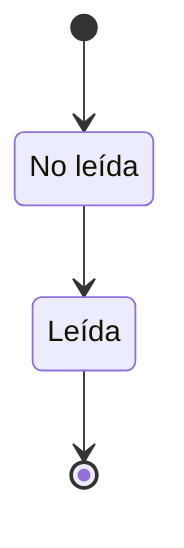

# FS-COM-02 — Centro de notificaciones

| Campo | Valor |
|---|---|
| **Módulo** | Comunicación (COM) |
| **Estado** | Borrador |
| **Responsable** | Por asignar |
| **Casos de uso** | [CU-23](../casos-de-uso.md#cu-23--consultar-notificaciones) |
| **Historias** | [HU-30](../historias.md#hu-30) |
| **Última actualización** | 2026-10-24 |

## 1. Objetivo

Reunir en un solo lugar la actividad que involucra al usuario, para que no tenga que revisar cada sección. Este spec define un mecanismo **común** que los demás módulos usan para generar notificaciones.

## 2. Quién es quién

| Actor | Qué hace | Qué ve | Qué no puede hacer |
|---|---|---|---|
| Destinatario | Abre sus notificaciones, las marca como leídas, elige qué correos recibe (FS-USR-05). | Solo sus notificaciones, de la más reciente a la más antigua. | Ver notificaciones de otros; desactivar los avisos de moderación. |
| Sistema | Crea notificaciones desde los eventos, envía correos y elimina las de más de 90 días. | — | Notificar a alguien por sus propias acciones. |
| Servicio de correo | Entrega los correos de actividad. | — | — |

## 3. Alcance

**Incluye:**

- Indicador de notificaciones no leídas en el menú.
- Panel de notificaciones con la lista y la acción de marcar como leídas.
- Mecanismo común para que cualquier módulo cree notificaciones.
- Envío por correo según las preferencias de [FS-USR-05](../../usuarios/specs/FS-USR-05-configuracion-cuenta.md).
- Los tipos de notificación de la red (Sprint 3).

**No incluye:**

- Notificaciones push en el celular.
- Resúmenes diarios o semanales por correo.

## 4. Reglas de negocio

| ID | Regla |
|---|---|
| RN-01 | Cada notificación tiene: destinatario, tipo, actor que la originó (si aplica), texto, enlace al elemento relacionado, fecha y estado (no leída o leída). |
| RN-02 | El indicador del menú muestra el número de notificaciones no leídas; a partir de 100 muestra "99+". |
| RN-03 | Una notificación se marca como leída al abrirla. También se pueden marcar todas como leídas. Abrir el panel no las marca como leídas. |
| RN-04 | El indicador se actualiza sin recargar la página, con un retraso máximo de 60 segundos. |
| RN-05 | Las notificaciones se conservan 90 días y luego se eliminan. |
| RN-06 | Si el elemento relacionado ya no existe (por ejemplo, una solicitud cancelada), la notificación se elimina o, si ya fue leída, muestra "Este contenido ya no está disponible" al abrirla. |
| RN-07 | Además de la notificación interna, se envía un correo solo si el tipo lo permite y el usuario lo tiene activado en FS-USR-05. |
| RN-08 | Nunca se notifica a un usuario por sus propias acciones. |
| RN-09 | Un mismo evento recibido dos veces crea una sola notificación (RNF-CON-04). |
| RN-10 | Mientras la cuenta del destinatario no esté activa, sus notificaciones se guardan pero no se envían correos; al reactivarse, las ve en su panel. |
| RN-11 | Tras tres rebotes seguidos a una dirección se dejan de enviar correos a esa dirección y se muestra un aviso en la plataforma (RNF-DIS-06). |

## 5. Requisitos funcionales

| ID | Requisito | Prioridad |
|---|---|---|
| RF-01 | El sistema debe mostrar un ícono de campana con el indicador de no leídas en el menú principal. | Alta |
| RF-02 | Al pulsar la campana, el sistema debe abrir un panel con las 20 notificaciones más recientes, con las no leídas resaltadas, y un enlace "Ver todas". | Alta |
| RF-03 | La página "Ver todas" debe mostrar el historial completo con carga progresiva y filtro "Solo no leídas". | Media |
| RF-04 | Al seleccionar una notificación, el sistema debe llevar al elemento relacionado y marcarla como leída. | Alta |
| RF-05 | El sistema debe ofrecer "Marcar todas como leídas". | Media |
| RF-06 | El sistema debe crear las notificaciones consumiendo los eventos de dominio de los demás módulos (ADR-004), aplicando RN-07 y RN-08 automáticamente. Ningún módulo llama a Comunicación para notificar. | Alta |

## 6. Datos y validaciones

**Catálogo de tipos de notificación.** Cada sprint agrega sus tipos aquí. Cada tipo nace de un evento de dominio ([catálogo de eventos](../../../../contracts/eventos/README.md)); `conexion.solicitud_aceptada` también se crea cuando dos solicitudes se cruzan ([FS-RED-01](../../red/specs/FS-RED-01-solicitudes-conexion.md), RN-02), para quien envió primero.

| Tipo | Evento de origen | Texto | Enlace | Correo | Sprint |
|---|---|---|---|---|---|
| `conexion.solicitud_recibida` | `conexion.solicitada` | "{actor} quiere conectar contigo." | Solicitudes recibidas | Sí, "Nuevas solicitudes de conexión" | 3 |
| `conexion.solicitud_aceptada` | `conexion.aceptada` | "{actor} aceptó tu solicitud de conexión." | Perfil del actor | No | 3 |
| `publicacion.comentario` | `publicacion.comentada` | "{actor} comentó tu publicación \"{título}\"." | Página de la publicación | No | 4 |
| `mensaje.nuevo` | `mensaje.enviado` | "{actor} te envió un mensaje." (una por conversación con mensajes sin leer) | Conversación | Sí, "Mensajes privados sin leer", tras 1 hora sin leer | 5 |
| `moderacion.contenido_retirado` | `contenido.retirado` | "Retiramos tu {publicación / comentario / evento / oportunidad / proyecto / perfil} \"{título}\" por incumplir las normas de la comunidad." | Contenido retirado (vista del autor) | Siempre (no se puede desactivar) | 5 |
| `moderacion.reporte_revisado` | `reporte.revisado` | "Revisamos el contenido que reportaste." | Sin enlace | No | 5 |
| `postulacion.nueva` | `postulacion.creada` | "{actor} se postuló a \"{oportunidad}\"." | Panel de postulaciones | Sí, "Nuevas postulaciones a mis oportunidades" | 6 |
| `postulacion.estado_cambiado` | `postulacion.estado_cambiado` | "Tu postulación a \"{oportunidad}\" está {estado}." | Postulación en "Mis postulaciones" | Sí, "Cambios en mis postulaciones" | 6 |
| `oportunidad.cancelada` | `oportunidad.cancelada` | "Se canceló \"{oportunidad}\": {motivo}." (a quienes tenían la postulación pendiente) | Postulación en "Mis postulaciones" | Sí, "Cambios en mis postulaciones" | 6 |
| `postulacion.retirada` | `postulacion.retirada` | "{actor} retiró su postulación a \"{oportunidad}\"." | Panel de postulaciones | No | 6 |
| `evento.recordatorio` | Tarea programada (Sistema) | "Mañana es \"{evento}\" a las {hora}." | Detalle del evento | Sí, "Eventos a los que asistiré" | 7 |
| `evento.actualizado` | `evento.actualizado` | "Cambió {fecha / lugar / enlace} de \"{evento}\"." | Detalle del evento | Sí, "Eventos a los que asistiré" | 7 |
| `evento.cancelado` | `evento.cancelado` | "Se canceló \"{evento}\": {motivo}." | Detalle del evento | Sí, "Eventos a los que asistiré" | 7 |
| `evento.retirado` | `evento.retirado` | "Se retiró \"{evento}\" por incumplir las normas de la comunidad." (a los asistentes) | Detalle del evento | Sí, "Eventos a los que asistiré" | 7 |
| `proyecto.solicitud_recibida` | `proyecto.solicitud_creada` | "{actor} quiere unirse a \"{proyecto}\"." | Miembros > Solicitudes | Sí, "Actividad en mis proyectos" | 8 |
| `proyecto.solicitud_respondida` | `proyecto.solicitud_respondida` | "Tu solicitud para unirte a \"{proyecto}\" fue {aprobada / rechazada}." | Espacio del proyecto | Sí, "Actividad en mis proyectos" | 8 |
| `proyecto.invitacion` | `proyecto.invitacion_creada` | "{actor} te invitó a unirte a \"{proyecto}\"." | Resumen del proyecto | Sí, "Actividad en mis proyectos" | 8 |
| `proyecto.tarea_asignada` | `proyecto.tarea_asignada` | "{actor} te asignó la tarea \"{tarea}\" en \"{proyecto}\"." | Tareas del proyecto | No | 8 |
| `proyecto.rol_cambiado` | `proyecto.rol_cambiado` | "Ahora eres {rol} en \"{proyecto}\"." | Miembros del proyecto | No | 8 |
| `proyecto.miembro_retirado` | `proyecto.miembro_retirado` | "Ya no eres miembro de \"{proyecto}\"." | Resumen del proyecto | Sí, "Actividad en mis proyectos" | 8 |

## 7. Estados



| Estado | Entra cuando | Sale hacia |
|---|---|---|
| No leída | Se crea | **Leída** al abrirla o al marcar todas |
| Leída | RN-03 | Se elimina a los 90 días |

## 8. Flujo principal

1. **Cualquier página** → campana → **Panel de notificaciones** → selecciona una → **Elemento relacionado**.
2. **Panel** → "Ver todas" → **Página de notificaciones**.

## 9. Variaciones

| Variación | Qué cambia | Regla |
|---|---|---|
| Tipo con correo y preferencia activa | Además de la notificación, un correo. | RN-07 |
| Preferencia desactivada | Solo la notificación interna. | RN-07 |
| Aviso de moderación | Siempre con correo. | Catálogo |
| Elemento relacionado eliminado | Se elimina la notificación o muestra MSG-02. | RN-06 |
| Más de 99 sin leer | "99+". | RN-02 |

## 10. ¿Qué pasaría si…?

| Situación | Comportamiento esperado | Regla o pregunta |
|---|---|---|
| El mismo evento llega dos veces | Una sola notificación. | RN-09 |
| El destinatario está suspendido | Se guardan sin correo; las ve al volver. | RN-10 |
| El canal de tiempo real está caído | El indicador se actualiza al recargar o reconectar. | RN-04, ADR-007 |
| El servicio de correo falla | Los correos se reintentan; la notificación interna ya existe. | RNF-DIS-05, EC-02 |
| La dirección de correo rebota | A los tres rebotes se dejan de enviar correos y aparece MSG-04. | RN-11 |
| Marca todas como leídas mientras llega una nueva | La nueva queda sin leer. | RN-03 |
| Privacidad: el texto revela contenido privado | Los textos solo nombran al actor y al elemento; nunca el contenido de un mensaje. | Catálogo |

## 11. Mensajes al usuario

| Código | Situación | Mensaje |
|---|---|---|
| MSG-01 | Sin notificaciones | "No tienes notificaciones." |
| MSG-02 | Elemento eliminado | "Este contenido ya no está disponible." |
| MSG-03 | Todas leídas | "Marcaste todas las notificaciones como leídas." |
| MSG-04 | Correo que rebota | "No pudimos entregar correos a tu dirección. Revisa tu correo en la configuración." |

## 12. Resultado esperado

```gherkin
Escenario: Recibir una notificación
  Dado que tengo la plataforma abierta
  Cuando Luis me envía una solicitud de conexión
  Entonces en menos de 60 segundos la campana muestra 1 sin que recargue la página

Escenario: Abrir una notificación
  Dado que tengo una notificación de solicitud de Luis sin leer
  Cuando la selecciono
  Entonces llego a mis solicitudes recibidas
  Y la notificación queda como leída
  Y el indicador disminuye en 1

Escenario: Abrir el panel no marca como leídas
  Dado que tengo 3 notificaciones sin leer
  Cuando abro y cierro el panel sin seleccionar ninguna
  Entonces el indicador sigue mostrando 3

Escenario: Marcar todas como leídas
  Dado que tengo 5 notificaciones sin leer
  Cuando pulso "Marcar todas como leídas"
  Entonces el indicador desaparece

Escenario: Correo según preferencias
  Dado que desactivé el correo "Nuevas solicitudes de conexión"
  Cuando Luis me envía una solicitud
  Entonces recibo la notificación interna
  Y no recibo correo

Escenario: Solicitud cancelada
  Dado que Luis me envió una solicitud y luego la canceló
  Y yo no había leído la notificación
  Entonces la notificación desaparece de mi panel

Escenario: Más de 99
  Dado que tengo 120 notificaciones sin leer
  Entonces el indicador muestra "99+"

Escenario: Evento repetido
  Dado que el evento de la solicitud de Luis llega dos veces
  Entonces tengo una sola notificación de esa solicitud

Escenario: Destinatario suspendido
  Dado que mi cuenta está suspendida
  Cuando Luis comenta mi publicación
  Entonces no recibo correo
  Y al reactivarse mi cuenta veo la notificación en el panel

Escenario: Correo que rebota
  Dado que los correos a mi dirección rebotaron tres veces seguidas
  Entonces dejan de enviarse correos a mi dirección
  Y veo el mensaje MSG-04 en la plataforma

Escenario: Notificación nueva al marcar todas
  Dado que pulso "Marcar todas como leídas"
  Cuando en ese momento llega una notificación nueva
  Entonces la nueva queda sin leer
```

## 13. Contratos

**Expone:**

- API: `GET /api/v1/comunicacion/notificaciones`, `GET /api/v1/comunicacion/notificaciones/no-leidas`, `POST /api/v1/comunicacion/notificaciones/{id}/lectura`, `POST /api/v1/comunicacion/notificaciones/lectura` ([contrato](../../../../contracts/api/comunicacion.yaml)).
- Canal de tiempo real para el indicador (ADR-007).

**Consume:** los eventos del [catálogo](../../../../contracts/eventos/README.md); Usuarios: preferencias de correo y dirección del destinatario.

## 14. Calidad

RNF-REN-05, RNF-DIS-05, RNF-DIS-06, RNF-CON-04, RNF-PRI-09 (90 días), [EC-02](../../../srs/Especificacion_Requisitos.md#34-escenarios-de-atributos-de-calidad).

## 15. Preguntas abiertas

- P-16 — tiempo real (ADR-007).

## 16. Lista de revisión

- [x] Cada actor de "Quién es quién" existe en el [SRS §2.4](../../../srs/Especificacion_Requisitos.md#24-actores-del-sistema) con el mismo nombre.
- [x] Toda acción tiene un actor que puede hacerla y se valida en el servidor (RNF-SEG-04).
- [ ] Cada regla tiene al menos un escenario en "Resultado esperado".
- [x] "¿Qué pasaría si…?" revisó las siete situaciones: concurrencia, estado de la cuenta, eliminación de lo que usa, pérdida de permiso, falla externa, límites de uso y privacidad.
- [ ] Ningún dato se recoge sin finalidad (RNF-PRI-01).
- [x] No contradice a su caso de uso, a su historia ni a otro spec.
- [x] Sus contratos existen en [`contracts/`](../../../../contracts/README.md).
- [ ] No tiene preguntas abiertas que bloqueen el desarrollo.

## 17. Historial de cambios

| Fecha | Autor | Cambio |
|---|---|---|
| 2026-10-06 | Gamero | Creación |
| 2026-10-24 | Equipo UniLink | Estudio de quién es quién, variaciones, casos límite y contratos; nueva plantilla. |
