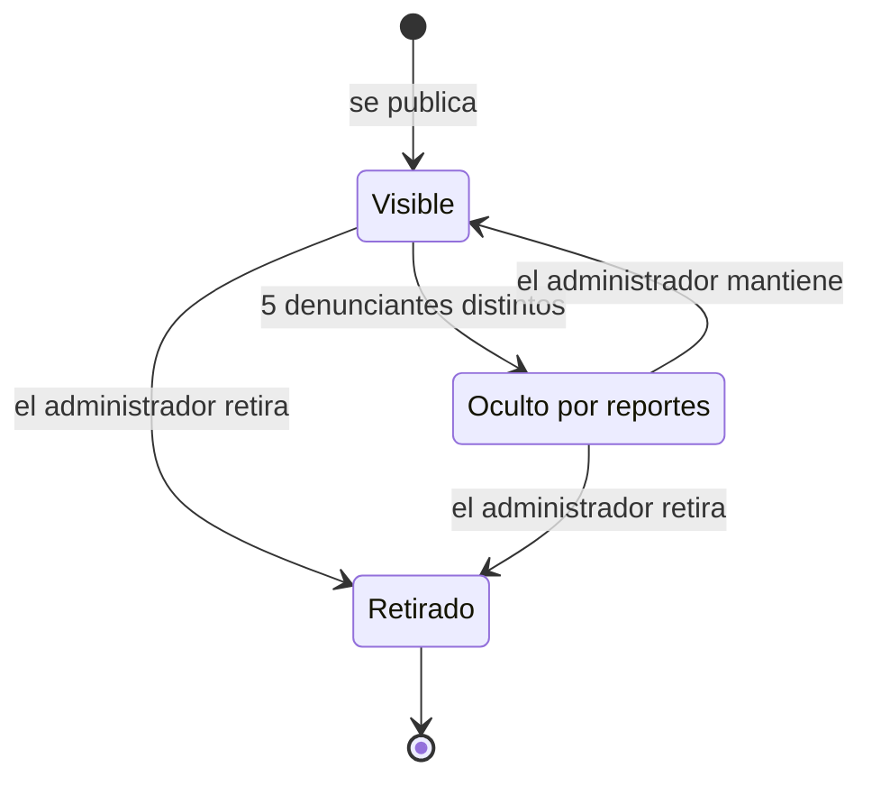

# Módulo Contenido (CNT)

## Propósito

Lo que la comunidad publica y cómo se cuida: **publicaciones, comentarios y reacciones**, el **feed** de cada usuario y la **moderación** de todo el contenido público de la plataforma.

La moderación es **transversal**: cualquier módulo con contenido público (perfiles, oportunidades, eventos, proyectos) lo hace moderable implementando el contrato `Reportable`; la cola, los motivos, el umbral y las decisiones son los mismos para todos.

**No es responsabilidad de este módulo:** la lista de palabras prohibidas y las categorías (las administra [Plataforma](../plataforma/README.md)); las sanciones a cuentas ([Usuarios](../usuarios/README.md), FS-USR-08).

## Documentos

| Documento | Contenido |
|---|---|
| [Casos de uso](./casos-de-uso.md) | CU-08, CU-09, CU-25 |
| [Historias de usuario](./historias.md) | HU-08, HU-09, HU-18, HU-19 |
| [FS-CNT-01](./specs/FS-CNT-01-publicaciones-feed.md) | Publicaciones y feed |
| [FS-CNT-02](./specs/FS-CNT-02-moderacion-contenido.md) | Moderación de contenido (incluye el contrato `Reportable`) |

## Quién es quién

| Actor | En este módulo |
|---|---|
| Autor | Publica, edita y elimina sus publicaciones; comenta; elimina comentarios en sus publicaciones. |
| Lector | Ve el feed, reacciona, comenta y comparte. |
| Denunciante | Reporta cualquier contenido público ajeno. |
| Administrador de la plataforma | Revisa la cola y decide retirar o mantener. |
| Sistema | Oculta automáticamente lo que reportan 5 usuarios distintos. |

| Acción | Autor | Lector | Denunciante | Administrador de la plataforma |
|---|---|---|---|---|
| Publicar, editar, eliminar | ✓ (lo propio) | — | — | — |
| Comentar y reaccionar | ✓ | ✓ | — | — |
| Reportar | — (lo propio no) | — | ✓ | — |
| Retirar o mantener | — | — | — | ✓ (no lo propio) |

## Entidades y datos propios

| Entidad | Datos |
|---|---|
| Publicación | Autor, título, texto, categoría, adjuntos, estado, fechas, marca "Editada". |
| Comentario y reacción | Autor, texto o tipo, fecha. |
| Reporte | Elemento (tipo y módulo dueño), denunciante, motivo, descripción, estado. |
| Decisión de moderación | Elemento, administrador, decisión, norma, comentario, fecha. |

Este ciclo vale para cualquier elemento `Reportable`; el estado propio de cada elemento (por ejemplo, un evento Programado) lo lleva su módulo.

## Expone

| Tipo | Elemento |
|---|---|
| API | `/api/v1/contenido/...`: publicaciones, feed, comentarios, reacciones, reportes y moderación ([contrato](../../../contracts/api/contenido.yaml)). |
| Interfaz pública | Reportar un elemento; si un elemento está oculto o retirado ([contrato](../../../contracts/modulos/contenido.md)). |
| Contrato `Reportable` | Lo implementan Usuarios (perfil), Contenido (publicación y comentario) y Colaboración (oportunidad, evento y proyecto). |
| Eventos | `publicacion.comentada`, `contenido.reportado`, `contenido.retirado`, `reporte.revisado`, `auditoria.registrada` ([catálogo](../../../contracts/eventos/README.md)). |

## Consume

| De | Qué | Para |
|---|---|---|
| Usuarios | Datos públicos del autor, estado de la cuenta, categorías de interés | Mostrar y ordenar el feed. |
| Red | Si son conexiones; qué ve un observador | Visibilidad de publicaciones (FS-CNT-01 RN-06). |
| Plataforma | Categorías de tipo Publicaciones; palabras prohibidas | Publicar y filtrar textos. |
| Implementaciones de `Reportable` | Resumen, ocultar, restaurar y retirar | Moderar contenido de otros módulos. |

## Preguntas abiertas del módulo

P-13, P-29, P-31, P-32, P-35, P-49.
