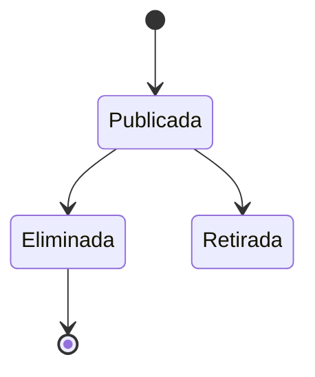

# FS-CNT-01 — Publicaciones y feed

| Campo | Valor |
|---|---|
| **Módulo** | Contenido (CNT) |
| **Estado** | Borrador |
| **Responsable** | Por asignar |
| **Casos de uso** | [CU-08](../casos-de-uso.md#cu-08--publicar-contenido), [CU-09](../casos-de-uso.md#cu-09--visualizar-publicaciones) |
| **Historias** | [HU-08](../historias.md#hu-08), [HU-09](../historias.md#hu-09) |
| **Última actualización** | 2026-10-24 |

## 1. Objetivo

Permitir que la comunidad comparta proyectos, logros y artículos, y que cada usuario vea en su feed el contenido de su red y de sus temas de interés, incluso si todavía no tiene conexiones.

## 2. Quién es quién

| Actor | Qué hace | Qué ve | Qué no puede hacer |
|---|---|---|---|
| Autor | Publica, edita (título, texto y categoría) y elimina sus publicaciones; elimina comentarios en ellas. | Sus publicaciones aunque estén ocultas o retiradas, con el motivo. | Cambiar adjuntos después de publicar; publicar con palabras prohibidas. |
| Lector | Ve el feed, reacciona, comenta y comparte el enlace. | Lo que permite la privacidad del autor (RN-06). | Ver publicaciones de un perfil "Solo mis conexiones" sin ser su conexión; reaccionar dos veces. |
| Denunciante | Reporta publicaciones y comentarios ajenos (FS-CNT-02). | — | Reportar lo propio. |
| Sistema | Arma el feed con contenido de respaldo y ordena por relevancia. | — | — |

## 3. Alcance

**Incluye:**

- Crear, editar y eliminar publicaciones propias, con imágenes o un PDF adjunto.
- Feed con publicaciones de conexiones, categorías de interés y contenido de respaldo para usuarios nuevos.
- Filtro por categoría y orden "Recientes" o "Relevantes".
- Interacciones: reacción "Me gusta", comentarios y compartir enlace.
- Página individual de cada publicación.

**No incluye:**

- Reportar publicaciones y moderación (FS-CNT-02, Sprint 5).
- Compartir una publicación por mensaje privado (FS-COM-01, Sprint 5).
- Volver a publicar contenido de otros en el propio perfil, menciones (@) y etiquetas (#).
- Encuestas o videos.

## 4. Reglas de negocio

**Publicaciones**

| ID | Regla |
|---|---|
| RN-01 | Toda publicación tiene título, texto y una categoría activa de tipo "Publicaciones" ([FS-PLT-01](../../plataforma/specs/FS-PLT-01-gestion-categorias.md)). |
| RN-02 | Adjuntos: hasta 4 imágenes (JPG, PNG o WebP, máximo 5 MB cada una) **o** un PDF (máximo 10 MB). No se pueden combinar imágenes y PDF. |
| RN-03 | Antes de publicar, el sistema revisa el título y el texto contra la lista de palabras prohibidas que administra [FS-PLT-01](../../plataforma/specs/FS-PLT-01-gestion-categorias.md). Si hay coincidencias, rechaza la publicación e indica el motivo. |
| RN-04 | El autor puede editar el título, el texto y la categoría en cualquier momento; la publicación muestra "Editada". Los adjuntos no se pueden cambiar después de publicar. |
| RN-05 | Al eliminar una publicación se eliminan también sus comentarios y reacciones. |
| RN-06 | **Visibilidad:** si el perfil del autor es "Comunidad", la publicación la ve cualquier usuario autenticado. Si es "Solo mis conexiones", solo la ven sus conexiones. |

**Feed**

| ID | Regla |
|---|---|
| RN-07 | El feed muestra, de los últimos 30 días: publicaciones propias, de las conexiones y de las categorías de interés del usuario ([FS-USR-04](../../usuarios/specs/FS-USR-04-preferencias-contenido.md)), respetando RN-06. |
| RN-08 | **Contenido de respaldo:** si RN-07 da menos de 10 publicaciones, se completa con publicaciones recientes de la facultad del usuario y, si aún faltan, con las más recientes de toda la plataforma. Estas se marcan como "Sugerida para ti". |
| RN-09 | **Orden "Recientes"** (por defecto): de la más nueva a la más antigua. |
| RN-10 | **Orden "Relevantes":** puntaje = (reacciones + comentarios × 2) + 10 si el autor es conexión + 5 si la categoría es de interés, dividido entre (horas desde la publicación + 2). Así el contenido nuevo y con actividad sube, y el viejo baja. |
| RN-11 | El feed carga 10 publicaciones a la vez a medida que el usuario se desplaza. |

**Interacciones**

| ID | Regla |
|---|---|
| RN-12 | Cada usuario puede dar un solo "Me gusta" por publicación y puede quitarlo. |
| RN-13 | Los comentarios tienen máximo 1.000 caracteres, no admiten respuestas anidadas y pasan por la misma revisión de RN-03. |
| RN-14 | El autor de un comentario puede eliminarlo. El autor de la publicación puede eliminar cualquier comentario de su publicación. |
| RN-15 | "Compartir" copia el enlace de la publicación. El enlace solo funciona para usuarios autenticados que tengan permiso de verla según RN-06. |
| RN-16 | Se notifica al autor de la publicación cuando alguien comenta ([FS-COM-02](../../comunicacion/specs/FS-COM-02-centro-notificaciones.md)). Las reacciones no generan notificación, para no saturar al usuario. |
| RN-17 | Las publicaciones y los comentarios implementan el contrato `Reportable` de [FS-CNT-02](./FS-CNT-02-moderacion-contenido.md). Una publicación retirada u oculta no aparece en ningún feed, perfil ni enlace, salvo para su autor. |
| RN-18 | Si la subida de un adjunto falla, la publicación no se crea y el texto escrito se conserva para reintentar (MSG-09). |
| RN-19 | Una edición sobre una publicación que cambió mientras tanto (otra pestaña o un retiro) recibe un conflicto y muestra la versión actual (RNF-CON-02). |

## 5. Requisitos funcionales

| ID | Requisito | Prioridad |
|---|---|---|
| RF-01 | El sistema debe ofrecer un cuadro "Comparte algo con la comunidad" en la parte superior del feed que abre el formulario de publicación. | Alta |
| RF-02 | El sistema debe validar y publicar según RN-01 a RN-03, y mostrar la publicación de inmediato al inicio del feed del autor. | Alta |
| RF-03 | El sistema debe mostrar cada publicación con: foto, nombre y titular del autor, fecha relativa ("hace 2 h"), categoría, título, texto (recortado a 5 líneas con "Ver más"), adjuntos, número de "Me gusta" y de comentarios, y los botones de interacción. | Alta |
| RF-04 | El sistema debe ofrecer el filtro por categoría y el selector "Recientes / Relevantes" en el feed. | Media |
| RF-05 | El sistema debe permitir editar y eliminar publicaciones propias (RN-04, RN-05), pidiendo confirmación para eliminar. | Alta |
| RF-06 | El sistema debe permitir dar o quitar "Me gusta" y mostrar la lista de quiénes reaccionaron. | Media |
| RF-07 | El sistema debe permitir comentar y mostrar los 2 comentarios más recientes bajo la publicación, con "Ver todos los comentarios". | Alta |
| RF-08 | Cada publicación debe tener una página propia accesible por enlace (RN-15). | Media |
| RF-09 | El perfil de cada usuario debe mostrar una pestaña "Publicaciones" con las suyas, respetando RN-06. | Media |
| RF-10 | Los PDF deben poder abrirse o descargarse; las imágenes deben verse ampliadas al pulsarlas. | Media |

## 6. Datos y validaciones

| Campo | Tipo | Obligatorio | Validación |
|---|---|---|---|
| Título | Texto | Sí | 5 a 120 caracteres. |
| Texto | Texto largo | Sí | 10 a 3.000 caracteres. Los enlaces se convierten en vínculos. |
| Categoría | Lista | Sí | Categorías activas de tipo "Publicaciones". |
| Imágenes | Archivos | No | RN-02. Cada imagen admite una descripción opcional de hasta 250 caracteres para lectores de pantalla ([RNF-ACC-05](../../../srs/Especificacion_Requisitos.md#336-accesibilidad)). |
| PDF | Archivo | No | RN-02. |
| Comentario | Texto | Sí, para comentar | 1 a 1.000 caracteres; RN-13. |

## 7. Estados



| Estado de la publicación | Entra cuando | Sale hacia |
|---|---|---|
| Publicada | Pasa la validación | **Eliminada** por su autor; **Retirada** por un administrador (FS-CNT-02) |
| Eliminada | El autor la elimina | Estado final |

## 8. Flujo principal

1. **Feed** → "Comparte algo con la comunidad" → **Formulario** → "Publicar" → **Feed** con la publicación arriba.
2. **Feed** → "Me gusta" o "Comentar" en una publicación → se actualiza en el mismo lugar.
3. **Feed** → menú "…" de una publicación propia → "Editar" o "Eliminar".
4. **Enlace compartido** → **Página de la publicación**.

## 9. Variaciones

| Variación | Qué cambia | Regla |
|---|---|---|
| Con imágenes o con un PDF | Hasta 4 imágenes **o** 1 PDF. | RN-02 |
| Usuario sin red ni categorías | Contenido de respaldo de su facultad y de la plataforma. | RN-08 |
| Personal administrativo (sin facultad) | El respaldo usa las publicaciones más recientes de toda la plataforma. | RN-08 |
| Orden "Relevantes" | Puntaje por actividad, conexión e interés. | RN-10 |
| Autor con perfil "Solo mis conexiones" | Solo sus conexiones ven sus publicaciones. | RN-06 |
| Publicación editada | Muestra "Editada". | RN-04 |

## 10. ¿Qué pasaría si…?

| Situación | Comportamiento esperado | Regla o pregunta |
|---|---|---|
| Comenta una publicación que su autor acaba de eliminar | El comentario se rechaza con MSG-06. | RN-05 |
| Dos "Me gusta" del mismo usuario a la vez | Cuenta uno solo. | RN-12 |
| El autor edita mientras un administrador la retira | El retiro prevalece; la edición recibe un conflicto. | RN-19, FS-CNT-02 |
| La cuenta del autor se suspende | Sus publicaciones y comentarios dejan de verse hasta la reactivación. | FS-USR-08 RN-04 |
| Falla el almacenamiento al subir adjuntos | No se publica; el texto se conserva (MSG-09). | RN-18 |
| Publica dos veces por un reintento | Se crea una sola publicación. | RNF-CON-03 |
| Cambia la lista de palabras prohibidas | Lo ya publicado no se revisa de nuevo; se revisa al editar. Lo inapropiado se reporta. | RN-03 |
| La categoría se desactiva | La publicación la conserva (FS-PLT-01 RN-05). | FS-PLT-01 |
| Privacidad: alguien comparte el enlace con quien no puede verla | Ve MSG-06. | RN-15 |

## 11. Mensajes al usuario

| Código | Situación | Mensaje |
|---|---|---|
| MSG-01 | Publicación creada | "Tu publicación ya está en el feed." |
| MSG-02 | Contenido rechazado (RN-03) | "Tu publicación contiene términos que no cumplen las normas de la comunidad. Revisa el texto e inténtalo de nuevo." |
| MSG-03 | Adjunto inválido | "Puedes adjuntar hasta 4 imágenes (JPG, PNG o WebP, máximo 5 MB) o un PDF de máximo 10 MB." |
| MSG-04 | Confirmar eliminación | "¿Eliminar esta publicación? También se eliminarán sus comentarios." |
| MSG-05 | Enlace copiado | "Enlace copiado." |
| MSG-06 | Sin permiso o eliminada | "Esta publicación no está disponible." |
| MSG-07 | Filtro sin resultados | "No hay publicaciones recientes en esta categoría." |
| MSG-08 | Etiqueta de respaldo | "Sugerida para ti" |
| MSG-09 | Adjunto no subido | "No pudimos subir tus archivos. Tu texto sigue aquí; inténtalo de nuevo." |

## 12. Resultado esperado

```gherkin
Escenario: Publicar con imágenes
  Dado que estoy en el feed
  Cuando creo una publicación con título, texto, categoría "Logros académicos" y 2 imágenes
  Entonces veo el mensaje MSG-01
  Y la publicación aparece primera en mi feed

Escenario: Mezclar imágenes y PDF
  Dado que adjunté una imagen
  Cuando intento adjuntar un PDF
  Entonces veo el mensaje MSG-03

Escenario: Palabras prohibidas
  Dado que el texto de mi publicación contiene una palabra de la lista prohibida
  Cuando intento publicar
  Entonces veo el mensaje MSG-02 y la publicación no se crea

Escenario: Feed de un usuario con red
  Dado que estoy conectado con Luis y me interesa la categoría "Tecnología"
  Cuando abro el feed
  Entonces veo las publicaciones de Luis y las de "Tecnología" de los últimos 30 días

Escenario: Feed de un usuario nuevo
  Dado que no tengo conexiones ni categorías de interés
  Cuando abro el feed
  Entonces veo publicaciones recientes de mi facultad marcadas como "Sugerida para ti"

Escenario: Publicación de un perfil privado
  Dado que el perfil de Luis es "Solo mis conexiones" y no estoy conectado con él
  Entonces no veo sus publicaciones en mi feed ni en su perfil
  Y si abro el enlace de una de ellas veo el mensaje MSG-06

Escenario: Comentar y notificar
  Dado que veo una publicación de Luis
  Cuando escribo un comentario
  Entonces el comentario aparece bajo la publicación
  Y Luis recibe una notificación

Escenario: Moderar comentarios propios
  Dado que Pedro comentó en mi publicación
  Cuando elimino su comentario
  Entonces el comentario desaparece

Escenario: Editar publicación
  Dado que tengo una publicación
  Cuando cambio su texto
  Entonces la publicación muestra el nuevo texto y la etiqueta "Editada"

Escenario: Orden por relevancia
  Dado que hay dos publicaciones de la misma hora
  Y una tiene 10 comentarios y la otra ninguno
  Cuando elijo "Relevantes"
  Entonces la publicación con comentarios aparece primero

Escenario: Comentar una publicación eliminada
  Dado que estoy escribiendo un comentario en la publicación de Luis
  Cuando Luis la elimina antes de que envíe
  Entonces veo el mensaje MSG-06 y el comentario no se guarda

Escenario: Me gusta repetido
  Dado que pulso "Me gusta" dos veces seguidas en la misma publicación
  Entonces la publicación cuenta un solo "Me gusta" mío

Escenario: Falla al subir adjuntos
  Dado que el almacenamiento de archivos no responde
  Cuando publico con 2 imágenes
  Entonces la publicación no se crea
  Y veo el mensaje MSG-09 con mi texto intacto

Escenario: Autor suspendido
  Dado que la cuenta de Luis se suspende
  Cuando abro mi feed
  Entonces no veo las publicaciones de Luis

Escenario: Publicación retirada
  Dado que un administrador retiró una publicación de Luis
  Cuando abro su enlace
  Entonces veo el mensaje MSG-06
```

## 13. Contratos

**Expone:**

- API: `GET /api/v1/contenido/feed`, `POST /api/v1/contenido/publicaciones`, `GET`, `PUT` y `DELETE /api/v1/contenido/publicaciones/{id}`, `POST /api/v1/contenido/publicaciones/{id}/comentarios`, `DELETE /api/v1/contenido/comentarios/{id}`, `PUT` y `DELETE /api/v1/contenido/publicaciones/{id}/reaccion`, `GET /api/v1/contenido/usuarios/{id}/publicaciones` ([contrato](../../../../contracts/api/contenido.yaml)).
- `Reportable` para "publicación" y "comentario".
- Evento: `publicacion.comentada` ([catálogo](../../../../contracts/eventos/README.md)).

**Consume:** Red (conexiones y visibilidad), Usuarios (autor, estado y categorías de interés), Plataforma (categorías y palabras prohibidas).

## 14. Calidad

RNF-SEG-06 (adjuntos), RNF-ACC-05, RNF-REN-02, RNF-CON-02, RNF-CON-03, [EC-01](../../../srs/Especificacion_Requisitos.md#34-escenarios-de-atributos-de-calidad).

## 15. Preguntas abiertas

- P-29 — quién mantiene la lista de palabras prohibidas.
- P-31 — ¿una o varias reacciones?

## 16. Lista de revisión

- [x] Cada actor de "Quién es quién" existe en el [SRS §2.4](../../../srs/Especificacion_Requisitos.md#24-actores-del-sistema) con el mismo nombre.
- [x] Toda acción tiene un actor que puede hacerla y se valida en el servidor (RNF-SEG-04).
- [ ] Cada regla tiene al menos un escenario en "Resultado esperado".
- [x] "¿Qué pasaría si…?" revisó las siete situaciones: concurrencia, estado de la cuenta, eliminación de lo que usa, pérdida de permiso, falla externa, límites de uso y privacidad.
- [ ] Ningún dato se recoge sin finalidad (RNF-PRI-01).
- [x] No contradice a su caso de uso, a su historia ni a otro spec.
- [x] Sus contratos existen en [`contracts/`](../../../../contracts/README.md).
- [ ] No tiene preguntas abiertas que bloqueen el desarrollo.

## 17. Historial de cambios

| Fecha | Autor | Cambio |
|---|---|---|
| 2026-10-06 | Gamero | Creación |
| 2026-10-24 | Equipo UniLink | Estudio de quién es quién, variaciones, casos límite y contratos; nueva plantilla. |
