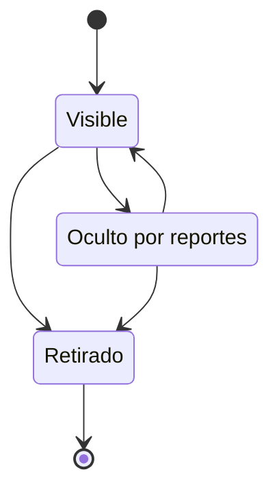

# FS-CNT-02 — Moderación de contenido

| Campo | Valor |
|---|---|
| **Módulo** | Contenido (CNT) |
| **Estado** | Borrador |
| **Responsable** | Por asignar |
| **Casos de uso** | [CU-25](../casos-de-uso.md#cu-25--moderar-contenido-publicaciones-y-eventos) |
| **Historias** | [HU-18](../historias.md#hu-18), [HU-19](../historias.md#hu-19) |
| **Última actualización** | 2026-10-24 |

## 1. Objetivo

Mantener un espacio seguro y respetuoso: los usuarios reportan el contenido que incumple las normas, y el administrador lo revisa y decide si lo retira, con un registro de cada decisión.

## 2. Quién es quién

| Actor | Qué hace | Qué ve | Qué no puede hacer |
|---|---|---|---|
| Denunciante | Reporta un elemento ajeno con un motivo. | La confirmación y, después, el aviso de que se revisó. | Reportar lo propio o dos veces lo mismo; saber la decisión. |
| Autor | Recibe el aviso si su contenido se retira. | Su contenido retirado con la norma y el motivo. | Saber quién lo reportó. |
| Administrador de la plataforma | Revisa la cola, retira o mantiene; retira contenido sin reportes. | El contenido, el autor, los motivos agrupados y el historial. | Decidir sobre contenido propio (RN-15). |
| Sistema | Oculta lo que reportan 5 usuarios distintos. | — | Retirar contenido por su cuenta. |

## 3. Alcance

**Incluye:**

- Reportar cualquier contenido público mediante el contrato `Reportable`: publicaciones y comentarios (Sprint 5), perfiles (Sprint 5), oportunidades (Sprint 6), eventos (Sprint 7) y proyectos (Sprint 8).
- Ocultamiento automático del contenido con muchos reportes.
- Cola de moderación para el administrador.
- Retirar contenido o descartar reportes, con aviso al autor y al denunciante.
- Mecanismo común de reportes que reutilizarán los demás tipos de contenido.

**No incluye:**

- Reportar mensajes privados (pendiente de P-32) y servicios (fase 2).
- HU-19 (eventos) queda completa en el Sprint 7, cuando Colaboración implementa `Reportable` para eventos.
- Moderación automática con inteligencia artificial.

## 4. Reglas de negocio

| ID | Regla |
|---|---|
| RN-01 | Se puede reportar cualquier elemento `Reportable` de otro usuario (RN-13). No se puede reportar el propio contenido. |
| RN-02 | Un usuario solo puede reportar una vez el mismo elemento. |
| RN-03 | Motivos de reporte: Spam, Acoso o lenguaje ofensivo, Información falsa, Contenido inapropiado, Otro. Con "Otro", el usuario debe escribir una descripción. |
| RN-04 | Cuando un elemento recibe reportes de 5 usuarios distintos, se oculta automáticamente a todos menos a su autor, hasta que un administrador lo revise. |
| RN-05 | La cola de moderación muestra los elementos con reportes pendientes, ordenados primero por ocultos automáticamente y después por número de reportes. |
| RN-06 | **Retirar:** el elemento deja de verse para todos. Su autor lo ve en su perfil marcado como "Retirado por moderación" junto con el motivo, y recibe una notificación y un correo. |
| RN-07 | **Mantener:** los reportes pendientes se descartan y el elemento vuelve a verse si estaba oculto. Los reportes futuros vuelven a la cola, pero el elemento ya no se oculta automáticamente. |
| RN-08 | El administrador también puede retirar contenido sin reportes, desde el listado de publicaciones. |
| RN-09 | Retirar exige seleccionar la norma incumplida y escribir un comentario de al menos 20 caracteres. |
| RN-10 | El autor nunca sabe quién lo reportó. Los denunciantes reciben una notificación cuando su reporte se revisa, sin detalles de la decisión. |
| RN-11 | Cada decisión queda registrada con el administrador, la fecha, la decisión y el motivo (registro de [FS-PLT-01](../../plataforma/specs/FS-PLT-01-gestion-categorias.md)). El contenido retirado cuenta en el historial del autor ([FS-USR-08](../../usuarios/specs/FS-USR-08-gestion-cuentas.md)). |
| RN-12 | Retirar una publicación retira también sus comentarios. |
| RN-13 | **Contrato `Reportable`.** Cada módulo con contenido público lo implementa para sus tipos y ofrece: un resumen para la cola (texto, autor, enlace), ocultar, restaurar y retirar. La moderación no conoce los detalles de cada tipo ([interfaz](../../../../contracts/modulos/contenido.md)). Tipos: publicación, comentario (Contenido), perfil (Usuarios), oportunidad, evento y proyecto (Colaboración). |
| RN-14 | La lista de palabras prohibidas de [FS-PLT-01](../../plataforma/specs/FS-PLT-01-gestion-categorias.md) se aplica a todo texto público al crearlo o editarlo: publicaciones, comentarios, perfiles, oportunidades, eventos y proyectos. |
| RN-15 | Un administrador no decide sobre contenido propio: ese elemento lo resuelve otro administrador. |
| RN-16 | Si el autor elimina el elemento antes de la revisión, sus reportes se cierran y sale de la cola. |
| RN-17 | Si el autor edita un elemento oculto por reportes, sigue oculto hasta que un administrador lo revise. |

## 5. Requisitos funcionales

| ID | Requisito | Prioridad |
|---|---|---|
| RF-01 | El sistema debe agregar la opción "Reportar" a todo elemento `Reportable` ajeno, con el formulario de motivos (RN-03). | Alta |
| RF-02 | El sistema debe aplicar RN-02 y RN-04 automáticamente. | Alta |
| RF-03 | El panel de administración debe incluir la sección "Moderación" con la cola (RN-05) y un indicador del número de elementos pendientes. | Alta |
| RF-04 | Cada elemento de la cola debe mostrar el contenido completo, su autor, la cantidad de reportes, los motivos agrupados y los comentarios de "Otro". | Alta |
| RF-05 | El sistema debe permitir "Retirar" (RN-06, RN-09) o "Mantener" (RN-07) cada elemento. | Alta |
| RF-06 | La sección Moderación debe tener una pestaña "Todas las publicaciones" con búsqueda por texto y autor, para aplicar RN-08. | Media |
| RF-07 | La sección Moderación debe tener una pestaña "Historial" con las decisiones tomadas. | Media |
| RF-08 | El mecanismo de reportes debe admitir nuevos tipos de contenido sin cambiar la cola ni las reglas (RN-13). | Alta |

## 6. Datos y validaciones

| Campo | Tipo | Obligatorio | Validación |
|---|---|---|---|
| Motivo del reporte | Opción | Sí | RN-03. |
| Descripción | Texto | Sí, si el motivo es "Otro" | 10 a 500 caracteres. |
| Norma incumplida (al retirar) | Opción | Sí | Códigos N-01 a N-11 de las [normas de la comunidad](../../../normas-comunidad.md). |
| Comentario del administrador | Texto | Sí, al retirar | 20 a 500 caracteres. |

## 7. Estados



| Estado del elemento | Entra cuando | Sale hacia |
|---|---|---|
| Visible | Se publica | **Oculto por reportes** (RN-04), **Retirado** (RN-06, RN-08) |
| Oculto por reportes | 5 reportes distintos | **Visible** si se mantiene; **Retirado** si se retira |
| Retirado | Decisión del administrador | Estado final |

## 8. Flujo principal

1. **Feed** → menú "…" de una publicación → "Reportar" → elige motivo → "Enviar".
2. **Panel** → "Moderación" → **Cola** → selecciona un elemento → "Retirar" (norma y comentario) o "Mantener".

## 9. Variaciones

| Variación | Qué cambia | Regla |
|---|---|---|
| Elemento de otro módulo (perfil, oportunidad, evento, proyecto) | Se modera igual; el módulo dueño aplica ocultar, restaurar o retirar. | RN-13 |
| Retiro de un perfil | Se ocultan titular, biografía y trayectoria (FS-USR-06 RN-11). | RN-13 |
| Retiro de un evento | Se avisa también a los asistentes (`evento.retirado`). | FS-COL-03 RN-11 |
| Retiro sin reportes | Mismos efectos. | RN-08 |
| Mantener un elemento ya mantenido | No se vuelve a ocultar automáticamente. | RN-07 |

## 10. ¿Qué pasaría si…?

| Situación | Comportamiento esperado | Regla o pregunta |
|---|---|---|
| Llega el quinto reporte mientras un administrador decide | La decisión del administrador prevalece; el ocultamiento automático no se aplica a un elemento ya decidido. | RN-04, RN-07 |
| Dos administradores deciden el mismo elemento | El primero gana; el segundo ve MSG-06. | RNF-CON-02 |
| El autor elimina el elemento antes de la revisión | Los reportes se cierran y sale de la cola. | RN-16 |
| El autor edita un elemento oculto | Sigue oculto hasta la revisión. | RN-17 |
| El contenido es de un administrador | Lo decide otro administrador. | RN-15 |
| El autor está suspendido | Su contenido ya no se ve; la cola lo conserva para decidir. | FS-USR-08 RN-04 |
| Varias cuentas de una misma persona reportan para ocultar | El umbral cuenta usuarios distintos; las cuentas múltiples incumplen N-03. | RN-04, P-35 |
| Falla el aviso al autor | La decisión se aplica igual; el aviso se reintenta. | RNF-CON-04 |
| Privacidad: el autor quiere saber quién lo reportó | Nunca se revela. | RN-10 |

## 11. Mensajes al usuario

| Código | Situación | Mensaje |
|---|---|---|
| MSG-01 | Reporte enviado | "Gracias por tu reporte. Lo revisaremos pronto." |
| MSG-02 | Reporte repetido | "Ya reportaste este contenido." |
| MSG-03 | Aviso al autor | "Retiramos tu {publicación / comentario / evento} \"{título}\" porque incumple la norma \"{norma}\": {comentario}." |
| MSG-04 | Aviso al denunciante | "Revisamos el contenido que reportaste. Gracias por ayudarnos a cuidar la comunidad." |
| MSG-05 | Contenido retirado, visto por su autor | "Retirado por moderación: {norma}." |
| MSG-06 | Decisión ya tomada | "Otro administrador ya resolvió este elemento." |

## 12. Resultado esperado

```gherkin
Escenario: Reportar una publicación
  Dado que veo una publicación de Pedro
  Cuando la reporto con el motivo "Spam"
  Entonces veo el mensaje MSG-01
  Y la publicación aparece en la cola de moderación

Escenario: Reporte repetido
  Dado que ya reporté una publicación
  Cuando intento reportarla de nuevo
  Entonces veo el mensaje MSG-02

Escenario: Ocultamiento automático
  Dado que una publicación tiene reportes de 4 usuarios distintos
  Cuando un quinto usuario la reporta
  Entonces deja de verse para todos menos para su autor
  Y aparece primera en la cola de moderación

Escenario: Retirar contenido
  Dado que reviso una publicación reportada
  Cuando la retiro indicando la norma y un comentario
  Entonces deja de verse para todos
  Y su autor recibe el aviso MSG-03
  Y quienes la reportaron reciben el aviso MSG-04
  Y la decisión queda en el historial

Escenario: Mantener contenido
  Dado que una publicación fue ocultada por reportes
  Cuando decido mantenerla
  Entonces vuelve a verse para todos
  Y si recibe 5 reportes nuevos, no se vuelve a ocultar automáticamente

Escenario: Anonimato del denunciante
  Dado que reporté una publicación de Pedro y fue retirada
  Entonces Pedro no puede saber que fui yo

Escenario: Retirar sin reportes
  Dado que encuentro una publicación inapropiada sin reportes
  Cuando la retiro desde "Todas las publicaciones"
  Entonces se aplican los mismos efectos que al retirar una publicación reportada

Escenario: Reportar un perfil
  Dado que veo el perfil de Pedro con una biografía ofensiva
  Cuando lo reporto con el motivo "Acoso o lenguaje ofensivo"
  Entonces el perfil aparece en la cola de moderación

Escenario: Dos administradores a la vez
  Dado que Ana y Carlos revisan la misma publicación
  Y Ana la retira
  Cuando Carlos intenta mantenerla
  Entonces Carlos ve el mensaje MSG-06

Escenario: Contenido de un administrador
  Dado que una publicación de Ana, administradora, fue reportada
  Cuando Ana abre la cola de moderación
  Entonces no puede decidir sobre su propia publicación

Escenario: El autor elimina antes de la revisión
  Dado que una publicación reportada sigue en la cola
  Cuando su autor la elimina
  Entonces sale de la cola y sus reportes se cierran

Escenario: Edición de un elemento oculto
  Dado que una publicación está oculta por reportes
  Cuando su autor la edita
  Entonces sigue oculta hasta la revisión

Escenario: Palabras prohibidas en una oportunidad
  Dado que el texto de una oportunidad contiene una palabra de la lista prohibida
  Cuando su responsable intenta publicarla
  Entonces la publicación se rechaza
```

## 13. Contratos

**Expone:**

- API: `POST /api/v1/contenido/reportes`, `GET /api/v1/contenido/admin/moderacion/cola`, `POST /api/v1/contenido/admin/moderacion/{tipo}/{id}/decision`, `GET /api/v1/contenido/admin/moderacion/historial` ([contrato](../../../../contracts/api/contenido.yaml)).
- Interfaz pública: reportar un elemento; contrato `Reportable` ([interfaz](../../../../contracts/modulos/contenido.md)).
- Eventos: `contenido.reportado`, `contenido.retirado`, `reporte.revisado`, `auditoria.registrada` ([catálogo](../../../../contracts/eventos/README.md)).

**Consume:** las implementaciones de `Reportable` de Usuarios y Colaboración; Plataforma (palabras prohibidas y normas N-01 a N-11).

## 14. Calidad

RNF-SEG-04, RNF-SEG-10 (auditoría), RNF-CON-02, RNF-CON-04, [EC-06](../../../srs/Especificacion_Requisitos.md#34-escenarios-de-atributos-de-calidad).

## 15. Preguntas abiertas

- P-13 — aprobación de las normas (bloqueante).
- P-32 — ¿reportar mensajes privados?
- P-35 — umbral de 5 reportes.
- P-49 — ¿rol de moderador?

## 16. Lista de revisión

- [x] Cada actor de "Quién es quién" existe en el [SRS §2.4](../../../srs/Especificacion_Requisitos.md#24-actores-del-sistema) con el mismo nombre.
- [x] Toda acción tiene un actor que puede hacerla y se valida en el servidor (RNF-SEG-04).
- [ ] Cada regla tiene al menos un escenario en "Resultado esperado".
- [x] "¿Qué pasaría si…?" revisó las siete situaciones: concurrencia, estado de la cuenta, eliminación de lo que usa, pérdida de permiso, falla externa, límites de uso y privacidad.
- [ ] Ningún dato se recoge sin finalidad (RNF-PRI-01).
- [x] No contradice a su caso de uso, a su historia ni a otro spec.
- [x] Sus contratos existen en [`contracts/`](../../../../contracts/README.md).
- [ ] No tiene preguntas abiertas que bloqueen el desarrollo.

## 17. Historial de cambios

| Fecha | Autor | Cambio |
|---|---|---|
| 2026-10-06 | Gamero | Creación |
| 2026-10-24 | Equipo UniLink | Estudio de quién es quién, variaciones, casos límite y contratos; nueva plantilla. |
