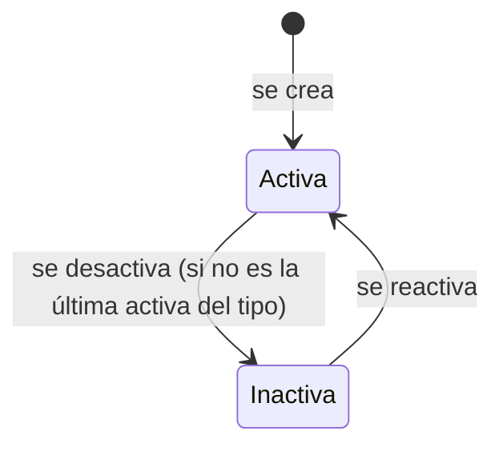

# Módulo Plataforma (PLT)

## Propósito

Lo que comparte toda la plataforma y administra el equipo de UniLink: las **categorías** de cada tipo de contenido, la **lista de palabras prohibidas**, el **panel de administración** y el **registro de auditoría** de las acciones de los administradores.

Es el módulo de más abajo: no usa a ningún otro (ADR-003). Recibe las acciones de administración de los demás módulos por el evento `auditoria.registrada`.

**No es responsabilidad de este módulo:** sancionar cuentas ([Usuarios](../usuarios/README.md), FS-USR-08) ni moderar contenido ([Contenido](../contenido/README.md), FS-CNT-02); el panel solo los reúne en un mismo menú.

## Documentos

| Documento | Contenido |
|---|---|
| [Casos de uso](./casos-de-uso.md) | CU-26 |
| [Historias de usuario](./historias.md) | HU-20 |
| [FS-PLT-01](./specs/FS-PLT-01-gestion-categorias.md) | Categorías, palabras prohibidas, panel de administración y registro de auditoría |

## Quién es quién

| Actor | En este módulo |
|---|---|
| Administrador de la plataforma | Entra al panel; administra categorías y palabras prohibidas; consulta la auditoría. |
| Usuario | Ve las categorías activas al publicar y al elegir sus intereses. |
| Sistema | Registra cada acción de administración que llega por evento. |

## Entidades y datos propios

| Entidad | Datos |
|---|---|
| Categoría | Tipo de contenido, nombre, descripción, orden, estado. |
| Palabra prohibida | Palabra o frase normalizada, fecha, administrador que la agregó. |
| Registro de auditoría | Administrador, fecha, módulo, acción, elemento afectado, valores anterior y nuevo, motivo. No se modifica desde la aplicación. |

## Expone

| Tipo | Elemento |
|---|---|
| API | `/api/v1/plataforma/...`: categorías (públicas y de administración), palabras prohibidas y auditoría ([contrato](../../../contracts/api/plataforma.yaml)). |
| Interfaz pública | Categorías activas de un tipo; revisar un texto contra las palabras prohibidas ([contrato](../../../contracts/modulos/plataforma.md)). |
| Eventos | `categoria.cambiada` ([catálogo](../../../contracts/eventos/README.md)). |

## Consume

| De | Qué | Para |
|---|---|---|
| Evento `auditoria.registrada` (Usuarios, Contenido y el propio módulo) | Acciones de administración | El registro de auditoría. |
| Contexto de la petición | Rol de administrador | Control de acceso al panel. |

## Preguntas abiertas del módulo

P-07, P-25, P-29, P-49.
