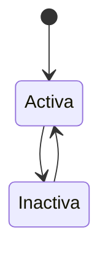

# FS-PLT-01 — Gestión de categorías

| Campo | Valor |
|---|---|
| **Módulo** | Plataforma (PLT) |
| **Estado** | Borrador |
| **Responsable** | Por asignar |
| **Casos de uso** | [CU-26](../casos-de-uso.md#cu-26--administrar-categorías) |
| **Historias** | [HU-20](../historias.md#hu-20) |
| **Última actualización** | 2026-10-24 |

## 1. Objetivo

Permitir que el administrador de la plataforma mantenga ordenada la clasificación del contenido sin depender del equipo técnico. Este es también el **primer spec del panel de administración**, por lo que define cómo se accede a él.

## 2. Quién es quién

| Actor | Qué hace | Qué ve | Qué no puede hacer |
|---|---|---|---|
| Administrador de la plataforma | Crea, edita, ordena, desactiva y reactiva categorías; mantiene las palabras prohibidas; consulta la auditoría. | El panel, las categorías con su uso, la lista y el registro. | Asignarse o quitar el rol de administrador (RN-01); eliminar categorías; editar o borrar la auditoría. |
| Usuario | Elige categorías al publicar y en sus preferencias. | Solo las categorías activas. | Entrar al panel (MSG-01). |
| Sistema | Registra en la auditoría cada acción recibida. | — | — |

## 3. Alcance

**Incluye:**

- Acceso al panel de administración y su control de permisos.
- Listado de categorías por tipo de contenido.
- Crear, editar, ordenar, desactivar y reactivar categorías.
- Registro de auditoría de las acciones de administración de toda la plataforma.
- Lista de palabras prohibidas que usan todos los módulos para revisar los textos públicos.

**No incluye:**

- Asignar el rol de administrador desde la interfaz (ver RN-01).
- Revisar solicitudes de categorías nuevas enviadas por usuarios: la única fuente de esas solicitudes es la publicación de servicios, así que se agrega con FS-SRV-02 en la fase 2.
- Gestión de cuentas (FS-USR-08) y moderación (FS-CNT-02).

## 4. Reglas de negocio

| ID | Regla |
|---|---|
| RN-01 | El rol de administrador de la plataforma se asigna directamente en la base de datos por el equipo técnico, con registro de quién lo asignó. No existe una pantalla para asignarlo en el MVP. |
| RN-02 | Solo los usuarios con rol de administrador pueden entrar al panel. Cualquier otro usuario que intente abrir una dirección del panel recibe una página de "Acceso denegado". |
| RN-03 | Cada categoría pertenece a un solo tipo de contenido: Publicaciones, Proyectos, Eventos u Oportunidades. El tipo Servicios se agrega en la fase 2. |
| RN-04 | El nombre de una categoría es único dentro de su tipo (sin distinguir mayúsculas ni tildes). Dos tipos distintos sí pueden tener categorías con el mismo nombre (por ejemplo, "Investigación" en Publicaciones y en Proyectos). |
| RN-05 | Las categorías no se eliminan, solo se desactivan. Una categoría desactivada no aparece al crear contenido nuevo ni en las preferencias, pero el contenido existente la conserva y sigue visible con ella ([FS-USR-04](../../usuarios/specs/FS-USR-04-preferencias-contenido.md), RN-03). |
| RN-06 | No se puede desactivar la última categoría activa de un tipo. |
| RN-07 | Al cambiar el nombre de una categoría, el cambio se refleja en todo el contenido que la usa. |
| RN-08 | El administrador define el orden en que se muestran las categorías de cada tipo. Las nuevas se agregan al final. |
| RN-09 | Toda creación, edición, desactivación o reactivación queda registrada con el administrador, la fecha, la acción y los valores anterior y nuevo. |
| RN-10 | **Palabras prohibidas:** los administradores mantienen una lista de palabras o frases (propuesta de P-29). Se comparan normalizadas (sin mayúsculas ni tildes) y por palabra completa, para no rechazar palabras que solo contienen otra. Cada cambio queda en la auditoría. |
| RN-11 | Los demás módulos revisan sus textos públicos contra esta lista por la interfaz pública ([FS-CNT-02](../../contenido/specs/FS-CNT-02-moderacion-contenido.md), RN-14). Un cambio en la lista no revisa lo ya publicado. |
| RN-12 | **Registro de auditoría:** reúne las acciones de administración de todos los módulos (categorías, palabras prohibidas, sanciones, decisiones de moderación), que llegan por el evento `auditoria.registrada`. No se puede modificar ni borrar desde la aplicación y se conserva 2 años (RNF-SEG-10). |
| RN-13 | Cambiar el nombre, el estado o el orden de una categoría publica `categoria.cambiada`. |

## 5. Requisitos funcionales

| ID | Requisito | Prioridad |
|---|---|---|
| RF-01 | El sistema debe mostrar la opción "Administración" en el menú del usuario solo a los administradores. | Alta |
| RF-02 | El panel debe tener un menú lateral con las secciones de administración. En este sprint existen "Categorías", "Palabras prohibidas" y "Auditoría"; "Usuarios" (FS-USR-08) y "Moderación" (FS-CNT-02) se agregan en el Sprint 5. | Alta |
| RF-03 | La sección Categorías debe mostrar una pestaña por tipo de contenido con sus categorías: nombre, descripción, estado, cantidad de contenido que la usa y orden. | Alta |
| RF-04 | El sistema debe permitir crear y editar categorías (RN-03, RN-04, RN-07). | Alta |
| RF-05 | El sistema debe permitir desactivar y reactivar categorías (RN-05, RN-06), pidiendo confirmación al desactivar e indicando cuánto contenido la usa. | Alta |
| RF-06 | El sistema debe permitir reordenar las categorías de un tipo arrastrándolas (RN-08). | Baja |
| RF-07 | El sistema debe mostrar el historial de cambios de cada categoría (RN-09). | Media |
| RF-08 | El sistema debe permitir agregar y quitar palabras prohibidas (RN-10), mostrando quién y cuándo. | Alta |
| RF-09 | La sección "Auditoría" debe listar el registro (RN-12) con filtros por administrador, módulo, acción y fechas, sin opción de editar ni borrar. | Media |

## 6. Datos y validaciones

| Campo | Tipo | Obligatorio | Validación |
|---|---|---|---|
| Tipo de contenido | Lista | Sí | Publicaciones, Proyectos, Eventos u Oportunidades (Servicios en la fase 2). No se puede cambiar después de crear la categoría. |
| Nombre | Texto | Sí | 2 a 40 caracteres; RN-04. |
| Descripción | Texto | No | Máximo 200 caracteres. Se muestra como ayuda al elegir la categoría. |

Las categorías semilla cargadas en el Sprint 1 ([FS-USR-04](../../usuarios/specs/FS-USR-04-preferencias-contenido.md), sección 6) quedan administrables desde este panel.

## 7. Estados



| Estado | Entra cuando | Sale hacia |
|---|---|---|
| Activa | Se crea o se reactiva | **Inactiva** al desactivarla (si no es la última activa del tipo) |
| Inactiva | Se desactiva | **Activa** al reactivarla |

## 8. Flujo principal

1. **Menú del usuario** → "Administración" → **Panel** → "Categorías".
2. **Categorías** → pestaña de un tipo → "Nueva categoría" → **Formulario** → "Guardar".
3. **Categorías** → menú de una categoría → "Editar", "Desactivar", "Reactivar" o "Ver historial".

## 9. Variaciones

| Variación | Qué cambia | Regla |
|---|---|---|
| Mismo nombre en otro tipo | Se permite. | RN-04 |
| Categoría en uso que se desactiva | El contenido la conserva; no se usa en contenido nuevo. | RN-05 |
| Última categoría activa del tipo | No se puede desactivar. | RN-06 |
| Categorías semilla del Sprint 1 | Quedan administrables desde aquí. | Sección 6 |
| _(Fase 2)_ Solicitudes de categorías de usuarios | Llegan con FS-SRV-02. | Alcance |

## 10. ¿Qué pasaría si…?

| Situación | Comportamiento esperado | Regla o pregunta |
|---|---|---|
| Dos administradores crean el mismo nombre a la vez | Se crea una; el otro ve MSG-02. | RN-04 |
| Se desactiva una categoría mientras un usuario publica con ella | La publicación se rechaza con MSG-06 y el usuario elige otra. | RN-05 |
| Se renombra una categoría | Todo el contenido muestra el nombre nuevo (`categoria.cambiada`). | RN-07, RN-13 |
| Dos administradores reordenan a la vez | Queda el último orden guardado. | RN-08 |
| El administrador pierde su rol con el panel abierto | La siguiente acción muestra MSG-01. | RN-02 |
| Una palabra prohibida forma parte de otra | No se rechaza: la comparación es por palabra completa. | RN-10 |
| Falla el registro en la auditoría | El evento se reintenta; la acción no se pierde del registro. | RNF-CON-04 |
| Privacidad: la auditoría contiene datos de personas | Solo la ven administradores y se borra a los 2 años. | RN-12, RNF-PRI-09 |

## 11. Mensajes al usuario

| Código | Situación | Mensaje |
|---|---|---|
| MSG-01 | Acceso denegado | "No tienes permiso para ver esta página." |
| MSG-02 | Nombre repetido | "Ya existe una categoría llamada \"{nombre}\" en {tipo}." |
| MSG-03 | Confirmar desactivación | "\"{nombre}\" la usan {n} elementos. Seguirán mostrándola, pero no podrá usarse en contenido nuevo. ¿Desactivar?" |
| MSG-04 | Última categoría activa | "No puedes desactivar la última categoría activa de {tipo}." |
| MSG-05 | Categoría guardada | "Categoría guardada." |
| MSG-06 | Categoría desactivada al publicar | "Esta categoría ya no está disponible. Elige otra." |
| MSG-07 | Palabra repetida | "\"{palabra}\" ya está en la lista." |

## 12. Resultado esperado

```gherkin
Escenario: Acceso solo para administradores
  Dado que soy un usuario sin rol de administrador
  Cuando abro la dirección del panel de administración
  Entonces veo el mensaje MSG-01
  Y no veo la opción "Administración" en mi menú

Escenario: Crear categoría
  Dado que soy administrador
  Cuando creo la categoría "Bioinformática" en Publicaciones
  Entonces veo el mensaje MSG-05
  Y los usuarios pueden elegirla al publicar y en sus intereses

Escenario: Nombre repetido en el mismo tipo
  Dado que existe "Investigación" en Publicaciones
  Cuando intento crear "investigacion" en Publicaciones
  Entonces veo el mensaje MSG-02

Escenario: Mismo nombre en otro tipo
  Dado que existe "Investigación" en Publicaciones
  Cuando creo "Investigación" en Proyectos
  Entonces la categoría se crea sin error

Escenario: Desactivar categoría en uso
  Dado que "Emprendimiento" la usan 12 publicaciones
  Cuando la desactivo
  Entonces las 12 publicaciones siguen mostrando "Emprendimiento"
  Y ya no aparece al crear una publicación nueva

Escenario: Última categoría activa
  Dado que "Culturales" es la única categoría activa de Eventos
  Cuando intento desactivarla
  Entonces veo el mensaje MSG-04

Escenario: Historial
  Dado que renombré "Tecnología" a "Tecnología e innovación"
  Cuando abro su historial
  Entonces veo mi nombre, la fecha, la acción y los valores anterior y nuevo

Escenario: Categoría desactivada al publicar
  Dado que estoy escribiendo una publicación con la categoría "Emprendimiento"
  Cuando un administrador la desactiva antes de que publique
  Entonces veo el mensaje MSG-06 y debo elegir otra categoría

Escenario: Agregar una palabra prohibida
  Dado que soy administrador
  Cuando agrego la palabra "estafa" a la lista
  Entonces una publicación nueva con esa palabra se rechaza
  Y la acción aparece en la auditoría

Escenario: Comparación por palabra completa
  Dado que "asno" está en la lista de palabras prohibidas
  Cuando publico un texto con la palabra "pasnorte"
  Entonces la publicación no se rechaza

Escenario: Auditoría de una sanción
  Dado que un administrador suspendió la cuenta de Pedro
  Cuando abro la sección "Auditoría"
  Entonces veo la suspensión con su administrador, fecha y motivo
  Y no tengo opción de editarla ni borrarla

Escenario: Mismo nombre a la vez
  Dado que Ana y Carlos crean "Bioinformática" en Publicaciones al mismo tiempo
  Entonces existe una sola categoría "Bioinformática" en Publicaciones
```

## 13. Contratos

**Expone:**

- API: `GET /api/v1/plataforma/categorias?tipo=`, `/api/v1/plataforma/admin/categorias/...`, `/api/v1/plataforma/admin/palabras-prohibidas/...`, `GET /api/v1/plataforma/admin/auditoria` ([contrato](../../../../contracts/api/plataforma.yaml)).
- Interfaz pública: categorías activas de un tipo; revisar un texto contra las palabras prohibidas ([interfaz](../../../../contracts/modulos/plataforma.md)).
- Eventos: `categoria.cambiada`, `auditoria.registrada` (de sus propias acciones) ([catálogo](../../../../contracts/eventos/README.md)).

**Consume:** evento `auditoria.registrada` de los demás módulos.

## 14. Calidad

RNF-SEG-04, RNF-SEG-10, RNF-PRI-09.

## 15. Preguntas abiertas

- P-07 — quiénes administran al lanzamiento.
- P-25 — fusionar o eliminar etiquetas duplicadas.
- P-29 — quién mantiene la lista de palabras prohibidas.
- P-49 — ¿rol de moderador?

## 16. Lista de revisión

- [x] Cada actor de "Quién es quién" existe en el [SRS §2.4](../../../srs/Especificacion_Requisitos.md#24-actores-del-sistema) con el mismo nombre.
- [x] Toda acción tiene un actor que puede hacerla y se valida en el servidor (RNF-SEG-04).
- [ ] Cada regla tiene al menos un escenario en "Resultado esperado".
- [x] "¿Qué pasaría si…?" revisó las siete situaciones: concurrencia, estado de la cuenta, eliminación de lo que usa, pérdida de permiso, falla externa, límites de uso y privacidad.
- [ ] Ningún dato se recoge sin finalidad (RNF-PRI-01).
- [x] No contradice a su caso de uso, a su historia ni a otro spec.
- [x] Sus contratos existen en [`contracts/`](../../../../contracts/README.md).
- [ ] No tiene preguntas abiertas que bloqueen el desarrollo.

## 17. Historial de cambios

| Fecha | Autor | Cambio |
|---|---|---|
| 2026-10-06 | Gamero | Creación |
| 2026-10-24 | Equipo UniLink | Estudio de quién es quién, variaciones, casos límite y contratos; nueva plantilla. |
