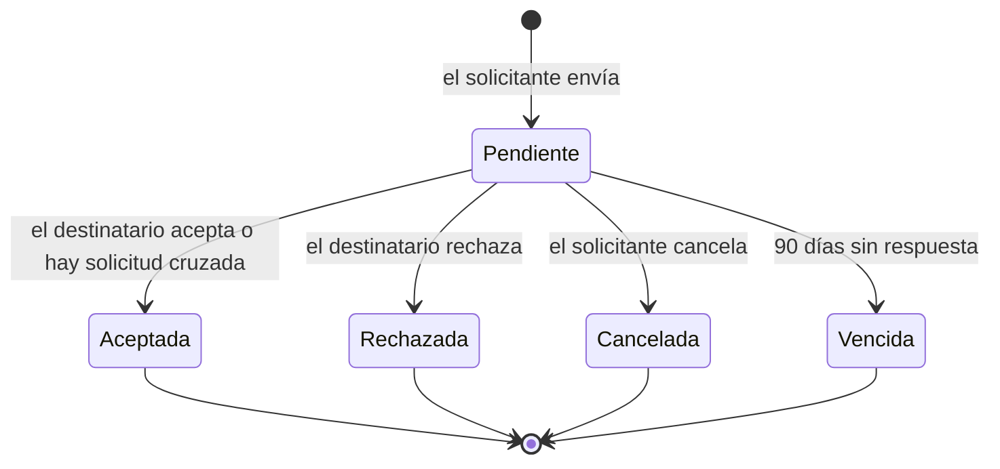

# Módulo Red (RED)

## Propósito

Las **relaciones** entre las personas y el **descubrimiento**: solicitudes y conexiones, el onboarding con sugerencias, la búsqueda de perfiles y la regla de qué parte de un perfil ve cada observador.

**No es responsabilidad de este módulo:** los datos del perfil y su privacidad configurada ([Usuarios](../usuarios/README.md)); los mensajes y las notificaciones ([Comunicación](../comunicacion/README.md)).

## Documentos

| Documento | Contenido |
|---|---|
| [Casos de uso](./casos-de-uso.md) | CU-05, CU-06, CU-07, CU-13 |
| [Historias de usuario](./historias.md) | HU-05, HU-06, HU-07, HU-24 |
| [FS-RED-01](./specs/FS-RED-01-solicitudes-conexion.md) | Solicitudes de conexión |
| [FS-RED-02](./specs/FS-RED-02-onboarding-sugerencias.md) | Onboarding y sugerencias (incluye la regla de complementariedad) |
| [FS-RED-03](./specs/FS-RED-03-busqueda-perfiles.md) | Búsqueda de perfiles y vista del perfil de otro usuario |

## Quién es quién

| Actor | En este módulo |
|---|---|
| Solicitante | Envía y cancela solicitudes de conexión. |
| Destinatario | Acepta o rechaza las solicitudes que recibe. |
| Conexión | Ve el perfil completo del otro y puede escribirle (Comunicación). |
| Observador | Busca y ve perfiles según su privacidad. |
| Usuario | Recibe sugerencias en el onboarding y en "Personas que podrían interesarte". |
| Sistema | Vence solicitudes a los 90 días; recalcula sugerencias cuando cambian los perfiles. |

| Acción | Solicitante | Destinatario | Observador | Administrador de la plataforma |
|---|---|---|---|---|
| Enviar y cancelar una solicitud | ✓ (30 por día fuera del onboarding) | — | — | — |
| Aceptar o rechazar | — | ✓ | — | — |
| Eliminar una conexión | ✓ (cualquiera de los dos) | ✓ | — | — |
| Buscar y ver perfiles | ✓ | ✓ | ✓ (según privacidad) | ✓ |

## Entidades y datos propios

| Entidad | Datos |
|---|---|
| Solicitud de conexión | Solicitante, destinatario, mensaje, estado, fechas, espera tras rechazo. |
| Conexión | Los dos usuarios y la fecha. |
| Sugerencias | Puntaje y motivo por candidato (calculado; se recalcula con `perfil.actualizado`). |

## Expone

| Tipo | Elemento |
|---|---|
| API | `/api/v1/red/...`: solicitudes, conexiones, onboarding, búsqueda y vista del perfil de otro usuario ([contrato](../../../contracts/api/red.yaml)). |
| Interfaz pública | Si dos usuarios están conectados; qué parte de un perfil ve un observador; perfiles complementarios; número de conexiones ([contrato](../../../contracts/modulos/red.md)). |
| Eventos | `conexion.solicitada`, `conexion.aceptada`, `conexion.eliminada` ([catálogo](../../../contracts/eventos/README.md)). |

## Consume

| De | Qué | Para |
|---|---|---|
| Usuarios | Estado de la cuenta, datos públicos, privacidad, etiquetas, categorías de interés; marcar el onboarding como completado | Solicitudes, sugerencias, búsqueda y vista del perfil. |
| Eventos `cuenta.estado_cambiado`, `perfil.actualizado` | Cambios de estado y de perfil | Ocultar o mostrar perfiles y solicitudes; recalcular sugerencias. |

## Preguntas abiertas del módulo

P-17, P-26, P-27, P-28, P-45, P-50, P-51.
