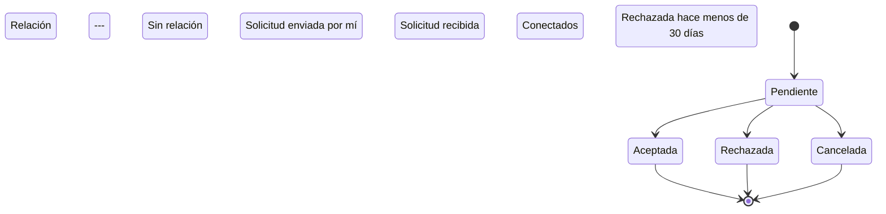

# FS-RED-01 — Solicitudes de conexión

| Campo | Valor |
|---|---|
| **Módulo** | Red (RED) |
| **Estado** | Borrador |
| **Responsable** | Por asignar |
| **Casos de uso** | [CU-06](../casos-de-uso.md#cu-06--enviar-solicitud-de-conexión), [CU-07](../casos-de-uso.md#cu-07--responder-solicitud-de-conexión) |
| **Historias** | [HU-06](../historias.md#hu-06), [HU-07](../historias.md#hu-07) |
| **Última actualización** | 2026-10-27 |

## 1. Objetivo

Permitir que los miembros de la comunidad formen conexiones profesionales de mutuo acuerdo. Las conexiones habilitan la mensajería privada (FS-COM-01), alimentan el feed (FS-CNT-01) y dan acceso a los perfiles privados.

## 2. Quién es quién

| Actor | Qué hace | Qué ve | Qué no puede hacer |
|---|---|---|---|
| Solicitante | Envía (con mensaje opcional) y cancela solicitudes; elimina conexiones. | El botón según la relación, sus solicitudes enviadas y la fecha de espera tras un rechazo. | Enviar más de 30 por día fuera del onboarding; enviar a cuentas no activas o a sí mismo; saber el motivo de un rechazo. |
| Destinatario | Acepta o rechaza; elimina conexiones. | Las solicitudes recibidas con el mensaje y el motivo de complementariedad. | Ver quién canceló una solicitud. |
| Conexión | Ve el perfil completo del otro. | El botón "Conectado". | — |
| Sistema | Conecta de inmediato ante solicitudes cruzadas. | — | — |

## 3. Alcance

**Incluye:**

- Enviar una solicitud con mensaje opcional.
- Cancelar una solicitud enviada.
- Aceptar o rechazar solicitudes recibidas.
- Ver la lista de conexiones y de solicitudes enviadas y recibidas.
- Eliminar una conexión.
- Botón de conexión en el perfil y en los resultados de búsqueda.

**No incluye:**

- Bloquear o reportar usuarios.
- Seguir a alguien sin conexión mutua.
- Sugerencias de conexión ([FS-RED-02](./FS-RED-02-onboarding-sugerencias.md)).

## 4. Reglas de negocio

| ID | Regla |
|---|---|
| RN-01 | Entre dos usuarios solo puede existir una solicitud pendiente o una conexión a la vez. |
| RN-02 | Si A envía una solicitud a B y B ya tenía una pendiente hacia A, se conectan de inmediato (aceptación automática). |
| RN-03 | La conexión es mutua: si A está conectado con B, B está conectado con A. |
| RN-04 | La solicitud puede llevar un mensaje opcional de hasta 300 caracteres. |
| RN-05 | Un usuario puede enviar como máximo 30 solicitudes por día, para evitar spam. Las enviadas desde el onboarding no cuentan en este límite. |
| RN-06 | Al rechazar, el solicitante no recibe notificación ni motivo. Para él, el botón vuelve a "Conectar", pero no puede enviar otra solicitud a esa persona durante 30 días. |
| RN-07 | Cancelar una solicitud pendiente o eliminar una conexión no notifica a la otra persona. Tras eliminar una conexión, cualquiera de los dos puede enviar una solicitud nueva sin espera. |
| RN-08 | Las solicitudes pendientes **no vencen**: siguen pendientes hasta que el destinatario responda o el solicitante la cancele (reunión del 2026-10-19, RD-16). |
| RN-09 | No se pueden enviar solicitudes a cuentas que no estén activas ni a uno mismo. |
| RN-10 | Al aceptar, se notifica al solicitante (FS-COM-02) y, si lo tiene activado, por correo. Al recibir una solicitud, se notifica al destinatario de la misma forma. Las notificaciones salen de los eventos `conexion.solicitada` y `conexion.aceptada`. |
| RN-11 | Responder o cancelar una solicitud que ya no está pendiente no tiene efecto: se muestra MSG-09 con el estado actual. |

## 5. Requisitos funcionales

| ID | Requisito | Prioridad |
|---|---|---|
| RF-01 | El sistema debe mostrar en el perfil de otro usuario y en las tarjetas de búsqueda un botón cuyo texto depende del estado de la relación (sección 7). | Alta |
| RF-02 | Al pulsar "Conectar", el sistema debe permitir agregar un mensaje opcional y enviar la solicitud. | Alta |
| RF-03 | El sistema debe ofrecer una página "Mi red" con tres pestañas: Conexiones, Solicitudes recibidas y Solicitudes enviadas. | Alta |
| RF-04 | En Solicitudes recibidas, cada solicitud debe mostrar la tarjeta del solicitante, su mensaje, el motivo de complementariedad si aplica, y los botones "Aceptar" y "Rechazar". | Alta |
| RF-05 | El sistema debe permitir cancelar una solicitud enviada desde el perfil del destinatario o desde Solicitudes enviadas. | Media |
| RF-06 | El sistema debe permitir eliminar una conexión desde el perfil de la persona o desde la pestaña Conexiones, pidiendo confirmación. | Media |
| RF-07 | La pestaña Conexiones debe permitir buscar por nombre dentro de las propias conexiones y mostrar el total. | Media |
| RF-08 | El perfil público debe mostrar el número de conexiones del usuario. | Baja |
| RF-09 | El menú principal debe mostrar el número de solicitudes recibidas pendientes. | Alta |

## 6. Datos y validaciones

| Campo | Tipo | Obligatorio | Validación |
|---|---|---|---|
| Mensaje de la solicitud | Texto | No | Máximo 300 caracteres. |

**Datos que se guardan de cada solicitud:** solicitante, destinatario, mensaje, estado, fecha de envío y fecha de respuesta.

## 7. Estados



**Estados de la solicitud:**

| Estado | Entra cuando | Sale hacia |
|---|---|---|
| Pendiente | Se envía | **Aceptada**, **Rechazada** o **Cancelada**; no vence (RN-08) |
| Aceptada | El destinatario acepta, o RN-02 | Estado final; se crea la conexión |
| Rechazada | El destinatario rechaza | Estado final; aplica la espera de RN-06 |
| Cancelada | El solicitante la cancela | Estado final |

**Botón según la relación, visto por el usuario actual:**

| Relación | Texto del botón | Acción |
|---|---|---|
| Sin relación | "Conectar" | Enviar solicitud |
| Solicitud enviada por mí | "Pendiente" | Cancelar solicitud |
| Solicitud recibida | "Responder" | Aceptar o rechazar |
| Conectados | "Conectado" | Menú con "Enviar mensaje" (desde el Sprint 5) y "Eliminar conexión" |
| Rechazada hace menos de 30 días | "Conectar" deshabilitado | Muestra MSG-05 |

## 8. Flujo principal

1. **Perfil o resultado de búsqueda** → "Conectar" → **Diálogo de solicitud** (mensaje opcional) → "Enviar" → botón "Pendiente".
2. **Notificación** o **Mi red > Solicitudes recibidas** → "Aceptar" → la persona pasa a Conexiones.
3. **Mi red > Conexiones** → menú de una conexión → "Eliminar conexión" → confirmación.

## 9. Variaciones

| Variación | Qué cambia | Regla |
|---|---|---|
| Solicitudes cruzadas | Se conectan de inmediato (MSG-02). | RN-02 |
| Desde el onboarding | No cuentan en el límite diario. | RN-05 |
| Rechazada hace menos de 30 días | "Conectar" deshabilitado con la fecha (MSG-05). | RN-06 |
| Tras eliminar una conexión | Cualquiera puede volver a enviar sin espera. | RN-07 |

## 10. ¿Qué pasaría si…?

| Situación | Comportamiento esperado | Regla o pregunta |
|---|---|---|
| Los dos pulsan "Conectar" a la vez | Quedan conectados una sola vez. | RN-01, RN-02 |
| El destinatario acepta justo cuando el solicitante cancela | Gana la primera operación; la otra ve MSG-09. | RN-11 |
| La cuenta del destinatario se suspende con solicitudes pendientes | Sus solicitudes dejan de mostrarse a los demás; qué pasa al reactivarse o eliminarse depende de P-51. | RN-09, P-51 |
| Se elimina una conexión con conversación abierta | La conversación queda en solo lectura (FS-COM-01 RN-06). | FS-COM-01 |
| Falla la notificación o el correo | La solicitud o la conexión se guardan igual; el aviso se reintenta. | RNF-CON-04 |
| Llega al límite de 30 en dos pestañas a la vez | El conteo es atómico: nunca pasa de 30. | RN-05, RNF-CON-01 |
| Privacidad: el solicitante deduce el rechazo por la espera | Se acepta por ahora. | P-26 |
| Acoso por solicitudes repetidas | Existe la espera de 30 días. Se decidió permitir bloquear y reportar usuarios (RD-17); sus efectos se especificarán aparte. | P-27, RD-17 |
| Una solicitud lleva meses sin respuesta | Sigue pendiente; el solicitante puede cancelarla cuando quiera. | RN-08 |

## 11. Mensajes al usuario

| Código | Situación | Mensaje |
|---|---|---|
| MSG-01 | Solicitud enviada | "Solicitud enviada a {nombre}." |
| MSG-02 | Ya conectados por RN-02 | "¡Ahora estás conectado con {nombre}!" |
| MSG-03 | Solicitud aceptada | "Ahora estás conectado con {nombre}." |
| MSG-04 | Límite diario | "Alcanzaste el límite de 30 solicitudes por hoy. Podrás enviar más mañana." |
| MSG-05 | Espera por rechazo | "Podrás enviar otra solicitud a {nombre} a partir del {fecha}." |
| MSG-06 | Confirmar eliminación | "¿Eliminar a {nombre} de tus conexiones? No le avisaremos." |
| MSG-07 | Sin conexiones | "Aún no tienes conexiones. Busca personas con intereses parecidos a los tuyos." |
| MSG-08 | Sin solicitudes | "No tienes solicitudes pendientes." |
| MSG-09 | Solicitud ya resuelta | "Esta solicitud ya no está pendiente." |

## 12. Resultado esperado

```gherkin
Escenario: Enviar solicitud con mensaje
  Dado que veo el perfil de Luis y no tenemos relación
  Cuando pulso "Conectar", escribo un mensaje y envío
  Entonces veo el mensaje MSG-01
  Y el botón cambia a "Pendiente"
  Y Luis recibe una notificación

Escenario: Aceptar solicitud
  Dado que Luis me envió una solicitud
  Cuando la acepto
  Entonces Luis aparece en mis conexiones y yo en las suyas
  Y Luis recibe una notificación de aceptación

Escenario: Solicitud recibida vista en el perfil
  Dado que Luis me envió una solicitud pendiente
  Cuando abro su perfil
  Entonces el botón dice "Responder" y no "Conectar"

Escenario: Solicitudes simultáneas
  Dado que Luis y yo pulsamos "Conectar" en el perfil del otro casi al mismo tiempo
  Cuando el sistema procesa la segunda solicitud
  Entonces quedamos conectados
  Y quien envió la segunda ve el mensaje MSG-02

Escenario: Rechazar solicitud
  Dado que Luis me envió una solicitud
  Cuando la rechazo
  Entonces Luis no recibe ninguna notificación
  Y durante 30 días Luis ve el botón "Conectar" deshabilitado con el mensaje MSG-05

Escenario: Cancelar solicitud
  Dado que envié una solicitud a Luis que sigue pendiente
  Cuando la cancelo
  Entonces el botón vuelve a "Conectar"
  Y la solicitud desaparece de las recibidas de Luis

Escenario: Eliminar conexión
  Dado que estoy conectado con Luis
  Cuando elimino la conexión y confirmo
  Entonces ya no aparecemos en las conexiones del otro
  Y Luis no recibe ninguna notificación

Escenario: Límite diario
  Dado que hoy envié 30 solicitudes fuera del onboarding
  Cuando intento enviar otra
  Entonces veo el mensaje MSG-04

Escenario: Perfil privado tras conectar
  Dado que el perfil de Luis es "Solo mis conexiones"
  Cuando Luis acepta mi solicitud
  Entonces puedo ver su perfil completo

Escenario: Aceptar y cancelar a la vez
  Dado que Luis me envió una solicitud
  Y Luis la cancela en el mismo momento en que la acepto
  Entonces solo una de las dos acciones tiene efecto
  Y quien llegó después ve el mensaje MSG-09

Escenario: Destinatario suspendido
  Dado que envié una solicitud a Pedro
  Cuando la cuenta de Pedro se suspende
  Entonces la solicitud deja de aparecer en mis solicitudes enviadas

Escenario: Notificación que falla
  Dado que el envío de notificaciones falla
  Cuando acepto la solicitud de Luis
  Entonces quedamos conectados
  Y Luis recibe la notificación cuando el envío se recupera

Escenario: Solicitud sin respuesta
  Dado que envié una solicitud a Luis hace 120 días y no ha respondido
  Entonces la solicitud sigue pendiente
  Y Luis todavía puede aceptarla

Escenario: Límite diario en dos pestañas
  Dado que hoy envié 29 solicitudes
  Cuando envío dos más a la vez desde dos pestañas
  Entonces solo una se envía y la otra muestra el mensaje MSG-04
```

## 13. Contratos

**Expone:**

- API: `POST /api/v1/red/solicitudes`, `POST /api/v1/red/solicitudes/{id}/aceptacion`, `POST /api/v1/red/solicitudes/{id}/rechazo`, `DELETE /api/v1/red/solicitudes/{id}`, `GET /api/v1/red/solicitudes`, `GET /api/v1/red/conexiones`, `DELETE /api/v1/red/conexiones/{usuario_id}` ([contrato](../../../../contracts/api/red.yaml)).
- `GET /api/v1/red/solicitudes?tipo=enviadas` devuelve solo las pendientes, porque el solicitante no ve los rechazos (RN-06). Esquemas completos en el contrato.
- Interfaz pública: si dos usuarios están conectados; número de conexiones ([interfaz](../../../../contracts/modulos/red.md)).
- Eventos: `conexion.solicitada`, `conexion.aceptada`, `conexion.eliminada` ([catálogo](../../../../contracts/eventos/README.md)).

**Consume:** Usuarios: estado de la cuenta y datos públicos para las tarjetas.

## 14. Calidad

RNF-SEG-07 (límite diario), RNF-CON-01, RNF-CON-04.

## 15. Preguntas abiertas

- P-26 — ¿aceptable que el rechazo se deduzca por la espera?
- P-27 — resuelta (sí, RD-17); falta especificar los efectos del bloqueo.
- P-51 — solicitudes de cuentas que dejan de estar activas.

## 16. Lista de revisión

- [x] Cada actor de "Quién es quién" existe en el [SRS §2.4](../../../srs/Especificacion_Requisitos.md#24-actores-del-sistema) con el mismo nombre.
- [x] Toda acción tiene un actor que puede hacerla y se valida en el servidor (RNF-SEG-04).
- [ ] Cada regla tiene al menos un escenario en "Resultado esperado".
- [x] "¿Qué pasaría si…?" revisó las siete situaciones: concurrencia, estado de la cuenta, eliminación de lo que usa, pérdida de permiso, falla externa, límites de uso y privacidad.
- [ ] Ningún dato se recoge sin finalidad (RNF-PRI-01).
- [x] No contradice a su caso de uso, a su historia ni a otro spec.
- [x] Sus contratos existen en [`contracts/`](../../../../contracts/README.md).
- [ ] No tiene preguntas abiertas que bloqueen el desarrollo.

## 17. Historial de cambios

| Fecha | Autor | Cambio |
|---|---|---|
| 2026-10-06 | Gamero | Creación |
| 2026-10-24 | Equipo UniLink | Estudio de quién es quién, variaciones, casos límite y contratos; nueva plantilla. |
| 2026-10-27 | Gamero | Reunión del 2026-10-19: las solicitudes no vencen (RN-08; se quita el estado Vencida); bloqueo de usuarios decidido (RD-17); contrato con esquemas. |
