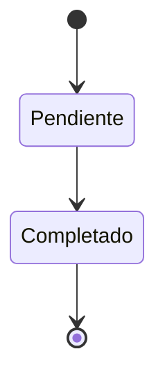

# FS-RED-02 — Onboarding y sugerencias de conexión

| Campo | Valor |
|---|---|
| **Módulo** | Red (RED) |
| **Estado** | Borrador |
| **Responsable** | Por asignar |
| **Casos de uso** | [CU-13](../casos-de-uso.md#cu-13--sugerir-conexiones-iniciales-onboarding) |
| **Historias** | [HU-24](../historias.md#hu-24) |
| **Última actualización** | 2026-10-24 |

## 1. Objetivo

Evitar que un usuario nuevo llegue a una plataforma vacía: en su primer ingreso, UniLink le sugiere personas con quienes conectar, priorizando a quienes **pueden aportar lo que necesita** o **necesitan lo que puede aportar**.

## 2. Quién es quién

| Actor | Qué hace | Qué ve | Qué no puede hacer |
|---|---|---|---|
| Usuario | Revisa las sugerencias, elige a quién enviar solicitud u omite el paso. | Hasta 20 sugerencias con su motivo; nunca preseleccionadas. | Ver candidatos con perfil privado, incompleto o cuenta no activa. |
| Sistema | Calcula el puntaje y el motivo; marca el onboarding como completado en la cuenta. | — | Enviar solicitudes que el usuario no eligió. |

## 3. Alcance

**Incluye:**

- Pantalla de onboarding que aparece una sola vez.
- Regla de complementariedad entre perfiles (RN-10), que también usa la búsqueda ([FS-RED-03](./FS-RED-03-busqueda-perfiles.md)).
- Cálculo de sugerencias por complementariedad, unidad académica, facultad y categorías de interés.
- Envío de varias solicitudes de conexión a la vez.
- Opción de omitir el paso.

**No incluye:**

- Sugerencias de espacios de proyectos: las agrega [FS-COL-05](../../colaboracion/specs/FS-COL-05-espacios-proyectos.md) (RF-10) en el Sprint 8.
- Contenido del feed para quien omite el paso: lo resuelve FS-CNT-01 (Sprint 4).
- Sugerencias periódicas después del onboarding (la página "Personas que podrían interesarte" de [FS-RED-03](./FS-RED-03-busqueda-perfiles.md) cubre ese caso).

## 4. Reglas de negocio

| ID | Regla |
|---|---|
| RN-01 | El onboarding aparece una sola vez: justo después de guardar el perfil por primera vez ([FS-USR-06](../../usuarios/specs/FS-USR-06-perfil-profesional.md)). Si el usuario lo cierra sin terminar ni omitir, aparece en su siguiente inicio de sesión. |
| RN-02 | El onboarding se marca como completado cuando el usuario envía sus solicitudes o lo omite. El indicador vive en la cuenta: Red lo marca por la interfaz pública de Usuarios. |
| RN-03 | **Puntaje de cada candidato:** complementariedad × 3 (RN-10) + misma unidad académica × 2 + misma facultad × 1 + 1 por cada categoría de interés en común (máximo 3, [FS-USR-04](../../usuarios/specs/FS-USR-04-preferencias-contenido.md)). "Misma facultad" no aplica al personal administrativo, que no tiene facultad. |
| RN-04 | Se muestran como máximo 20 sugerencias, ordenadas por puntaje. Solo se sugieren candidatos con puntaje mayor que 0. |
| RN-05 | Solo se sugieren cuentas activas, visibles para la comunidad (no "Solo mis conexiones") y con perfil completo. |
| RN-06 | Cada sugerencia muestra su motivo principal, en este orden de prioridad: complementariedad, misma unidad académica, misma facultad, categorías de interés en común. |
| RN-07 | Ninguna sugerencia viene preseleccionada; el usuario elige a quién enviar solicitud. |
| RN-08 | Las solicitudes enviadas desde el onboarding siguen las reglas de [FS-RED-01](./FS-RED-01-solicitudes-conexion.md), excepto el límite diario (RN-05 de ese spec). |
| RN-09 | Si no hay ningún candidato con puntaje mayor que 0, se muestra un mensaje y se continúa a la página principal. |
| RN-10 | **Complementariedad:** dos usuarios A y B son complementarios cuando al menos una etiqueta de "Necesito" de A coincide con una de "Puedo aportar" de B, o al revés ([FS-USR-06](../../usuarios/specs/FS-USR-06-perfil-profesional.md)). El puntaje es la cantidad de coincidencias en ambos sentidos. Solo se calcula entre cuentas activas, y las etiquetas de un perfil "Solo mis conexiones" no se usan para sugerirlo a quien no es su conexión. |
| RN-11 | Si un candidato deja de estar disponible (cuenta no activa, perfil privado) entre que se muestra y se envía, su solicitud se omite y las demás se envían (MSG-05). |

## 5. Requisitos funcionales

| ID | Requisito | Prioridad |
|---|---|---|
| RF-01 | El sistema debe mostrar la pantalla de onboarding según RN-01. | Alta |
| RF-02 | El sistema debe calcular y mostrar las sugerencias según RN-03 a RN-06, cada una como tarjeta con casilla de selección. | Alta |
| RF-03 | El sistema debe ofrecer "Seleccionar todos" y mostrar cuántas personas hay seleccionadas. | Media |
| RF-04 | Al pulsar "Conectar con {n} personas", el sistema debe enviar las solicitudes y llevar al usuario a la página principal. | Alta |
| RF-05 | El sistema debe ofrecer "Omitir por ahora", que lleva a la página principal sin enviar solicitudes. | Alta |
| RF-06 | El sistema debe resaltar con una insignia las sugerencias por complementariedad. | Media |

## 6. Datos y validaciones

**Ejemplo de cálculo del puntaje para Ana** (Ing. de Sistemas, Facultad de Ingeniería; necesita "Diseño gráfico"; intereses: Tecnología, Emprendimiento):

| Candidato | Complementario | Misma unidad académica | Misma facultad | Categorías en común | Puntaje | Motivo mostrado |
|---|---|---|---|---|---|---|
| Luis (Diseño, aporta "Diseño gráfico") | 1 × 3 = 3 | 0 | 0 | 1 (Emprendimiento) | 4 | "Puede aportar Diseño gráfico, que tú necesitas" |
| Carla (Ing. de Sistemas) | 0 | 2 | 1 | 1 (Tecnología) | 4 | "Estudia Ingeniería de Sistemas, como tú" |
| Pedro (Ing. Civil) | 0 | 0 | 1 | 0 | 1 | "También es de la Facultad de Ingeniería" |

A igual puntaje, se ordena primero el candidato con complementariedad (Luis antes que Carla).

## 7. Estados



| Estado del onboarding del usuario | Entra cuando | Sale hacia |
|---|---|---|
| Pendiente | Se crea la cuenta | **Completado** al enviar solicitudes u omitir |
| Completado | RN-02 | Estado final |

## 8. Flujo principal

1. **Editar perfil** (primera vez) → guarda → **Onboarding: "Personas que podrías conocer"**.
2. **Onboarding** → selecciona personas → "Conectar con {n} personas" → **Página principal**.
3. **Onboarding** → "Omitir por ahora" → **Página principal**.

Mientras no exista el feed (Sprint 4), la página principal es "Personas que podrían interesarte" ([FS-RED-03](./FS-RED-03-busqueda-perfiles.md), RN-07).

## 9. Variaciones

| Variación | Qué cambia | Regla |
|---|---|---|
| Personal administrativo | "Misma facultad" no suma; "misma unidad" compara dependencias. | RN-03 |
| Omite el paso | Página principal sin solicitudes; el feed usa el contenido de respaldo. | RF-05 |
| Cierra sin terminar | Reaparece en el siguiente inicio de sesión. | RN-01 |
| Sin candidatos | MSG-03 y continuar. | RN-09 |
| Antes del Sprint 4 (sin feed) | La página principal es "Personas que podrían interesarte". | Sección 8 |
| Antes del Sprint 8 (sin proyectos) | No hay sugerencias de proyectos. | P-50 |

## 10. ¿Qué pasaría si…?

| Situación | Comportamiento esperado | Regla o pregunta |
|---|---|---|
| Un candidato suspende su cuenta o pone su perfil privado mientras el usuario elige | Esa solicitud se omite y se envían las demás (MSG-05). | RN-11 |
| Envía 20 solicitudes de una vez | Se envían todas; no cuentan en el límite diario. | RN-08 |
| Pocos usuarios con perfil completo al lanzamiento | Pocas o ninguna sugerencia; se mitiga con perfiles de mentores. | RN-09, P-28 |
| Cambia su perfil después del onboarding | Las sugerencias de "Personas que podrían interesarte" se recalculan con `perfil.actualizado`. | RN-10 |
| Falla el envío de las notificaciones de las solicitudes | Las solicitudes se crean igual; los avisos se reintentan. | RNF-CON-04 |
| Privacidad | Los perfiles "Solo mis conexiones" nunca se sugieren a quien no es su conexión. | RN-05, RN-10 |
| Usuario registrado antes de que existan proyectos | No recibirá proyectos en su onboarding. | P-50 |

## 11. Mensajes al usuario

| Código | Situación | Mensaje |
|---|---|---|
| MSG-01 | Título | "Personas que podrías conocer" |
| MSG-02 | Subtítulo | "Elegimos estas personas según lo que necesitas, lo que puedes aportar y tu unidad académica." |
| MSG-03 | Sin sugerencias | "Todavía no encontramos personas afines. Completa tus etiquetas de \"Puedo aportar\" y \"Necesito\" para mejorar las sugerencias." |
| MSG-04 | Solicitudes enviadas | "Enviamos {n} solicitudes de conexión. Te avisaremos cuando las acepten." |
| MSG-05 | Algunas no se enviaron | "Enviamos {n} solicitudes. {m} personas ya no están disponibles." |

## 12. Resultado esperado

```gherkin
Escenario: Mostrar el onboarding una sola vez
  Dado que acabo de guardar mi perfil por primera vez
  Entonces veo la pantalla "Personas que podrías conocer"
  Cuando la omito y luego cierro sesión y vuelvo a entrar
  Entonces no vuelvo a ver el onboarding

Escenario: Retomar un onboarding sin terminar
  Dado que vi el onboarding y cerré el navegador sin enviar ni omitir
  Cuando vuelvo a iniciar sesión
  Entonces veo de nuevo el onboarding

Escenario: Sugerencia por complementariedad primero
  Dado que necesito "Diseño gráfico"
  Y Luis puede aportar "Diseño gráfico" y tiene el mismo puntaje que Carla
  Entonces Luis aparece antes que Carla con el motivo "Puede aportar Diseño gráfico, que tú necesitas"

Escenario: Perfiles privados excluidos
  Dado que el perfil de Pedro es "Solo mis conexiones"
  Entonces Pedro no aparece en mis sugerencias

Escenario: Enviar varias solicitudes
  Dado que selecciono a 5 personas
  Cuando pulso "Conectar con 5 personas"
  Entonces se envían 5 solicitudes de conexión
  Y veo el mensaje MSG-04
  Y esas 5 solicitudes no cuentan en mi límite diario

Escenario: Sin candidatos
  Dado que ningún usuario tiene puntaje mayor que 0 conmigo
  Entonces veo el mensaje MSG-03 y un botón para continuar

Escenario: Perfiles complementarios
  Dado que Ana necesita "Diseño gráfico"
  Y Luis puede aportar "Diseño gráfico"
  Y ambos tienen el perfil visible para toda la comunidad
  Cuando se calculan las sugerencias de Ana
  Entonces Luis tiene complementariedad 1

Escenario: Privacidad en la complementariedad
  Dado que Luis puede aportar "Diseño gráfico" y su perfil es visible solo para conexiones
  Y Ana, que necesita "Diseño gráfico", no está conectada con Luis
  Cuando se calculan las sugerencias de Ana
  Entonces Luis no aparece

Escenario: Personal administrativo
  Dado que soy personal administrativo de "Bienestar Universitario"
  Y Carla también lo es
  Entonces Carla suma 2 por misma unidad académica
  Y nadie suma por misma facultad conmigo

Escenario: Candidato que deja de estar disponible
  Dado que seleccioné a 5 personas
  Y una de ellas puso su perfil como "Solo mis conexiones"
  Cuando pulso "Conectar con 5 personas"
  Entonces se envían 4 solicitudes
  Y veo el mensaje MSG-05
```

## 13. Contratos

**Expone:**

- API: `GET /api/v1/red/onboarding`, `POST /api/v1/red/onboarding` (solicitudes elegidas u omitir), `GET /api/v1/red/sugerencias` ([contrato](../../../../contracts/api/red.yaml)).
- Interfaz pública: perfiles complementarios de un usuario ([interfaz](../../../../contracts/modulos/red.md)).

**Consume:** Usuarios: datos públicos, privacidad, etiquetas, categorías de interés y marcar el onboarding como completado; evento `perfil.actualizado` ([catálogo](../../../../contracts/eventos/README.md)).

## 14. Calidad

RNF-REN-02, RNF-USA-05, RNF-CON-04.

## 15. Preguntas abiertas

- P-28 — perfiles de mentores al lanzamiento.
- P-45 — pesos del puntaje.
- P-50 — proyectos sugeridos a quien ya pasó el onboarding.

## 16. Lista de revisión

- [x] Cada actor de "Quién es quién" existe en el [SRS §2.4](../../../srs/Especificacion_Requisitos.md#24-actores-del-sistema) con el mismo nombre.
- [x] Toda acción tiene un actor que puede hacerla y se valida en el servidor (RNF-SEG-04).
- [ ] Cada regla tiene al menos un escenario en "Resultado esperado".
- [x] "¿Qué pasaría si…?" revisó las siete situaciones: concurrencia, estado de la cuenta, eliminación de lo que usa, pérdida de permiso, falla externa, límites de uso y privacidad.
- [ ] Ningún dato se recoge sin finalidad (RNF-PRI-01).
- [x] No contradice a su caso de uso, a su historia ni a otro spec.
- [x] Sus contratos existen en [`contracts/`](../../../../contracts/README.md).
- [ ] No tiene preguntas abiertas que bloqueen el desarrollo.

## 17. Historial de cambios

| Fecha | Autor | Cambio |
|---|---|---|
| 2026-10-06 | Gamero | Creación |
| 2026-10-24 | Equipo UniLink | Estudio de quién es quién, variaciones, casos límite y contratos; nueva plantilla. |
