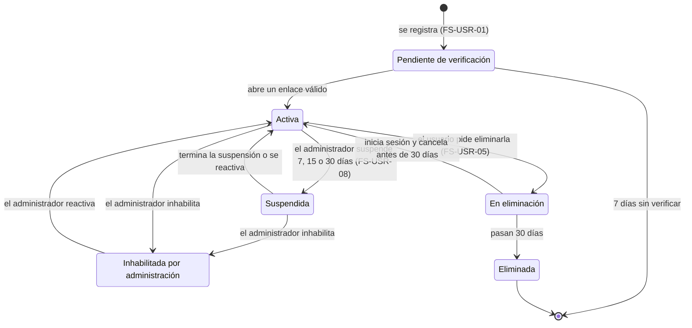

# Módulo Usuarios (USR)

## Propósito

La **persona** dentro de UniLink: su cuenta, su sesión, su configuración y privacidad, sus categorías de interés, su perfil profesional y su hoja de vida, además de la gestión de cuentas que hace la administración.

**No es responsabilidad de este módulo:** las conexiones, las sugerencias y la búsqueda ([Red](../red/README.md)); las notificaciones y los correos de actividad ([Comunicación](../comunicacion/README.md)); el registro de auditoría ([Plataforma](../plataforma/README.md)).

## Documentos

| Documento | Contenido |
|---|---|
| [Casos de uso](./casos-de-uso.md) | CU-01, CU-02, CU-03, CU-04, CU-17, CU-18, CU-19, CU-24 |
| [Historias de usuario](./historias.md) | HU-01, HU-02, HU-03, HU-04, HU-13, HU-14, HU-17, HU-28 |
| [FS-USR-01](./specs/FS-USR-01-registro.md) | Registro y verificación de cuenta |
| [FS-USR-02](./specs/FS-USR-02-inicio-sesion.md) | Inicio y cierre de sesión |
| [FS-USR-03](./specs/FS-USR-03-recuperar-contrasena.md) | Recuperación de contraseña |
| [FS-USR-04](./specs/FS-USR-04-preferencias-contenido.md) | Preferencias de contenido |
| [FS-USR-05](./specs/FS-USR-05-configuracion-cuenta.md) | Configuración de cuenta y privacidad |
| [FS-USR-06](./specs/FS-USR-06-perfil-profesional.md) | Perfil profesional |
| [FS-USR-07](./specs/FS-USR-07-hoja-de-vida-pdf.md) | Hoja de vida en PDF |
| [FS-USR-08](./specs/FS-USR-08-gestion-cuentas.md) | Gestión de cuentas de usuario |

## Quién es quién

| Actor | En este módulo |
|---|---|
| Visitante | Se registra, verifica su correo, inicia sesión y recupera su contraseña. |
| Dueño del perfil | Edita su perfil, su configuración, su privacidad y sus categorías de interés; descarga su hoja de vida; elimina su cuenta. |
| Observador | Ve el perfil de otro según su privacidad (la regla la aplica [Red](../red/README.md), que sabe quién es conexión). |
| Administrador de la plataforma | Consulta cuentas; suspende, inhabilita y reactiva (FS-USR-08). |
| Sistema | Vence enlaces, borra cuentas sin verificar o en eliminación, levanta bloqueos y suspensiones. |
| Servicio de correo | Entrega verificaciones, recuperaciones y avisos de seguridad. |

| Acción | Visitante | Dueño del perfil | Observador | Administrador de la plataforma |
|---|---|---|---|---|
| Registrarse, iniciar sesión, recuperar contraseña | ✓ | — | — | — |
| Editar perfil, configuración y preferencias | — | ✓ | — | — |
| Ver el perfil | — | ✓ | Según privacidad | Datos básicos y estado |
| Descargar la hoja de vida | — | ✓ (solo la propia) | — | — |
| Suspender, inhabilitar o reactivar | — | — | — | ✓ (no a sí mismo ni a otro administrador) |
| Cancelar una eliminación | — | ✓ (iniciando sesión antes de 30 días) | — | — |

## Entidades y datos propios

| Entidad | Datos | Notas |
|---|---|---|
| Cuenta | Correo institucional, correo de respaldo, tipo de usuario (verificado o declarado), estado, fechas, aceptación de términos (versión y fecha) | Única fuente del estado de la cuenta. |
| Credenciales y sesiones | Hash de la contraseña, sesiones, intentos fallidos | Componente interno: ningún otro módulo lo ve. |
| Configuración | Privacidad del perfil, preferencias de correo por tipo | La privacidad la aplica Red (y quien muestre datos del usuario). |
| Categorías de interés | Categorías elegidas por tipo de contenido | Las categorías son de Plataforma; aquí solo la elección. |
| Perfil | Nombre, unidad académica, foto, titular, biografía, etiquetas, trayectoria, indicador de onboarding | El indicador lo marca Red por la interfaz pública. |
| Sanción | Tipo, duración, motivo, administrador | Su registro va también a la auditoría (evento). |

### Unidad académica

| Tipo de usuario | Unidad académica | Facultad |
|---|---|---|
| Estudiante | Programa (catálogo oficial) | Se deduce del programa |
| Profesor | Facultad y departamento (catálogo oficial) | La elegida |
| Personal administrativo | Dependencia (catálogo oficial; mientras no exista, texto) | No aplica |

## Máquina de estados de la cuenta

Es la **única** definición del estado de la cuenta; los specs la citan.

| Estado | Puede iniciar sesión | Su perfil y contenido se ven | Quién lo cambia |
|---|---|---|---|
| Pendiente de verificación | No (FS-USR-02 RN-01) | No | Sistema, al verificar o a los 7 días |
| Activa | Sí | Sí, según privacidad | — |
| Suspendida | No | No | Administrador; Sistema al terminar el plazo |
| Inhabilitada por administración | No | No | Administrador |
| En eliminación | Solo para cancelar la eliminación | No | Usuario; Sistema a los 30 días |
| Eliminada | — | Sus mensajes en conversaciones ajenas aparecen como de "Usuario eliminado" | Estado final |

Aparte del estado de la cuenta, el **acceso** puede estar bloqueado temporalmente 15 minutos por intentos fallidos (FS-USR-02 RN-02); no cambia el estado de la cuenta.

Cada cambio de estado publica `cuenta.estado_cambiado`. Lo que hace cada módulo con lo que posee esa cuenta (oportunidades, eventos, proyectos, postulaciones, asistencias) está pendiente de **P-51**. Hoy ya está decidido: el perfil, las publicaciones y los comentarios dejan de verse (FS-USR-08 RN-04) y las conversaciones quedan en solo lectura (FS-COM-01 RN-08).

## Expone

| Tipo | Elemento |
|---|---|
| API | `/api/v1/usuarios/...`: registro, verificación, sesión, recuperación, configuración, preferencias, perfil, hoja de vida y administración de cuentas ([contrato](../../../contracts/api/usuarios.yaml)). |
| Interfaz pública | Estado de una cuenta; datos públicos, nivel de privacidad y etiquetas de un perfil; afinidad con una lista de habilidades; categorías de interés; correo y preferencias de correo de un usuario (solo para Comunicación); marcar el onboarding como completado ([contrato](../../../contracts/modulos/usuarios.md)). |
| Contexto de la petición | Usuario autenticado y sus roles, que resuelve la sesión para todos los módulos. |
| Eventos | `cuenta.estado_cambiado`, `perfil.actualizado`, `auditoria.registrada` ([catálogo](../../../contracts/eventos/README.md)). |

## Consume

| De | Qué | Para |
|---|---|---|
| Plataforma | Categorías activas por tipo | Preferencias (FS-USR-04). |
| Plataforma | Lista de palabras prohibidas | Textos públicos del perfil (titular, biografía, etiquetas). |
| Evento `categoria.cambiada` | Categoría renombrada o desactivada | Mantener las preferencias (FS-USR-04 RN-03). |
| Evento `contenido.retirado` | Contenido retirado de un usuario | Historial del detalle de la cuenta (FS-USR-08). |

## Preguntas abiertas del módulo

P-03, P-04, P-05, P-06, P-11, P-12, P-21, P-22, P-23, P-24, P-25, P-33, P-34, P-46, P-48, P-51, P-54, P-55.
