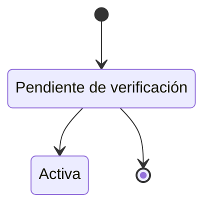

# FS-USR-01 — Registro y verificación de cuenta

| Campo | Valor |
|---|---|
| **Módulo** | Usuarios (USR) |
| **Estado** | Borrador |
| **Responsable** | Por asignar |
| **Casos de uso** | [CU-01](../casos-de-uso.md#cu-01--registrar-cuenta) |
| **Historias** | [HU-01](../historias.md#hu-01) |
| **Última actualización** | 2026-10-24 |

## 1. Objetivo

Permitir que estudiantes, profesores y personal administrativo de la Universidad del Magdalena creen una cuenta con su correo institucional y la activen verificando ese correo. Así se garantiza que solo la comunidad universitaria entra a la red.

## 2. Quién es quién

| Actor | Qué hace | Qué ve | Qué no puede hacer |
|---|---|---|---|
| Visitante | Completa el formulario, acepta los términos, verifica su correo y pide reenvíos. | El formulario, el indicador de requisitos de la contraseña y la pantalla "Revisa tu correo". | Registrarse con un correo no institucional o ya registrado; elegir un tipo distinto al que fija la lista de TI. |
| Sistema | Valida el dominio y el tipo, crea la cuenta pendiente, envía y vence enlaces, elimina cuentas sin verificar a los 7 días. | — | Activar una cuenta sin un enlace válido. |
| Servicio de correo | Entrega el enlace de verificación. | — | — |

## 3. Alcance

**Incluye:**

- Formulario de registro con correo institucional.
- Selección opcional de categorías de interés (detallada en [FS-USR-04](./FS-USR-04-preferencias-contenido.md)).
- Envío, reenvío y expiración del enlace de verificación.
- Activación de la cuenta y redirección al perfil.

**No incluye:**

- Registro de egresados y tercerizados con correo personal (FS-SRV-03, fase 2).
- Contenido del formulario de perfil profesional (FS-USR-06).
- Inicio de sesión con proveedores externos (Google, Microsoft).

## 4. Reglas de negocio

| ID | Regla |
|---|---|
| RN-01 | Solo se aceptan correos de los dominios institucionales configurados (inicialmente `unimagdalena.edu.co`). La comparación no distingue mayúsculas. |
| RN-02 | Un correo solo puede estar asociado a una cuenta. |
| RN-03 | La contraseña debe tener al menos 8 caracteres e incluir una mayúscula, una minúscula y un número. |
| RN-04 | El enlace de verificación es de un solo uso y vence 24 horas después de enviado. |
| RN-05 | Al solicitar un nuevo enlace, los anteriores quedan invalidados. |
| RN-06 | Se pueden pedir como máximo 3 reenvíos por hora para un mismo correo. |
| RN-07 | Una cuenta sin verificar no puede iniciar sesión ([FS-USR-02](./FS-USR-02-inicio-sesion.md)). |
| RN-08 | Las cuentas sin verificar se eliminan a los 7 días de creadas, liberando el correo. |
| RN-09 | El usuario debe aceptar los términos de uso, las [normas de la comunidad](../../../normas-comunidad.md) y la política de tratamiento de datos personales (Ley 1581 de 2012) para registrarse. |
| RN-10 | La **unidad académica** depende del tipo de usuario: programa para el estudiante (la facultad se deduce del programa), facultad y departamento para el profesor, y dependencia para el personal administrativo. Se elige del catálogo oficial ([módulo Usuarios](../README.md#unidad-académica)). |
| RN-11 | **Tipo de usuario verificado:** si la lista oficial de TI incluye el correo, el tipo lo fija la lista y queda **Verificado**. Si el correo no está en la lista o la lista no existe todavía, el tipo queda **Declarado por el usuario** y así se muestra en el perfil. |

## 5. Requisitos funcionales

| ID | Requisito | Prioridad |
|---|---|---|
| RF-01 | El sistema debe mostrar un formulario de registro con los campos de la sección 6. | Alta |
| RF-02 | El sistema debe validar cada campo al perder el foco y de nuevo al enviar el formulario. | Alta |
| RF-03 | El sistema debe crear la cuenta en estado **Pendiente de verificación** y enviar el enlace al correo ingresado. | Alta |
| RF-04 | El sistema debe mostrar una pantalla de "Revisa tu correo" con la opción de reenviar el enlace. | Alta |
| RF-05 | Al abrir un enlace válido, el sistema debe activar la cuenta, iniciar sesión y redirigir a la edición de perfil. Mientras la edición de perfil no exista (Sprint 1), redirige a una página de bienvenida con acceso a la configuración y al cierre de sesión. | Alta |
| RF-06 | Al abrir un enlace vencido o inválido, el sistema debe explicarlo y ofrecer reenviar uno nuevo. | Alta |
| RF-07 | _(Fase 2)_ Si el correo no es institucional, el sistema debe mostrar, además del error, un enlace al registro de egresados y tercerizados. | Media |
| RF-08 | El sistema debe guardar la contraseña cifrada con un algoritmo de hash con sal; nunca en texto plano. | Alta |

## 6. Datos y validaciones

| Campo | Tipo | Obligatorio | Validación |
|---|---|---|---|
| Nombres | Texto | Sí | 2 a 60 caracteres; solo letras, espacios, tildes y guiones. |
| Apellidos | Texto | Sí | 2 a 60 caracteres; mismas reglas que nombres. |
| Correo institucional | Correo | Sí | Formato válido, dominio permitido (RN-01) y no registrado (RN-02). |
| Contraseña | Contraseña | Sí | RN-03. Se muestra un indicador de requisitos cumplidos. |
| Confirmar contraseña | Contraseña | Sí | Igual a la contraseña. |
| Tipo de usuario | Lista | Sí | Estudiante, Profesor o Personal administrativo. Si la lista de TI lo fija, viene preseleccionado y no se puede cambiar (RN-11). |
| Programa | Lista | Sí, si es estudiante | Programas vigentes del catálogo oficial (RN-10). |
| Facultad y departamento | Listas | Sí, si es profesor | Catálogo oficial (RN-10). |
| Dependencia | Lista | Sí, si es personal administrativo | Catálogo oficial (RN-10); mientras no exista, texto de 2 a 100 caracteres. |
| Categorías de interés | Selección múltiple | No | Ver [FS-USR-04](./FS-USR-04-preferencias-contenido.md). |
| Acepto términos, normas de la comunidad y tratamiento de datos | Casilla | Sí | Debe estar marcada (RN-09). Cada documento se abre con un enlace. |

**Finalidad de los datos personales** (RNF-PRI-01): nombres y apellidos identifican al usuario en su perfil; el correo institucional prueba la pertenencia a la universidad y es el medio de acceso; el tipo de usuario y la unidad académica se usan en el perfil, la búsqueda y las sugerencias; la aceptación de términos se guarda con fecha y versión como prueba del consentimiento (RNF-PRI-02). La contraseña solo se guarda como hash (RNF-SEG-02).

## 7. Estados



| Estado | Entra cuando | Sale hacia |
|---|---|---|
| Pendiente de verificación | Se envía el formulario | **Activa** al verificar; se elimina a los 7 días (RN-08) |
| Activa | Se abre un enlace válido | Suspendida o inhabilitada (FS-USR-08) |

La máquina de estados completa de la cuenta está en el [README del módulo](../README.md#máquina-de-estados-de-la-cuenta).

## 8. Flujo principal

1. **Registro** → el usuario completa el formulario → **Revisa tu correo**.
2. **Revisa tu correo** → "Reenviar enlace" → se envía un enlace nuevo (RN-05, RN-06).
3. **Correo** → abre el enlace → **Cuenta verificada** → redirige a **Editar perfil** (FS-USR-06).
4. **Enlace inválido** → "Enviar un enlace nuevo" → **Revisa tu correo**.

## 9. Variaciones

| Variación | Qué cambia | Regla |
|---|---|---|
| Se registra un estudiante | Elige programa; la facultad se deduce. | RN-10 |
| Se registra un profesor | Elige facultad y departamento. | RN-10 |
| Se registra personal administrativo | Elige dependencia; no tiene facultad. | RN-10 |
| El correo está en la lista de TI | El tipo viene fijado y queda Verificado. | RN-11 |
| No hay lista de TI o el correo no está | El tipo queda Declarado por el usuario. | RN-11 |
| No elige categorías de interés | La cuenta se crea sin preferencias. | FS-USR-04 RN-02 |
| _(Fase 2)_ El correo no es institucional | Además del error, enlace al registro de egresados y tercerizados. | RF-07 |

## 10. ¿Qué pasaría si…?

| Situación | Comportamiento esperado | Regla o pregunta |
|---|---|---|
| Dos registros llegan a la vez con el mismo correo | Solo uno crea la cuenta; el otro ve MSG-02. | RN-02 |
| Alguien se registra con el correo de una cuenta que sigue pendiente | Se trata como correo registrado: MSG-02 y la opción de reenviar el enlace. El correo se libera a los 7 días. | RN-02, RN-08 |
| La cuenta pendiente se elimina a los 7 días y luego se abre su enlace | Ve MSG-06 y debe registrarse de nuevo. | RN-08 |
| El servicio de correo no responde | La cuenta queda pendiente, el correo se reintenta y el usuario puede pedir reenvío. | RNF-DIS-05, EC-02 |
| El enlace se abre en otro navegador o dispositivo | La cuenta se activa e inicia sesión en ese navegador. | RN-04 |
| El enlace se abre por segunda vez | Ve MSG-06; si la cuenta ya está activa, puede iniciar sesión. | RN-04 |
| Pide más de 3 reenvíos en una hora | MSG-07 y no se envía nada. | RN-06 |
| Cambia la lista de dominios con cuentas pendientes | Las pendientes siguen su curso; los registros nuevos usan la lista nueva. | RN-01 |
| Privacidad: MSG-02 revela que un correo tiene cuenta | Hoy se acepta (el correo es institucional y los intentos están limitados); queda en pregunta. | P-54 |

## 11. Mensajes al usuario

| Código | Situación | Mensaje |
|---|---|---|
| MSG-01 | Dominio no institucional | "Usa tu correo institucional (@unimagdalena.edu.co)." En la fase 2 se agrega: "¿Eres egresado o trabajas en el campus para una empresa externa? Regístrate aquí." |
| MSG-02 | Correo ya registrado | "Ya existe una cuenta con este correo. Inicia sesión o recupera tu contraseña." |
| MSG-03 | Contraseña débil | "La contraseña debe tener al menos 8 caracteres, una mayúscula, una minúscula y un número." |
| MSG-04 | Contraseñas distintas | "Las contraseñas no coinciden." |
| MSG-05 | Registro enviado | "Te enviamos un enlace a {correo}. Ábrelo en las próximas 24 horas para activar tu cuenta." |
| MSG-06 | Enlace vencido o inválido | "Este enlace ya no es válido. Solicita uno nuevo para activar tu cuenta." |
| MSG-07 | Límite de reenvíos | "Ya solicitaste varios enlaces. Intenta de nuevo en una hora." |
| MSG-08 | Cuenta verificada | "¡Tu cuenta está activa! Ahora completa tu perfil." |

## 12. Resultado esperado

```gherkin
Escenario: Registro exitoso
  Dado que soy un visitante en la página de registro
  Cuando completo el formulario con datos válidos y un correo @unimagdalena.edu.co
  Entonces mi cuenta queda "Pendiente de verificación"
  Y recibo un correo con un enlace de verificación
  Y veo el mensaje MSG-05

Escenario: Correo no institucional
  Dado que estoy en la página de registro
  Cuando ingreso un correo @gmail.com
  Entonces veo el mensaje MSG-01
  Y no puedo enviar el formulario

Escenario: Correo ya registrado
  Dado que existe una cuenta con el correo ana@unimagdalena.edu.co
  Cuando intento registrarme con ese mismo correo
  Entonces veo el mensaje MSG-02

Escenario: Verificación exitosa
  Dado que tengo una cuenta pendiente y un enlace de hace menos de 24 horas
  Cuando abro el enlace
  Entonces mi cuenta queda "Activa"
  Y quedo con la sesión iniciada en la página de edición de perfil

Escenario: Enlace vencido
  Dado que recibí un enlace hace más de 24 horas
  Cuando lo abro
  Entonces veo el mensaje MSG-06 y la opción de solicitar uno nuevo

Escenario: Enlace anterior invalidado
  Dado que solicité un segundo enlace de verificación
  Cuando abro el primer enlace
  Entonces veo el mensaje MSG-06

Escenario: Límite de reenvíos
  Dado que solicité 3 enlaces en la última hora
  Cuando solicito otro
  Entonces veo el mensaje MSG-07 y no se envía ningún correo

Escenario: Registro de un profesor
  Dado que estoy en la página de registro
  Cuando elijo el tipo "Profesor"
  Entonces el formulario me pide facultad y departamento en lugar de programa

Escenario: Registro de personal administrativo
  Dado que estoy en la página de registro
  Cuando elijo el tipo "Personal administrativo" y una dependencia
  Entonces puedo enviar el formulario sin programa ni facultad

Escenario: Tipo fijado por la lista de TI
  Dado que mi correo aparece en la lista de TI como "Estudiante"
  Cuando abro el formulario de registro
  Entonces el tipo "Estudiante" aparece seleccionado y no lo puedo cambiar

Escenario: Tipo declarado
  Dado que la lista de TI todavía no existe
  Cuando me registro como "Profesor"
  Entonces mi tipo queda "Declarado por el usuario"

Escenario: Registros simultáneos con el mismo correo
  Dado que dos registros con ana@unimagdalena.edu.co llegan al mismo tiempo
  Entonces solo existe una cuenta con ese correo
  Y el segundo registro ve el mensaje MSG-02

Escenario: Correo con una cuenta pendiente
  Dado que existe una cuenta pendiente con ana@unimagdalena.edu.co
  Cuando intento registrarme con ese correo
  Entonces veo el mensaje MSG-02 y la opción de reenviar el enlace

Escenario: Servicio de correo caído
  Dado que el servicio de correo no responde
  Cuando completo el registro
  Entonces mi cuenta queda "Pendiente de verificación"
  Y el correo se envía cuando el servicio vuelve
```

## 13. Contratos

**Expone:**

- API: `POST /api/v1/usuarios/registro`, `POST /api/v1/usuarios/registro/reenvio`, `POST /api/v1/usuarios/verificacion` ([contrato](../../../../contracts/api/usuarios.yaml)).
- Evento: `cuenta.estado_cambiado` al pasar a Activa ([catálogo](../../../../contracts/eventos/README.md)).

**Consume:**

- Plataforma: categorías activas para el paso de categorías de interés (FS-USR-04).
- Catálogos de programas, facultades, departamentos y dependencias, y lista de tipos de TI (datos semilla; P-03, P-04).

## 14. Calidad

RNF-SEG-02 (hash de contraseñas), RNF-PRI-02 (consentimiento), RNF-SEG-07 (límites de reenvío), RNF-DIS-06 (entregabilidad), RNF-PRI-09 (retención de cuentas sin verificar), [EC-02](../../../srs/Especificacion_Requisitos.md#34-escenarios-de-atributos-de-calidad).

## 15. Preguntas abiertas

- P-03 — dominios válidos y lista de tipos de usuario.
- P-04 — catálogos de programas, facultades, departamentos y dependencias.
- P-11 — aprobación jurídica del texto de autorización.
- P-54 — ¿el registro debe ocultar que un correo ya tiene cuenta?

## 16. Lista de revisión

- [x] Cada actor de "Quién es quién" existe en el [SRS §2.4](../../../srs/Especificacion_Requisitos.md#24-actores-del-sistema) con el mismo nombre.
- [x] Toda acción tiene un actor que puede hacerla y se valida en el servidor (RNF-SEG-04).
- [ ] Cada regla tiene al menos un escenario en "Resultado esperado".
- [x] "¿Qué pasaría si…?" revisó las siete situaciones: concurrencia, estado de la cuenta, eliminación de lo que usa, pérdida de permiso, falla externa, límites de uso y privacidad.
- [x] Ningún dato se recoge sin finalidad (RNF-PRI-01).
- [x] No contradice a su caso de uso, a su historia ni a otro spec.
- [x] Sus contratos existen en [`contracts/`](../../../../contracts/README.md).
- [ ] No tiene preguntas abiertas que bloqueen el desarrollo.

## 17. Historial de cambios

| Fecha | Autor | Cambio |
|---|---|---|
| 2026-10-06 | Gamero | Creación |
| 2026-10-24 | Equipo UniLink | Estudio de quién es quién, variaciones, casos límite y contratos; nueva plantilla. |
