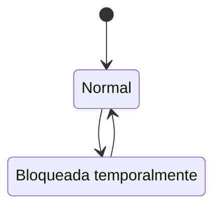

# FS-USR-02 — Inicio y cierre de sesión

| Campo | Valor |
|---|---|
| **Módulo** | Usuarios (USR) |
| **Estado** | Borrador |
| **Responsable** | Por asignar |
| **Casos de uso** | [CU-02](../casos-de-uso.md#cu-02--iniciar-sesión) |
| **Historias** | [HU-02](../historias.md#hu-02) |
| **Última actualización** | 2026-10-24 |

## 1. Objetivo

Permitir que un usuario con cuenta activa acceda a UniLink de forma segura y cierre su sesión cuando lo desee, protegiendo las cuentas frente a intentos repetidos de adivinar la contraseña.

## 2. Quién es quién

| Actor | Qué hace | Qué ve | Qué no puede hacer |
|---|---|---|---|
| Visitante | Ingresa su correo y contraseña; elige "Mantener sesión iniciada". | El formulario, los intentos restantes (2 o menos) y el tiempo de bloqueo. | Saber si un correo está registrado por el mensaje de error (RN-03). |
| Usuario | Cierra su sesión. | El menú con "Cerrar sesión". | Mantener una sesión de una cuenta que dejó de estar activa. |
| Sistema | Cuenta los intentos, bloquea 15 minutos, vence las sesiones y las cierra al cambiar el estado de la cuenta. | — | — |

## 3. Alcance

**Incluye:**

- Inicio de sesión con correo y contraseña.
- Bloqueo temporal por intentos fallidos.
- Opción "Mantener sesión iniciada".
- Cierre de sesión.
- Redirección a la edición de perfil o al onboarding mientras estén pendientes.

**No incluye:**

- Recuperación de contraseña ([FS-USR-03](./FS-USR-03-recuperar-contrasena.md)).
- Autenticación en dos pasos.
- Inicio de sesión con proveedores externos.

## 4. Reglas de negocio

| ID | Regla |
|---|---|
| RN-01 | Solo las cuentas en estado **Activa** pueden iniciar sesión. Una cuenta **En eliminación** puede autenticarse únicamente para cancelar la eliminación ([FS-USR-05](./FS-USR-05-configuracion-cuenta.md), RN-09). |
| RN-02 | Tras 5 intentos fallidos consecutivos, la cuenta se bloquea 15 minutos. Un inicio de sesión exitoso reinicia el contador. |
| RN-03 | El mensaje de credenciales incorrectas es el mismo si el correo no existe o si la contraseña es incorrecta, para no revelar qué correos están registrados. |
| RN-04 | Sin "Mantener sesión iniciada", la sesión expira tras 2 horas de inactividad. Con la opción marcada, dura 30 días. |
| RN-05 | Al cerrar sesión se invalida la sesión en el servidor, no solo en el navegador. |
| RN-06 | Si el usuario nunca ha guardado su perfil, va a la edición de perfil ([FS-USR-06](./FS-USR-06-perfil-profesional.md)). Si ya lo guardó pero tiene el onboarding pendiente, va al onboarding ([FS-RED-02](../../red/specs/FS-RED-02-onboarding-sugerencias.md)). En cualquier otro caso, va al feed. Mientras esas pantallas no existan (Sprints 1 y 2), va a la página de bienvenida provisional de [FS-USR-01](./FS-USR-01-registro.md) (RF-05). |
| RN-07 | Si una cuenta se suspende, se inhabilita o cambia su contraseña, sus sesiones abiertas se cierran de inmediato; la siguiente petición pide iniciar sesión de nuevo (MSG-06 o MSG-05). |

## 5. Requisitos funcionales

| ID | Requisito | Prioridad |
|---|---|---|
| RF-01 | El sistema debe mostrar un formulario con correo, contraseña, "Mantener sesión iniciada" y el enlace "¿Olvidaste tu contraseña?". | Alta |
| RF-02 | El sistema debe validar las credenciales y, si son correctas, crear la sesión y redirigir según RN-06. | Alta |
| RF-03 | El sistema debe indicar los intentos restantes cuando quedan 2 o menos. | Media |
| RF-04 | El sistema debe bloquear la cuenta según RN-02 e informar cuánto tiempo falta para desbloquearla. | Alta |
| RF-05 | Si la cuenta está pendiente de verificación, el sistema debe ofrecer reenviar el enlace ([FS-USR-01](./FS-USR-01-registro.md)). | Alta |
| RF-06 | Si la cuenta está suspendida o inhabilitada, el sistema debe impedir el acceso e informar el estado. | Alta |
| RF-07 | El sistema debe ofrecer la opción "Cerrar sesión" en el menú del usuario. | Alta |
| RF-08 | Si un usuario sin sesión intenta abrir una página protegida, el sistema debe llevarlo al inicio de sesión y, al ingresar, devolverlo a esa página. | Media |

## 6. Datos y validaciones

| Campo | Tipo | Obligatorio | Validación |
|---|---|---|---|
| Correo | Correo | Sí | Formato válido. |
| Contraseña | Contraseña | Sí | No vacía. |
| Mantener sesión iniciada | Casilla | No | Desmarcada por defecto. |

## 7. Estados



| Estado de acceso | Entra cuando | Sale hacia |
|---|---|---|
| Normal | Estado inicial o inicio de sesión exitoso | **Bloqueada temporalmente** al quinto intento fallido |
| Bloqueada temporalmente | 5 intentos fallidos consecutivos | **Normal** después de 15 minutos o al restablecer la contraseña |

La máquina de estados completa de la cuenta está en el [README del módulo](../README.md#máquina-de-estados-de-la-cuenta).

## 8. Flujo principal

1. **Inicio de sesión** → credenciales válidas → **Editar perfil**, **Onboarding** o **Feed**, según RN-06.
2. **Inicio de sesión** → credenciales inválidas → mismo formulario con el mensaje de error.
3. **Menú del usuario** → "Cerrar sesión" → **Inicio de sesión**.

## 9. Variaciones

| Variación | Qué cambia | Regla |
|---|---|---|
| Con "Mantener sesión iniciada" | La sesión dura 30 días en lugar de 2 horas de inactividad. | RN-04 |
| Perfil nunca guardado | Va a la edición de perfil. | RN-06 |
| Perfil guardado y onboarding pendiente | Va al onboarding. | RN-06 |
| Cuenta pendiente de verificación | MSG-04 con la opción de reenviar el enlace. | RF-05 |
| Cuenta suspendida o inhabilitada | MSG-05 con el estado y, si es una suspensión, la fecha de fin. | RF-06 |
| Cuenta en eliminación | Se autentica solo para ofrecer cancelar la eliminación (MSG-08 de FS-USR-05). | RN-01 |
| Intentó abrir una página protegida | Al iniciar sesión vuelve a esa página. | RF-08 |

## 10. ¿Qué pasaría si…?

| Situación | Comportamiento esperado | Regla o pregunta |
|---|---|---|
| Intentos fallidos simultáneos desde varios dispositivos | El contador es de la cuenta y se actualiza de forma atómica: al quinto fallo, en cualquier dispositivo, se bloquea. | RN-02, RNF-CON-01 |
| Un administrador suspende la cuenta mientras el usuario navega | Sus sesiones se cierran; la siguiente petición muestra MSG-05. | RN-07 |
| Cambia la contraseña en otro dispositivo | La sesión de este dispositivo se cierra; ve MSG-06. | RN-07, FS-USR-05 RN-05 |
| Alguien falla 5 veces con el correo de otra persona para bloquearla | Hoy la bloquea 15 minutos; puede desbloquearse restableciendo la contraseña. Queda en pregunta si se limita también por origen. | RN-02, P-55 |
| Restablece la contraseña estando bloqueado | El bloqueo se levanta. | FS-USR-03 RN-06 |
| La sesión expira con un formulario a medio llenar | Al enviar ve MSG-06; tras iniciar sesión vuelve a la página (RF-08). | RN-04, RF-08 |
| Privacidad: MSG-04 y MSG-03 solo aparecen para correos registrados | Revelan que el correo existe a quien conoce la contraseña o intenta 5 veces; se acepta por usabilidad y queda junto a P-55. | RN-03, P-55 |

## 11. Mensajes al usuario

| Código | Situación | Mensaje |
|---|---|---|
| MSG-01 | Credenciales incorrectas | "Correo o contraseña incorrectos." |
| MSG-02 | Pocos intentos restantes | "Correo o contraseña incorrectos. Te quedan {n} intentos antes de bloquear tu cuenta por 15 minutos." |
| MSG-03 | Cuenta bloqueada | "Tu cuenta está bloqueada por seguridad. Intenta de nuevo en {m} minutos o restablece tu contraseña." |
| MSG-04 | Cuenta sin verificar | "Aún no has verificado tu correo. ¿Quieres que te enviemos un nuevo enlace?" |
| MSG-05 | Cuenta suspendida o inhabilitada | "Tu cuenta está {estado}. Si crees que es un error, escribe a {correo de soporte}." |
| MSG-06 | Sesión expirada | "Tu sesión expiró. Inicia sesión de nuevo." |

## 12. Resultado esperado

```gherkin
Escenario: Inicio de sesión exitoso
  Dado que tengo una cuenta activa que ya completó el onboarding
  Cuando ingreso mi correo y contraseña correctos
  Entonces quedo con la sesión iniciada en el feed

Escenario: Perfil sin guardar
  Dado que verifiqué mi cuenta pero nunca guardé mi perfil
  Cuando ingreso credenciales correctas
  Entonces soy dirigido a la edición de perfil

Escenario: Onboarding pendiente
  Dado que guardé mi perfil pero no terminé ni omití el onboarding
  Cuando ingreso credenciales correctas
  Entonces soy dirigido al onboarding

Escenario: Credenciales incorrectas
  Dado que tengo una cuenta activa
  Cuando ingreso una contraseña incorrecta por primera vez
  Entonces veo el mensaje MSG-01

Escenario: Correo inexistente
  Dado que no existe una cuenta con nadie@unimagdalena.edu.co
  Cuando intento iniciar sesión con ese correo
  Entonces veo el mismo mensaje MSG-01

Escenario: Bloqueo por intentos fallidos
  Dado que he fallado 4 intentos consecutivos
  Cuando fallo el quinto
  Entonces veo el mensaje MSG-03
  Y no puedo iniciar sesión durante 15 minutos aunque use la contraseña correcta

Escenario: Cuenta sin verificar
  Dado que mi cuenta está pendiente de verificación
  Cuando ingreso credenciales correctas
  Entonces veo el mensaje MSG-04 y no inicio sesión

Escenario: Cerrar sesión
  Dado que tengo la sesión iniciada
  Cuando selecciono "Cerrar sesión"
  Entonces vuelvo a la página de inicio de sesión
  Y al usar el botón "Atrás" del navegador no puedo ver páginas protegidas

Escenario: Volver a la página solicitada
  Dado que no tengo sesión iniciada
  Cuando abro el enlace de un perfil y luego inicio sesión
  Entonces soy dirigido a ese perfil

Escenario: Suspensión durante la sesión
  Dado que tengo la sesión iniciada
  Cuando un administrador suspende mi cuenta
  Entonces mi siguiente acción me lleva al inicio de sesión con el mensaje MSG-05

Escenario: Cuenta en eliminación
  Dado que pedí eliminar mi cuenta hace 3 días
  Cuando ingreso mis credenciales correctas
  Entonces veo la opción de recuperar mi cuenta
  Y no entro al feed hasta decidir

Escenario: Intentos desde varios dispositivos
  Dado que fallé 3 intentos en un computador
  Cuando fallo 2 más en el celular
  Entonces mi cuenta queda bloqueada 15 minutos

Escenario: Página de bienvenida provisional
  Dado que solo existen las funciones del Sprint 1
  Cuando inicio sesión con una cuenta activa
  Entonces llego a la página de bienvenida provisional
```

## 13. Contratos

**Expone:**

- API: `POST /api/v1/usuarios/sesion` (iniciar), `DELETE /api/v1/usuarios/sesion` (cerrar), `GET /api/v1/usuarios/sesion` (usuario actual y a dónde redirigir) ([contrato](../../../../contracts/api/usuarios.yaml)).
- Contexto de la petición: usuario autenticado y roles, para todos los módulos ([interfaz](../../../../contracts/modulos/usuarios.md)).

**Consume:**

- Estado del onboarding: lo guarda la cuenta (Usuarios); Red lo marca como completado. El inicio de sesión no consulta a Red.

## 14. Calidad

RNF-SEG-01, RNF-SEG-03 (cookies y cierre en el servidor), RNF-SEG-07 (intentos), [EC-03](../../../srs/Especificacion_Requisitos.md#34-escenarios-de-atributos-de-calidad).

## 15. Preguntas abiertas

- P-05 — correo de soporte de MSG-05.
- P-21 — ¿avisar por correo cuando la cuenta se bloquea?
- P-55 — ¿limitar los intentos también por origen para evitar bloqueos malintencionados?

## 16. Lista de revisión

- [x] Cada actor de "Quién es quién" existe en el [SRS §2.4](../../../srs/Especificacion_Requisitos.md#24-actores-del-sistema) con el mismo nombre.
- [x] Toda acción tiene un actor que puede hacerla y se valida en el servidor (RNF-SEG-04).
- [ ] Cada regla tiene al menos un escenario en "Resultado esperado".
- [x] "¿Qué pasaría si…?" revisó las siete situaciones: concurrencia, estado de la cuenta, eliminación de lo que usa, pérdida de permiso, falla externa, límites de uso y privacidad.
- [ ] Ningún dato se recoge sin finalidad (RNF-PRI-01).
- [x] No contradice a su caso de uso, a su historia ni a otro spec.
- [x] Sus contratos existen en [`contracts/`](../../../../contracts/README.md).
- [ ] No tiene preguntas abiertas que bloqueen el desarrollo.

## 17. Historial de cambios

| Fecha | Autor | Cambio |
|---|---|---|
| 2026-10-06 | Gamero | Creación |
| 2026-10-24 | Equipo UniLink | Estudio de quién es quién, variaciones, casos límite y contratos; nueva plantilla. |
