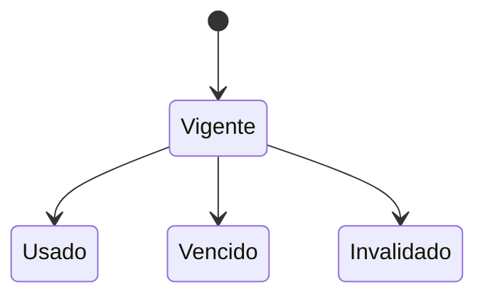

# FS-USR-03 — Recuperación de contraseña

| Campo | Valor |
|---|---|
| **Módulo** | Usuarios (USR) |
| **Estado** | Borrador |
| **Responsable** | Por asignar |
| **Casos de uso** | [CU-17](../casos-de-uso.md#cu-17--recuperar-contraseña) |
| **Historias** | [HU-28](../historias.md#hu-28) |
| **Última actualización** | 2026-10-24 |

## 1. Objetivo

Permitir que un usuario que olvidó su contraseña, o cuya cuenta quedó bloqueada, recupere el acceso de forma segura a través de su correo.

## 2. Quién es quién

| Actor | Qué hace | Qué ve | Qué no puede hacer |
|---|---|---|---|
| Visitante | Pide el enlace con su correo institucional o de respaldo y define la nueva contraseña. | El formulario, el mismo mensaje exista o no la cuenta, y el formulario de la nueva contraseña. | Saber si un correo tiene cuenta; reutilizar un enlace. |
| Sistema | Envía, invalida y vence enlaces; cierra las sesiones y levanta el bloqueo al restablecer. | — | Enviar enlaces a cuentas suspendidas o inhabilitadas. |
| Servicio de correo | Entrega el enlace y el aviso de cambio. | — | — |

## 3. Alcance

**Incluye:**

- Solicitud del enlace de restablecimiento.
- Definición de la nueva contraseña.
- Cierre de las sesiones abiertas y desbloqueo de la cuenta.

**No incluye:**

- Cambio de contraseña con la sesión iniciada (FS-USR-05).
- Recuperación de cuentas cuyo correo ya no existe.

## 4. Reglas de negocio

| ID | Regla |
|---|---|
| RN-01 | El enlace de restablecimiento es de un solo uso y vence 1 hora después de enviado. |
| RN-02 | Al solicitar un nuevo enlace, los anteriores quedan invalidados. |
| RN-03 | La respuesta a la solicitud es idéntica exista o no el correo, para no revelar qué cuentas existen. |
| RN-04 | Se pueden pedir como máximo 3 enlaces por hora para un mismo correo. |
| RN-05 | La nueva contraseña cumple la misma política del registro ([FS-USR-01](./FS-USR-01-registro.md), RN-03) y no puede ser igual a la actual. |
| RN-06 | Al restablecer la contraseña se cierran todas las sesiones abiertas y se levanta el bloqueo por intentos fallidos. |
| RN-07 | Se envía un correo de aviso al usuario cuando su contraseña cambia. |
| RN-08 | Solo se envían enlaces a cuentas **Activas** o **En eliminación** (para que puedan entrar y cancelarla). Las suspendidas o inhabilitadas no reciben nada, pero ven el mismo MSG-01 (RN-03). Las pendientes de verificación reciben en su lugar el enlace de verificación. |
| RN-09 | La solicitud acepta el correo institucional o el **correo de respaldo** verificado ([FS-USR-05](./FS-USR-05-configuracion-cuenta.md), RN-11). El enlace se envía solo a la dirección ingresada. |
| RN-10 | Al abrir el enlace se vuelve a comprobar el estado de la cuenta: si ya no es Activa ni En eliminación, se muestra MSG-02. |

## 5. Requisitos funcionales

| ID | Requisito | Prioridad |
|---|---|---|
| RF-01 | El sistema debe mostrar un formulario para ingresar el correo, accesible desde el inicio de sesión. | Alta |
| RF-02 | El sistema debe enviar el enlace de restablecimiento según RN-01 a RN-04 y RN-08. | Alta |
| RF-03 | Al abrir un enlace válido, el sistema debe mostrar un formulario para la nueva contraseña y su confirmación. | Alta |
| RF-04 | El sistema debe guardar la nueva contraseña, aplicar RN-06 y RN-07, y redirigir al inicio de sesión. | Alta |
| RF-05 | Al abrir un enlace vencido, usado o inválido, el sistema debe explicarlo y ofrecer solicitar uno nuevo. | Alta |

## 6. Datos y validaciones

| Campo | Tipo | Obligatorio | Validación |
|---|---|---|---|
| Correo | Correo | Sí | Formato válido. |
| Nueva contraseña | Contraseña | Sí | RN-05. |
| Confirmar contraseña | Contraseña | Sí | Igual a la nueva contraseña. |

## 7. Estados



| Estado del enlace | Entra cuando | Sale hacia |
|---|---|---|
| Vigente | Se envía | **Usado**, **Vencido** (1 hora) o **Invalidado** (se pidió otro) |

## 8. Flujo principal

1. **Inicio de sesión** → "¿Olvidaste tu contraseña?" → **Solicitar enlace**.
2. **Solicitar enlace** → envía el correo → **Revisa tu correo**.
3. **Correo** → abre el enlace → **Nueva contraseña** → guarda → **Inicio de sesión** con mensaje de éxito.

## 9. Variaciones

| Variación | Qué cambia | Regla |
|---|---|---|
| Usa el correo de respaldo | El enlace llega a esa dirección. | RN-09 |
| Cuenta bloqueada por intentos | Al restablecer, se desbloquea. | RN-06 |
| Cuenta pendiente de verificación | Recibe el enlace de verificación. | RN-08 |
| Cuenta en eliminación | Recibe el enlace para poder entrar y cancelar. | RN-08 |
| Cuenta suspendida o inhabilitada | No recibe nada; ve MSG-01. | RN-08, RN-03 |

## 10. ¿Qué pasaría si…?

| Situación | Comportamiento esperado | Regla o pregunta |
|---|---|---|
| Pide dos enlaces seguidos | Solo el último es válido. | RN-02 |
| Un administrador suspende la cuenta después de enviar el enlace | Al abrirlo ve MSG-02. | RN-10 |
| El correo institucional ya no existe (egresado) | Puede usar su correo de respaldo, si lo registró. | RN-09 |
| El servicio de correo no responde | El enlace se envía al volver el servicio; el usuario ve MSG-01 igual. | RNF-DIS-05, EC-02 |
| Más de 3 solicitudes en una hora para un correo | MSG-04, exista o no la cuenta. | RN-04, RN-03 |
| Abre el enlace en dos pestañas y guarda en ambas | La primera cambia la contraseña; la segunda ve MSG-02. | RN-01 |
| Quiere reutilizar una contraseña anterior | Solo se impide la actual. | RN-05, P-22 |

## 11. Mensajes al usuario

| Código | Situación | Mensaje |
|---|---|---|
| MSG-01 | Solicitud enviada (exista o no el correo) | "Si existe una cuenta con {correo}, recibirás un enlace para restablecer tu contraseña. Vence en 1 hora." |
| MSG-02 | Enlace inválido | "Este enlace ya no es válido. Solicita uno nuevo." |
| MSG-03 | Contraseña igual a la actual | "La nueva contraseña debe ser distinta de la actual." |
| MSG-04 | Límite de solicitudes | "Ya solicitaste varios enlaces. Intenta de nuevo en una hora." |
| MSG-05 | Contraseña restablecida | "Tu contraseña se actualizó. Inicia sesión con la nueva contraseña." |
| MSG-06 | Correo de aviso | "La contraseña de tu cuenta UniLink cambió el {fecha}. Si no fuiste tú, escribe a {correo de soporte}." |

## 12. Resultado esperado

```gherkin
Escenario: Solicitud con correo registrado
  Dado que tengo una cuenta activa
  Cuando solicito restablecer mi contraseña
  Entonces veo el mensaje MSG-01
  Y recibo un enlace que vence en 1 hora

Escenario: Solicitud con correo no registrado
  Dado que no existe una cuenta con nadie@unimagdalena.edu.co
  Cuando solicito restablecer la contraseña con ese correo
  Entonces veo el mismo mensaje MSG-01
  Y no se envía ningún correo

Escenario: Restablecimiento exitoso
  Dado que abrí un enlace vigente
  Cuando ingreso una nueva contraseña válida y la confirmo
  Entonces veo el mensaje MSG-05
  Y mis otras sesiones abiertas se cierran
  Y recibo el correo de aviso MSG-06

Escenario: Desbloqueo de la cuenta
  Dado que mi cuenta está bloqueada por intentos fallidos
  Cuando restablezco mi contraseña
  Entonces puedo iniciar sesión de inmediato con la nueva contraseña

Escenario: Enlace usado
  Dado que ya restablecí mi contraseña con un enlace
  Cuando vuelvo a abrir ese enlace
  Entonces veo el mensaje MSG-02

Escenario: Enlace vencido
  Dado que recibí un enlace hace más de 1 hora
  Cuando lo abro
  Entonces veo el mensaje MSG-02

Escenario: Recuperar con el correo de respaldo
  Dado que mi correo de respaldo ana@gmail.com está verificado
  Cuando pido restablecer la contraseña con ana@gmail.com
  Entonces recibo el enlace en ana@gmail.com

Escenario: Cuenta suspendida
  Dado que mi cuenta está suspendida
  Cuando pido restablecer la contraseña
  Entonces veo el mensaje MSG-01
  Y no se envía ningún correo

Escenario: Suspensión después del enlace
  Dado que pedí un enlace y después un administrador suspendió mi cuenta
  Cuando abro el enlace
  Entonces veo el mensaje MSG-02

Escenario: Cuenta en eliminación
  Dado que mi cuenta está en eliminación y olvidé mi contraseña
  Cuando la restablezco
  Entonces puedo iniciar sesión y cancelar la eliminación
```

## 13. Contratos

**Expone:** `POST /api/v1/usuarios/recuperacion` y `POST /api/v1/usuarios/recuperacion/confirmacion` ([contrato](../../../../contracts/api/usuarios.yaml)).

**Consume:** nada de otros módulos. Los correos de seguridad los envía Usuarios con su propio adaptador de correo (no pasan por Comunicación).

## 14. Calidad

RNF-SEG-02, RNF-SEG-07, RNF-DIS-06, RNF-PRI-09 (vencimiento del enlace).

## 15. Preguntas abiertas

- P-22 — ¿impedir reutilizar contraseñas anteriores?

## 16. Lista de revisión

- [x] Cada actor de "Quién es quién" existe en el [SRS §2.4](../../../srs/Especificacion_Requisitos.md#24-actores-del-sistema) con el mismo nombre.
- [x] Toda acción tiene un actor que puede hacerla y se valida en el servidor (RNF-SEG-04).
- [ ] Cada regla tiene al menos un escenario en "Resultado esperado".
- [x] "¿Qué pasaría si…?" revisó las siete situaciones: concurrencia, estado de la cuenta, eliminación de lo que usa, pérdida de permiso, falla externa, límites de uso y privacidad.
- [ ] Ningún dato se recoge sin finalidad (RNF-PRI-01).
- [x] No contradice a su caso de uso, a su historia ni a otro spec.
- [x] Sus contratos existen en [`contracts/`](../../../../contracts/README.md).
- [ ] No tiene preguntas abiertas que bloqueen el desarrollo.

## 17. Historial de cambios

| Fecha | Autor | Cambio |
|---|---|---|
| 2026-10-06 | Gamero | Creación |
| 2026-10-24 | Equipo UniLink | Estudio de quién es quién, variaciones, casos límite y contratos; nueva plantilla. |
