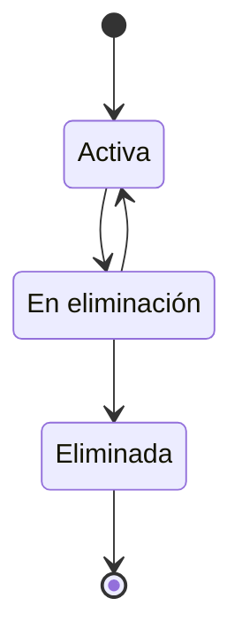

# FS-USR-05 — Configuración de cuenta y privacidad

| Campo | Valor |
|---|---|
| **Módulo** | Usuarios (USR) |
| **Estado** | Borrador |
| **Responsable** | Por asignar |
| **Casos de uso** | [CU-03](../casos-de-uso.md#cu-03--administrar-cuenta) |
| **Historias** | [HU-03](../historias.md#hu-03) |
| **Última actualización** | 2026-10-24 |

## 1. Objetivo

Dar al usuario control sobre su cuenta: sus datos de acceso, quién puede ver su perfil, qué correos recibe y, si lo decide, la eliminación de su cuenta, como exige la Ley 1581 de 2012 de protección de datos personales.

## 2. Quién es quién

| Actor | Qué hace | Qué ve | Qué no puede hacer |
|---|---|---|---|
| Dueño del perfil | Cambia su correo, su contraseña, su correo de respaldo, su privacidad y sus correos; cierra otras sesiones; elimina su cuenta o cancela la eliminación. | Su configuración, el correo pendiente de verificar y lo que tiene a su cargo antes de eliminar. | Cambiar datos de acceso sin su contraseña actual; desactivar los correos de seguridad. |
| Sistema | Envía enlaces y avisos; elimina los datos a los 30 días. | — | — |
| Servicio de correo | Entrega enlaces y avisos de seguridad. | — | — |

## 3. Alcance

**Incluye:**

- Cambio de correo con verificación.
- Cambio de contraseña con la sesión iniciada.
- Privacidad del perfil.
- Preferencias de notificaciones por correo.
- Acceso a las preferencias de contenido ([FS-USR-04](./FS-USR-04-preferencias-contenido.md)).
- Cierre de sesión en todos los dispositivos.
- Eliminación de la cuenta.

**No incluye:**

- Edición de nombre, foto y datos profesionales: se hace en el perfil ([FS-USR-06](./FS-USR-06-perfil-profesional.md)).
- Notificaciones dentro de la plataforma (FS-COM-02).
- Descarga de una copia de todos los datos del usuario.

## 4. Reglas de negocio

| ID | Regla |
|---|---|
| RN-01 | Para cambiar el correo, la contraseña o eliminar la cuenta, el usuario debe ingresar su contraseña actual. |
| RN-02 | El correo nuevo debe cumplir las mismas reglas del registro: dominio institucional ([FS-USR-01](./FS-USR-01-registro.md), RN-01) y no estar registrado (RN-02). En la fase 2, los egresados y tercerizados podrán usar un correo personal. |
| RN-03 | El correo nuevo solo reemplaza al anterior cuando el usuario abre el enlace enviado a ese nuevo correo. El enlace vence en 24 horas. |
| RN-04 | Cuando cambia el correo o la contraseña, se envía un aviso al correo anterior o actual. |
| RN-05 | La nueva contraseña cumple la política del registro y no puede ser igual a la actual. Al cambiarla se cierran las demás sesiones. |
| RN-06 | La privacidad del perfil tiene dos niveles: **Comunidad** (por defecto) y **Solo mis conexiones**. Con "Solo mis conexiones", los no conectados ven únicamente nombre, foto y unidad académica. |
| RN-07 | Las notificaciones por correo se activan o desactivan por tipo. Los correos de seguridad (verificación, recuperación, cambio de contraseña, eliminación de cuenta) no se pueden desactivar. |
| RN-08 | Al solicitar la eliminación, la cuenta pasa a **En eliminación**: el perfil y el contenido dejan de ser visibles de inmediato. |
| RN-09 | Si el usuario inicia sesión dentro de los 30 días siguientes, puede cancelar la eliminación y la cuenta vuelve a estar activa. Pasados 30 días, los datos personales se eliminan de forma definitiva. |
| RN-10 | Al eliminarse la cuenta, sus mensajes en conversaciones de otros usuarios se muestran como de "Usuario eliminado". |
| RN-11 | **Correo de respaldo:** el usuario puede registrar un correo personal, distinto del institucional, que se verifica con un enlace válido por 24 horas. Solo se usa para recuperar la contraseña ([FS-USR-03](./FS-USR-03-recuperar-contrasena.md)) y para avisos de seguridad; nunca se muestra a otros usuarios ni recibe notificaciones de actividad. |
| RN-12 | Antes de pedir la eliminación, el sistema muestra lo que el usuario tiene a su cargo (oportunidades abiertas, eventos programados, proyectos que administra). Qué pasa con cada cosa depende de P-51. |

## 5. Requisitos funcionales

| ID | Requisito | Prioridad |
|---|---|---|
| RF-01 | El sistema debe ofrecer una página de configuración con las secciones: Cuenta, Seguridad, Privacidad, Notificaciones, Intereses y Eliminar cuenta. | Alta |
| RF-02 | El sistema debe permitir cambiar el correo según RN-01 a RN-04, mostrando el correo pendiente mientras no se verifique. | Media |
| RF-03 | El sistema debe permitir cambiar la contraseña según RN-01, RN-04 y RN-05. | Alta |
| RF-04 | El sistema debe permitir elegir el nivel de privacidad del perfil (RN-06) y aplicarlo de inmediato en perfil, búsqueda y sugerencias. | Alta |
| RF-05 | El sistema debe permitir activar o desactivar cada tipo de notificación por correo (RN-07). | Media |
| RF-06 | El sistema debe permitir cerrar la sesión en todos los dispositivos excepto el actual. | Media |
| RF-07 | El sistema debe permitir eliminar la cuenta según RN-01, RN-08, RN-09 y RN-12, explicando antes qué se elimina y cuándo. | Alta |
| RF-08 | El sistema debe permitir registrar, verificar, cambiar y quitar el correo de respaldo (RN-11). | Media |

## 6. Datos y validaciones

| Sección | Campo | Tipo | Obligatorio | Validación |
|---|---|---|---|---|
| Cuenta | Correo nuevo | Correo | Sí, para cambiarlo | RN-02. |
| Cuenta | Correo de respaldo | Correo | No | Formato válido, distinto del institucional y no usado como respaldo por otra cuenta (RN-11). |
| Seguridad | Contraseña actual | Contraseña | Sí | Debe coincidir con la actual. |
| Seguridad | Nueva contraseña y confirmación | Contraseña | Sí | RN-05. |
| Privacidad | Visibilidad del perfil | Opción única | Sí | Comunidad o Solo mis conexiones. |
| Notificaciones | Tipos de correo | Interruptores | — | Ver tabla siguiente. |
| Eliminar cuenta | Contraseña | Contraseña | Sí | RN-01. |
| Eliminar cuenta | Confirmación | Casilla | Sí | "Entiendo que mi cuenta se eliminará en 30 días." |

**Notificaciones por correo configurables (todas activas por defecto):**

| Tipo | Disponible desde |
|---|---|
| Nuevas solicitudes de conexión | Sprint 3 |
| Mensajes privados sin leer | Sprint 5 |
| Cambios en mis postulaciones | Sprint 6 |
| Nuevas postulaciones a mis oportunidades | Sprint 6 |
| Eventos a los que asistiré | Sprint 7 |
| Actividad en mis proyectos | Sprint 8 |

**Finalidad de los datos personales** (RNF-PRI-01): el correo nuevo y el correo de respaldo se usan solo para el acceso y la seguridad de la cuenta; la privacidad y las preferencias de correo, para decidir qué se muestra y qué se envía.

## 7. Estados



| Estado de la cuenta | Entra cuando | Sale hacia |
|---|---|---|
| Activa | — | **En eliminación** al solicitar la eliminación |
| En eliminación | Solicita la eliminación | **Activa** si inicia sesión y cancela antes de 30 días; **Eliminada** a los 30 días |
| Eliminada | Pasan 30 días | Estado final |

La máquina de estados completa de la cuenta está en el [README del módulo](../README.md#máquina-de-estados-de-la-cuenta).

## 8. Flujo principal

1. **Menú del usuario** → "Configuración" → **Configuración** (sección Cuenta).
2. **Seguridad** → cambia la contraseña → mensaje de éxito.
3. **Eliminar cuenta** → explicación → contraseña y confirmación → cierra la sesión → **Inicio de sesión** con aviso.
4. **Inicio de sesión** de una cuenta en eliminación → "¿Quieres recuperar tu cuenta?" → **Feed**.

## 9. Variaciones

| Variación | Qué cambia | Regla |
|---|---|---|
| Cambia el correo | El nuevo reemplaza al anterior solo al verificarlo. | RN-03 |
| Registra un correo de respaldo | Queda pendiente hasta verificarlo. | RN-11 |
| Perfil "Solo mis conexiones" | Los no conectados ven nombre, foto y unidad académica. | RN-06 |
| Elimina la cuenta teniendo oportunidades, eventos o proyectos a cargo | Ve la lista antes de confirmar. | RN-12, P-51 |
| Cancela la eliminación | La cuenta vuelve a Activa con todo su contenido. | RN-09 |

## 10. ¿Qué pasaría si…?

| Situación | Comportamiento esperado | Regla o pregunta |
|---|---|---|
| Dos cuentas piden cambiar al mismo correo nuevo | La primera que verifica se queda con él; el enlace de la otra deja de ser válido. | RN-02 |
| Pide la eliminación siendo responsable de una oportunidad con postulaciones | Ve la lista (RN-12); qué pasa con la oportunidad depende de P-51. | RN-12, P-51 |
| Un administrador intenta sancionar una cuenta en eliminación | No puede (FS-USR-08 RN-08). | FS-USR-08 |
| Cambia la privacidad mientras otro ve su perfil | La siguiente carga del perfil ya aplica la privacidad nueva. | RN-06, RF-04 |
| El servicio de correo falla al enviar el enlace del correo nuevo | El cambio queda pendiente; puede pedir reenvío. | RNF-DIS-05 |
| Usa como respaldo el correo institucional | MSG-11. | RN-11 |
| El correo de respaldo ya lo usa otra cuenta | Se rechaza sin decir de quién es. | RN-11 |

## 11. Mensajes al usuario

| Código | Situación | Mensaje |
|---|---|---|
| MSG-01 | Contraseña actual incorrecta | "La contraseña actual no es correcta." |
| MSG-02 | Correo pendiente de verificar | "Te enviamos un enlace a {correo nuevo}. Tu correo cambiará cuando lo abras." |
| MSG-03 | Correo actualizado | "Tu correo ahora es {correo nuevo}." |
| MSG-04 | Aviso al correo anterior | "El correo de tu cuenta UniLink cambió a {correo nuevo}. Si no fuiste tú, escribe a {correo de soporte}." |
| MSG-05 | Contraseña actualizada | "Tu contraseña se actualizó y cerramos tus otras sesiones." |
| MSG-06 | Privacidad actualizada | "Ahora tu perfil es visible para: {nivel}." |
| MSG-07 | Explicación antes de eliminar | "Tu perfil y tu contenido dejarán de verse de inmediato. Tienes 30 días para arrepentirte iniciando sesión; después, tus datos se eliminarán para siempre." |
| MSG-08 | Cuenta en eliminación al iniciar sesión | "Tu cuenta se eliminará el {fecha}. ¿Quieres recuperarla?" |
| MSG-09 | Sesiones cerradas | "Cerramos tu sesión en los demás dispositivos." |
| MSG-10 | Correo de respaldo pendiente | "Te enviamos un enlace a {correo de respaldo}. Lo usaremos solo para recuperar tu cuenta." |
| MSG-11 | Respaldo igual al institucional | "El correo de respaldo debe ser distinto de tu correo institucional." |

## 12. Resultado esperado

```gherkin
Escenario: Cambiar contraseña
  Dado que tengo la sesión iniciada en dos dispositivos
  Cuando cambio mi contraseña ingresando la actual correctamente
  Entonces veo el mensaje MSG-05
  Y la sesión del otro dispositivo se cierra
  Y recibo un correo de aviso

Escenario: Cambiar correo
  Dado que mi correo es ana@unimagdalena.edu.co
  Cuando solicito cambiarlo a ana.perez@unimagdalena.edu.co con mi contraseña
  Entonces veo el mensaje MSG-02
  Y mi correo sigue siendo el anterior hasta que abra el enlace
  Cuando abro el enlace
  Entonces veo el mensaje MSG-03
  Y el correo anterior recibe el aviso MSG-04

Escenario: Cambiar a un correo no institucional
  Dado que soy estudiante
  Cuando intento cambiar mi correo a ana@gmail.com
  Entonces el sistema rechaza el cambio

Escenario: Perfil solo para conexiones
  Dado que configuro mi perfil como "Solo mis conexiones"
  Cuando un usuario no conectado abre mi perfil
  Entonces solo ve mi nombre, foto y unidad académica

Escenario: Correos de seguridad obligatorios
  Dado que estoy en la sección Notificaciones
  Entonces no veo opción para desactivar los correos de seguridad

Escenario: Eliminar cuenta y arrepentirse
  Dado que solicité eliminar mi cuenta hace 10 días
  Cuando inicio sesión
  Entonces veo el mensaje MSG-08
  Cuando elijo recuperarla
  Entonces mi cuenta vuelve a estar activa con todo mi contenido

Escenario: Eliminación definitiva
  Dado que solicité eliminar mi cuenta hace más de 30 días
  Entonces mis datos personales se eliminaron
  Y mis mensajes en conversaciones ajenas aparecen como de "Usuario eliminado"

Escenario: Registrar el correo de respaldo
  Dado que estoy en la sección Cuenta
  Cuando registro ana@gmail.com como correo de respaldo
  Entonces veo el mensaje MSG-10
  Y el correo queda pendiente hasta que abra el enlace

Escenario: Respaldo igual al institucional
  Dado que mi correo es ana@unimagdalena.edu.co
  Cuando intento usarlo como correo de respaldo
  Entonces veo el mensaje MSG-11

Escenario: Lo que tengo a cargo antes de eliminar
  Dado que soy responsable de una oportunidad abierta
  Cuando abro "Eliminar cuenta"
  Entonces veo esa oportunidad en la lista de lo que tengo a mi cargo

Escenario: Mismo correo nuevo en dos cuentas
  Dado que Ana y Luis pidieron cambiar su correo a nuevo@unimagdalena.edu.co
  Cuando Ana abre su enlace primero
  Entonces el correo de Ana cambia
  Y el enlace de Luis ya no es válido
```

## 13. Contratos

**Expone:**

- API: `/api/v1/usuarios/configuracion/...` (correo, contraseña, correo de respaldo, privacidad, correos, sesiones, eliminación) ([contrato](../../../../contracts/api/usuarios.yaml)).
- Eventos: `cuenta.estado_cambiado` (En eliminación, Activa, Eliminada) y `perfil.actualizado` al cambiar la privacidad ([catálogo](../../../../contracts/eventos/README.md)).

**Consume:** Colaboración: lo que el usuario tiene a cargo (la pantalla de eliminación lo pide a ese módulo desde la capa de API, ADR-003).

## 14. Calidad

RNF-PRI-05, RNF-PRI-06, RNF-PRI-09 (30 días), RNF-SEG-03, RNF-CON-02.

## 15. Preguntas abiertas

- P-12 — validación jurídica de los 30 días.
- P-23 — qué pasa con el contenido de una cuenta eliminada.
- P-51 — efectos del estado de la cuenta sobre lo que posee.

## 16. Lista de revisión

- [x] Cada actor de "Quién es quién" existe en el [SRS §2.4](../../../srs/Especificacion_Requisitos.md#24-actores-del-sistema) con el mismo nombre.
- [x] Toda acción tiene un actor que puede hacerla y se valida en el servidor (RNF-SEG-04).
- [ ] Cada regla tiene al menos un escenario en "Resultado esperado".
- [x] "¿Qué pasaría si…?" revisó las siete situaciones: concurrencia, estado de la cuenta, eliminación de lo que usa, pérdida de permiso, falla externa, límites de uso y privacidad.
- [x] Ningún dato se recoge sin finalidad (RNF-PRI-01).
- [x] No contradice a su caso de uso, a su historia ni a otro spec.
- [x] Sus contratos existen en [`contracts/`](../../../../contracts/README.md).
- [ ] No tiene preguntas abiertas que bloqueen el desarrollo.

## 17. Historial de cambios

| Fecha | Autor | Cambio |
|---|---|---|
| 2026-10-06 | Gamero | Creación |
| 2026-10-24 | Equipo UniLink | Estudio de quién es quién, variaciones, casos límite y contratos; nueva plantilla. |
