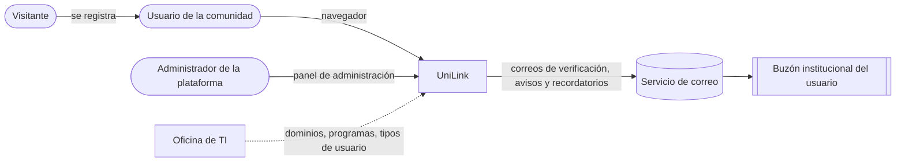
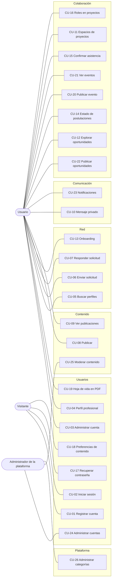

# Especificación de Requisitos de Software (SRS) — UniLink

_MVP — Red Profesional Universitaria — Universidad del Magdalena_
_Centro de Interés de Desarrollo Tecnológico e Innovación (CIDTI)_

Conforme a ISO/IEC/IEEE 29148:2018.

| Campo | Valor |
|---|---|
| **Versión** | 0.1 — Borrador |
| **Estado** | Pendiente de revisión del equipo |
| **Última actualización** | 2026-10-24 |

## Historial de versiones

| Versión | Fecha | Autor | Cambio |
|---|---|---|---|
| 0.1 | 2026-10-24 | Equipo UniLink | Creación a partir de los casos de uso, las historias, los specs y los requisitos no funcionales existentes, al reorganizar la documentación por módulos. |
| 0.1.1 | 2026-10-27 | Gamero | Supuesto de usuarios simultáneos (~1.000) según la reunión del 2026-10-19; RNF-REN-01 y EC-01 ajustados. |

## Tabla de contenido

- [1. Introducción](#1-introducción)
- [2. Descripción general](#2-descripción-general)
- [3. Requisitos específicos](#3-requisitos-específicos)
- [4. Verificación](#4-verificación)
- [Apéndice A. Matriz de trazabilidad](#apéndice-a-matriz-de-trazabilidad)
- [Apéndice B. Matriz de riesgos](#apéndice-b-matriz-de-riesgos)
- [Apéndice C. Equipo y responsabilidades](#apéndice-c-equipo-y-responsabilidades)

---

## 1. Introducción

### 1.1 Propósito

Este documento define **qué** debe hacer UniLink y **con qué calidad**: para quién es, qué restricciones tiene, qué requisitos funcionales y no funcionales debe cumplir y cómo se verifica cada uno. Es la puerta de entrada a la documentación: el detalle de cada funcionalidad está en los [módulos](../modulos/README.md) y las decisiones técnicas en [arquitectura](../arquitectura/Registro_Decisiones.md).

Lo leen el equipo de desarrollo (qué construir), el Product Owner (qué se prometió), la dirección del CIDTI (alcance y supuestos) y las oficinas de la universidad que deben validar aspectos legales o institucionales.

### 1.2 Alcance

UniLink es la red profesional de la comunidad de la Universidad del Magdalena: estudiantes, profesores y personal administrativo construyen su perfil profesional, se conectan, publican contenido, conversan en privado y participan en oportunidades, eventos y proyectos.

**El MVP incluye seis módulos:**

| Módulo | Qué resuelve |
|---|---|
| [Usuarios](../modulos/usuarios/README.md) | Registro con correo institucional, sesión, configuración, preferencias, perfil profesional, hoja de vida y gestión de cuentas. |
| [Red](../modulos/red/README.md) | Conexiones, onboarding con sugerencias y búsqueda de perfiles. |
| [Contenido](../modulos/contenido/README.md) | Publicaciones, feed y moderación. |
| [Comunicación](../modulos/comunicacion/README.md) | Mensajería privada y notificaciones. |
| [Colaboración](../modulos/colaboracion/README.md) | Oportunidades con postulaciones, eventos con asistencia y espacios de proyectos con roles. |
| [Plataforma](../modulos/plataforma/README.md) | Categorías, panel de administración y registro de auditoría. |

**Fase 2 (fuera del MVP):** el [módulo de servicios](../modulos/servicios/README.md) (CU-27 a CU-30): verificación de credenciales, publicación y solicitud de servicios, y registro de egresados y personal tercerizado con correo personal. Se dejó fuera porque amplía el alcance más allá de una red universitaria, introduce usuarios sin correo institucional y exige verificación manual de documentos.

**Fuera de alcance:**

| Excluido | Motivo |
|---|---|
| Aplicaciones nativas para celular | El MVP es una aplicación web adaptable (RNF-COM-02). |
| Pagos, venta de entradas o contratación dentro de la plataforma | La negociación ocurre fuera de UniLink; evita obligaciones financieras. |
| Inicio de sesión con proveedores externos (Google, Microsoft) | El correo institucional es la prueba de pertenencia; se puede revisar después (ADR-010). |
| Oportunidades de empresas externas a la universidad | UniLink es una red interna en el MVP. |
| Chat grupal, archivos en mensajes, encuestas y videos | Limitan el tamaño del MVP; quedan como preguntas para después del lanzamiento. |
| Moderación automática con inteligencia artificial | La moderación es humana y con registro de cada decisión. |

### 1.3 Glosario

| Término | Definición |
|---|---|
| Afinidad | Porcentaje de las habilidades que pide una oportunidad o un proyecto que un usuario tiene entre sus habilidades o su "Puedo aportar". |
| Categoría de interés | Categoría de publicaciones, proyectos o eventos que un usuario elige para personalizar lo que ve ([FS-USR-04](../modulos/usuarios/specs/FS-USR-04-preferencias-contenido.md)). |
| Complementariedad | Relación entre dos usuarios cuando lo que uno necesita coincide con lo que el otro puede aportar ([FS-USR-06](../modulos/usuarios/specs/FS-USR-06-perfil-profesional.md)). |
| Conexión | Relación profesional mutua entre dos usuarios, aceptada por ambos. |
| Cupo | Número máximo de participantes de una oportunidad, un evento o un proyecto. |
| Etiqueta | Palabra o frase normalizada que describe una habilidad, un interés o lo que un usuario aporta o necesita. |
| Feed | Lista de publicaciones que ve cada usuario según su red y sus categorías de interés. |
| Onboarding | Paso que se muestra una sola vez al usuario nuevo con sugerencias de conexión. |
| Reporte | Aviso de un usuario sobre contenido que puede incumplir las [normas de la comunidad](../normas-comunidad.md). |
| Retiro | Decisión de un administrador de dejar de mostrar un contenido por incumplir las normas. |
| RSVP | Confirmación de asistencia a un evento. |
| Unidad académica | Pertenencia institucional de un usuario según su tipo: programa (estudiante), facultad y departamento (profesor) o dependencia (personal administrativo). |
| CU / HU | Caso de uso / historia de usuario. |
| RN / RF / MSG | Regla de negocio / requisito funcional / mensaje al usuario, numerados dentro de cada spec. |
| RNF | Requisito no funcional (sección 3.3). |
| EC | Escenario de atributo de calidad (sección 3.4). |
| ADR | Registro de decisión arquitectónica. |
| C&C | Vista de componentes y conectores. |
| P-NN | Pregunta abierta ([preguntas-abiertas.md](../preguntas-abiertas.md)). |

### 1.4 Referencias

| Referencia | Uso |
|---|---|
| ISO/IEC/IEEE 29148:2018 | Estructura de este documento. |
| ISO/IEC 25010 | Clasificación de los requisitos no funcionales. |
| Ley 1581 de 2012 y Decreto 1377 de 2013 | Protección de datos personales. |
| Ley 1482 de 2011 | Actos de discriminación (norma N-02). |
| WCAG 2.1, nivel AA | Accesibilidad. |
| OWASP Top 10 | Seguridad de la aplicación. |
| [Normas de la comunidad](../normas-comunidad.md) | Conducta que aceptan los usuarios y aplican los administradores. |

---

## 2. Descripción general

### 2.1 Perspectiva del producto

En la universidad, quien necesita un diseñador para su proyecto, un monitor de cálculo o integrantes para un semillero depende de grupos de chat dispersos y de conocidos. UniLink reúne a la comunidad en un solo lugar donde cada persona declara **qué puede aportar y qué necesita**, y la plataforma cruza esas declaraciones para sugerir conexiones, ordenar oportunidades y armar equipos.

### 2.2 Funciones del producto

| Módulo | Funciones |
|---|---|
| Usuarios | Registrarse y verificar el correo; iniciar y cerrar sesión; recuperar la contraseña; configurar la cuenta y la privacidad; elegir categorías de interés; construir el perfil con "Puedo aportar / Necesito"; descargar la hoja de vida en PDF; suspender, inhabilitar y reactivar cuentas (administrador). |
| Red | Enviar, aceptar, rechazar y cancelar solicitudes de conexión; recibir sugerencias en el onboarding; buscar perfiles por texto, filtros y complementariedad. |
| Contenido | Publicar con imágenes o PDF; ver el feed por recientes o relevantes; comentar y reaccionar; reportar contenido; moderar (administrador). |
| Comunicación | Conversar en privado; recibir notificaciones dentro de la plataforma y por correo según las preferencias. |
| Colaboración | Publicar oportunidades y gestionar postulaciones; postularse y seguir el estado; publicar eventos y confirmar asistencia; crear proyectos, reclutar integrantes, organizar tareas y asignar roles. |
| Plataforma | Administrar categorías; acceder al panel de administración; consultar el registro de auditoría. |

### 2.3 Stakeholders

| Stakeholder | Qué espera | Qué decide | Preguntas que le corresponden |
|---|---|---|---|
| Dirección del CIDTI | Una red útil para la comunidad, dentro del presupuesto y el plazo. | Alcance, prioridades, quiénes administran la plataforma. | P-01, P-07 |
| Oficina de TI | Que UniLink respete la infraestructura y las políticas de la universidad. | Dominios válidos, lista de tipos de usuario, alojamiento, buzón de soporte. | P-02, P-03, P-05, P-18 |
| Oficina jurídica y de protección de datos | Cumplimiento de la Ley 1581 y de los reglamentos internos. | Textos de autorización, plazos de eliminación y de revisión, normas de la comunidad. | P-10 a P-15 |
| Bienestar Universitario | Rutas de atención para casos de acoso o violencia. | Enlaces institucionales de las normas N-01 y N-07. | P-08 |
| Admisiones y Registro | Que los datos académicos sean los oficiales. | Catálogo de programas y facultades. | P-04 |
| Estudiantes | Encontrar oportunidades, equipos y mentores. | — (se validan con pruebas de usuario, RNF-USA-05) | — |
| Profesores | Reclutar para investigación y semilleros; difundir eventos. | — | — |
| Personal administrativo | Difundir convocatorias y eventos de su dependencia. | — | — |
| Administradores de la plataforma | Herramientas para moderar con criterio y registro. | Retiros y sanciones, dentro de las normas. | — |
| Equipo de UniLink (Product Owner y desarrollo) | Requisitos claros y decisiones registradas. | Producto y técnica. | P-16 a P-51 |

### 2.4 Actores del sistema

Un actor es un papel, no una persona: el mismo usuario es Autor de su publicación y Lector de las demás. Todos los specs usan estos nombres en su sección "Quién es quién".

| Actor | Definición | Fase |
|---|---|---|
| Visitante | Persona sin sesión iniciada; solo puede registrarse, iniciar sesión o recuperar su contraseña. | MVP |
| Usuario | Persona con cuenta **Activa** y sesión iniciada. Es la base de todos los papeles siguientes. | MVP |
| Estudiante | Usuario de tipo estudiante; su unidad académica es un programa. | MVP |
| Profesor | Usuario de tipo profesor; su unidad académica es una facultad y un departamento. | MVP |
| Personal administrativo | Usuario de tipo personal administrativo; su unidad académica es una dependencia. | MVP |
| Dueño del perfil | Usuario respecto de su propio perfil, cuenta y configuración. | MVP |
| Observador | Usuario que ve el perfil, las publicaciones o los datos de otro. | MVP |
| Solicitante | Usuario que pide conectar con otro o unirse a un proyecto. | MVP |
| Destinatario | Usuario que recibe una solicitud de conexión, un mensaje o una notificación. | MVP |
| Conexión | Usuario conectado con otro. | MVP |
| Autor | Usuario que crea una publicación o un comentario. | MVP |
| Lector | Usuario que ve publicaciones ajenas en el feed o por enlace. | MVP |
| Denunciante | Usuario que reporta un contenido. | MVP |
| Remitente | Usuario que envía un mensaje privado. | MVP |
| Responsable de oportunidad | Usuario que publica una oportunidad y decide sus postulaciones. | MVP |
| Postulante | Usuario que se postula a una oportunidad. | MVP |
| Organizador | Usuario que publica un evento. | MVP |
| Asistente | Usuario que confirmó asistencia a un evento. | MVP |
| Creador del proyecto | Usuario que creó un proyecto; es administrador del proyecto y está protegido (FS-COL-06). | MVP |
| Miembro del proyecto | Usuario que pertenece a un proyecto con uno de estos roles: | MVP |
| Administrador de proyecto | Miembro que gestiona el proyecto, sus miembros y sus roles. | MVP |
| Editor | Miembro que crea y edita tareas. | MVP |
| Visualizador | Miembro que solo ve el proyecto y mueve sus propias tareas. | MVP |
| Administrador de la plataforma | Miembro del equipo de UniLink con el rol de administración (asignado por el equipo técnico, FS-PLT-01). | MVP |
| Sistema | Reglas y tareas automáticas: vencimientos, cierres, recordatorios, limpiezas, ocultamiento por reportes. | MVP |
| Servicio de correo | Servicio externo que entrega los correos de la plataforma. | MVP |
| Egresado | Persona graduada que se registra con correo personal como oferente. | Fase 2 |
| Tercerizado | Empleado de una empresa que presta servicios en el campus. | Fase 2 |
| Oferente | Usuario que publica servicios. | Fase 2 |

### 2.5 Matriz de permisos

Resumen de lo que puede hacer cada actor. Cada spec detalla la suya en "Quién es quién" y todas se validan en el servidor (RNF-SEG-04). `✓` = puede; `—` = no puede; `P-NN` = pendiente de decisión.

| Módulo | Acción | Visitante | Usuario | Dueño del objeto | Participante | Administrador de la plataforma |
|---|---|---|---|---|---|---|
| Usuarios | Registrarse, recuperar contraseña | ✓ | — | — | — | — |
| Usuarios | Editar perfil y configuración | — | — | ✓ (Dueño del perfil) | — | — |
| Usuarios | Ver perfil completo de otro | — | ✓ si es "Comunidad" | ✓ | ✓ si es Conexión | Datos básicos (FS-USR-08) |
| Usuarios | Descargar hoja de vida | — | — | ✓ (solo la propia) | — | — |
| Usuarios | Suspender, inhabilitar, reactivar cuentas | — | — | — | — | ✓ (no a sí mismo ni a otro administrador) |
| Red | Enviar solicitud de conexión | — | ✓ (30 por día) | — | — | — |
| Red | Aceptar o rechazar | — | — | — | ✓ (Destinatario) | — |
| Red | Buscar perfiles | — | ✓ | — | — | ✓ |
| Contenido | Publicar, comentar, reaccionar | — | ✓ | — | — | — |
| Contenido | Editar o eliminar publicación | — | — | ✓ (Autor) | — | — |
| Contenido | Eliminar comentarios de su publicación | — | — | ✓ (Autor) | — | — |
| Contenido | Reportar | — | ✓ (no lo propio) | — | — | — |
| Contenido | Retirar contenido o mantenerlo | — | — | — | — | ✓ |
| Comunicación | Enviar mensaje privado | — | — | — | ✓ (Conexión o postulación aceptada) | — |
| Comunicación | Leer conversaciones ajenas | — | — | — | — | — (RNF-PRI-04) |
| Comunicación | Ver y marcar notificaciones | — | — | ✓ (Destinatario) | — | — |
| Colaboración | Publicar oportunidad, evento o proyecto | — | ✓ (P-36 para oportunidades) | — | — | — |
| Colaboración | Decidir postulaciones | — | — | ✓ (Responsable de oportunidad) | — | — |
| Colaboración | Postularse, confirmar asistencia, pedir unirse | — | ✓ | — (no a lo propio) | — | — |
| Colaboración | Ver enlace de un evento virtual | — | — | ✓ (Organizador) | ✓ (Asistente) | — |
| Colaboración | Cambiar roles y retirar miembros | — | — | ✓ (Administrador de proyecto) | — | — |
| Colaboración | Eliminar un proyecto | — | — | ✓ (Creador del proyecto, sin otros miembros) | — | — |
| Plataforma | Administrar categorías | — | — | — | — | ✓ |
| Plataforma | Consultar el registro de auditoría | — | — | — | — | ✓ |
| Todos | Actuar sobre cuentas no activas | — | — | P-51 | P-51 | — |

### 2.6 Restricciones

| Tipo | Restricción |
|---|---|
| Arquitectura | Monolito modular con seis módulos; un módulo solo usa a otro por su interfaz pública o sus eventos ([ADR-002](../arquitectura/Registro_Decisiones.md#adr-002-estilo-arquitectónico), [ADR-003](../arquitectura/Registro_Decisiones.md#adr-003-límites-de-los-módulos-y-dependencias-permitidas)). |
| Contratos | La API y las interfaces se acuerdan en [`contracts/`](../../contracts/README.md) antes de programar (ADR-006). |
| Legal | Ley 1581 de 2012; la Universidad del Magdalena es responsable del tratamiento de los datos. |
| Institucional | Acceso solo con correo de los dominios institucionales configurados (P-03). |
| Plataforma | Aplicación web adaptable; navegadores de RNF-COM-01. |
| Idioma | Español de Colombia, hora de Colombia (RNF-USA-01). |
| Equipo y plazo | Un equipo pequeño de desarrollo; Sprint 0 más 8 sprints de 2 semanas ([roadmap](../sprints/README.md)). |
| Presupuesto | Presupuesto universitario; condiciona el alojamiento (P-02, ADR-009). |

### 2.7 Supuestos y dependencias

Las cifras de rendimiento y capacidad parten de estos supuestos. El de usuarios simultáneos se decidió en la reunión del 2026-10-19 (P-01); los demás siguen pendientes de validar. Si cambian, hay que revisar las secciones 3.3.3 y 3.3.4.

| Supuesto | Valor |
|---|---|
| Usuarios registrados el primer año | 5.000 |
| Usuarios registrados que la arquitectura debe soportar sin rediseño | 25.000 |
| Usuarios conectados al mismo tiempo en hora pico | ~1.000, con holgura el primer año; los picos se dan en las convocatorias de monitores (Reunión 2026-10-19, P-01) |
| Publicaciones nuevas por día | 300 |
| Mensajes privados por día | 5.000 |
| Horario de mayor uso | Lunes a viernes, 7:00 a. m. a 10:00 p. m. (hora de Colombia) |

**Dependencias externas:** lista de dominios institucionales y de tipos de usuario (TI, P-03), catálogo de programas, facultades y dependencias (Admisiones y Registro, P-04), servicio de correo con entrega confiable al dominio de la universidad, y aprobación jurídica de las normas y de la autorización de datos (P-11, P-13).

---

## 3. Requisitos específicos

### 3.1 Requisitos funcionales

Los requisitos funcionales viven en cada spec y se citan con el código del spec: `USR-01/RF-03` es el RF-03 de [FS-USR-01](../modulos/usuarios/specs/FS-USR-01-registro.md).

| Módulo | Spec | Nombre | Requisitos funcionales |
|---|---|---|---|
| Usuarios | [FS-USR-01](../modulos/usuarios/specs/FS-USR-01-registro.md) | Registro y verificación de cuenta | RF-01 a RF-08 |
| Usuarios | [FS-USR-02](../modulos/usuarios/specs/FS-USR-02-inicio-sesion.md) | Inicio y cierre de sesión | RF-01 a RF-08 |
| Usuarios | [FS-USR-03](../modulos/usuarios/specs/FS-USR-03-recuperar-contrasena.md) | Recuperación de contraseña | RF-01 a RF-05 |
| Usuarios | [FS-USR-04](../modulos/usuarios/specs/FS-USR-04-preferencias-contenido.md) | Preferencias de contenido | RF-01 a RF-04 |
| Usuarios | [FS-USR-05](../modulos/usuarios/specs/FS-USR-05-configuracion-cuenta.md) | Configuración de cuenta y privacidad | RF-01 a RF-07 |
| Usuarios | [FS-USR-06](../modulos/usuarios/specs/FS-USR-06-perfil-profesional.md) | Perfil profesional | RF-01 a RF-07 |
| Usuarios | [FS-USR-07](../modulos/usuarios/specs/FS-USR-07-hoja-de-vida-pdf.md) | Hoja de vida en PDF | RF-01 a RF-05 |
| Usuarios | [FS-USR-08](../modulos/usuarios/specs/FS-USR-08-gestion-cuentas.md) | Gestión de cuentas de usuario | RF-01 a RF-07 |
| Red | [FS-RED-01](../modulos/red/specs/FS-RED-01-solicitudes-conexion.md) | Solicitudes de conexión | RF-01 a RF-09 |
| Red | [FS-RED-02](../modulos/red/specs/FS-RED-02-onboarding-sugerencias.md) | Onboarding y sugerencias de conexión | RF-01 a RF-06 |
| Red | [FS-RED-03](../modulos/red/specs/FS-RED-03-busqueda-perfiles.md) | Búsqueda de perfiles | RF-01 a RF-08 |
| Contenido | [FS-CNT-01](../modulos/contenido/specs/FS-CNT-01-publicaciones-feed.md) | Publicaciones y feed | RF-01 a RF-10 |
| Contenido | [FS-CNT-02](../modulos/contenido/specs/FS-CNT-02-moderacion-contenido.md) | Moderación de contenido | RF-01 a RF-08 |
| Comunicación | [FS-COM-01](../modulos/comunicacion/specs/FS-COM-01-mensajeria-privada.md) | Mensajería privada | RF-01 a RF-09 |
| Comunicación | [FS-COM-02](../modulos/comunicacion/specs/FS-COM-02-centro-notificaciones.md) | Centro de notificaciones | RF-01 a RF-06 |
| Colaboración | [FS-COL-01](../modulos/colaboracion/specs/FS-COL-01-publicacion-oportunidades.md) | Publicación de oportunidades | RF-01 a RF-08 |
| Colaboración | [FS-COL-02](../modulos/colaboracion/specs/FS-COL-02-postulaciones.md) | Postulaciones | RF-01 a RF-08 |
| Colaboración | [FS-COL-03](../modulos/colaboracion/specs/FS-COL-03-publicacion-listado-eventos.md) | Publicación y listado de eventos | RF-01 a RF-09 |
| Colaboración | [FS-COL-04](../modulos/colaboracion/specs/FS-COL-04-confirmacion-asistencia.md) | Confirmación de asistencia (RSVP) | RF-01 a RF-08 |
| Colaboración | [FS-COL-05](../modulos/colaboracion/specs/FS-COL-05-espacios-proyectos.md) | Espacios de proyectos | RF-01 a RF-10 |
| Colaboración | [FS-COL-06](../modulos/colaboracion/specs/FS-COL-06-roles-proyectos.md) | Roles en proyectos | RF-01 a RF-06 |
| Plataforma | [FS-PLT-01](../modulos/plataforma/specs/FS-PLT-01-gestion-categorias.md) | Gestión de categorías | RF-01 a RF-07 |

### 3.2 Casos de uso

Los 30 casos de uso conservan su número y se agrupan por módulo. CU-27 a CU-30 son de la fase 2.

| Módulo | Casos de uso | Historias |
|---|---|---|
| Usuarios | [CU-01, 02, 03, 04, 17, 18, 19, 24](../modulos/usuarios/casos-de-uso.md) | [HU-01, 02, 03, 04, 13, 14, 17, 28](../modulos/usuarios/historias.md) |
| Red | [CU-05, 06, 07, 13](../modulos/red/casos-de-uso.md) | [HU-05, 06, 07, 24](../modulos/red/historias.md) |
| Contenido | [CU-08, 09, 25](../modulos/contenido/casos-de-uso.md) | [HU-08, 09, 18, 19](../modulos/contenido/historias.md) |
| Comunicación | [CU-10, 23](../modulos/comunicacion/casos-de-uso.md) | [HU-10, 30](../modulos/comunicacion/historias.md) |
| Colaboración | [CU-11, 12, 14, 15, 16, 20, 21, 22](../modulos/colaboracion/casos-de-uso.md) | [HU-11, 12, 15, 16, 25, 26, 27, 29](../modulos/colaboracion/historias.md) |
| Plataforma | [CU-26](../modulos/plataforma/casos-de-uso.md) | [HU-20](../modulos/plataforma/historias.md) |
| Servicios (fase 2) | [CU-27, 28, 29, 30](../modulos/servicios/casos-de-uso.md) | [HU-21, 22, 23, 31](../modulos/servicios/historias.md) |

### 3.3 Requisitos no funcionales

Definen **cómo de bien** debe funcionar UniLink. Aplican a todos los módulos del MVP, siguen las características de calidad de ISO/IEC 25010 y cada uno tiene un criterio verificable.

#### 3.3.1 Seguridad

| ID | Requisito | Cómo se verifica | Prioridad |
|---|---|---|---|
| RNF-SEG-01 | Toda comunicación entre el navegador y el servidor usa HTTPS con TLS 1.2 o superior. Las peticiones HTTP se redirigen a HTTPS. | Escaneo de configuración TLS con calificación A o superior (por ejemplo, SSL Labs). | Alta |
| RNF-SEG-02 | Las contraseñas se almacenan con un algoritmo de hash lento con sal (bcrypt, scrypt o Argon2). Nunca se guardan, registran ni envían en texto plano. | Revisión de código y de la base de datos. | Alta |
| RNF-SEG-03 | Las cookies de sesión son `HttpOnly`, `Secure` y `SameSite`. Los tokens de sesión se invalidan en el servidor al cerrar sesión o cambiar la contraseña. | Prueba automatizada y revisión con las herramientas del navegador. | Alta |
| RNF-SEG-04 | Todo permiso se valida en el servidor: rol de administrador, privacidad del perfil, membresía y rol en proyectos, visibilidad de enlaces de eventos y acceso a conversaciones. Ocultar un botón en la pantalla no se considera control de acceso. | Pruebas automatizadas que llaman directamente a la API con un usuario sin permiso y esperan un rechazo. | Alta |
| RNF-SEG-05 | La aplicación se protege contra las vulnerabilidades de OWASP Top 10, en particular inyección, XSS, CSRF y control de acceso roto. Todo dato que ingresa el usuario se valida en el servidor y se escapa al mostrarse. | Escaneo automático de seguridad (por ejemplo, OWASP ZAP) antes de cada salida a producción, sin hallazgos altos ni críticos. | Alta |
| RNF-SEG-06 | Los archivos subidos (fotos, imágenes, PDF) se validan por su contenido real y no solo por la extensión, respetan los límites de tamaño de cada spec y se sirven desde un dominio o ruta que no ejecuta código. | Prueba subiendo un archivo con extensión falsa; debe rechazarse. | Alta |
| RNF-SEG-07 | Los límites de uso de los specs (intentos de inicio de sesión, reenvíos de correo, solicitudes de conexión, mensajes por minuto) se aplican en el servidor. Además, la API limita a 100 peticiones por minuto por usuario. | Pruebas de carga que superan cada límite y reciben el error esperado. | Alta |
| RNF-SEG-08 | Las contraseñas, claves de API y credenciales de base de datos no se guardan en el repositorio. Se manejan como variables de entorno o en un gestor de secretos. | Escaneo de secretos en el repositorio dentro de la integración continua. | Alta |
| RNF-SEG-09 | Las dependencias del proyecto se revisan automáticamente en busca de vulnerabilidades conocidas. Las críticas se corrigen en menos de 7 días. | Alerta de dependencias activa en GitHub (Dependabot o similar). | Media |
| RNF-SEG-10 | Las acciones de los administradores de la plataforma quedan en un registro de auditoría que no se puede modificar desde la aplicación y se conserva 2 años. | Revisión del registro tras ejecutar cada acción de administración. | Alta |

#### 3.3.2 Privacidad y protección de datos personales

UniLink trata datos personales de la comunidad universitaria y debe cumplir la Ley 1581 de 2012 y el Decreto 1377 de 2013. La Universidad del Magdalena actúa como responsable del tratamiento.

| ID | Requisito | Cómo se verifica | Prioridad |
|---|---|---|---|
| RNF-PRI-01 | Solo se recogen los datos necesarios para las funciones de UniLink. Cualquier dato nuevo exige justificar su finalidad en el spec que lo introduce. | Revisión de cada spec antes de pasar a Aprobado. | Alta |
| RNF-PRI-02 | El usuario acepta de forma expresa la política de tratamiento de datos al registrarse, y la plataforma guarda la fecha y la versión aceptada. | Revisión de la base de datos tras un registro. | Alta |
| RNF-PRI-03 | La base de datos y las copias de seguridad se cifran en reposo. | Revisión de la configuración de la infraestructura. | Alta |
| RNF-PRI-04 | Ninguna persona del equipo ni administrador de la plataforma puede leer mensajes privados desde la aplicación. El acceso directo a la base de datos se limita al equipo de infraestructura y queda registrado. | Revisión de permisos de la base de datos y de la aplicación. | Alta |
| RNF-PRI-05 | Las consultas de los titulares sobre sus datos se responden en máximo 10 días hábiles, y los reclamos (corregir o suprimir datos) en máximo 15 días hábiles, como exige la Ley 1581. El canal es el correo de soporte. | Procedimiento documentado y probado con un caso real antes del lanzamiento. | Alta |
| RNF-PRI-06 | Al eliminarse una cuenta ([FS-USR-05](../modulos/usuarios/specs/FS-USR-05-configuracion-cuenta.md)), sus datos personales se borran también de los archivos subidos y, a más tardar 30 días después, de las copias de seguridad. | Prueba de eliminación y revisión de la política de copias. | Alta |
| RNF-PRI-07 | Los registros técnicos (logs) no contienen contraseñas, tokens, contenido de mensajes privados ni documentos de identidad. | Revisión de una muestra de registros en el entorno de pruebas. | Alta |
| RNF-PRI-08 | Los datos se almacenan en proveedores que garanticen niveles adecuados de protección, según las reglas de transferencia internacional de datos de la Superintendencia de Industria y Comercio. | Revisión jurídica del proveedor de infraestructura en el Sprint 0. | Alta |

#### 3.3.3 Rendimiento

Los tiempos se miden en el percentil 95 (p95): el 95 % de las peticiones debe cumplirlos con la carga de los [supuestos de uso](#27-supuestos-y-dependencias).

| ID | Requisito | Cómo se verifica | Prioridad |
|---|---|---|---|
| RNF-REN-01 | Las consultas de la API responden en menos de 500 ms (p95) y las operaciones de escritura en menos de 1 segundo (p95). | Prueba de carga con 1.000 usuarios simultáneos. | Alta |
| RNF-REN-02 | El feed, la búsqueda de perfiles y la exploración de oportunidades y proyectos responden en menos de 1 segundo (p95). | Prueba de carga con datos de volumen realista (25.000 usuarios, 100.000 publicaciones). | Alta |
| RNF-REN-03 | En un celular de gama media con conexión 4G, la primera pantalla útil aparece en menos de 3 segundos (métrica Largest Contentful Paint). | Medición con Lighthouse en modo móvil, con puntaje de rendimiento de al menos 80. | Media |
| RNF-REN-04 | Las imágenes se sirven comprimidas y redimensionadas según el tamaño en que se muestran. | Revisión con Lighthouse: sin advertencias de imágenes de gran tamaño. | Media |
| RNF-REN-05 | Las tareas pesadas (envío de correos, generación de notificaciones masivas, tareas programadas) se ejecutan en segundo plano y no retrasan la respuesta al usuario. | Revisión de arquitectura y medición del tiempo de respuesta al publicar. | Alta |

#### 3.3.4 Disponibilidad y recuperación

| ID | Requisito | Cómo se verifica | Prioridad |
|---|---|---|---|
| RNF-DIS-01 | UniLink está disponible al menos el 99,5 % del tiempo cada mes, sin contar los mantenimientos programados. | Monitoreo externo de disponibilidad. | Alta |
| RNF-DIS-02 | Los mantenimientos programados se hacen fuera del horario de mayor uso y se anuncian en la plataforma con 48 horas de anticipación. | Calendario de mantenimientos y aviso publicado. | Media |
| RNF-DIS-03 | Se hacen copias de seguridad diarias de la base de datos y de los archivos subidos, y se conservan 30 días. | Revisión de la configuración y de las copias existentes. | Alta |
| RNF-DIS-04 | Ante una falla grave, se pierden como máximo 24 horas de datos (RPO) y el servicio se restablece en máximo 8 horas (RTO). | Simulacro de restauración completa una vez por semestre. | Alta |
| RNF-DIS-05 | Si falla un servicio externo (correo, almacenamiento de archivos, tiempo real), el resto de la plataforma sigue funcionando y el usuario ve un mensaje claro. Los correos que no se pudieron enviar se reintentan. | Prueba desactivando cada servicio externo en el entorno de pruebas. | Media |
| RNF-DIS-06 | Los correos salen de un dominio con SPF, DKIM y DMARC configurados. Los rebotes se registran: tras tres rebotes seguidos a una dirección se deja de enviarle correos y se avisa al usuario dentro de la plataforma. | Revisión de la configuración del dominio y prueba de rebote en el entorno de pruebas. | Alta |

#### 3.3.5 Usabilidad

| ID | Requisito | Cómo se verifica | Prioridad |
|---|---|---|---|
| RNF-USA-01 | La interfaz está en español de Colombia. Las fechas se muestran como `dd/mm/aaaa`, la hora en formato de 12 horas con a. m. y p. m., y la zona horaria es la de Colombia (UTC-5). | Revisión de las pantallas. | Alta |
| RNF-USA-02 | El diseño se adapta a pantallas desde 360 px de ancho (celulares) hasta escritorio, y todas las funciones están disponibles en celular. | Pruebas en 360 px, 768 px y 1.280 px de ancho. | Alta |
| RNF-USA-03 | Los mensajes al usuario usan los textos definidos en cada spec (sección 11), en lenguaje claro y sin códigos técnicos. | Revisión de cada spec implementado contra su tabla de mensajes. | Alta |
| RNF-USA-04 | Toda acción que no se puede deshacer (eliminar, cancelar, retirar) pide confirmación, y toda acción exitosa muestra un aviso breve. | Revisión de las pantallas. | Media |
| RNF-USA-05 | Un usuario nuevo puede registrarse, completar su perfil y enviar su primera solicitud de conexión en menos de 10 minutos, sin ayuda. | Prueba con 5 estudiantes antes del lanzamiento. | Media |

#### 3.3.6 Accesibilidad

| ID | Requisito | Cómo se verifica | Prioridad |
|---|---|---|---|
| RNF-ACC-01 | La plataforma cumple las pautas WCAG 2.1 nivel AA. | Auditoría con herramientas automáticas (por ejemplo, axe) sin errores, más revisión manual de las pantallas principales. | Alta |
| RNF-ACC-02 | Todas las funciones se pueden usar solo con el teclado, con un indicador de foco visible. | Prueba manual recorriendo cada pantalla con la tecla Tab. | Alta |
| RNF-ACC-03 | El texto tiene un contraste de al menos 4,5:1 con su fondo (3:1 para textos grandes). | Herramienta de verificación de contraste. | Alta |
| RNF-ACC-04 | La información nunca depende solo del color: los estados (por ejemplo, de postulaciones) siempre van acompañados de texto. | Revisión de las pantallas. | Alta |
| RNF-ACC-05 | Las imágenes tienen texto alternativo. Al subir imágenes a publicaciones o eventos, el usuario puede escribir una descripción. | Revisión con lector de pantalla (NVDA o VoiceOver) de las pantallas principales. | Media |
| RNF-ACC-06 | La plataforma sigue siendo usable con el zoom del navegador al 200 %. | Prueba manual. | Media |

#### 3.3.7 Compatibilidad

| ID | Requisito | Cómo se verifica | Prioridad |
|---|---|---|---|
| RNF-COM-01 | UniLink funciona en las dos últimas versiones de Chrome, Edge, Firefox y Safari en computador, y de Chrome en Android y Safari en iOS. | Pruebas manuales de los flujos principales en cada navegador antes de cada salida a producción. | Alta |
| RNF-COM-02 | El MVP es una aplicación web; no incluye aplicaciones nativas para celular. | — | — |
| RNF-COM-03 | Los archivos de calendario exportados (`.ics`) se abren correctamente en Google Calendar, Outlook y el calendario de iOS. | Prueba manual en cada aplicación. | Media |

#### 3.3.8 Mantenibilidad

| ID | Requisito | Cómo se verifica | Prioridad |
|---|---|---|---|
| RNF-MAN-01 | Cada regla de negocio (RN) de los specs tiene al menos una prueba automatizada, y los criterios de aceptación en Gherkin se usan como base de las pruebas de aceptación. | Revisión en cada pull request; parte de la _Definition of Done_. | Alta |
| RNF-MAN-02 | La cobertura de pruebas del código de negocio es de al menos 70 %. | Reporte de cobertura en la integración continua. | Media |
| RNF-MAN-03 | Todo cambio entra a la rama principal mediante un pull request revisado por al menos otra persona, con las pruebas y el análisis de estilo (lint) en verde. | Reglas de protección de rama en GitHub. | Alta |
| RNF-MAN-04 | Los mensajes de commit siguen la convención _Conventional Commits_ (`feat:`, `fix:`, `docs:`…), como ya se hace en el repositorio. | Revisión del historial. | Baja |
| RNF-MAN-05 | La API se acuerda antes de programar: el contrato vive en [`contracts/`](../../contracts/README.md) y la integración continua compara con él el que genera el código. | Paso de la integración continua que falla si el contrato generado y el acordado difieren. | Alta |
| RNF-MAN-07 | Los módulos cumplen [`contracts/`](../../contracts/README.md): un módulo solo usa a otro por su interfaz pública o por sus eventos, nunca sus tablas, y las dependencias entre módulos no forman ciclos (Red usa a Usuarios, nunca al revés). | Prueba de arquitectura en la integración continua que analiza las dependencias entre módulos. | Alta |
| RNF-MAN-06 | Si una implementación cambia el comportamiento definido en un spec, el spec se actualiza en el mismo pull request. | Revisión en cada pull request. | Alta |

#### 3.3.9 Observabilidad

| ID | Requisito | Cómo se verifica | Prioridad |
|---|---|---|---|
| RNF-OBS-01 | La aplicación genera registros estructurados con fecha, nivel, módulo y un identificador por petición, respetando RNF-PRI-07. | Revisión de los registros en el entorno de pruebas. | Alta |
| RNF-OBS-02 | Los errores del servidor y del navegador se envían a una herramienta de monitoreo de errores que alerta al equipo. | Error provocado en pruebas que llega a la herramienta. | Alta |
| RNF-OBS-03 | El equipo recibe una alerta si la plataforma deja de responder o si el tiempo de respuesta supera el doble de lo definido en la sección 3.3.3 durante 5 minutos. | Prueba de la alerta en el entorno de pruebas. | Media |
| RNF-OBS-04 | Se miden indicadores de uso del producto (usuarios activos, conexiones, publicaciones, postulaciones) sin rastrear a usuarios individuales con herramientas de terceros. | Panel de indicadores disponible para el equipo. | Baja |

#### 3.3.10 Despliegue y entornos

| ID | Requisito | Cómo se verifica | Prioridad |
|---|---|---|---|
| RNF-DES-01 | Existen tres entornos separados: desarrollo, pruebas y producción. Producción nunca usa datos de prueba, y pruebas nunca usa datos reales sin anonimizar. | Revisión de la infraestructura. | Alta |
| RNF-DES-02 | El despliegue es automático desde el repositorio: al unir a la rama principal se despliega en pruebas, y la salida a producción requiere una aprobación manual. | Revisión de la integración continua. | Alta |
| RNF-DES-03 | Cualquier integrante puede levantar el proyecto en su computador siguiendo el README, con un solo comando para los servicios necesarios. | Prueba con un integrante nuevo. | Media |
| RNF-DES-04 | Un despliegue fallido se puede revertir a la versión anterior en menos de 15 minutos. | Simulacro de reversión. | Media |

#### 3.3.11 Consistencia

| ID | Requisito | Cómo se verifica | Prioridad |
|---|---|---|---|
| RNF-CON-01 | Una operación que consume cupo (confirmar asistencia, aceptar postulaciones, unirse a un proyecto) es atómica: nunca se supera el cupo, aun con peticiones simultáneas. Aceptar en lote más postulantes que cupos disponibles rechaza toda la operación. | Prueba concurrente ([EC-04](#34-escenarios-de-atributos-de-calidad)). | Alta |
| RNF-CON-02 | Dos ediciones simultáneas de un mismo elemento no se pisan: la segunda recibe un conflicto y ve la versión actual (`If-Match`). | Prueba con dos ediciones simultáneas. | Media |
| RNF-CON-03 | Las creaciones que el navegador puede reenviar (publicar, postularse, enviar un mensaje) no se duplican si llegan dos veces (`Idempotency-Key`). | Prueba que reenvía la misma petición. | Media |
| RNF-CON-04 | Un evento de dominio se publica solo después de confirmar la operación que lo origina, y quien lo consume lo procesa una sola vez aunque lo reciba repetido. Si un consumidor falla, la operación original no se deshace y el evento se reintenta. | Prueba que hace fallar a un consumidor y repite el evento. | Alta |

#### 3.3.12 Retención de datos

| ID | Requisito | Cómo se verifica | Prioridad |
|---|---|---|---|
| RNF-PRI-09 | Cada tipo de dato se conserva solo el tiempo de la tabla siguiente; una tarea programada lo elimina al vencer. | Prueba de cada tarea de limpieza en el entorno de pruebas. | Alta |

| Dato | Plazo | Después | Spec o requisito |
|---|---|---|---|
| Cuenta sin verificar | 7 días | Se elimina y libera el correo | [FS-USR-01](../modulos/usuarios/specs/FS-USR-01-registro.md) |
| Enlace de verificación de correo | 24 horas | Deja de ser válido | FS-USR-01 |
| Enlace de recuperación de contraseña | 1 hora | Deja de ser válido | [FS-USR-03](../modulos/usuarios/specs/FS-USR-03-recuperar-contrasena.md) |
| Cuenta en eliminación | 30 días | Se borran los datos personales | [FS-USR-05](../modulos/usuarios/specs/FS-USR-05-configuracion-cuenta.md) |
| Datos de una cuenta eliminada en las copias de seguridad | 30 días más | Se borran de las copias | RNF-PRI-06 |
| Copias de seguridad | 30 días | Se descartan | RNF-DIS-03 |
| Notificaciones | 90 días | Se eliminan | [FS-COM-02](../modulos/comunicacion/specs/FS-COM-02-centro-notificaciones.md) |
| Registro de auditoría | 2 años | Se elimina | RNF-SEG-10 |
| Registros técnicos (logs) | Por definir | — | [P-52](../preguntas-abiertas.md) |

#### 3.3.13 Valores operativos definidos en los specs

Estos valores ya están definidos en los specs funcionales. Se reúnen aquí para tener una vista única; **la fuente de verdad sigue siendo cada spec**.

| Tema | Valor | Spec |
|---|---|---|
| Política de contraseñas | Mínimo 8 caracteres, con mayúscula, minúscula y número | [FS-USR-01](../modulos/usuarios/specs/FS-USR-01-registro.md) |
| Enlace de verificación de correo | Vence en 24 horas; máximo 3 reenvíos por hora | [FS-USR-01](../modulos/usuarios/specs/FS-USR-01-registro.md) |
| Cuentas sin verificar | Se eliminan a los 7 días | [FS-USR-01](../modulos/usuarios/specs/FS-USR-01-registro.md) |
| Bloqueo por intentos fallidos | 5 intentos, bloqueo de 15 minutos | [FS-USR-02](../modulos/usuarios/specs/FS-USR-02-inicio-sesion.md) |
| Duración de la sesión | 2 horas de inactividad, o 30 días con "Mantener sesión iniciada" | [FS-USR-02](../modulos/usuarios/specs/FS-USR-02-inicio-sesion.md) |
| Enlace de recuperación de contraseña | Vence en 1 hora | [FS-USR-03](../modulos/usuarios/specs/FS-USR-03-recuperar-contrasena.md) |
| Eliminación de cuenta | Definitiva a los 30 días | [FS-USR-05](../modulos/usuarios/specs/FS-USR-05-configuracion-cuenta.md) |
| Generación de hoja de vida | Menos de 10 segundos | [FS-USR-07](../modulos/usuarios/specs/FS-USR-07-hoja-de-vida-pdf.md) |
| Solicitudes de conexión | Máximo 30 por día; no vencen (reunión del 2026-10-19) | [FS-RED-01](../modulos/red/specs/FS-RED-01-solicitudes-conexion.md) |
| Indicador de notificaciones | Se actualiza en menos de 60 segundos | [FS-COM-02](../modulos/comunicacion/specs/FS-COM-02-centro-notificaciones.md) |
| Conservación de notificaciones | 90 días | [FS-COM-02](../modulos/comunicacion/specs/FS-COM-02-centro-notificaciones.md) |
| Entrega de mensajes | Menos de 2 segundos; máximo 60 mensajes por minuto | [FS-COM-01](../modulos/comunicacion/specs/FS-COM-01-mensajeria-privada.md) |
| Archivos | Imágenes de máximo 5 MB; PDF de máximo 10 MB | [FS-USR-06](../modulos/usuarios/specs/FS-USR-06-perfil-profesional.md), [FS-CNT-01](../modulos/contenido/specs/FS-CNT-01-publicaciones-feed.md) |

#### 3.3.14 Cuándo se aplica cada requisito

Los requisitos no funcionales son **transversales**: no se implementan en un solo sprint, sino que cada sprint debe cumplir los que le aplican.

| Momento | Requisitos |
|---|---|
| **Sprint 0** (antes del Sprint 1) | Elegir infraestructura y proveedores (RNF-PRI-08), montar entornos y despliegue (RNF-DES-01 a 04), integración continua con pruebas, lint y escaneos (RNF-MAN-03, RNF-SEG-08, RNF-SEG-09), registros y monitoreo de errores (RNF-OBS-01, RNF-OBS-02), copias de seguridad (RNF-DIS-03), revisión de dependencias entre módulos y del contrato (RNF-MAN-05, RNF-MAN-07). |
| **Sprint 1** | Seguridad de contraseñas y sesiones (RNF-SEG-01 a 03), límites de uso (RNF-SEG-07), consentimiento de datos (RNF-PRI-02), entregabilidad de correo (RNF-DIS-06), retención de datos (RNF-PRI-09). |
| **Todos los sprints** | Control de acceso en el servidor (RNF-SEG-04), OWASP (RNF-SEG-05), rendimiento (sección 3.3.3), usabilidad (sección 3.3.5), accesibilidad (sección 3.3.6), mantenibilidad (sección 3.3.8), consistencia (sección 3.3.11). Forman parte de la _Definition of Done_. |
| **Antes del lanzamiento** | Prueba de carga (RNF-REN-01, 02), auditoría de accesibilidad (RNF-ACC-01), escaneo de seguridad (RNF-SEG-05), simulacro de restauración (RNF-DIS-04), procedimiento de consultas y reclamos de datos (RNF-PRI-05), prueba con estudiantes (RNF-USA-05), escenarios de calidad EC-01 a EC-07 (sección 3.4). |

Las preguntas pendientes sobre estos requisitos (P-01, P-02, P-10 y P-18) están en el [consolidado](../preguntas-abiertas.md).

### 3.4 Escenarios de atributos de calidad

Cada escenario convierte un atributo de calidad en una situación verificable. Se prueban antes del lanzamiento (sección 3.3.14) y cada spec indica cuáles le aplican.

| ID | Atributo | Fuente | Estímulo | Entorno | Artefacto | Respuesta | Medida | Concreta |
|---|---|---|---|---|---|---|---|---|
| EC-01 | Rendimiento | 1.000 usuarios | Abren el feed al mismo tiempo | Hora pico, datos de volumen realista (25.000 usuarios, 100.000 publicaciones) | Módulo Contenido | Devuelve las primeras 10 publicaciones | p95 < 1 s | RNF-REN-01, RNF-REN-02 |
| EC-02 | Disponibilidad | Servicio de correo | Deja de responder durante una hora | Operación normal | Usuarios, Comunicación | El registro, las notificaciones internas y el resto de la plataforma siguen funcionando; los correos quedan pendientes y se reintentan | 0 errores visibles por la caída; 100 % de los correos pendientes enviados al volver el servicio | RNF-DIS-05, RNF-REN-05 |
| EC-03 | Seguridad | Usuario Editor de un proyecto | Llama directamente a la API para cambiar el rol de otro miembro | Producción | Colaboración | La petición se rechaza con 403 y el intento queda en los registros | 100 % de las acciones de la matriz probadas por la API | RNF-SEG-04, RNF-SEG-05 |
| EC-04 | Consistencia | Dos usuarios | Confirman a la vez el último cupo de un evento | Hora pico | Colaboración | Solo uno obtiene el cupo; el otro ve "Cupo completo" | Nunca hay más confirmados que cupo, en 1.000 intentos concurrentes | RNF-CON-01 |
| EC-05 | Privacidad | Administrador de la plataforma | Busca la forma de leer una conversación privada | Producción | Comunicación, panel de administración | La aplicación no ofrece ninguna pantalla, ruta ni exportación con el contenido de los mensajes | 0 rutas que devuelvan mensajes a quien no es parte | RNF-PRI-04 |
| EC-06 | Modificabilidad | Equipo de desarrollo | Agrega un nuevo tipo de contenido reportable | Desarrollo | Contenido (moderación) | El nuevo tipo implementa el contrato `Reportable`; la cola y las reglas de moderación no cambian | 0 cambios en el módulo Contenido | RNF-MAN-07 |
| EC-07 | Modificabilidad | Equipo de desarrollo | Decide sacar la mensajería a un servicio aparte | Desarrollo | Comunicación | Solo cambia la implementación de su interfaz pública | 0 cambios en los demás módulos | RNF-MAN-07, ADR-004 |

---

## 4. Verificación

| Tipo | Cómo se verifica | Cuándo |
|---|---|---|
| Regla de negocio (RN) | Al menos una prueba automatizada por regla (RNF-MAN-01). | En el pull request del spec. |
| Requisito funcional (RF) | Escenarios Gherkin de la sección "Resultado esperado" del spec como pruebas de aceptación. | En el pull request del spec. |
| Permisos ("Quién es quién") | Pruebas que llaman directamente a la API con un usuario sin permiso y esperan el rechazo (RNF-SEG-04). | En el pull request del spec. |
| "¿Qué pasaría si…?" | Cada fila tiene un escenario Gherkin; las de concurrencia, con una prueba concurrente. | En el pull request del spec. |
| Requisito no funcional (RNF) | Columna "Cómo se verifica" de la sección 3.3. | Según la sección 3.3.14. |
| Escenario de calidad (EC) | Prueba específica con su medida (carga, falla provocada, prueba de API, revisión de rutas). | Antes del lanzamiento y tras cambios grandes. |
| Contratos | La integración continua valida los OpenAPI y los esquemas de eventos, y compara el contrato con el generado desde el código (RNF-MAN-05). | En cada pull request. |
| Documentación | `python scripts/verificar_docs.py --fase completa` sin errores. | En cada pull request que toque `docs/` o `contracts/`. |

---

## Apéndice A. Matriz de trazabilidad

CU → HU → spec → RNF y escenarios de calidad que aplican → contratos. Los RNF transversales (sección 3.3.14, "Todos los sprints") aplican a todos los specs y no se repiten. El sprint de cada spec está solo en el [roadmap](../sprints/README.md).

| Spec | Casos de uso | Historias | RNF y escenarios de calidad | Contratos |
|---|---|---|---|---|
| [FS-USR-01](../modulos/usuarios/specs/FS-USR-01-registro.md) | CU-01 | HU-01 | RNF-SEG-02, RNF-PRI-02, RNF-DIS-06, EC-02 | [API](../../contracts/api/usuarios.yaml), [interfaz](../../contracts/modulos/usuarios.md), [eventos](../../contracts/eventos/README.md) |
| [FS-USR-02](../modulos/usuarios/specs/FS-USR-02-inicio-sesion.md) | CU-02 | HU-02 | RNF-SEG-03, RNF-SEG-07 | [API](../../contracts/api/usuarios.yaml), [interfaz](../../contracts/modulos/usuarios.md), [eventos](../../contracts/eventos/README.md) |
| [FS-USR-03](../modulos/usuarios/specs/FS-USR-03-recuperar-contrasena.md) | CU-17 | HU-28 | RNF-SEG-07, RNF-DIS-06 | [API](../../contracts/api/usuarios.yaml), [interfaz](../../contracts/modulos/usuarios.md), [eventos](../../contracts/eventos/README.md) |
| [FS-USR-04](../modulos/usuarios/specs/FS-USR-04-preferencias-contenido.md) | CU-18 | HU-14 | — | [API](../../contracts/api/usuarios.yaml), [interfaz](../../contracts/modulos/usuarios.md), [eventos](../../contracts/eventos/README.md) |
| [FS-USR-05](../modulos/usuarios/specs/FS-USR-05-configuracion-cuenta.md) | CU-03 | HU-03 | RNF-PRI-06, RNF-PRI-09 | [API](../../contracts/api/usuarios.yaml), [interfaz](../../contracts/modulos/usuarios.md), [eventos](../../contracts/eventos/README.md) |
| [FS-USR-06](../modulos/usuarios/specs/FS-USR-06-perfil-profesional.md) | CU-04 | HU-04 | RNF-SEG-06, RNF-PRI-01, RNF-CON-02 | [API](../../contracts/api/usuarios.yaml), [interfaz](../../contracts/modulos/usuarios.md), [eventos](../../contracts/eventos/README.md) |
| [FS-USR-07](../modulos/usuarios/specs/FS-USR-07-hoja-de-vida-pdf.md) | CU-19 | HU-13 | RNF-REN-05 | [API](../../contracts/api/usuarios.yaml), [interfaz](../../contracts/modulos/usuarios.md), [eventos](../../contracts/eventos/README.md) |
| [FS-USR-08](../modulos/usuarios/specs/FS-USR-08-gestion-cuentas.md) | CU-24 | HU-17 | RNF-SEG-10 | [API](../../contracts/api/usuarios.yaml), [interfaz](../../contracts/modulos/usuarios.md), [eventos](../../contracts/eventos/README.md) |
| [FS-RED-01](../modulos/red/specs/FS-RED-01-solicitudes-conexion.md) | CU-06, CU-07 | HU-06, HU-07 | RNF-SEG-07 | [API](../../contracts/api/red.yaml), [interfaz](../../contracts/modulos/red.md), [eventos](../../contracts/eventos/README.md) |
| [FS-RED-02](../modulos/red/specs/FS-RED-02-onboarding-sugerencias.md) | CU-13 | HU-24 | — | [API](../../contracts/api/red.yaml), [interfaz](../../contracts/modulos/red.md), [eventos](../../contracts/eventos/README.md) |
| [FS-RED-03](../modulos/red/specs/FS-RED-03-busqueda-perfiles.md) | CU-05 | HU-05 | RNF-REN-02, EC-01 | [API](../../contracts/api/red.yaml), [interfaz](../../contracts/modulos/red.md), [eventos](../../contracts/eventos/README.md) |
| [FS-CNT-01](../modulos/contenido/specs/FS-CNT-01-publicaciones-feed.md) | CU-08, CU-09 | HU-08, HU-09 | RNF-SEG-06, RNF-ACC-05, RNF-CON-03, EC-01 | [API](../../contracts/api/contenido.yaml), [interfaz](../../contracts/modulos/contenido.md), [eventos](../../contracts/eventos/README.md) |
| [FS-CNT-02](../modulos/contenido/specs/FS-CNT-02-moderacion-contenido.md) | CU-25 | HU-18, HU-19 | RNF-SEG-10, EC-06 | [API](../../contracts/api/contenido.yaml), [interfaz](../../contracts/modulos/contenido.md), [eventos](../../contracts/eventos/README.md) |
| [FS-COM-01](../modulos/comunicacion/specs/FS-COM-01-mensajeria-privada.md) | CU-10 | HU-10 | RNF-PRI-04, RNF-SEG-07, EC-05, EC-07 | [API](../../contracts/api/comunicacion.yaml), [interfaz](../../contracts/modulos/comunicacion.md), [eventos](../../contracts/eventos/README.md) |
| [FS-COM-02](../modulos/comunicacion/specs/FS-COM-02-centro-notificaciones.md) | CU-23 | HU-30 | RNF-REN-05, RNF-DIS-05, EC-02 | [API](../../contracts/api/comunicacion.yaml), [interfaz](../../contracts/modulos/comunicacion.md), [eventos](../../contracts/eventos/README.md) |
| [FS-COL-01](../modulos/colaboracion/specs/FS-COL-01-publicacion-oportunidades.md) | CU-22 | HU-29 | RNF-CON-01, EC-04 | [API](../../contracts/api/colaboracion.yaml), [interfaz](../../contracts/modulos/colaboracion.md), [eventos](../../contracts/eventos/README.md) |
| [FS-COL-02](../modulos/colaboracion/specs/FS-COL-02-postulaciones.md) | CU-12, CU-14 | HU-12, HU-25 | RNF-CON-03 | [API](../../contracts/api/colaboracion.yaml), [interfaz](../../contracts/modulos/colaboracion.md), [eventos](../../contracts/eventos/README.md) |
| [FS-COL-03](../modulos/colaboracion/specs/FS-COL-03-publicacion-listado-eventos.md) | CU-20, CU-21 | HU-15, HU-16 | RNF-CON-02, RNF-ACC-05 | [API](../../contracts/api/colaboracion.yaml), [interfaz](../../contracts/modulos/colaboracion.md), [eventos](../../contracts/eventos/README.md) |
| [FS-COL-04](../modulos/colaboracion/specs/FS-COL-04-confirmacion-asistencia.md) | CU-15 | HU-26 | RNF-CON-01, RNF-COM-03, EC-04 | [API](../../contracts/api/colaboracion.yaml), [interfaz](../../contracts/modulos/colaboracion.md), [eventos](../../contracts/eventos/README.md) |
| [FS-COL-05](../modulos/colaboracion/specs/FS-COL-05-espacios-proyectos.md) | CU-11 | HU-11 | RNF-CON-01, EC-04 | [API](../../contracts/api/colaboracion.yaml), [interfaz](../../contracts/modulos/colaboracion.md), [eventos](../../contracts/eventos/README.md) |
| [FS-COL-06](../modulos/colaboracion/specs/FS-COL-06-roles-proyectos.md) | CU-16 | HU-27 | RNF-SEG-04, EC-03 | [API](../../contracts/api/colaboracion.yaml), [interfaz](../../contracts/modulos/colaboracion.md), [eventos](../../contracts/eventos/README.md) |
| [FS-PLT-01](../modulos/plataforma/specs/FS-PLT-01-gestion-categorias.md) | CU-26 | HU-20 | RNF-SEG-10 | [API](../../contracts/api/plataforma.yaml), [interfaz](../../contracts/modulos/plataforma.md), [eventos](../../contracts/eventos/README.md) |
| FS-SRV-01 a FS-SRV-03 _(fase 2)_ | CU-27 a CU-30 | HU-21, HU-22, HU-23, HU-31 | — | — |

## Apéndice B. Matriz de riesgos

| ID | Riesgo | Probabilidad | Impacto | Mitigación | Responsable |
|---|---|---|---|---|---|
| R-01 | Los correos automáticos llegan tarde o a spam en el dominio institucional. | Media | Alto: nadie puede activar su cuenta. | Probar el envío en el Sprint 1; SPF, DKIM y DMARC (RNF-DIS-06); coordinar con TI. | Por asignar |
| R-02 | Las preguntas institucionales y jurídicas no se responden a tiempo. | Alta | Alto: los specs no pueden pasar a Aprobado. | Reunión de decisiones antes del Sprint 0 con el [consolidado](../preguntas-abiertas.md); propuestas por defecto en cada pregunta. | Product Owner |
| R-03 | Pocos usuarios al lanzamiento: sugerencias y feed vacíos. | Alta | Medio | Contenido de respaldo del feed; perfiles de mentores (P-28); campaña con el CIDTI. | Dirección del CIDTI |
| R-04 | La lista de tipos de usuario no está disponible y cualquiera se declara profesor. | Media | Medio | Mostrar "Tipo declarado por el usuario" mientras no exista la verificación (FS-USR-01). | Por asignar |
| R-05 | Los egresados pierden su correo institucional y la cuenta. | Media | Medio | Correo de respaldo verificado (FS-USR-05). | Por asignar |
| R-06 | Contenido inapropiado en oportunidades, proyectos o perfiles sin moderación. | Media | Alto | Moderación transversal con el contrato `Reportable` (FS-CNT-02). | Por asignar |
| R-07 | Se supera un cupo por peticiones simultáneas. | Baja | Medio | Operaciones con cupo atómicas (RNF-CON-01, EC-04). | Por asignar |
| R-08 | Un módulo empieza a usar las tablas de otro y el monolito se acopla. | Media | Alto a mediano plazo | Revisión de dependencias en la integración continua (RNF-MAN-07). | Por asignar |
| R-09 | El Sprint 5 (mensajería, cuentas y moderación) y el Sprint 8 (proyectos) son grandes. | Media | Medio | Mover a una iteración posterior los requisitos de prioridad media señalados en cada sprint. | Scrum Master |
| R-10 | El equipo es pequeño para operar con 99,5 % de disponibilidad. | Media | Alto | Servicios gestionados si el alojamiento lo permite (P-02, P-18). | Dirección del CIDTI |

## Apéndice C. Equipo y responsabilidades

**Roles:**

| Rol | Responsabilidad |
|---|---|
| Product Owner | Prioriza el backlog, responde las preguntas de producto y aprueba los specs. |
| Scrum Master | Facilita las ceremonias y retira bloqueos. |
| Responsable de módulo | Escribe y mantiene los specs y el contrato de su módulo; responde por su calidad. |
| Revisor | Revisa los pull requests del módulo (RNF-MAN-03). |

**Responsabilidades por módulo** (R = responsable, A = aprueba, C = consultado; se completa en la reunión de decisiones):

| Módulo | Responsable (R) | Revisor | Aprueba (A) | Consultado (C) |
|---|---|---|---|---|
| Usuarios | Por asignar | Por asignar | Product Owner | Oficina de TI, oficina jurídica |
| Red | Por asignar | Por asignar | Product Owner | — |
| Contenido | Por asignar | Por asignar | Product Owner | Oficina jurídica (normas), Bienestar Universitario |
| Comunicación | Por asignar | Por asignar | Product Owner | Oficina jurídica (privacidad de mensajes) |
| Colaboración | Por asignar | Por asignar | Product Owner | Dirección del CIDTI |
| Plataforma | Por asignar | Por asignar | Product Owner | Dirección del CIDTI (administradores) |
| Contratos y arquitectura | Por asignar | Responsables de los módulos afectados | Equipo de desarrollo | — |
