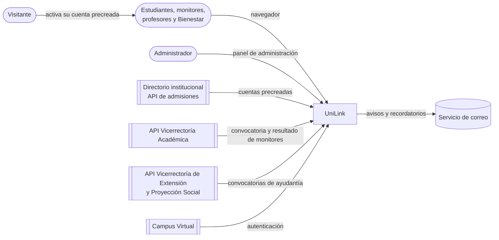

# Especificación de Requisitos de Software (SRS) — UniLink

_MVP — Red Profesional Universitaria — Universidad del Magdalena_
_Centro de Interés de Desarrollo Tecnológico e Innovación (CIDTI)_

Conforme a ISO/IEC/IEEE 29148:2018.

| Campo | Valor |
|---|---|
| **Versión** | 0.2 — Borrador |
| **Estado** | Pendiente de revisión del equipo |
| **Última actualización** | 2026-10-29 |

## Historial de versiones

| Versión | Fecha | Autor | Cambio |
|---|---|---|---|
| 0.1 | 2026-10-24 | Equipo UniLink | Creación a partir de los casos de uso, las historias, los specs y los requisitos no funcionales existentes, al reorganizar la documentación por módulos. |
| 0.1.1 | 2026-10-27 | Gamero | Supuesto de usuarios simultáneos (~1.000) según la reunión del 2026-10-19; RNF-REN-01 y EC-01 ajustados. |
| 0.2 | 2026-10-29 | Gamero | Simplificación para el MVP acotado (monitorías, semilleros, ayudantías y actividades complementarias). El SRS conserva solo lo que no está en otro documento: contexto, stakeholders, restricciones, supuestos, requisitos no funcionales, escenarios de calidad, verificación y riesgos. Alcance, actores, permisos, specs y casos de uso pasan a enlazar a su fuente. Requisitos no funcionales y escenarios de calidad ajustados al MVP; RNF-CON-05 nuevo. |

## Tabla de contenido

- [1. Introducción](#1-introducción)
- [2. Descripción general](#2-descripción-general)
- [3. Requisitos específicos](#3-requisitos-específicos)
- [4. Verificación](#4-verificación)
- [Apéndice A. Matriz de trazabilidad](#apéndice-a-matriz-de-trazabilidad)
- [Apéndice B. Matriz de riesgos](#apéndice-b-matriz-de-riesgos)

**Dónde está cada cosa.** Este documento define **con qué calidad** debe funcionar UniLink y bajo qué condiciones. **Qué** hace el MVP y **quién** lo usa está en [Actores y alcance del MVP](../actores_y_alcance_mvp.md). **Cómo** funciona cada funcionalidad está en su spec, dentro de [Módulos](../modulos/README.md).

---

## 1. Introducción

### 1.1 Propósito

Este documento define los requisitos no funcionales del MVP de UniLink, los escenarios de calidad con que se verifican y el contexto que los justifica: para quién es la plataforma, qué restricciones tiene y qué supuestos de uso se asumen.

Lo leen el equipo de desarrollo, el Product Owner, la dirección del CIDTI y las oficinas de la Universidad que deben validar aspectos legales o institucionales.

### 1.2 Alcance

El MVP conecta a los estudiantes con cuatro líneas de oferta de la Universidad: **monitorías académicas, semilleros de investigación, ayudantías académicas y actividades complementarias** de Bienestar Universitario. Se apoya en una base de cuenta precreada, perfil, notificaciones y administración.

El detalle (qué entra, qué queda fuera, los 13 specs, los 16 casos de uso y el plan de sprints) está en [Actores y alcance del MVP](../actores_y_alcance_mvp.md#5-alcance-qué-entra-y-qué-no).

### 1.3 Glosario

| Término | Definición |
|---|---|
| Monitoría académica | Apoyo académico entre pares que presta un monitor en un área y una especialización. |
| Monitor académico | Estudiante que la Vicerrectoría Académica selecciona por convocatoria. UniLink recibe sus datos oficiales por API ([CU-31](../modulos/usuarios/casos-de-uso.md#cu-31--obtener-la-condición-de-monitor-académico)). |
| Semillero de investigación | Grupo de investigación que dirige un profesor y al que se unen estudiantes. |
| Ayudantía académica | Plaza de apoyo que la Vicerrectoría de Extensión y Proyección Social asigna por convocatoria. UniLink la muestra y la postulación ocurre fuera. |
| Actividad complementaria | Actividad formativa de Bienestar Universitario con fecha, lugar y cupo, a la que el estudiante se inscribe. |
| Convocatoria | Llamado con requisitos y fechas para aspirar a una monitoría o a una ayudantía. Se recibe por API y se resuelve fuera de UniLink. |
| Cuenta precreada | Cuenta que la Universidad crea con los datos del directorio institucional y que el usuario solo activa y personaliza. |
| Datos oficiales / datos extra | Los oficiales llegan de las APIs institucionales y son de solo lectura. Los extra los agrega el usuario a su perfil. |
| Sincronización | Tarea programada que trae los datos de las APIs institucionales y los aplica en UniLink. |
| Cupo | Número máximo de inscritos de una actividad o de integrantes de un semillero. |
| Etiqueta | Palabra o frase del catálogo predefinido que describe una habilidad o un interés. |
| Unidad académica | Pertenencia institucional del usuario: programa (estudiante), facultad y departamento (profesor) o dependencia (personal administrativo). |
| Retiro | Decisión del Administrador de dejar de mostrar un semillero o una actividad que incumple las normas, con motivo registrado. |
| CU / HU | Caso de uso / historia de usuario. |
| RN / RF / MSG | Regla de negocio / requisito funcional / mensaje al usuario, numerados dentro de cada spec. |
| RNF | Requisito no funcional (sección 3.3). |
| EC | Escenario de atributo de calidad (sección 3.4). |
| ADR | Registro de decisión arquitectónica. |
| P-NN | Pregunta abierta ([preguntas-abiertas.md](../preguntas-abiertas.md)). |

### 1.4 Referencias

| Referencia | Uso |
|---|---|
| ISO/IEC/IEEE 29148:2018 | Estructura de este documento. |
| ISO/IEC 25010 | Clasificación de los requisitos no funcionales. |
| Ley 1581 de 2012 y Decreto 1377 de 2013 | Protección de datos personales. |
| WCAG 2.1, nivel AA | Accesibilidad. |
| OWASP Top 10 | Seguridad de la aplicación. |
| [Normas de la comunidad](../normas-comunidad.md) | Conducta que aceptan los usuarios y aplica el Administrador. |

## 2. Descripción general

### 2.1 Perspectiva del producto

Hoy un estudiante que busca un monitor, un semillero, una ayudantía o una actividad complementaria depende de carteleras, grupos de chat y conocidos: la oferta está repartida entre varias dependencias y no se sabe quién está disponible. UniLink reúne esa oferta en un solo lugar. Las monitorías y las ayudantías llegan de las vicerrectorías por API; los semilleros los publican los profesores, y las actividades, Bienestar Universitario.

En el MVP, el directorio y las APIs de las vicerrectorías se **simulan**, con el patrón de puerto y adaptador de [ADR-014](../arquitectura/Registro_Decisiones.md#adr-014-integración-con-la-api-de-admisiones) (P-61, P-72).

### 2.2 Funciones del producto

Están en [Actores y alcance del MVP, secciones 2 y 4](../actores_y_alcance_mvp.md#2-las-cuatro-líneas-del-mvp).

### 2.3 Stakeholders

| Stakeholder | Qué espera | Qué decide | Preguntas que le corresponden |
|---|---|---|---|
| Dirección del CIDTI | Una plataforma útil para los estudiantes, dentro del presupuesto y el plazo. | Alcance, prioridades, quiénes administran la plataforma. | P-07, P-68 |
| Oficina de TI | Que UniLink respete la infraestructura y las políticas de la Universidad. | Alojamiento, autenticación con el Campus Virtual, directorio institucional, buzón de soporte. | P-02, P-03, P-18, P-63 |
| Oficina jurídica y de protección de datos | Cumplimiento de la Ley 1581 y de los reglamentos internos. | Autorización de datos, borrado de cuentas, normas de la comunidad. | P-10 a P-15 |
| Vicerrectoría Académica | Que la comunidad encuentre a los monitores que selecciona. | Convocatoria y resultado de monitorías; acceso a su API. | P-72 |
| Vicerrectoría de Extensión y Proyección Social | Más difusión de sus convocatorias de ayudantía. | Convocatorias y proceso de postulación; acceso a su API. | P-72 |
| Bienestar Universitario | Más inscritos en sus actividades complementarias. | Qué actividades publica y con qué cupo; quién de su personal publica. | P-71 |
| Admisiones y Registro | Que los datos académicos sean los oficiales. | Datos del directorio institucional. | P-04, P-61 |
| Estudiantes | Encontrar monitores, semilleros, ayudantías y actividades sin buscar en varios lugares. | — (se validan con pruebas de usuario, RNF-USA-05) | — |
| Profesores | Conformar sus semilleros con estudiantes interesados. | — | — |
| Administrador de la plataforma | Herramientas para operar y retirar ofertas con criterio y registro. | Retiros y sanciones, dentro de las normas. | — |
| Equipo de UniLink (Product Owner y desarrollo) | Requisitos claros y decisiones registradas. | Producto y técnica. | P-16 a P-60 |

### 2.4 Actores del sistema

Los seis actores del MVP (Visitante, Estudiante, Monitor académico, Profesor, Personal de Bienestar Universitario y Administrador de la plataforma) y los sistemas externos están en [Actores y alcance del MVP, sección 3](../actores_y_alcance_mvp.md#3-actores-del-mvp). Los nombres que usan los specs en su sección "Quién es quién" (Autor, Postulante, Organizador…) se clasifican en la [sección 7](../actores_y_alcance_mvp.md#7-evaluación-de-los-actores-anteriores) de ese documento.

### 2.5 Matriz de permisos

La matriz vigente es la de [Actores y alcance del MVP, sección 4](../actores_y_alcance_mvp.md#4-qué-hace-cada-actor). Todos los permisos se validan en el servidor (RNF-SEG-04).

### 2.6 Restricciones

| Tipo | Restricción |
|---|---|
| Arquitectura | Monolito modular; un módulo solo usa a otro por su interfaz pública o sus eventos ([ADR-002](../arquitectura/Registro_Decisiones.md#adr-002-estilo-arquitectónico), [ADR-003](../arquitectura/Registro_Decisiones.md#adr-003-límites-de-los-módulos-y-dependencias-permitidas)). En el MVP no se construye el módulo Contenido, y de Comunicación solo las notificaciones. |
| Contratos | La API y las interfaces se acuerdan en [`contracts/`](../../contracts/README.md) antes de programar (ADR-006). |
| Legal | Ley 1581 de 2012; la Universidad del Magdalena es responsable del tratamiento de los datos. |
| Institucional | La comunidad entra con su cuenta institucional precreada ([ADR-013](../arquitectura/Registro_Decisiones.md#adr-013-autenticación-institucional-y-cuentas-precreadas)). Los datos oficiales (cuentas, monitores y ayudantías) vienen de las APIs institucionales y no se editan en UniLink. |
| Plataforma | Aplicación web adaptable; navegadores de RNF-COM-01. |
| Idioma | Español de Colombia, hora de Colombia (RNF-USA-01). |
| Equipo y plazo | Un equipo pequeño de estudiantes; Sprint 0 más 8 sprints de 2 semanas, 6 de contenido y 2 de margen ([plan](../actores_y_alcance_mvp.md#6-plan-de-sprints-propuesto)). |
| Presupuesto | Presupuesto universitario e infraestructura propia (ADR-009). |

### 2.7 Supuestos y dependencias

Las cifras de rendimiento y capacidad parten de estos supuestos. El de usuarios simultáneos se decidió en la reunión del 2026-10-19 (P-01); los demás siguen pendientes de validar. Si cambian, hay que revisar las secciones 3.3.3 y 3.3.4.

| Supuesto | Valor |
|---|---|
| Usuarios registrados el primer año | 5.000 |
| Usuarios registrados que la arquitectura debe soportar sin rediseño | 25.000 |
| Usuarios conectados al mismo tiempo en hora pico | ~1.000. El pico se da al publicarse el resultado de la convocatoria de monitorías (Reunión 2026-10-19, P-01). |
| Horario de mayor uso | Lunes a viernes, 7:00 a. m. a 10:00 p. m. (hora de Colombia) |

**Dependencias externas:**
- Directorio institucional (Admisiones y Registro, P-04, P-61).
- API de la Vicerrectoría Académica y API de la Vicerrectoría de Extensión y Proyección Social (P-72).
- Autenticación con el Campus Virtual (TI, P-63).
- Servicio de correo con entrega confiable al dominio de la Universidad.
- Aprobación jurídica de las normas y de la autorización de datos (P-11, P-13).

---

## 3. Requisitos específicos

### 3.1 Requisitos funcionales

Viven en cada spec y se citan con su código: `USR-01/RF-03` es el RF-03 de [FS-USR-01](../modulos/usuarios/specs/FS-USR-01-registro.md). Los specs del MVP están en [Actores y alcance del MVP, sección 5.1](../actores_y_alcance_mvp.md#51-specs-que-entran-al-mvp).

### 3.2 Casos de uso

Los 16 casos de uso del MVP y su diagrama están en [Actores y alcance del MVP, sección 4.2](../actores_y_alcance_mvp.md#42-casos-de-uso-del-mvp). Su texto está en el archivo `casos-de-uso.md` de cada [módulo](../modulos/README.md).

### 3.3 Requisitos no funcionales

Definen **cómo de bien** debe funcionar UniLink. Aplican a todos los módulos del MVP, siguen las características de calidad de ISO/IEC 25010 y cada uno tiene un criterio verificable.

#### 3.3.1 Seguridad

| ID | Requisito | Cómo se verifica | Prioridad |
|---|---|---|---|
| RNF-SEG-01 | Toda comunicación entre el navegador y el servidor usa HTTPS con TLS 1.2 o superior. Las peticiones HTTP se redirigen a HTTPS. | Escaneo de configuración TLS con calificación A o superior (por ejemplo, SSL Labs). | Alta |
| RNF-SEG-02 | Las contraseñas que guarde UniLink se almacenan con un algoritmo de hash lento con sal (bcrypt, scrypt o Argon2). Nunca se guardan, registran ni envían en texto plano. | Revisión de código y de la base de datos. | Alta |
| RNF-SEG-03 | Las cookies de sesión son `HttpOnly`, `Secure` y `SameSite`. Los tokens de sesión se invalidan en el servidor al cerrar sesión. | Prueba automatizada y revisión con las herramientas del navegador. | Alta |
| RNF-SEG-04 | Todo permiso se valida en el servidor: rol de administrador, tipo de usuario que publica (profesor, Bienestar), dirección e integración de semilleros, lista de inscritos y privacidad del perfil. Ocultar un botón en la pantalla no se considera control de acceso. | Pruebas automatizadas que llaman directamente a la API con un usuario sin permiso y esperan un rechazo. | Alta |
| RNF-SEG-05 | La aplicación se protege contra las vulnerabilidades de OWASP Top 10, en particular inyección, XSS, CSRF y control de acceso roto. Todo dato que ingresa el usuario se valida en el servidor y se escapa al mostrarse. | Escaneo automático de seguridad (por ejemplo, OWASP ZAP) antes de cada salida a producción, sin hallazgos altos ni críticos. | Alta |
| RNF-SEG-06 | Los archivos subidos (foto de perfil, imagen de una actividad) se validan por su contenido real y no solo por la extensión, respetan los límites de tamaño de cada spec y se sirven desde un dominio o ruta que no ejecuta código. | Prueba subiendo un archivo con extensión falsa; debe rechazarse. | Alta |
| RNF-SEG-07 | Los límites de uso de los specs (intentos de inicio de sesión, reenvíos de correo, solicitudes de ingreso a semilleros, inscripciones) se aplican en el servidor. Además, la API limita a 100 peticiones por minuto por usuario. | Pruebas de carga que superan cada límite y reciben el error esperado. | Alta |
| RNF-SEG-08 | Las contraseñas, claves de API (incluidas las de las APIs institucionales) y credenciales de base de datos no se guardan en el repositorio. Se manejan como variables de entorno o en un gestor de secretos. | Escaneo de secretos en el repositorio dentro de la integración continua. | Alta |
| RNF-SEG-09 | Las dependencias del proyecto se revisan automáticamente en busca de vulnerabilidades conocidas. Las críticas se corrigen en menos de 7 días. | Alerta de dependencias activa en GitHub (Dependabot o similar). | Media |
| RNF-SEG-10 | Las acciones del Administrador y los cambios que aplica la sincronización (altas y bajas de monitores) quedan en un registro de auditoría que no se puede modificar desde la aplicación y se conserva 2 años. | Revisión del registro tras ejecutar cada acción de administración y cada sincronización. | Alta |

#### 3.3.2 Privacidad y protección de datos personales

UniLink trata datos personales de la comunidad universitaria y debe cumplir la Ley 1581 de 2012 y el Decreto 1377 de 2013. La Universidad del Magdalena actúa como responsable del tratamiento.

| ID | Requisito | Cómo se verifica | Prioridad |
|---|---|---|---|
| RNF-PRI-01 | Solo se recogen los datos necesarios para las funciones de UniLink. Cualquier dato nuevo exige justificar su finalidad en el spec que lo introduce. De las APIs institucionales solo se reciben los datos de la [sección 3 del documento de actores](../actores_y_alcance_mvp.md#3-actores-del-mvp). | Revisión de cada spec antes de pasar a Aprobado. | Alta |
| RNF-PRI-02 | El usuario acepta de forma expresa la política de tratamiento de datos al activar su cuenta, y la plataforma guarda la fecha y la versión aceptada. | Revisión de la base de datos tras una activación. | Alta |
| RNF-PRI-03 | La base de datos y las copias de seguridad se cifran en reposo. | Revisión de la configuración de la infraestructura. | Alta |
| RNF-PRI-04 | _Fuera del MVP:_ privacidad de los mensajes privados. Se retoma con la mensajería. | — | — |
| RNF-PRI-05 | Las consultas de los titulares sobre sus datos se responden en máximo 10 días hábiles, y los reclamos (corregir o suprimir datos) en máximo 15 días hábiles, como exige la Ley 1581. El canal es el correo de soporte. | Procedimiento documentado y probado con un caso real antes del lanzamiento. | Alta |
| RNF-PRI-06 | Al eliminarse una cuenta se aplica el borrado lógico con trazabilidad de [ADR-015](../arquitectura/Registro_Decisiones.md#adr-015-eliminación-de-cuentas-borrado-lógico), una vez validado por la Oficina Jurídica frente al derecho de supresión (P-12). | Prueba de eliminación cuando ADR-015 se acepte. | Alta |
| RNF-PRI-07 | Los registros técnicos (logs) no contienen contraseñas, tokens ni claves de las APIs institucionales. | Revisión de una muestra de registros en el entorno de pruebas. | Alta |
| RNF-PRI-08 | Los datos se almacenan en infraestructura que garantice niveles adecuados de protección, según las reglas de la Superintendencia de Industria y Comercio. | Revisión jurídica de la infraestructura en el Sprint 0. | Alta |

#### 3.3.3 Rendimiento

Los tiempos se miden en el percentil 95 (p95): el 95 % de las peticiones debe cumplirlos con la carga de los [supuestos de uso](#27-supuestos-y-dependencias).

| ID | Requisito | Cómo se verifica | Prioridad |
|---|---|---|---|
| RNF-REN-01 | Las consultas de la API responden en menos de 500 ms (p95) y las operaciones de escritura en menos de 1 segundo (p95). | Prueba de carga con 1.000 usuarios simultáneos. | Alta |
| RNF-REN-02 | La búsqueda de monitores y la exploración de semilleros, ayudantías y actividades responden en menos de 1 segundo (p95). | Prueba de carga con datos de volumen realista (25.000 usuarios). | Alta |
| RNF-REN-03 | En un celular de gama media con conexión 4G, la primera pantalla útil aparece en menos de 3 segundos (métrica Largest Contentful Paint). | Medición con Lighthouse en modo móvil, con puntaje de rendimiento de al menos 80. | Media |
| RNF-REN-04 | Las imágenes se sirven comprimidas y redimensionadas según el tamaño en que se muestran. | Revisión con Lighthouse: sin advertencias de imágenes de gran tamaño. | Media |
| RNF-REN-05 | Las tareas pesadas (sincronización con las APIs institucionales, envío de correos, notificaciones masivas) se ejecutan en segundo plano y no retrasan la respuesta al usuario. | Revisión de arquitectura y medición del tiempo de respuesta durante una sincronización. | Alta |

#### 3.3.4 Disponibilidad y recuperación

| ID | Requisito | Cómo se verifica | Prioridad |
|---|---|---|---|
| RNF-DIS-01 | UniLink está disponible al menos el 99,5 % del tiempo cada mes, sin contar los mantenimientos programados. | Monitoreo externo de disponibilidad. | Alta |
| RNF-DIS-02 | Los mantenimientos programados se hacen fuera del horario de mayor uso y se anuncian en la plataforma con 48 horas de anticipación. | Calendario de mantenimientos y aviso publicado. | Media |
| RNF-DIS-03 | Se hacen copias de seguridad diarias de la base de datos y de los archivos subidos, y se conservan 30 días. | Revisión de la configuración y de las copias existentes. | Alta |
| RNF-DIS-04 | Ante una falla grave, se pierden como máximo 24 horas de datos (RPO) y el servicio se restablece en máximo 8 horas (RTO). | Simulacro de restauración completa una vez por semestre. | Alta |
| RNF-DIS-05 | Si falla un servicio externo (correo, directorio institucional, APIs de las vicerrectorías, Campus Virtual), el resto de la plataforma sigue funcionando y el usuario ve un mensaje claro. Los datos importados vigentes se siguen mostrando, la sincronización se reintenta y los correos pendientes se reenvían. | Prueba desactivando cada servicio externo en el entorno de pruebas ([EC-05](#34-escenarios-de-atributos-de-calidad)). | Alta |
| RNF-DIS-06 | Los correos salen de un dominio con SPF, DKIM y DMARC configurados. Los rebotes se registran: tras tres rebotes seguidos a una dirección se deja de enviarle correos y se avisa al usuario dentro de la plataforma. | Revisión de la configuración del dominio y prueba de rebote en el entorno de pruebas. | Alta |

#### 3.3.5 Usabilidad

| ID | Requisito | Cómo se verifica | Prioridad |
|---|---|---|---|
| RNF-USA-01 | La interfaz está en español de Colombia. Las fechas se muestran como `dd/mm/aaaa`, la hora en formato de 12 horas con a. m. y p. m., y la zona horaria es la de Colombia (UTC-5). | Revisión de las pantallas. | Alta |
| RNF-USA-02 | El diseño se adapta a pantallas desde 360 px de ancho (celulares) hasta escritorio, y todas las funciones están disponibles en celular. | Pruebas en 360 px, 768 px y 1.280 px de ancho. | Alta |
| RNF-USA-03 | Los mensajes al usuario usan los textos definidos en cada spec (sección 11), en lenguaje claro y sin códigos técnicos. | Revisión de cada spec implementado contra su tabla de mensajes. | Alta |
| RNF-USA-04 | Toda acción que no se puede deshacer (eliminar, cancelar, retirar) pide confirmación, y toda acción exitosa muestra un aviso breve. | Revisión de las pantallas. | Media |
| RNF-USA-05 | Un estudiante nuevo puede activar su cuenta, completar su perfil y encontrar un monitor de su área en menos de 10 minutos, sin ayuda. | Prueba con 5 estudiantes antes del lanzamiento. | Media |

#### 3.3.6 Accesibilidad

| ID | Requisito | Cómo se verifica | Prioridad |
|---|---|---|---|
| RNF-ACC-01 | La plataforma cumple las pautas WCAG 2.1 nivel AA. | Auditoría con herramientas automáticas (por ejemplo, axe) sin errores, más revisión manual de las pantallas principales. | Alta |
| RNF-ACC-02 | Todas las funciones se pueden usar solo con el teclado, con un indicador de foco visible. | Prueba manual recorriendo cada pantalla con la tecla Tab. | Alta |
| RNF-ACC-03 | El texto tiene un contraste de al menos 4,5:1 con su fondo (3:1 para textos grandes). | Herramienta de verificación de contraste. | Alta |
| RNF-ACC-04 | La información nunca depende solo del color: los estados (por ejemplo, de una inscripción o de una solicitud de ingreso) siempre van acompañados de texto. | Revisión de las pantallas. | Alta |
| RNF-ACC-05 | Las imágenes tienen texto alternativo. Al subir la imagen de una actividad, quien la publica puede escribir una descripción. | Revisión con lector de pantalla (NVDA o VoiceOver) de las pantallas principales. | Media |
| RNF-ACC-06 | La plataforma sigue siendo usable con el zoom del navegador al 200 %. | Prueba manual. | Media |

#### 3.3.7 Compatibilidad

| ID | Requisito | Cómo se verifica | Prioridad |
|---|---|---|---|
| RNF-COM-01 | UniLink funciona en las dos últimas versiones de Chrome, Edge, Firefox y Safari en computador, y de Chrome en Android y Safari en iOS. | Pruebas manuales de los flujos principales en cada navegador antes de cada salida a producción. | Alta |
| RNF-COM-02 | El MVP es una aplicación web; no incluye aplicaciones nativas para celular. | — | — |
| RNF-COM-03 | Los archivos de calendario de las actividades (`.ics`) se abren correctamente en Google Calendar, Outlook y el calendario de iOS. | Prueba manual en cada aplicación. | Media |

#### 3.3.8 Mantenibilidad

| ID | Requisito | Cómo se verifica | Prioridad |
|---|---|---|---|
| RNF-MAN-01 | Cada regla de negocio (RN) de los specs tiene al menos una prueba automatizada, y los criterios de aceptación en Gherkin se usan como base de las pruebas de aceptación. | Revisión en cada pull request; parte de la _Definition of Done_. | Alta |
| RNF-MAN-02 | La cobertura de pruebas del código de negocio es de al menos 70 %. | Reporte de cobertura en la integración continua. | Media |
| RNF-MAN-03 | Todo cambio entra a la rama principal mediante un pull request revisado por al menos otra persona, con las pruebas y el análisis de estilo (lint) en verde. | Reglas de protección de rama en GitHub. | Alta |
| RNF-MAN-04 | Los mensajes de commit siguen la convención _Conventional Commits_ (`feat:`, `fix:`, `docs:`…), como ya se hace en el repositorio. | Revisión del historial. | Baja |
| RNF-MAN-05 | La API se acuerda antes de programar: el contrato vive en [`contracts/`](../../contracts/README.md) y la integración continua compara con él el que genera el código. | Paso de la integración continua que falla si el contrato generado y el acordado difieren. | Alta |
| RNF-MAN-06 | Si una implementación cambia el comportamiento definido en un spec, el spec se actualiza en el mismo pull request. | Revisión en cada pull request. | Alta |
| RNF-MAN-07 | Los módulos cumplen [`contracts/`](../../contracts/README.md): un módulo solo usa a otro por su interfaz pública o por sus eventos, nunca sus tablas, y las dependencias entre módulos no forman ciclos. Cada API institucional se usa solo a través de su puerto ([ADR-014](../arquitectura/Registro_Decisiones.md#adr-014-integración-con-la-api-de-admisiones), [ADR-017](../arquitectura/Registro_Decisiones.md#adr-017-arquitectura-interna-de-los-módulos-hexagonal-con-clean-architecture)). | Prueba de arquitectura en la integración continua que analiza las dependencias entre módulos. | Alta |

#### 3.3.9 Observabilidad

| ID | Requisito | Cómo se verifica | Prioridad |
|---|---|---|---|
| RNF-OBS-01 | La aplicación genera registros estructurados con fecha, nivel, módulo y un identificador por petición, respetando RNF-PRI-07. | Revisión de los registros en el entorno de pruebas. | Alta |
| RNF-OBS-02 | Los errores del servidor y del navegador, y las fallas de sincronización con las APIs institucionales, se envían a una herramienta de monitoreo que alerta al equipo. El Administrador ve el estado de la última sincronización. | Error provocado en pruebas que llega a la herramienta. | Alta |
| RNF-OBS-03 | El equipo recibe una alerta si la plataforma deja de responder o si el tiempo de respuesta supera el doble de lo definido en la sección 3.3.3 durante 5 minutos. | Prueba de la alerta en el entorno de pruebas. | Media |
| RNF-OBS-04 | Se miden indicadores de uso del producto (usuarios activos, búsquedas de monitores, solicitudes a semilleros, inscripciones a actividades, visitas a convocatorias de ayudantía) sin rastrear a usuarios individuales con herramientas de terceros. | Panel de indicadores disponible para el equipo. | Baja |

#### 3.3.10 Despliegue y entornos

| ID | Requisito | Cómo se verifica | Prioridad |
|---|---|---|---|
| RNF-DES-01 | Existen tres entornos separados: desarrollo, pruebas y producción. Producción nunca usa datos de prueba, y pruebas nunca usa datos reales sin anonimizar. Desarrollo y pruebas usan los adaptadores simulados de las APIs institucionales. | Revisión de la infraestructura. | Alta |
| RNF-DES-02 | El despliegue es automático desde el repositorio: al unir a la rama principal se despliega en pruebas, y la salida a producción requiere una aprobación manual. | Revisión de la integración continua. | Alta |
| RNF-DES-03 | Cualquier integrante puede levantar el proyecto en su computador siguiendo el README, con un solo comando para los servicios necesarios. | Prueba con un integrante nuevo. | Media |
| RNF-DES-04 | Un despliegue fallido se puede revertir a la versión anterior en menos de 15 minutos. | Simulacro de reversión. | Media |

#### 3.3.11 Consistencia

| ID | Requisito | Cómo se verifica | Prioridad |
|---|---|---|---|
| RNF-CON-01 | Una operación que consume cupo (inscribirse a una actividad, aceptar integrantes en un semillero) es atómica: nunca se supera el cupo, aun con peticiones simultáneas. | Prueba concurrente ([EC-04](#34-escenarios-de-atributos-de-calidad)). | Alta |
| RNF-CON-02 | Dos ediciones simultáneas de un mismo elemento no se pisan: la segunda recibe un conflicto y ve la versión actual (`If-Match`). | Prueba con dos ediciones simultáneas. | Media |
| RNF-CON-03 | Las creaciones que el navegador puede reenviar (solicitar ingreso a un semillero, inscribirse, publicar una actividad) no se duplican si llegan dos veces (`Idempotency-Key`). | Prueba que reenvía la misma petición. | Media |
| RNF-CON-04 | Un evento de dominio se publica solo después de confirmar la operación que lo origina, y quien lo consume lo procesa una sola vez aunque lo reciba repetido. Si un consumidor falla, la operación original no se deshace y el evento se reintenta. | Prueba que hace fallar a un consumidor y repite el evento. | Alta |
| RNF-CON-05 | La sincronización con las APIs institucionales es idempotente: procesar dos veces los mismos datos no duplica ni altera nada, y una sincronización incompleta no borra los datos vigentes. | Prueba que repite una sincronización y otra que la corta a la mitad. | Alta |

#### 3.3.12 Retención de datos

| ID | Requisito | Cómo se verifica | Prioridad |
|---|---|---|---|
| RNF-PRI-09 | Cada tipo de dato se conserva solo el tiempo de la tabla siguiente; una tarea programada lo elimina al vencer. | Prueba de cada tarea de limpieza en el entorno de pruebas. | Alta |

| Dato | Plazo | Después | Spec o requisito |
|---|---|---|---|
| Enlace de recuperación de contraseña | 1 hora | Deja de ser válido | [FS-USR-03](../modulos/usuarios/specs/FS-USR-03-recuperar-contrasena.md) |
| Cuenta eliminada | Según ADR-015 (pendiente de P-12) | Borrado lógico con trazabilidad | RNF-PRI-06 |
| Copias de seguridad | 30 días | Se descartan | RNF-DIS-03 |
| Notificaciones | 90 días | Se eliminan | [FS-COM-02](../modulos/comunicacion/specs/FS-COM-02-centro-notificaciones.md) |
| Registro de auditoría | 2 años | Se elimina | RNF-SEG-10 |
| Registros técnicos (logs) | Por definir | — | [P-52](../preguntas-abiertas.md) |

#### 3.3.13 Cuándo se aplica cada requisito

Los requisitos no funcionales son **transversales**: no se implementan en un solo sprint, sino que cada sprint debe cumplir los que le aplican. Los sprints son los del [plan del MVP](../actores_y_alcance_mvp.md#6-plan-de-sprints-propuesto).

| Momento | Requisitos |
|---|---|
| **Sprint 0** (antes del Sprint 1) | Infraestructura (RNF-PRI-08), entornos y despliegue (RNF-DES-01 a 04), integración continua con pruebas, lint y escaneos (RNF-MAN-03, RNF-SEG-08, RNF-SEG-09), registros y monitoreo (RNF-OBS-01, RNF-OBS-02), copias de seguridad (RNF-DIS-03), revisión de dependencias y del contrato (RNF-MAN-05, RNF-MAN-07). |
| **Sprint 1** | Sesiones (RNF-SEG-01 a 03), límites de uso (RNF-SEG-07), consentimiento al activar la cuenta (RNF-PRI-02), entregabilidad de correo (RNF-DIS-06), retención de datos (RNF-PRI-09), sincronización del directorio y de los monitores (RNF-CON-05, RNF-DIS-05). |
| **Sprint 4** | Sincronización de las convocatorias de ayudantía (RNF-CON-05, RNF-DIS-05). |
| **Todos los sprints** | Control de acceso en el servidor (RNF-SEG-04), OWASP (RNF-SEG-05), rendimiento (sección 3.3.3), usabilidad (sección 3.3.5), accesibilidad (sección 3.3.6), mantenibilidad (sección 3.3.8), consistencia (sección 3.3.11). Forman parte de la _Definition of Done_. |
| **Antes del lanzamiento** | Prueba de carga (RNF-REN-01, 02), auditoría de accesibilidad (RNF-ACC-01), escaneo de seguridad (RNF-SEG-05), simulacro de restauración (RNF-DIS-04), procedimiento de consultas y reclamos de datos (RNF-PRI-05), prueba con estudiantes (RNF-USA-05), escenarios de calidad EC-01 a EC-07 (sección 3.4). |

Las preguntas pendientes sobre estos requisitos (P-01, P-02, P-10, P-18 y P-72) están en el [consolidado](../preguntas-abiertas.md).

### 3.4 Escenarios de atributos de calidad

Cada escenario convierte un atributo de calidad en una situación verificable. Se prueban antes del lanzamiento (sección 3.3.13) y cada spec indica cuáles le aplican.

| ID | Atributo | Fuente | Estímulo | Entorno | Artefacto | Respuesta | Medida | Concreta |
|---|---|---|---|---|---|---|---|---|
| EC-01 | Rendimiento | 1.000 estudiantes | Buscan monitores al mismo tiempo, justo después de publicarse el resultado de la convocatoria | Hora pico, 25.000 usuarios registrados | Búsqueda de monitores (Red) | Devuelve la primera página de resultados | p95 < 1 s | RNF-REN-01, RNF-REN-02 |
| EC-02 | Disponibilidad | Servicio de correo | Deja de responder durante una hora | Operación normal | Usuarios, Comunicación | La activación de cuentas, las inscripciones, las notificaciones internas y el resto de la plataforma siguen funcionando; los correos quedan pendientes y se reintentan | 0 errores visibles por la caída; 100 % de los correos pendientes enviados al volver el servicio | RNF-DIS-05, RNF-REN-05 |
| EC-03 | Seguridad | Integrante de un semillero | Llama directamente a la API para aceptar una solicitud de ingreso, algo que solo puede hacer el Director | Producción | Colaboración | La petición se rechaza con 403 y el intento queda en los registros | 100 % de las acciones de la matriz probadas por la API | RNF-SEG-04, RNF-SEG-05 |
| EC-04 | Consistencia | Dos estudiantes | Se inscriben a la vez al último cupo de una actividad complementaria | Hora pico | Colaboración | Solo uno obtiene el cupo; el otro ve "Cupo completo" | Nunca hay más inscritos que cupo, en 1.000 intentos concurrentes | RNF-CON-01 |
| EC-05 | Disponibilidad | API de la Vicerrectoría Académica o de la de Extensión | No responde o envía datos incompletos durante una sincronización | Operación normal | Sincronización (Usuarios, Colaboración) | Se conservan los monitores y las convocatorias vigentes, la sincronización se reintenta y el Administrador ve la falla | 0 monitores o convocatorias perdidos por la falla; 0 errores visibles para el estudiante | RNF-DIS-05, RNF-CON-05, RNF-OBS-02 |
| EC-06 | Modificabilidad | Equipo de desarrollo | Reemplaza el adaptador simulado de una API institucional por el real | Desarrollo | Puerto de la integración | Solo cambia el adaptador y su configuración | 0 cambios en el dominio y en los demás módulos | RNF-MAN-07, ADR-014, ADR-017 |
| EC-07 | Integridad | Administrador o monitor | Intenta modificar por la API la condición, el área o la especialización de un monitor | Producción | Usuarios | La petición se rechaza; esos datos solo los escribe la sincronización | 0 rutas que permitan editar datos oficiales | RNF-SEG-04, RNF-SEG-10 |

---

## 4. Verificación

| Tipo | Cómo se verifica | Cuándo |
|---|---|---|
| Regla de negocio (RN) | Al menos una prueba automatizada por regla (RNF-MAN-01). | En el pull request del spec. |
| Requisito funcional (RF) | Escenarios Gherkin de la sección "Resultado esperado" del spec como pruebas de aceptación. | En el pull request del spec. |
| Permisos ("Quién es quién") | Pruebas que llaman directamente a la API con un usuario sin permiso y esperan el rechazo (RNF-SEG-04). | En el pull request del spec. |
| "¿Qué pasaría si…?" | Cada fila tiene un escenario Gherkin; las de concurrencia, con una prueba concurrente. | En el pull request del spec. |
| Requisito no funcional (RNF) | Columna "Cómo se verifica" de la sección 3.3. | Según la sección 3.3.13. |
| Escenario de calidad (EC) | Prueba específica con su medida (carga, falla provocada, prueba de API, revisión de rutas). | Antes del lanzamiento y tras cambios grandes. |
| Contratos | La integración continua valida los OpenAPI y los esquemas de eventos, y compara el contrato con el generado desde el código (RNF-MAN-05). | En cada pull request. |
| Documentación | `python scripts/verificar_docs.py --fase completa` sin errores. | En cada pull request que toque `docs/` o `contracts/`. |

---

## Apéndice A. Matriz de trazabilidad

Requisitos no funcionales y escenarios de calidad que aplican a cada spec del MVP, además de los transversales de la sección 3.3.13. Los casos de uso y el sprint de cada spec están en [Actores y alcance del MVP](../actores_y_alcance_mvp.md#42-casos-de-uso-del-mvp), y los contratos, en la sección 13 de cada spec.

| Spec | Casos de uso | RNF y escenarios de calidad |
|---|---|---|
| [FS-USR-01](../modulos/usuarios/specs/FS-USR-01-registro.md) | CU-01, CU-31 | RNF-PRI-02, RNF-DIS-05, RNF-DIS-06, RNF-CON-05, EC-02, EC-05 |
| [FS-USR-02](../modulos/usuarios/specs/FS-USR-02-inicio-sesion.md) | CU-02 | RNF-SEG-03, RNF-SEG-07 |
| [FS-USR-03](../modulos/usuarios/specs/FS-USR-03-recuperar-contrasena.md) | CU-17 | RNF-SEG-02, RNF-SEG-07, RNF-DIS-06 |
| [FS-USR-05](../modulos/usuarios/specs/FS-USR-05-configuracion-cuenta.md) | CU-03 | RNF-PRI-06, RNF-PRI-09 |
| [FS-USR-06](../modulos/usuarios/specs/FS-USR-06-perfil-profesional.md) | CU-04, CU-31 | RNF-SEG-06, RNF-PRI-01, RNF-CON-02, EC-07 |
| [FS-USR-08](../modulos/usuarios/specs/FS-USR-08-gestion-cuentas.md) | CU-24 | RNF-SEG-10 |
| [FS-RED-03](../modulos/red/specs/FS-RED-03-busqueda-perfiles.md) | CU-05 | RNF-REN-02, EC-01 |
| [FS-COM-02](../modulos/comunicacion/specs/FS-COM-02-centro-notificaciones.md) | CU-23 | RNF-REN-05, RNF-DIS-05, EC-02 |
| [FS-PLT-01](../modulos/plataforma/specs/FS-PLT-01-gestion-categorias.md) | CU-26 | RNF-SEG-10, RNF-OBS-02 |
| [FS-COL-02](../modulos/colaboracion/specs/FS-COL-02-postulaciones.md) | CU-12 | RNF-REN-02, RNF-CON-05, EC-05, EC-06 |
| [FS-COL-03](../modulos/colaboracion/specs/FS-COL-03-publicacion-listado-eventos.md) | CU-20, CU-21 | RNF-CON-02, RNF-CON-03, RNF-ACC-05 |
| [FS-COL-04](../modulos/colaboracion/specs/FS-COL-04-confirmacion-asistencia.md) | CU-15 | RNF-CON-01, RNF-COM-03, EC-04 |
| [FS-COL-05](../modulos/colaboracion/specs/FS-COL-05-espacios-proyectos.md) | CU-11 | RNF-CON-01, RNF-CON-03, EC-03 |

## Apéndice B. Matriz de riesgos

Riesgos del producto. Los hallazgos sobre la documentación están en [riesgos y brechas](../riesgos_y_brechas_unilink.md).

| ID | Riesgo | Probabilidad | Impacto | Mitigación | Responsable |
|---|---|---|---|---|---|
| R-01 | Los correos automáticos llegan tarde o a spam en el dominio institucional. | Media | Alto: avisos y recordatorios no llegan. | Probar el envío en el Sprint 1; SPF, DKIM y DMARC (RNF-DIS-06); coordinar con TI. | Por asignar |
| R-02 | Las preguntas institucionales y jurídicas no se responden a tiempo. | Alta | Alto: los specs no pueden pasar a Aprobado. | Reunión de decisiones con el [consolidado](../preguntas-abiertas.md); propuestas por defecto en cada pregunta. | Product Owner |
| R-03 | Los estudiantes no adoptan la plataforma aunque la oferta esté publicada. | Media | Alto | Cuentas, monitores y convocatorias cargados desde el primer día; difusión con Bienestar y las vicerrectorías; prueba con estudiantes (RNF-USA-05). | Dirección del CIDTI |
| R-04 | El acceso a las APIs institucionales (directorio, monitores, ayudantías) no llega a tiempo. | Alta | Alto: sin datos reales no hay producto final. | Adaptadores simulados en el MVP (ADR-014, EC-06); gestionar el acceso en paralelo (P-61, P-72). | Coordinación y specs |
| R-05 | El directorio no identifica bien al personal de Bienestar que puede publicar. | Media | Medio | Corrección por el Administrador (P-71). | Por asignar |
| R-06 | Se publican semilleros o actividades inapropiados. | Baja | Medio | Solo profesores y Bienestar publican; el Administrador retira con motivo y queda auditado. | Administrador |
| R-07 | Se supera un cupo por peticiones simultáneas. | Baja | Medio | Operaciones con cupo atómicas (RNF-CON-01, EC-04). | Por asignar |
| R-08 | Un módulo empieza a usar las tablas de otro y el monolito se acopla. | Media | Alto a mediano plazo | Revisión de dependencias en la integración continua (RNF-MAN-07). | Por asignar |
| R-09 | Los specs no se adaptan al MVP acotado antes del Sprint 1. | Alta | Alto | Adaptar primero los de la base (USR-01, USR-02, USR-03) y el resto un sprint antes de usarlos. | Coordinación y specs |
| R-10 | El equipo es pequeño para operar con 99,5 % de disponibilidad. | Media | Alto | Acordar soporte con TI (P-02, P-18). | Dirección del CIDTI |
